# TÀI LIỆU TOÀN DIỆN VÀ CẨM NANG HƯỚNG DẪN SỬ DỤNG HỆ THỐNG QUẢN TRỊ & GIÁM SÁT KIỂM TRA NỘI BỘ (KTNB - NTTU)
## BẢN HƯỚNG DẪN THỰC CHIẾN CHI TIẾT TỪNG BƯỚC - ĐÚNG TRÌNH TỰ NGHIỆP VỤ - 100% CÓ ẢNH MINH HỌA

---

**Đơn vị chủ quản:** Trường Đại học Nguyễn Tất Thành (NTTU)  
**Đơn vị quản lý nghiệp vụ:** Phòng Kiểm tra Nội bộ  
**Hệ thống phần mềm:** Hệ thống Quản trị & Giám sát Kiểm tra Nội bộ Trực tuyến (KTNB Online System)  
**Địa chỉ máy chủ truy cập:** [https://kiemtranoibo-ccks.ntt.edu.vn](https://kiemtranoibo-ccks.ntt.edu.vn)  
**Đường dẫn tải tài liệu:** [https://kiemtranoibo-ccks.ntt.edu.vn/tai-lieu-ktnb](https://kiemtranoibo-ccks.ntt.edu.vn/tai-lieu-ktnb)  
**Tác giả & Kiến trúc sư hệ thống:** Nguyễn Vĩnh Phúc  
**Phiên bản phát hành:** v2.6.5 (Production Release)  
**Năm học:** 2025 - 2026  

---

> [!IMPORTANT]
> **TIÊU CHUẨN THIẾT KẾ CẨM NANG:**  
> Cẩm nang này được xây dựng chuẩn xác theo **TRÌNH TỰ TÁC NGHIỆP THỰC TẾ** của cán bộ kiểm tra:
> 1. **Giới thiệu chức năng & Ý nghĩa nghiệp vụ**
> 2. **Bước 1: Thiết lập ca trực & Chọn ngày kiểm tra** (Tại sao phải làm bước này đầu tiên, cách lọc đúng ca trực)
> 3. **Bước 2: Sử dụng Bộ lọc nâng cao & Tìm kiếm**
> 4. **Bước 3: Cài đặt hiển thị cột dữ liệu (Ẩn / Hiện cột)**
> 5. **Bước 4: Thao tác Nhập / Xuất dữ liệu (Import, Export, Tải file mẫu Excel)**
> 6. **Bước 5: Thêm mới lịch / bản ghi dữ liệu**
> 7. **Bước 6: GHI NHẬN KIỂM TRA HIỆN TRƯỜNG (TRỌNG TÂM):** Phân tích chi tiết từng trường nhập liệu trong Form ghi nhận (Cán bộ giám sát, Sĩ số tham gia, Việc phát sinh, Chi tiết việc phát sinh, Bằng chứng, Ghi chú, Ảnh minh chứng).
> 8. **Bước 7: Chỉnh sửa & Xóa bản ghi an toàn**
> **MỖI BƯỚC ĐỀU CÓ HÌNH ẢNH MINH CHỨNG THỰC TẾ ĐI KÈM!**

---

## MỤC LỤC CHI TIẾT

- [PHẦN I: TỔNG QUAN, BỐI CẢNH & PHÂN QUYỀN HỆ THỐNG](#phần-i-tổng-quan-bối-cảnh--phân-quyền-hệ-thống)
- [PHẦN II: KIẾN TRÚC KỸ THUẬT & CÔNG NGHỆ ÁP DỤNG](#phần-ii-kiến-trúc-kỹ-thuật--công-nghệ-áp-dụng)
- [PHẦN III: DỰ TOÁN CHI PHÍ HẠ TẦNG & BẢN QUYỀN](#phần-iii-dự-toán-chi-phí-hạ-tầng--bản-quyền)
- [PHẦN IV: QUY CHUẨN GIAO DIỆN & CÁC NÚT THAO TÁC DÙNG CHUNG](#phần-iv-quy-chuẩn-giao-diện--các-nút-thao-tác-dùng-chung)
- [PHẦN V: HƯỚNG DẪN CHI TIẾT TỪNG PHÂN HỆ NGHIỆP VỤ (ĐÚNG TRÌNH TỰ - 100% CÓ ẢNH)](#phần-v-hướng-dẫn-chi-tiết-từng-phân-hệ-nghiệp-vụ-đúng-trình-tự---100-có-ảnh)
  - [5.1. Bảng điều khiển Tổng quan (Dashboard)](#51-bảng-điều-khiển-tổng-quan-dashboard)
  - [5.2. Giám sát Sinh hoạt Chủ nhiệm & Cố vấn Học tập (Homeroom)](#52-giám-sát-sinh-hoạt-chủ-nhiệm--cố-vấn-học-tập-homeroom)
  - [5.3. Giám sát Lớp học Trực tiếp (In-person Classes)](#53-giám-sát-lớp-học-trực-tiếp-in-person-classes)
  - [5.4. Giám sát Lớp học Trực tuyến (Online Classes)](#54-giám-sát-lớp-học-trực-tuyến-online-classes)
  - [5.5. Quản lý Lịch học theo ngày & Xuất Excel In ấn chuẩn A4 (Schedule)](#55-quản-lý-lịch-học-theo-ngày--xuất-excel-in-ấn-chuẩn-a4-schedule)
  - [5.6. Lập biên bản Sinh viên Vi phạm (Quét Barcode & Chụp ảnh)](#56-lập-biên-bản-sinh-viên-vi-phạm-quét-barcode--chụp-ảnh)
  - [5.7. Giám sát Thi Kết thúc học phần (Exams)](#57-giám-sát-thi-kết-thúc-học-phần-exams)
  - [5.8. Giám sát Thực hành Ngoài trường (External Practice)](#58-giám-sát-thực-hành-ngoài-trường-external-practice)
  - [5.9. Quản lý Nhận - Trả tài sản & Báo hỏng CSVC phòng học (Asset Check)](#59-quản-lý-nhận---trả-tài-sản--báo-hỏng-csvc-phòng-học-asset-check)
  - [5.10. Tiếp nhận & Xử lý Yêu cầu kiểm tra đột xuất (Requests)](#510-tiếp-nhận--xử-lý-yêu-cầu-kiểm-tra-đột-xuất-requests)
  - [5.11. Tiếp nhận & Xử lý Đơn thư Khiếu nại (Petitions)](#511-tiếp-nhận--xử-lý-đơn-thư-khiếu-nại-petitions)
  - [5.12. Quản lý Hồ sơ & Minh chứng kiểm tra lưu trữ (Document Records)](#512-quản-lý-hồ-sơ--minh-chứng-kiểm-tra-lưu-trữ-document-records)
  - [5.13. Kho Minh chứng Hình ảnh Điện tử (Evidence Storage)](#513-kho-minh-chứng-hình-ảnh-điện-tử-evidence-storage)
  - [5.14. Báo cáo Cuối ngày & Đồng bộ Google Sheets (Daily Report)](#514-báo-cáo-cuối-ngày--đồng-bộ-google-sheets-daily-report)
  - [5.15. Báo cáo Tổng hợp Việc Không Phù Hợp (KPH Report)](#515-báo-cáo-tổng-hợp-việc-không-phù-hợp-kph-report)
  - [5.16. Báo cáo Tổng hợp Sinh viên Vi phạm Quy chế](#516-báo-cáo-tổng-hợp-sinh-viên-vi-phạm-quy-chế)
  - [5.17. Báo cáo Người tốt - Việc tốt & Tuyên dương](#517-báo-cáo-người-tốt---việc-tốt--tuyên-dương)
  - [5.18. Báo cáo Sự cố Phòng học & Thiết bị hư hỏng](#518-báo-cáo-sự-cố-phòng-học--thiết-bị-hư-hỏng)
  - [5.19. Quản lý Danh mục Đơn vị / Khoa / Phòng ban (Departments)](#519-quản-lý-danh-mục-đơn-vị--khoa--phòng-ban-departments)
  - [5.20. Quản lý Hồ sơ Giảng viên toàn trường (Lecturers)](#520-quản-lý-hồ-sơ-giảng-viên-toàn-trường-lecturers)
  - [5.21. Quản lý Cán bộ Nhân viên & Thanh tra viên (Employees)](#521-quản-lý-cán-bộ-nhân-viên--thanh-tra-viên-employees)
  - [5.22. Quản lý Hồ sơ Sinh viên toàn trường (Students)](#522-quản-lý-hồ-sơ-sinh-viên-toàn-trường-students)
  - [5.23. Quản lý Phòng học (Classrooms) & Dãy nhà Cơ sở (Building Blocks)](#523-quản-lý-phòng-học-classrooms--dãy-nhà-cơ-sở-building-blocks)
  - [5.24. Quản lý Danh mục Bổ trợ (Chức vụ, Vai trò, Lỗi vi phạm, Quà tặng)](#524-quản-lý-danh-mục-bổ-trợ-chức-vụ-vai-trò-lỗi-vi-phạm-quà-tặng)
  - [5.25. Quản trị Phân quyền Người dùng & Nhóm quyền (Permissions)](#525-quản-trị-phân-quyền-người-dùng--nhóm-quyền-permissions)
  - [5.26. Kiểm toán Nhật ký Truy cập Hệ thống (Audit Access Log)](#526-kiểm-toán-nhật-ký-truy-cập-hệ-thống-audit-access-log)
  - [5.27. Sao lưu & Khôi phục Cơ sở Dữ liệu một chạm (Backup & Restore)](#527-sao-lưu--khôi-phục-cơ-sở-dữ-liệu-một-chạm-backup--restore)
  - [5.28. Quản lý Tệp mã nguồn & Tài nguyên dự án (Project Files)](#528-quản-lý-tệp-mã-nguồn--tài-nguyên-dự-án-project-files)
  - [5.29. Kênh Tin nhắn Nội bộ & Diễn đàn Thảo luận (Messaging & Discussion)](#529-kênh-tin-nhắn-nội-bộ--diễn-đàn-thảo-luận-messaging--discussion)
  - [5.30. Cổng Giảng viên Tra cứu Lịch & Giải trình (Lecturer Portal)](#530-cổng-giảng-viên-tra-cứu-lịch--giải-trình-lecturer-portal)
- [PHẦN VI: QUY TRÌNH VẬN HÀNH, BẢO TRÌ & XỬ LÝ SỰ CỐ (SOP)](#phần-vi-quy-trình-vận-hành-bảo-trì--xử-lý-sự-cố-sop)

---
# PHẦN I: TỔNG QUAN, BỐI CẢNH & PHÂN QUYỀN HỆ THỐNG

## 1.1. Bối cảnh thực tiễn tại Trường ĐH Nguyễn Tất Thành
Trường Đại học Nguyễn Tất Thành là trường đại học định hướng ứng dụng đa ngành quy mô lớn với hơn **30.000 sinh viên**, hàng ngàn giảng viên và hơn 50 ngành đào tạo phân bổ trên 4 cụm cơ sở chính tại TP. Hồ Chí Minh (Cơ sở Quận 4, Cơ sở Quận 12, Cơ sở Quận 7 và Khu Công nghệ cao TP. Thủ Đức).

Trước khi có phần mềm KTNB, công tác thanh tra kiểm tra gặp nhiều rào cản do quy trình thủ công:
- **Thời khóa biểu khổng lồ:** Hàng ngàn tiết học mỗi tuần trải rộng khắp các cơ sở, việc theo dõi biến động lớp học (dạy bù, đổi phòng, vắng) bằng file Excel gửi email dẫn đến việc phát hiện vi phạm bị trễ 24 - 48 giờ.
- **Minh chứng vi phạm tản mác:** Hình ảnh chụp phòng học hỏng thiết bị, ảnh sinh viên vi phạm, biên bản coi thi lưu trên điện thoại cá nhân cán bộ hoặc Zalo, dễ thất lạc và khó tra cứu khi có khiếu nại.
- **Áp lực tổng hợp số liệu:** Sau mỗi ca trực, cán bộ mất 1-2 tiếng để cộng dồn số tiết kiểm tra, số lớp vắng để làm báo cáo hành chính.

## 1.2. Mục tiêu chiến lược của hệ thống KTNB
1. **Số hóa 100% quy trình:** Chuyển đổi toàn bộ sổ tay thanh tra, biên bản kiểm tra sang nền tảng số.
2. **Giám sát thời gian thực (Real-time):** Lãnh đạo quan sát được ngay lớp nào đang học, lớp nào có việc phát sinh tại hiện trường trong vòng vài giây.
3. **Quét mã vạch thẻ sinh viên bằng Camera (5 giây):** Thay vì gõ tay, chỉ cần đưa thẻ sinh viên trước camera điện thoại là lập biên bản tức thời.
4. **Tự động hóa báo cáo & In ấn chuẩn A4:** Tự động tổng hợp báo cáo ngày, xuất Word, Excel mẫu in vừa khít khổ A4, đồng bộ Google Sheets dùng chung.

---

# PHẦN II: KIẾN TRÚC KỸ THUẬT & CÔNG NGHỆ ÁP DỤNG

- **Backend:** PHP 8.3 Enterprise (JIT Compiler, Typed Properties), Laravel 11.x, MySQL 8.0 (InnoDB, Indexing B-Tree, UTF8MB4), Spatie Permission RBAC.
- **Frontend:** Tailwind CSS (bộ màu chuẩn NTTU Navy `#003B7A` và Red `#C8102E`), Alpine.js v3 (State reactive không tải lại trang), CKEditor 5, Chart.js, HTML5-QRCode.
- **Xuất/Nhập tài liệu:** PhpSpreadsheet (Excel A4 vừa khít 1 trang in), PhpWord (Biên bản Word), SheetJS.
- **Bảo mật:** SSL Let's Encrypt TLS 1.3, Prepared Statements chống SQL Injection 100%, XSS Purifier, CSRF Guard, Audit Access Log lưu vết từng mili-giây.

---

# PHẦN III: DỰ TOÁN CHI PHÍ HẠ TẦNG & BẢN QUYỀN

- **Chi phí bản quyền phần mềm:** **0 VNĐ** (Sử dụng 100% mã nguồn mở doanh nghiệp Linux, PHP, Laravel, MySQL, Tailwind CSS).
- **Chi phí hạ tầng máy chủ & Cloud Backup:** **~11.100.000 VNĐ / năm** (~925.000 VNĐ/tháng cho Cloud VPS 4 Core, 8GB RAM, 100GB NVMe + Cloud Backup Storage).
- **Hiệu quả kinh tế (ROI):** Tiết kiệm ~25 triệu đồng chi phí in ấn giấy tờ biểu mẫu/năm và giải phóng hơn 5.200 giờ công lao động thanh tra/năm trong khâu tổng hợp báo cáo.

---

# PHẦN IV: QUY CHUẨN GIAO DIỆN & CÁC NÚT THAO TÁC DÙNG CHUNG

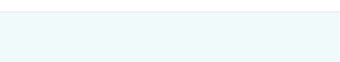

1. **Nút Thêm mới (+):** Màu xanh dương hoặc đỏ nổi bật $
ightarrow$ Mở popup thêm mới bản ghi.
2. **Nút Tải mẫu file (Template):** Tải file Excel mẫu đúng định dạng cột quy định.
3. **Nút Tải lên (Import):** Chọn file Excel từ máy tính nạp dữ liệu hàng loạt.
4. **Nút Tải xuống (Export):** Xuất bảng dữ liệu ra file Excel.
5. **Nút Bộ lọc nâng cao (Chiếc phễu):** Thiết lập lọc đa điều kiện.
6. **Nút Cài đặt hiển thị cột (Con mắt / Bánh răng):** Bật/tắt các cột dữ liệu cá nhân hóa.


Trên mỗi tiêu đề cột của bảng:
- **Nút 1 `(^) `:** Sắp xếp **Tăng dần** (A $
ightarrow$ Z, hoặc số nhỏ $
ightarrow$ lớn).
- **Nút 2 `(v)`:** Sắp xếp **Giảm dần** (Z $
ightarrow$ A, hoặc số lớn $
ightarrow$ nhỏ).
- **Nút 3 `(⇅)`:** **Hủy sắp xếp** (trả về thứ tự mặc định).

---
# PHẦN V: HƯỚNG DẪN CHI TIẾT TỪNG PHÂN HỆ NGHIỆP VỤ (ĐÚNG TRÌNH TỰ - 100% CÓ ẢNH)

## 5.2. Giám sát Sinh hoạt Chủ nhiệm & Cố vấn Học tập (Homeroom)
- **Đường dẫn truy cập:** `/monitoring/homeroom` hoặc Menu: **Công cụ kiểm tra** $
ightarrow$ **Cố vấn học tập**.
- **Đối tượng sử dụng chính:** Thanh tra viên ca trực, Lãnh đạo Phòng KTNB, Cố vấn học tập (CVHT).
- **Ý nghĩa nghiệp vụ:** Giám sát các buổi sinh hoạt lớp định kỳ giữa Giảng viên Cố vấn học tập và tập thể sinh viên (các lớp có mã học phần bắt đầu bằng `SHCN`). Đảm bảo buổi sinh hoạt diễn ra đúng giờ, đúng phòng, đủ quân số và ghi nhận kịp thời các nguyện vọng, kiến nghị của sinh viên gửi về Nhà trường.

---

### 📋 Màn hình Danh sách Chính Phân hệ Sinh hoạt Chủ nhiệm

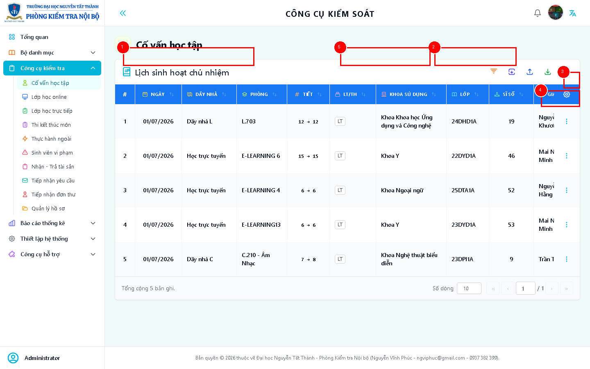

#### Chú giải các vị trí nút tác vụ trên màn hình danh sách (Theo số khoanh đỏ):
- **`[1]` Khu vực Thiết lập ca trực & Chọn ngày:** Lựa chọn ngày kiểm tra và ca trực để tải đúng thời khóa biểu sinh hoạt lớp.
- **`[2]` Nhóm nút Nhập / Xuất Excel:** Gồm Tải lên (Import), Tải mẫu Excel và Xuất báo cáo Excel (Export).
- **`[3]` Nút Cài đặt hiển thị cột:** Ẩn hoặc hiện các cột thông tin theo nhu cầu cá nhân.
- **`[4]` Nút Menu hành động trên dòng (Ghi nhận sinh hoạt):** Nút quan trọng nhất để thanh tra viên bấm vào ghi nhận kết quả kiểm tra tại phòng.
- **`[5]` Ô Tìm kiếm nhanh:** Nhập mã lớp SHCN, tên giảng viên CVHT hoặc mã phòng để lọc tức thì.

---

### TRÌNH TỰ TÁC NGHIỆP THỰC TẾ TỪNG BƯỚC:

#### Bước 1: Thiết lập Ca trực & Chọn Ngày kiểm tra (BẮT BUỘC ĐẦU TIÊN)
Trước khi bắt đầu đi tuần tra các phòng học, thanh tra viên **phải thiết lập ca trực và ngày kiểm tra** để hệ thống tải chính xác danh sách các lớp sinh hoạt diễn ra trong ca của mình:

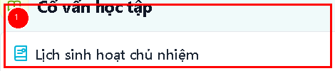

1. **Chọn Ngày kiểm tra:** Nhấp vào ô lịch để chọn ngày (mặc định là ngày hôm nay). Nếu kiểm tra bù hoặc xem lại lịch sử các tuần trước, chọn ngày tương ứng.
2. **Chọn Buổi học / Ca trực:**
   - **Buổi Sáng:** Khung giờ Tiết 1 đến Tiết 5 (07h00 - 11h30).
   - **Buổi Chiều:** Khung giờ Tiết 6 đến Tiết 10 (12h30 - 17h00).
   - **Buổi Tối:** Khung giờ Tiết 11 đến Tiết 15 (17h30 - 21h00).
3. **Ý nghĩa:** Sau khi chọn ca trực, bảng dữ liệu bên dưới sẽ chỉ nạp đúng các lớp sinh hoạt diễn ra trong ca đó, tránh hiển thị tràn lan hàng trăm lớp gây rối mắt.

---

#### Bước 2: Sử dụng Bộ lọc Nâng cao & Tìm kiếm Lớp Sinh hoạt
Khi cần tìm kiếm một lớp sinh hoạt cụ thể hoặc lọc theo tiêu chí khoa/cơ sở:

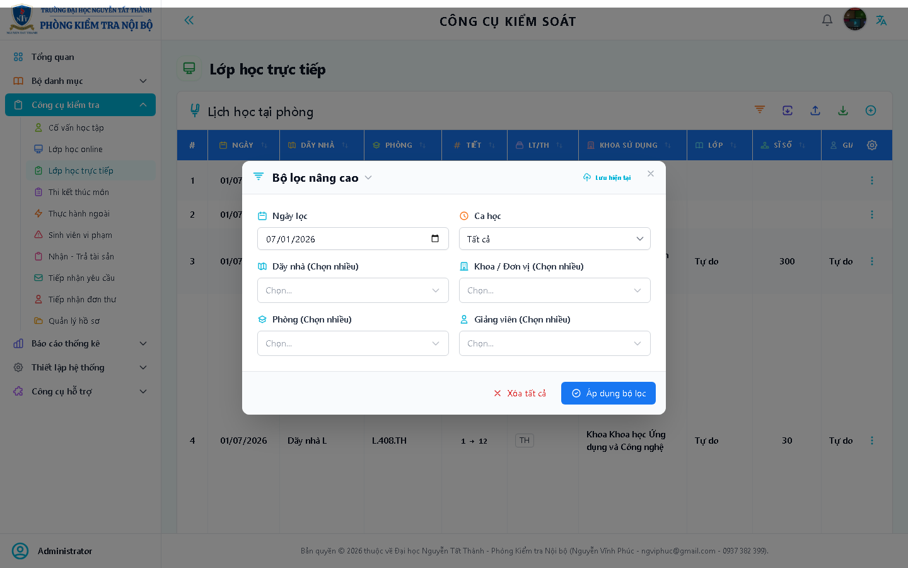

1. **Tìm kiếm nhanh:** Gõ mã lớp (ví dụ: `22DTH1A`, `23DDU01`), tên giảng viên cố vấn hoặc số phòng (`A.205`) vào ô tìm kiếm.
2. **Lọc nâng cao (Bấm nút hình chiếc phễu):**
   - **Lọc theo Cơ sở đào tạo:** Cơ sở Quận 4, Quận 12 hoặc Quận 7.
   - **Lọc theo Dãy nhà:** Dãy A, Dãy B, Dãy C...
   - **Lọc theo Khoa quản lý:** Khoa CNTT, Dược, Luật, Quản trị kinh doanh...
   - **Lọc theo Tình trạng kiểm tra:** *Chưa kiểm tra*, *Đã ghi nhận*, *Có việc phát sinh*.
3. Nhấn nút màu xanh **Áp dụng** để kích hoạt bộ lọc, hoặc nhấn **Đặt lại** để hủy lọc.

---

#### Bước 3: Cài đặt Hiển thị Cột Dữ liệu (Ẩn / Hiện Cột)
Để tối ưu không gian hiển thị, đặc biệt khi thanh tra viên tác nghiệp trên điện thoại di động:

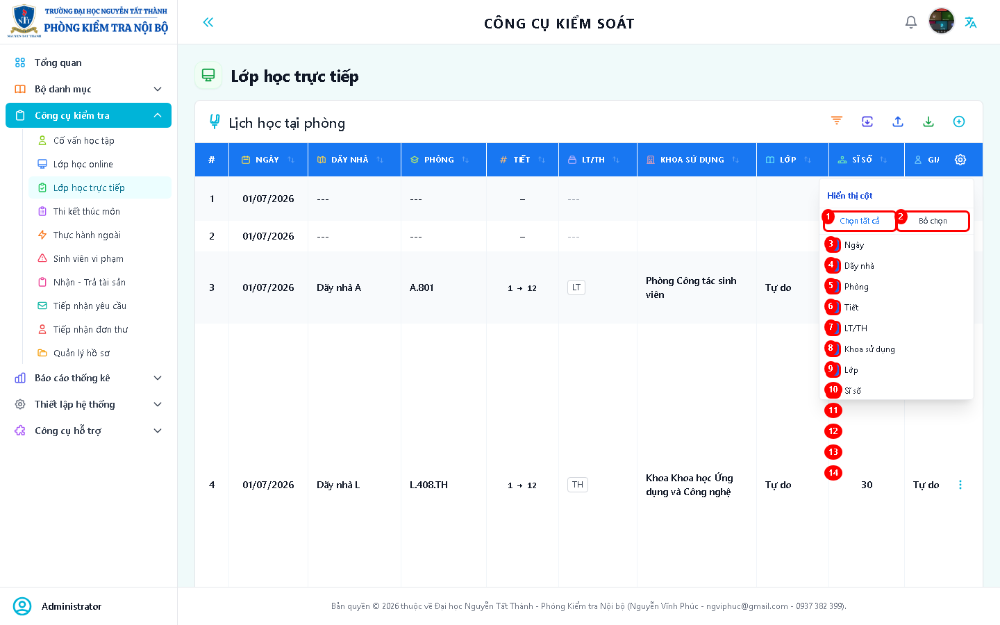

1. Nhấp vào nút **Cài đặt hiển thị cột** (biểu tượng con mắt trên góc phải bảng).
2. Tích chọn các cột cần xem:
   - **Mã lớp SHCN:** Ví dụ `SHCN96-22DTH1A`.
   - **Giảng viên Cố vấn học tập (CVHT):** Tên giảng viên phụ trách lớp.
   - **Phòng học & Dãy nhà:** Vị trí diễn ra buổi sinh hoạt.
   - **Tiết học:** Khung giờ sinh hoạt.
   - **Sĩ số sinh viên:** Sĩ số danh sách lớp và SV tham gia thực tế.
   - **Tình trạng buổi sinh hoạt:** Nhãn đánh giá chất lượng.
   - **Việc phát sinh:** Nội dung ghi chú bất thường.
3. Bỏ tích các cột không cần thiết để bảng gọn gàng hơn.

---

#### Bước 4: Thao tác Nhập / Xuất dữ liệu (Import, Export, Tải file mẫu Excel)

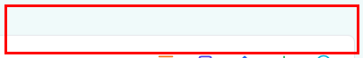

1. **Tải file mẫu Excel (Import Template):** Bấm nút biểu tượng mũi tên tải xuống có khay để tải về file Excel mẫu chuẩn cột quy định của Nhà trường.
2. **Nhập dữ liệu hàng loạt từ Excel (Import):** Bấm nút **Tải lên**, chọn file Excel thời khóa biểu sinh hoạt lớp được Phòng Đào tạo cấp $
ightarrow$ Hệ thống sẽ nạp hàng trăm buổi sinh hoạt vào lịch kiểm tra trong 5 giây.
3. **Xuất bảng dữ liệu ra Excel (Export):** Bấm nút **Xuất Excel** để tải về danh sách các lớp sinh hoạt đã lọc kèm đầy đủ kết quả ghi nhận phục vụ báo cáo.

---

#### Bước 5: Thêm mới Buổi Sinh hoạt Chủ nhiệm
Trường hợp lớp sinh hoạt đột xuất hoặc dạy bù chưa có trên thời khóa biểu:

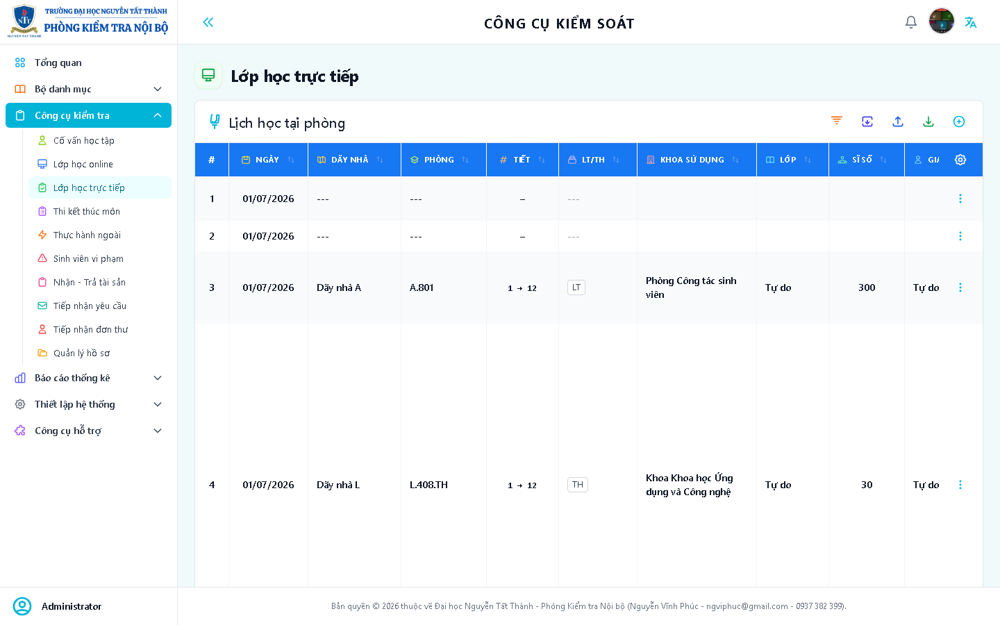

1. Nhấp nút **+ Thêm mới** ở thanh công cụ.
2. Điền các trường thông tin:
   - **Mã lớp / Tên lớp:** Nhập mã lớp (VD: `23DDU02`).
   - **Giảng viên CVHT:** Chọn tên giảng viên cố vấn từ danh mục.
   - **Phòng học:** Chọn phòng diễn ra buổi sinh hoạt (VD: `B.304`).
   - **Ngày sinh hoạt & Khung tiết:** Chọn ngày và tiết bắt đầu - kết thúc.
   - **Sĩ số lớp:** Nhập tổng số sinh viên của lớp.
3. Nhấn **Lưu dữ liệu** để thêm lớp vào danh sách kiểm tra ca trực.

---

#### Bước 6: GHI NHẬN SINH HOẠT TẠI LỚP (TRỌNG TÂM NGHIỆP VỤ)
Khi thanh tra viên đến trước cửa phòng học sinh hoạt chủ nhiệm:
Quan sát thực tế $
ightarrow$ Nhấp vào nút **Ghi nhận sinh hoạt** ở cột Hành động cuối dòng của lớp đó. Cửa sổ form ghi nhận chuyên sâu sẽ hiển thị:

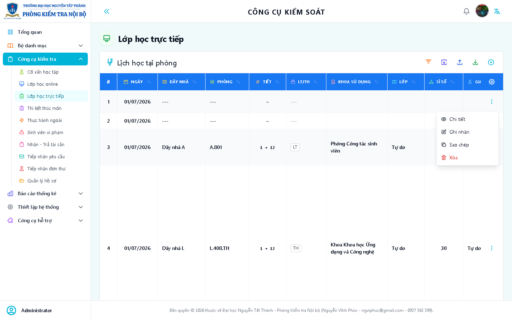

#### 📋 CHI TIẾT TỪNG TÍNH NĂNG VÀ TRƯỜNG NHẬP LIỆU TRONG FORM GHI NHẬN:

1. **Thông tin ca học (Tự động hiển thị ở đầu form):**
   - Ngày kiểm tra, Tiết học, Phòng học, Dãy nhà.
   - Mã lớp sinh hoạt, Giảng viên CVHT phụ trách, Sĩ số danh sách.
2. **Cán bộ giám sát (`employee`):**
   - Mặc định hệ thống tự điền tên của thanh tra viên đang đăng nhập. Có thể chọn lại nếu đi kiểm tra đôi.
3. **SV tham gia thực tế (`attending_students`):**
   - Đếm nhanh hoặc yêu cầu Ban cán sự lớp báo cáo số lượng sinh viên đang ngồi trong phòng.
   - Điền số lượng chính xác vào ô này (ví dụ: `42/50`). Hệ thống sẽ tự động tính tỷ lệ chuyên cần của lớp.
4. **Việc phát sinh (`incident` - BẮT BUỘC):**
   - Đối với phân hệ Sinh hoạt chủ nhiệm, việc chọn trạng thái phát sinh là bắt buộc.
   - Mở menu dropdown để chọn một trong các tình huống thực tế:
     - *Bình thường (Đúng giờ, nghiêm túc):* Giảng viên CVHT có mặt đúng giờ, sinh viên tham gia đầy đủ, phổ biến quy chế nghiêm túc.
     - *Giảng viên vào trễ:* Chọn số phút trễ (10 phút, 15 phút, 30 phút...).
     - *Giảng viên vắng mặt / Buổi sinh hoạt không diễn ra:* Phòng trống hoặc sinh viên tự sinh hoạt không có giảng viên.
     - *Đổi phòng sinh hoạt:* Lớp tự ý chuyển sang phòng khác mà không báo trước.
     - *Kết thúc sớm bất thường:* Giảng viên cho lớp nghỉ trước hơn 30 phút.
5. **Chi tiết việc phát sinh (`incident_detail` - TRƯỜNG BẮT BUỘC `*`):**
   - **Đặc thù nghiệp vụ:** Riêng phân hệ Sinh hoạt chủ nhiệm, trường này được gắn cờ bắt buộc có dấu `*` đỏ!
   - Thanh tra viên phải gõ mô tả chi tiết: Nội dung buổi sinh hoạt có triển khai đánh giá điểm rèn luyện không? Sinh viên có ý kiến phản ánh gì về học phí, phòng học hay giảng viên bộ môn không?
   - Nếu có sự cố (GV vắng/trễ), ghi rõ lý do giảng viên giải trình tại chỗ.
6. **Bằng chứng / Ghi chú (`evidence`):**
   - Ghi lại các bằng chứng xác thực (ví dụ: *Đã ký biên bản với Lớp trưởng Nguyễn Văn A, ảnh chụp lớp lúc 08h15*).
7. **Ghi chú thêm (`note`):**
   - Đánh giá chung chất lượng buổi sinh hoạt: *Tốt / Khá / Cần chấn chỉnh*.
8. **Đính kèm ảnh hiện trường:**
   - Nhấn nút chụp ảnh để lưu lại hình ảnh buổi sinh hoạt có mặt giảng viên và sinh viên làm minh chứng lưu kho.
9. **Lưu hoàn tất:** Bấm nút **Lưu cập nhật**. Trạng thái lớp sẽ lập tức chuyển màu xanh (đạt) hoặc màu vàng/đỏ (có việc phát sinh) và đồng bộ ngay lên Dashboard của Lãnh đạo phòng!

---

#### Bước 7: Chỉnh sửa & Xóa Ghi nhận Sinh hoạt An toàn
Trường hợp cần đính chính lại số lượng sinh viên tham gia hoặc xóa bản ghi nhầm lẫn:

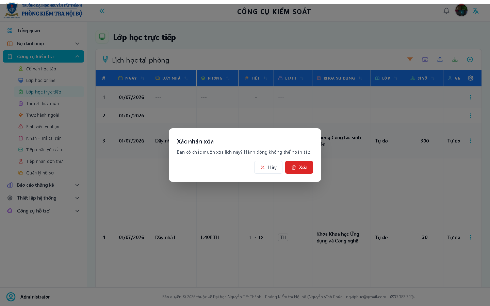

1. **Chỉnh sửa:** Bấm vào nút hình cây bút $
ightarrow$ Form ghi nhận mở lại $
ightarrow$ Điều chỉnh số liệu $
ightarrow$ Bấm Lưu.
2. **Xóa bản ghi:**
   - Bấm nút hình thùng rác ở dòng cần xóa.
   - Hộp thoại cảnh báo màu đỏ sẽ hiển thị: *"Bạn có chắc chắn muốn xóa bản ghi sinh hoạt lớp này không?"*.
   - Nhấn **Xác nhận Xóa** để xóa, hoặc nhấn **Hủy bỏ** để giữ nguyên.

---
## 5.4. Giám sát Lớp học Trực tuyến (Online Classes)
- **Đường dẫn truy cập:** `/monitoring/online` hoặc Menu: **Công cụ kiểm tra** $
ightarrow$ **Lớp học online**.
- **Đối tượng sử dụng chính:** Thanh tra viên kiểm tra ca trực, Lãnh đạo phòng KTNB.
- **Ý nghĩa nghiệp vụ:** Giám sát nề nếp các lớp học từ xa qua các nền tảng Internet (MS Teams, Zoom, Google Meet). Đảm bảo giảng viên mở phòng đúng giờ, bật camera, chia sẻ slide bài giảng và sinh viên tham gia đầy đủ theo thời khóa biểu.

---

### 📋 Màn hình Danh sách Chính Phân hệ Lớp học Online

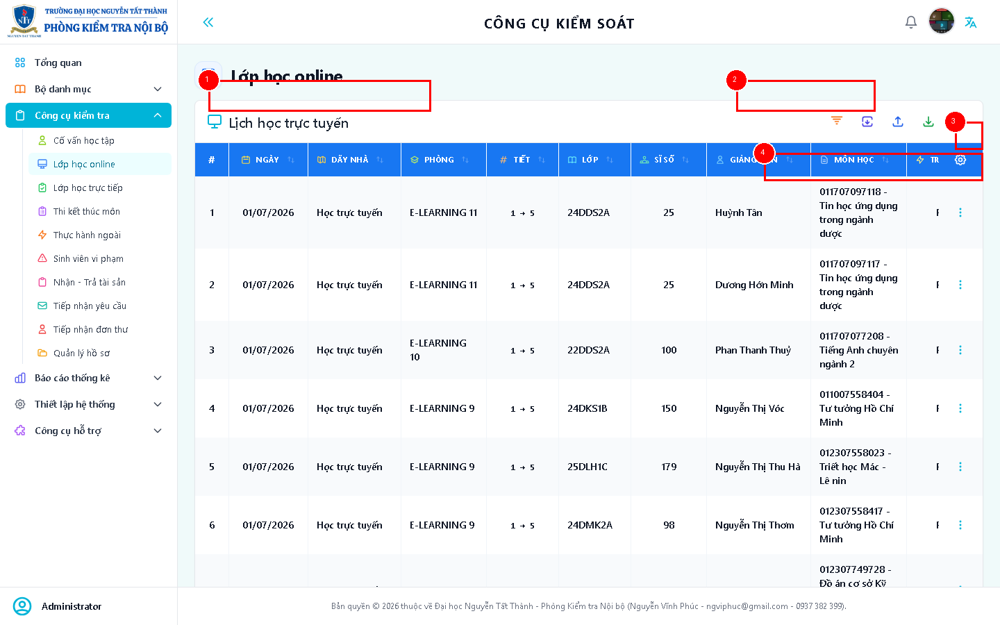

#### Chú giải các nút tác vụ trên màn hình:
- **`[1]` Khu vực Thiết lập ca trực & Chọn ngày:** Chọn ngày và ca học online để lọc thời khóa biểu.
- **`[2]` Nhóm nút Nhập / Xuất Excel:** Tải lên, tải mẫu và xuất danh sách lớp online.
- **`[3]` Nút Cài đặt hiển thị cột:** Ẩn/hiện cột Link phòng học, Nền tảng (Teams/Zoom/Meet), Sĩ số online.
- **`[4]` Nút Tham gia phòng & Ghi nhận kiểm tra:** Nút quan trọng nhất để thanh tra viên nhấp vào kiểm tra lớp học trực tuyến.

---

### TRÌNH TỰ TÁC NGHIỆP THỰC TẾ TỪNG BƯỚC:

#### Bước 1: Thiết lập Ca trực & Chọn Ngày học Online

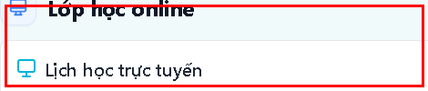

1. Chọn Ngày kiểm tra trên thanh công cụ.
2. Chọn Ca học: Ca Sáng (Tiết 1-5), Ca Chiều (Tiết 6-10), Ca Tối (Tiết 11-15).
3. Bảng sẽ chỉ hiển thị các lớp học có hình thức đào tạo trực tuyến trong ca đó.

---

#### Bước 2: Sử dụng Bộ lọc Nâng cao & Tìm kiếm Lớp Online


1. Nhấp nút **Bộ lọc nâng cao (Chiếc phễu)**.
2. Lọc theo Khoa quản lý, Giảng viên giảng dạy hoặc Tình trạng link phòng học (Đã có link / Chưa có link).
3. Nhấn **Áp dụng** để lọc dữ liệu.

---

#### Bước 3: Cài đặt Hiển thị Cột Dữ liệu Lớp Online


- Bật các cột: *Mã lớp, Tên môn học, Giảng viên, Đường dẫn phòng học (URL Link), Sĩ số đăng ký, Sĩ số online thực tế, Tình trạng kiểm tra*.

---

#### Bước 4: Nhấp Tham gia Phòng học & Kiểm tra Thực tế (Join Link)

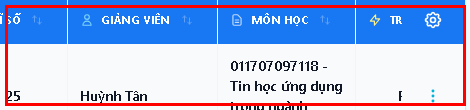

1. Trên dòng của lớp học online, nhấp trực tiếp vào nút xanh **Tham gia phòng (Join MS Teams / Zoom)**.
2. Trình duyệt sẽ mở tab mới kết nối thẳng vào phòng học online của giảng viên.
3. Thanh tra viên quan sát và kiểm tra 4 tiêu chí cốt lõi:
   - Giảng viên có mặt trong phòng đúng giờ hay không?
   - Giảng viên có bật webcam và micro giảng bài rõ ràng không?
   - Giảng viên có chia sẻ màn hình tài liệu bài giảng (slide) không?
   - Đếm số lượng tài khoản sinh viên đang có mặt trong danh sách cuộc họp so với sĩ số thời khóa biểu.
4. Chụp lại 1 ảnh màn hình (screenshot) danh sách người tham gia cuộc họp để làm minh chứng đối soát.

---

#### Bước 5: GHI NHẬN KẾT QUẢ KIỂM TRA LỚP HỌC ONLINE


Quay lại tab phần mềm KTNB $
ightarrow$ Nhấp nút **Ghi nhận kiểm tra** trên dòng của lớp đó:
1. **Cán bộ giám sát:** Hệ thống tự điền tên cán bộ.
2. **SV tham gia online:** Điền số lượng sinh viên đang trực tuyến trong phòng họp (ví dụ: `58/65`).
3. **Việc phát sinh:**
   - *Bình thường:* Giảng viên dạy nghiêm túc, mạng ổn định.
   - *Giảng viên không bật camera:* Nhắc nhở quy chế dạy online.
   - *Link phòng học bị lỗi / Không vào được:* Giảng viên chưa tạo phòng hoặc link sai.
   - *Giảng viên vào trễ:* Nhập số phút trễ.
   - *Lớp vắng quá 50% sĩ số:* Ghi nhận để báo cáo Khoa chủ quản.
4. **Chi tiết việc phát sinh:** Ghi chú cụ thể các vấn đề đường truyền mạng gián đoạn hoặc phản ánh của sinh viên.
5. **Tải ảnh minh chứng:** Tải ảnh chụp màn hình cuộc họp MS Teams/Zoom vừa chụp ở Bước 4 lên hệ thống.
6. Nhấn nút **Lưu cập nhật** để hoàn tất kiểm tra.

---

#### Bước 6: Xóa Bản ghi Lớp học Online khi Lớp chuyển sang Học Offline


- Khi lớp học có quyết định chuyển về học trực tiếp tại trường, thanh tra viên có thể xóa bản ghi khỏi danh mục online để tránh kiểm tra trùng lặp.

---
## 5.3. Giám sát Lớp học Trực tiếp (In-person Classes)
- **Đường dẫn truy cập:** `/monitoring/in-person`
- **Đối tượng sử dụng chính:** Thanh tra viên, Cán bộ kiểm tra ca trực
- **Mục đích nghiệp vụ:** Kiểm tra nề nếp giảng dạy và học tập trực tiếp tại các phòng học thuộc các cơ sở đào tạo của Nhà trường.

---

### Bước 1: Truy cập và Quan sát Màn hình Danh sách Chính
Thanh tra viên đăng nhập hệ thống, chọn menu `Giám sát Lớp học Trực tiếp (In-person Classes)` trên thanh Sidebar. Màn hình danh sách chính sẽ hiển thị như hình minh chứng bên dưới:

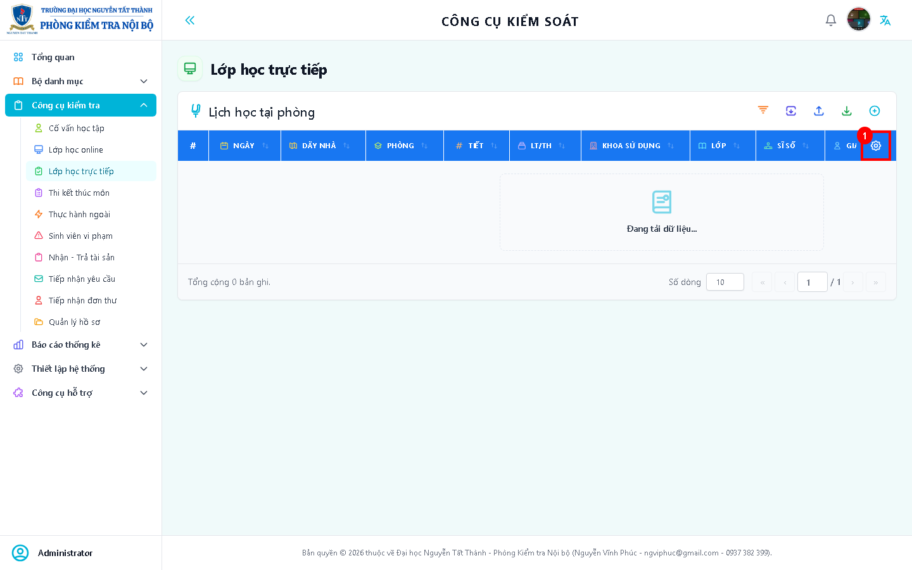

#### 📋 Chú giải các nút tác vụ trên màn hình danh sách (Theo số khoanh đỏ):
- **[1] Nhóm nút tác vụ thanh công cụ**: Gồm các nút Tải lên file Excel, Tải file mẫu import, Xuất file Excel báo cáo và Thêm lớp học mới.\n- **[2] Nút Cài đặt hiển thị cột**: Bấm để mở ngăn kéo bật/tắt các cột thông tin cần xem trên bảng lớp học.\n- **[3] Nút Menu hành động dòng**: Nằm ở cột cuối cùng mỗi phòng học, bấm để mở menu: Cập nhật tình trạng, Ghi nhận việc phát sinh, Đổi phòng, Sửa, Xóa.\n- **[4] Ô tìm kiếm nhanh**: Nhập mã phòng (A.101, B.203), tên giảng viên hoặc môn học để lọc tức thì.\n
---

### Bước 2: Tùy biến Hiển thị Cột Dữ liệu (Ẩn / Hiện Cột)
Nhấp vào nút **Cài đặt hiển thị cột** (biểu tượng con mắt trên thanh tiêu đề bảng) để mở bảng chọn cột:


#### 📋 Hướng dẫn thao tác cài đặt cột:
- **Bật cột:** Nhấp chuột vào ô vuông để xuất hiện dấu tick xanh $\rightarrow$ Cột dữ liệu đó sẽ hiển thị trên bảng.
- **Ẩn cột:** Bỏ dấu tick xanh $\rightarrow$ Cột dữ liệu đó sẽ ẩn đi để giao diện gọn gàng hơn.
- **Mã lớp học phần / Môn học**: Hiển thị mã số lớp và tên học phần đang giảng dạy.\n- **Giảng viên giảng dạy**: Hiển thị họ và tên giảng viên được phân công trên thời khóa biểu.\n- **Sĩ số sinh viên**: Hiển thị sĩ số đăng ký và sĩ số sinh viên có mặt thực tế.\n- **Tình trạng lớp học**: Hiển thị nhãn trạng thái: Đang học, Vào trễ, Nghỉ, Đổi phòng...\n- **Việc phát sinh / Ghi chú**: Hiển thị nội dung sự cố hoặc việc bất thường phát hiện tại phòng.\n- **Lưu ý:** Cấu hình cột được lưu tự động trên trình duyệt của bạn.\n\n---\n\n### Bước 3: Lọc Dữ liệu Nâng cao theo Nhiều Tiêu chí
Khi cần tìm kiếm các bản ghi thỏa mãn nhiều điều kiện kết hợp, nhấp vào nút **Bộ lọc nâng cao (Chiếc phễu)**:


#### 📋 Hướng dẫn thiết lập các tiêu chí lọc:
- **Chọn Ngày kiểm tra**: Mặc định là ngày hôm nay. Chọn ngày bất kỳ để xem lịch kiểm tra cũ hoặc tương lai.\n- **Chọn Cơ sở đào tạo**: Chọn Cơ sở Q.4, Cơ sở Q.12 hoặc Cơ sở Q.7 nơi cán bộ đang thực hiện ca trực.\n- **Chọn Buổi học / Ca trực**: Chọn Buổi Sáng (Tiết 1-5), Buổi Chiều (Tiết 6-10) hoặc Buổi Tối (Tiết 11-15).\n- **Chọn Tiết học cụ thể**: Chọn tiết học đang diễn ra (ví dụ: Tiết 3) để hệ thống lọc ra danh sách đúng các phòng đang học tiết đó.\n- **Thực thi lọc:** Sau khi chọn xong các tiêu chí, nhấp nút màu xanh **Áp dụng** để bảng làm mới số liệu.
- **Xóa bộ lọc:** Nhấp nút **Đặt lại** để hủy tất cả điều kiện lọc và quay về danh sách ban đầu.

---

### Bước 4: Thêm mới Bản ghi Dữ liệu (Form Nhập Liệu)
Trên màn hình chính, nhấp vào nút **Thêm mới (+)** màu nổi bật:


#### 📋 Bảng hướng dẫn chi tiết từng ô nhập liệu trên Form:

| Số hiệu | Tên trường / Ô nhập | Bắt buộc | Kiểu nhập liệu | Ý nghĩa nghiệp vụ & Hướng dẫn nhập |
| :---: | :--- | :---: | :---: | :--- |
| **`1`** | **Mã học phần / Tên môn học** | Có (*) | `Text / Select` | Chọn hoặc gõ mã môn học và tên môn học. |\n| **`2`** | **Phòng học** | Có (*) | `Select` | Chọn mã phòng học diễn ra tiết học (VD: A.301, B.202). |\n| **`3`** | **Giảng viên** | Có (*) | `Select` | Chọn tên giảng viên phụ trách giảng dạy từ danh mục. |\n| **`4`** | **Ngày học & Tiết học** | Có (*) | `Date & Select` | Chọn ngày và khoảng tiết học (VD: Tiết 1 đến Tiết 5). |\n| **`5`** | **Sĩ số đăng ký** | Không | `Number` | Nhập số lượng sinh viên đăng ký môn học theo danh sách. |\n
- **Hoàn tất thêm mới:** Điền đầy đủ các trường bắt buộc (có dấu `*`), nhấp nút **Lưu dữ liệu**.

---

### Bước 5: Chỉnh sửa / Cập nhật Bản ghi Dữ liệu
Khi cần điều chỉnh thông tin, nhấp vào nút **Chỉnh sửa (Hình cây bút)** ở cột Hành động:


#### 📋 Hướng dẫn thao tác chỉnh sửa:
- Form chỉnh sửa cho phép thanh tra viên cập nhật trạng thái lớp học tại hiện trường:
  1. **Đổi trạng thái lớp:** Chọn *Bình thường*, *Giảng viên vào trễ* (nhập số phút trễ), *Nghỉ không báo trước*, *Đổi phòng học*, *Dạy bù*.
  2. **Cập nhật sĩ số thực tế:** Đếm nhanh số sinh viên đang ngồi trong lớp và điền vào ô sĩ số.
  3. **Ghi nhận Việc phát sinh (ĐẶC BIỆT QUAN TRỌNG):** Gõ chi tiết bất kỳ sự cố nào xảy ra tại phòng (ví dụ: *Máy chiếu hỏng nguồn, Máy lạnh chảy nước, Giảng viên vắng tiết 1-2*).
  4. **Quy tắc trích xuất tự động:** Nội dung trong ô này sẽ tự động chuyển thành cột Ghi chú khi xuất file Excel báo cáo cuối ngày!
- Nhấp nút **Cập nhật** để lưu lại thông tin mới.

---

### Bước 6: Xóa Bản ghi & Hộp thoại Xác nhận An toàn
Khi một bản ghi bị nhập trùng hoặc hủy bỏ, nhấp vào nút **Xóa (Hình thùng rác)** ở cột Hành động:


#### 📋 Hướng dẫn thao tác xóa dữ liệu an toàn:
- Hệ thống sẽ hiển thị hộp thoại xác nhận: *"Bạn có chắc chắn muốn xóa bản ghi lớp học này không?"*.
- Chỉ xóa khi lớp học bị trùng lặp hoặc hủy lịch giảng dạy chính thức.
- **Nút Xác nhận Xóa (Màu đỏ):** Nhấp để xóa vĩnh viễn bản ghi khỏi hệ thống.
- **Nút Hủy bỏ (Màu xám):** Đóng hộp thoại và giữ nguyên dữ liệu.

---
## 5.5. Quản lý Lịch học theo ngày & Xuất Excel In ấn chuẩn A4 (Schedule)
- **Đường dẫn truy cập:** `/settings/schedule`
- **Đối tượng sử dụng chính:** Lãnh đạo phòng, Chuyên viên quản lý lịch kiểm tra
- **Mục đích nghiệp vụ:** Quản lý toàn bộ thời khóa biểu các lớp học theo từng ngày và xuất file Excel mẫu in kiểm tra phòng học chuẩn A4.

---

### Bước 1: Truy cập và Quan sát Màn hình Danh sách Chính
Thanh tra viên đăng nhập hệ thống, chọn menu `Quản lý Lịch học theo ngày & Xuất Excel In ấn chuẩn A4 (Schedule)` trên thanh Sidebar. Màn hình danh sách chính sẽ hiển thị như hình minh chứng bên dưới:


#### 📋 Chú giải các nút tác vụ trên màn hình danh sách (Theo số khoanh đỏ):
- **[1] Nút Thêm lịch học mới**: Bấm để thêm mới một buổi học vào lịch trình kiểm tra ngày.\n- **[2] Nút Cài đặt hiển thị cột**: Bật/tắt các cột chi tiết trên bảng thời khóa biểu.\n- **[3] Nút Xuất file Excel (POST an toàn)**: Xuất toàn bộ bảng lịch học ra file Excel mẫu in kiểm tra chuẩn A4 không bao giờ gặp lỗi đường dẫn quá dài (HTTP 414).\n- **[4] Ô tìm kiếm lịch học**: Tìm theo tên môn, mã phòng, mã lớp hoặc tên giảng viên.\n
---

### Bước 2: Tùy biến Hiển thị Cột Dữ liệu (Ẩn / Hiện Cột)
Nhấp vào nút **Cài đặt hiển thị cột** (biểu tượng con mắt trên thanh tiêu đề bảng) để mở bảng chọn cột:


#### 📋 Hướng dẫn thao tác cài đặt cột:
- **Bật cột:** Nhấp chuột vào ô vuông để xuất hiện dấu tick xanh $\rightarrow$ Cột dữ liệu đó sẽ hiển thị trên bảng.
- **Ẩn cột:** Bỏ dấu tick xanh $\rightarrow$ Cột dữ liệu đó sẽ ẩn đi để giao diện gọn gàng hơn.
- **Mã môn & Tên lớp**: Hiển thị thông tin lớp học phần.\n- **Thứ & Ngày học**: Hiển thị ngày tháng diễn ra tiết học.\n- **Phòng học & Dãy nhà**: Hiển thị phòng học và cơ sở đào tạo.\n- **Tiết bắt đầu - Tiết kết thúc**: Hiển thị khung giờ học.\n- **Ghi chú / Việc phát sinh**: Hiển thị các ghi chú theo dõi đặc biệt.\n- **Lưu ý:** Cấu hình cột được lưu tự động trên trình duyệt của bạn.\n\n---\n\n### Bước 3: Lọc Dữ liệu Nâng cao theo Nhiều Tiêu chí
Khi cần tìm kiếm các bản ghi thỏa mãn nhiều điều kiện kết hợp, nhấp vào nút **Bộ lọc nâng cao (Chiếc phễu)**:


#### 📋 Hướng dẫn thiết lập các tiêu chí lọc:
- **Lọc theo Khoảng ngày**: Chọn Từ ngày... Đến ngày... để xuất lịch nhiều ngày cùng lúc.\n- **Lọc theo Cơ sở**: Chọn Cơ sở Quận 4, Quận 12 hoặc Quận 7.\n- **Lọc theo Khoa quản lý môn**: Lọc các môn thuộc Khoa CNTT, Dược, Ngoại ngữ...\n- **Lọc theo Loại hình lớp**: Lọc lớp Lý thuyết, Thực hành xưởng, hay Sinh hoạt cố vấn.\n- **Thực thi lọc:** Sau khi chọn xong các tiêu chí, nhấp nút màu xanh **Áp dụng** để bảng làm mới số liệu.
- **Xóa bộ lọc:** Nhấp nút **Đặt lại** để hủy tất cả điều kiện lọc và quay về danh sách ban đầu.

---

### Bước 4: Thêm mới Bản ghi Dữ liệu (Form Nhập Liệu)
Trên màn hình chính, nhấp vào nút **Thêm mới (+)** màu nổi bật:


#### 📋 Bảng hướng dẫn chi tiết từng ô nhập liệu trên Form:

| Số hiệu | Tên trường / Ô nhập | Bắt buộc | Kiểu nhập liệu | Ý nghĩa nghiệp vụ & Hướng dẫn nhập |
| :---: | :--- | :---: | :---: | :--- |
| **`1`** | **Ngày học** | Có (*) | `Date Picker` | Chọn ngày diễn ra lớp học. |\n| **`2`** | **Phòng học** | Có (*) | `Dropdown` | Chọn phòng học từ danh mục cơ sở. |\n| **`3`** | **Khung tiết học** | Có (*) | `Select` | Chọn Tiết bắt đầu và Tiết kết thúc. |\n| **`4`** | **Giảng viên** | Có (*) | `Select` | Chọn giảng viên giảng dạy. |\n| **`5`** | **Lớp học phần** | Có (*) | `Text` | Nhập mã lớp học phần theo chuẩn đào tạo. |\n
- **Hoàn tất thêm mới:** Điền đầy đủ các trường bắt buộc (có dấu `*`), nhấp nút **Lưu dữ liệu**.

---

### Bước 5: Chỉnh sửa / Cập nhật Bản ghi Dữ liệu
Khi cần điều chỉnh thông tin, nhấp vào nút **Chỉnh sửa (Hình cây bút)** ở cột Hành động:


#### 📋 Hướng dẫn thao tác chỉnh sửa:
- Dùng để điều chỉnh phòng học hoặc giảng viên khi có thông báo đổi lịch chính thức từ Phòng Quản lý Đào tạo.
- Cập nhật thông tin giảng viên dạy thay hoặc phòng học thay thế trước khi thanh tra viên đi kiểm tra hiện trường.
- Nhấp nút **Cập nhật** để lưu lại thông tin mới.

---

### Bước 6: Xóa Bản ghi & Hộp thoại Xác nhận An toàn
Khi một bản ghi bị nhập trùng hoặc hủy bỏ, nhấp vào nút **Xóa (Hình thùng rác)** ở cột Hành động:


#### 📋 Hướng dẫn thao tác xóa dữ liệu an toàn:
- Chỉ xóa các bản ghi lịch học khi môn học đó có thông báo hủy lớp hoặc hoãn thi từ Nhà trường.
- **Nút Xác nhận Xóa (Màu đỏ):** Nhấp để xóa vĩnh viễn bản ghi khỏi hệ thống.
- **Nút Hủy bỏ (Màu xám):** Đóng hộp thoại và giữ nguyên dữ liệu.

---
## 5.6. Lập biên bản Sinh viên Vi phạm (Quét Barcode & Chụp ảnh)
- **Đường dẫn truy cập:** `/monitoring/student-violations`
- **Đối tượng sử dụng chính:** Thanh tra viên kiểm tra, Giám thị coi thi
- **Mục đích nghiệp vụ:** Ghi nhận, lập biên bản và quản lý danh sách sinh viên vi phạm nội quy, quy chế học đường và quy chế thi cử.

---

### Bước 1: Truy cập và Quan sát Màn hình Danh sách Chính
Thanh tra viên đăng nhập hệ thống, chọn menu `Lập biên bản Sinh viên Vi phạm (Quét Barcode & Chụp ảnh)` trên thanh Sidebar. Màn hình danh sách chính sẽ hiển thị như hình minh chứng bên dưới:

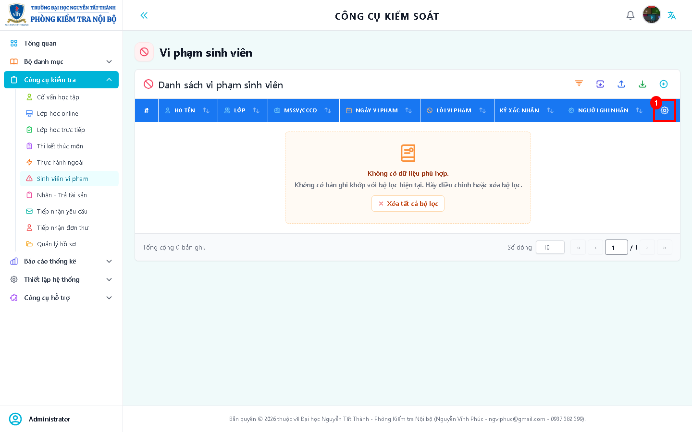

#### 📋 Chú giải các nút tác vụ trên màn hình danh sách (Theo số khoanh đỏ):
- **[1] Nút + Thêm vi phạm mới**: Màu đỏ nổi bật, bấm để mở cửa sổ lập biên bản vi phạm siêu tốc.\n- **[2] Nút Cài đặt hiển thị cột**: Tùy biến các cột: MSSV, Họ tên, Lớp, Hành vi vi phạm, Mức phạt, Ảnh minh chứng.\n- **[3] Nút Menu hành động dòng**: Bấm để Xem biên bản in, Sửa thông tin, Tải ảnh minh chứng hoặc Xóa biên bản.\n- **[4] Ô tìm kiếm sinh viên**: Tìm nhanh theo Mã số sinh viên (MSSV) hoặc Họ và tên sinh viên.\n
---

### Bước 2: Tùy biến Hiển thị Cột Dữ liệu (Ẩn / Hiện Cột)
Nhấp vào nút **Cài đặt hiển thị cột** (biểu tượng con mắt trên thanh tiêu đề bảng) để mở bảng chọn cột:

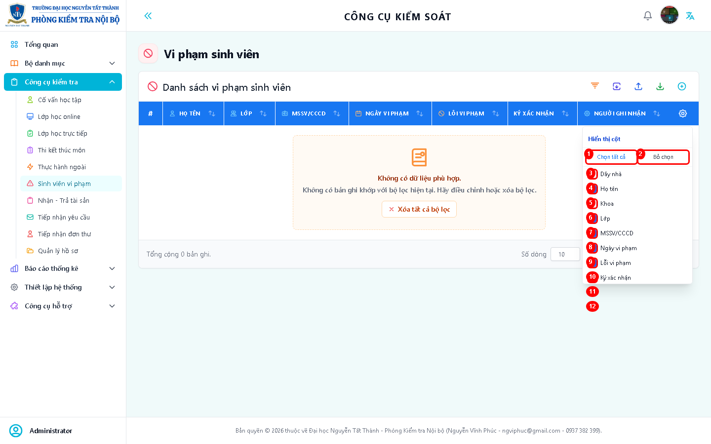

#### 📋 Hướng dẫn thao tác cài đặt cột:
- **Bật cột:** Nhấp chuột vào ô vuông để xuất hiện dấu tick xanh $\rightarrow$ Cột dữ liệu đó sẽ hiển thị trên bảng.
- **Ẩn cột:** Bỏ dấu tick xanh $\rightarrow$ Cột dữ liệu đó sẽ ẩn đi để giao diện gọn gàng hơn.
- **Mã số sinh viên (MSSV)**: Hiển thị mã số sinh viên NTTU.\n- **Họ và tên sinh viên**: Họ tên đầy đủ của sinh viên vi phạm.\n- **Lớp & Khoa đào tạo**: Lớp danh nghĩa và khoa chủ quản.\n- **Hành vi vi phạm**: Tên lỗi vi phạm quy chế.\n- **Địa điểm vi phạm**: Phòng học, dãy nhà hoặc khu vực sân trường.\n- **Ảnh minh chứng**: Biểu tượng hình ảnh chụp hiện trường vi phạm.\n- **Lưu ý:** Cấu hình cột được lưu tự động trên trình duyệt của bạn.\n\n---\n\n### Bước 3: Lọc Dữ liệu Nâng cao theo Nhiều Tiêu chí
Khi cần tìm kiếm các bản ghi thỏa mãn nhiều điều kiện kết hợp, nhấp vào nút **Bộ lọc nâng cao (Chiếc phễu)**:

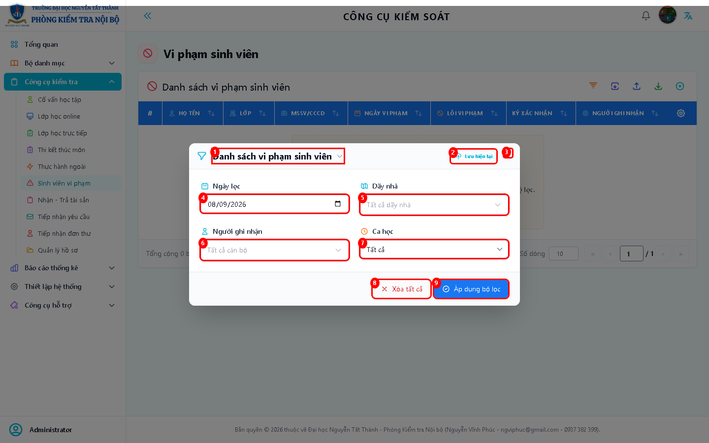

#### 📋 Hướng dẫn thiết lập các tiêu chí lọc:
- **Lọc theo Ngày vi phạm**: Chọn ngày hoặc khoảng ngày lập biên bản.\n- **Lọc theo Hành vi vi phạm**: Lọc theo lỗi: Không đeo thẻ, Sai trang phục, Hút thuốc, Gian lận thi...\n- **Lọc theo Cơ sở & Dãy nhà**: Lọc các vi phạm xảy ra tại Cơ sở Q.12, Q.4...\n- **Lọc theo Khoa / Viện**: Lọc vi phạm của sinh viên thuộc một khoa cụ thể để gửi báo cáo.\n- **Thực thi lọc:** Sau khi chọn xong các tiêu chí, nhấp nút màu xanh **Áp dụng** để bảng làm mới số liệu.
- **Xóa bộ lọc:** Nhấp nút **Đặt lại** để hủy tất cả điều kiện lọc và quay về danh sách ban đầu.

---

### Bước 4: Thêm mới Bản ghi Dữ liệu (Form Nhập Liệu)
Trên màn hình chính, nhấp vào nút **Thêm mới (+)** màu nổi bật:

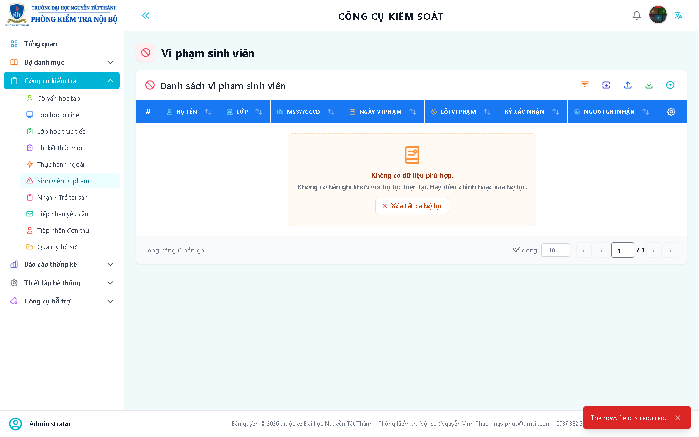

#### 📋 Bảng hướng dẫn chi tiết từng ô nhập liệu trên Form:

| Số hiệu | Tên trường / Ô nhập | Bắt buộc | Kiểu nhập liệu | Ý nghĩa nghiệp vụ & Hướng dẫn nhập |
| :---: | :--- | :---: | :---: | :--- |
| **`1`** | **Nút Quét Camera Barcode** | Khuyến nghị | `Camera Scan` | Bấm để bật camera điện thoại quét mã vạch thẻ sinh viên. Hệ thống tự động điền 100% MSSV, Họ tên, Lớp, Khoa trong 5 giây! |\n| **`2`** | **Mã số sinh viên (MSSV)** | Có (*) | `Text` | Nhập MSSV nếu sinh viên không mang thẻ để quét. |\n| **`3`** | **Họ tên, Lớp, Khoa** | Tự động | `Readonly` | Hệ thống tự động truy xuất từ CSDL Sinh viên. |\n| **`4`** | **Hành vi vi phạm** | Có (*) | `Select` | Chọn lỗi vi phạm từ danh mục quy định của Nhà trường. |\n| **`5`** | **Địa điểm xảy ra** | Có (*) | `Select` | Chọn Cơ sở, Dãy nhà, Số phòng học hoặc Sân trường. |\n| **`6`** | **Chụp ảnh minh chứng** | Có (*) | `File / Camera` | Bấm chụp ảnh trực tiếp sinh viên vi phạm hoặc hiện trường vi phạm đính kèm biên bản. |\n
- **Hoàn tất thêm mới:** Điền đầy đủ các trường bắt buộc (có dấu `*`), nhấp nút **Lưu dữ liệu**.

---

### Bước 5: Chỉnh sửa / Cập nhật Bản ghi Dữ liệu
Khi cần điều chỉnh thông tin, nhấp vào nút **Chỉnh sửa (Hình cây bút)** ở cột Hành động:


#### 📋 Hướng dẫn thao tác chỉnh sửa:
- Cho phép bổ sung thêm nội dung tường trình của sinh viên hoặc ý kiến của giảng viên/giám thị.
- Cập nhật lại hình thức xử lý kỷ luật sau khi có kết luận của Hội đồng Kỷ luật Nhà trường.
- Nhấp nút **Cập nhật** để lưu lại thông tin mới.

---

### Bước 6: Xóa Bản ghi & Hộp thoại Xác nhận An toàn
Khi một bản ghi bị nhập trùng hoặc hủy bỏ, nhấp vào nút **Xóa (Hình thùng rác)** ở cột Hành động:


#### 📋 Hướng dẫn thao tác xóa dữ liệu an toàn:
- Chỉ xóa biên bản khi có văn bản đính chính chính thức từ Lãnh đạo Phòng KTNB hoặc giải trình khiếu nại được chấp thuận.
- **Nút Xác nhận Xóa (Màu đỏ):** Nhấp để xóa vĩnh viễn bản ghi khỏi hệ thống.
- **Nút Hủy bỏ (Màu xám):** Đóng hộp thoại và giữ nguyên dữ liệu.

---
## 5.7. Giám sát Thi Kết thúc học phần (Exams)
- **Đường dẫn truy cập:** `/monitoring/exams`
- **Đối tượng sử dụng chính:** Thanh tra viên trực thi, Lãnh đạo hội đồng thi
- **Mục đích nghiệp vụ:** Giám sát nề nếp coi thi, sự có mặt của cán bộ coi thi (giám thị), kỷ luật phòng thi và sự cố đề thi.

---

### Bước 1: Truy cập và Quan sát Màn hình Danh sách Chính
Thanh tra viên đăng nhập hệ thống, chọn menu `Giám sát Thi Kết thúc học phần (Exams)` trên thanh Sidebar. Màn hình danh sách chính sẽ hiển thị như hình minh chứng bên dưới:

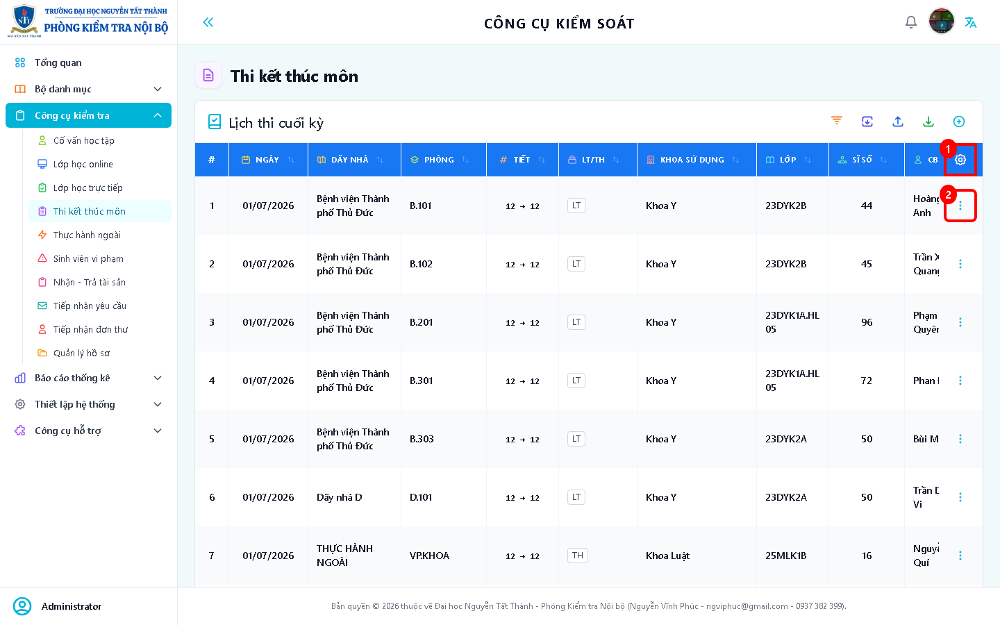

#### 📋 Chú giải các nút tác vụ trên màn hình danh sách (Theo số khoanh đỏ):
- **[1] Nhóm nút tác vụ kỳ thi**: Tải lên lịch thi, Tải mẫu, Xuất danh sách phòng thi và Thêm ca thi mới.\n- **[2] Nút Cài đặt hiển thị cột**: Bật/tắt các cột: Môn thi, Phòng thi, Giám thị 1, Giám thị 2, Sĩ số dự thi.\n- **[3] Nút Menu hành động dòng**: Cập nhật tình trạng phòng thi, ghi nhận thí sinh vắng thi, lập biên bản đình chỉ thi.\n- **[4] Ô tìm kiếm phòng thi**: Tìm theo tên môn thi, mã phòng thi hoặc tên cán bộ coi thi.\n
---

### Bước 2: Tùy biến Hiển thị Cột Dữ liệu (Ẩn / Hiện Cột)
Nhấp vào nút **Cài đặt hiển thị cột** (biểu tượng con mắt trên thanh tiêu đề bảng) để mở bảng chọn cột:

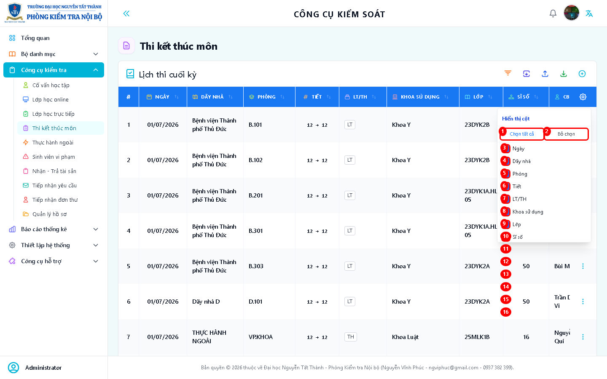

#### 📋 Hướng dẫn thao tác cài đặt cột:
- **Bật cột:** Nhấp chuột vào ô vuông để xuất hiện dấu tick xanh $\rightarrow$ Cột dữ liệu đó sẽ hiển thị trên bảng.
- **Ẩn cột:** Bỏ dấu tick xanh $\rightarrow$ Cột dữ liệu đó sẽ ẩn đi để giao diện gọn gàng hơn.
- **Môn thi & Ca thi**: Hiển thị tên học phần thi và ca thi (Ca 1, Ca 2, Ca 3...).\n- **Phòng thi & Điểm thi**: Hiển thị số phòng và cơ sở tổ chức thi.\n- **Cán bộ coi thi 1 & 2**: Hiển thị họ tên 2 giám thị được phân công coi thi.\n- **Sĩ số dự thi**: Hiển thị số lượng thí sinh có mặt và vắng mặt.\n- **Tình trạng phòng thi**: Hiển thị trạng thái: Đang thi nghiêm túc, Giám thị trễ, Có vi phạm quy chế...\n- **Lưu ý:** Cấu hình cột được lưu tự động trên trình duyệt của bạn.\n\n---\n\n### Bước 3: Lọc Dữ liệu Nâng cao theo Nhiều Tiêu chí
Khi cần tìm kiếm các bản ghi thỏa mãn nhiều điều kiện kết hợp, nhấp vào nút **Bộ lọc nâng cao (Chiếc phễu)**:

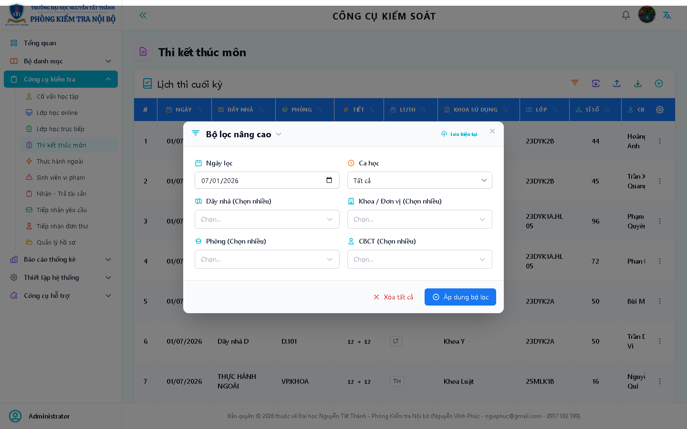

#### 📋 Hướng dẫn thiết lập các tiêu chí lọc:
- **Lọc theo Ngày thi**: Chọn ngày diễn ra đợt thi kết thúc môn.\n- **Lọc theo Điểm thi (Cơ sở)**: Chọn Cơ sở Q.12, Cơ sở Q.4 nơi đặt hội đồng thi.\n- **Lọc theo Ca thi**: Chọn Ca 1 (07h30), Ca 2 (09h30), Ca 3 (13h30), Ca 4 (15h30)...\n- **Lọc theo Tình trạng vi phạm**: Lọc các phòng thi có ghi nhận thí sinh hoặc giám thị vi phạm.\n- **Thực thi lọc:** Sau khi chọn xong các tiêu chí, nhấp nút màu xanh **Áp dụng** để bảng làm mới số liệu.
- **Xóa bộ lọc:** Nhấp nút **Đặt lại** để hủy tất cả điều kiện lọc và quay về danh sách ban đầu.

---

### Bước 4: Thêm mới Bản ghi Dữ liệu (Form Nhập Liệu)
Trên màn hình chính, nhấp vào nút **Thêm mới (+)** màu nổi bật:

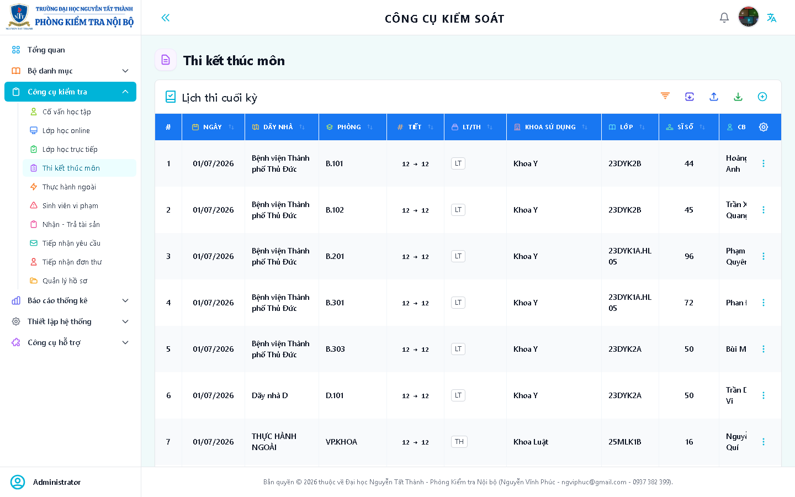

#### 📋 Bảng hướng dẫn chi tiết từng ô nhập liệu trên Form:

| Số hiệu | Tên trường / Ô nhập | Bắt buộc | Kiểu nhập liệu | Ý nghĩa nghiệp vụ & Hướng dẫn nhập |
| :---: | :--- | :---: | :---: | :--- |
| **`1`** | **Tên môn thi** | Có (*) | `Select / Text` | Chọn học phần kết thúc môn tổ chức thi. |\n| **`2`** | **Phòng thi & Ca thi** | Có (*) | `Select` | Chọn phòng thi và khung giờ ca thi. |\n| **`3`** | **Cán bộ coi thi 1 & 2** | Có (*) | `Select` | Chọn 2 cán bộ giám thị coi thi từ danh mục. |\n| **`4`** | **Sĩ số phòng thi** | Có (*) | `Number` | Nhập tổng số thí sinh trong danh sách phòng thi. |\n| **`5`** | **Hình thức thi** | Có (*) | `Select` | Chọn Tự luận, Trắc nghiệm trên máy, Tiểu luận hoặc Vấn đáp. |\n
- **Hoàn tất thêm mới:** Điền đầy đủ các trường bắt buộc (có dấu `*`), nhấp nút **Lưu dữ liệu**.

---

### Bước 5: Chỉnh sửa / Cập nhật Bản ghi Dữ liệu
Khi cần điều chỉnh thông tin, nhấp vào nút **Chỉnh sửa (Hình cây bút)** ở cột Hành động:


#### 📋 Hướng dẫn thao tác chỉnh sửa:
- Cập nhật số thí sinh vắng thi thực tế khi cán bộ thanh tra vào điểm danh phòng thi.
- Ghi nhận cán bộ coi thi đi trễ hoặc vắng mặt để Hội đồng thi điều động giám thị dự phòng thay thế kịp thời.
- Nhấp nút **Cập nhật** để lưu lại thông tin mới.

---

### Bước 6: Xóa Bản ghi & Hộp thoại Xác nhận An toàn
Khi một bản ghi bị nhập trùng hoặc hủy bỏ, nhấp vào nút **Xóa (Hình thùng rác)** ở cột Hành động:

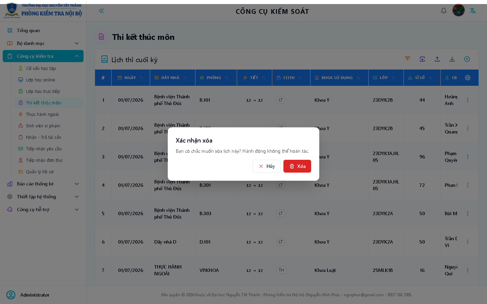

#### 📋 Hướng dẫn thao tác xóa dữ liệu an toàn:
- Xóa ca thi khi môn thi đó có quyết định dời ngày thi của Phòng Khảo thí.
- **Nút Xác nhận Xóa (Màu đỏ):** Nhấp để xóa vĩnh viễn bản ghi khỏi hệ thống.
- **Nút Hủy bỏ (Màu xám):** Đóng hộp thoại và giữ nguyên dữ liệu.

---
## 5.8. Giám sát Thực hành Ngoài trường (External Practice)
- **Đường dẫn truy cập:** `/monitoring/external-practice`
- **Đối tượng sử dụng chính:** Thanh tra viên kiểm tra thực tập ngoài
- **Mục đích nghiệp vụ:** Giám sát các đoàn sinh viên thực tập, thực hành lâm sàng tại Bệnh viện, Nhà máy, Khách sạn và Công ty đối tác ngoài trường.

---

### Bước 1: Truy cập và Quan sát Màn hình Danh sách Chính
Thanh tra viên đăng nhập hệ thống, chọn menu `Giám sát Thực hành Ngoài trường (External Practice)` trên thanh Sidebar. Màn hình danh sách chính sẽ hiển thị như hình minh chứng bên dưới:

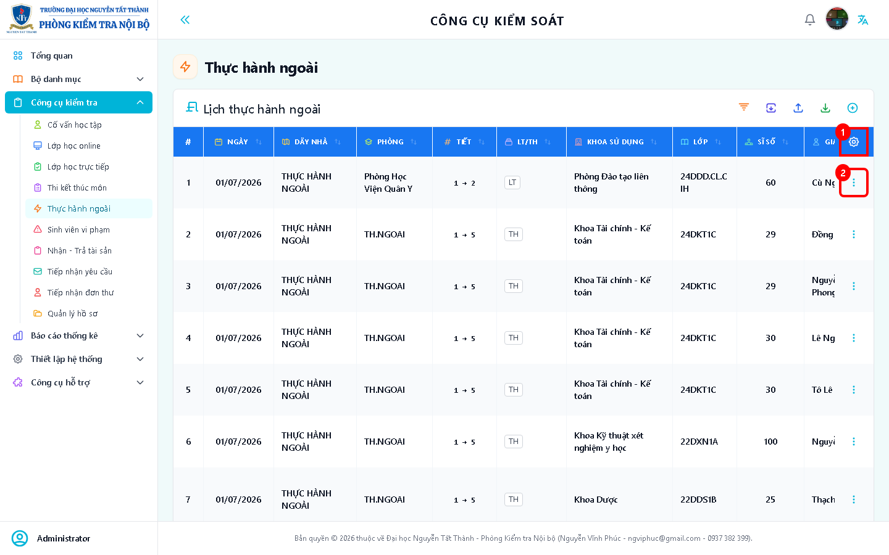

#### 📋 Chú giải các nút tác vụ trên màn hình danh sách (Theo số khoanh đỏ):
- **[1] Nút Thêm mới đoàn thực hành**: Tạo mới lịch trình kiểm tra đoàn thực tập ngoài trường.\n- **[2] Nút Cài đặt hiển thị cột**: Bật/tắt các cột: Đơn vị tiếp nhận, Số lượng SV, Giảng viên phụ trách, Định vị GPS.\n- **[3] Nút Menu hành động dòng**: Cập nhật tình trạng điểm danh, tải ảnh kiểm tra hiện trường tại bệnh viện/nhà máy.\n- **[4] Ô tìm kiếm cơ sở thực tập**: Tìm theo tên Bệnh viện (VD: BV Chợ Rẫy, BV 175...), tên giảng viên hoặc ngành học.\n
---

### Bước 2: Tùy biến Hiển thị Cột Dữ liệu (Ẩn / Hiện Cột)
Nhấp vào nút **Cài đặt hiển thị cột** (biểu tượng con mắt trên thanh tiêu đề bảng) để mở bảng chọn cột:

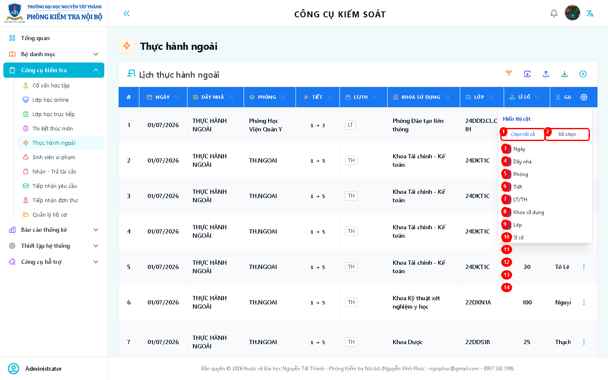

#### 📋 Hướng dẫn thao tác cài đặt cột:
- **Bật cột:** Nhấp chuột vào ô vuông để xuất hiện dấu tick xanh $\rightarrow$ Cột dữ liệu đó sẽ hiển thị trên bảng.
- **Ẩn cột:** Bỏ dấu tick xanh $\rightarrow$ Cột dữ liệu đó sẽ ẩn đi để giao diện gọn gàng hơn.
- **Đơn vị tiếp nhận thực tập**: Tên bệnh viện, doanh nghiệp, cơ sở đối tác.\n- **Khoa & Ngành đào tạo**: Khoa Y, Dược, Điều dưỡng, Kỹ thuật...\n- **Giảng viên hướng dẫn**: Cán bộ giảng viên phụ trách dẫn đoàn.\n- **Quân số thực tế**: Số lượng sinh viên có mặt thực tế tại cơ sở ngoài trường.\n- **Tọa độ GPS kiểm tra**: Vị trí địa lý xác nhận thanh tra viên có mặt tại hiện trường.\n- **Lưu ý:** Cấu hình cột được lưu tự động trên trình duyệt của bạn.\n\n---\n\n### Bước 3: Lọc Dữ liệu Nâng cao theo Nhiều Tiêu chí
Khi cần tìm kiếm các bản ghi thỏa mãn nhiều điều kiện kết hợp, nhấp vào nút **Bộ lọc nâng cao (Chiếc phễu)**:

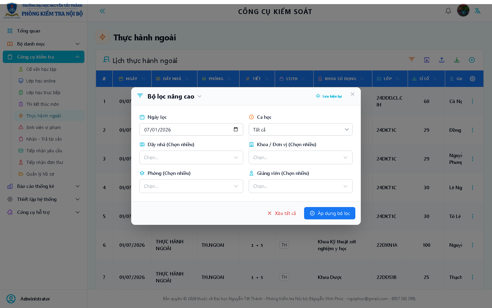

#### 📋 Hướng dẫn thiết lập các tiêu chí lọc:
- **Lọc theo Đơn vị thực tập**: Chọn bệnh viện hoặc công ty đối tác cụ thể.\n- **Lọc theo Khoa / Viện**: Lọc các đoàn thuộc Khoa Y, Khoa Dược, Khoa Du lịch...\n- **Lọc theo Ngày kiểm tra**: Chọn ngày thanh tra viên đi kiểm tra hiện trường.\n- **Thực thi lọc:** Sau khi chọn xong các tiêu chí, nhấp nút màu xanh **Áp dụng** để bảng làm mới số liệu.
- **Xóa bộ lọc:** Nhấp nút **Đặt lại** để hủy tất cả điều kiện lọc và quay về danh sách ban đầu.

---

### Bước 4: Thêm mới Bản ghi Dữ liệu (Form Nhập Liệu)
Trên màn hình chính, nhấp vào nút **Thêm mới (+)** màu nổi bật:

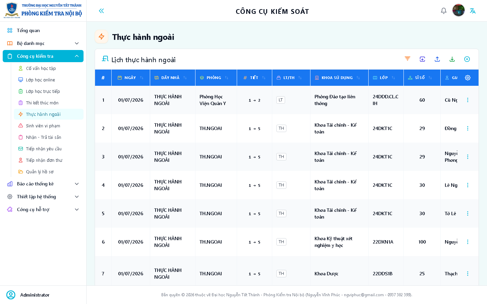

#### 📋 Bảng hướng dẫn chi tiết từng ô nhập liệu trên Form:

| Số hiệu | Tên trường / Ô nhập | Bắt buộc | Kiểu nhập liệu | Ý nghĩa nghiệp vụ & Hướng dẫn nhập |
| :---: | :--- | :---: | :---: | :--- |
| **`1`** | **Tên cơ sở tiếp nhận** | Có (*) | `Text` | Nhập tên bệnh viện hoặc doanh nghiệp đối tác. |\n| **`2`** | **Địa chỉ cơ sở** | Có (*) | `Text` | Địa chỉ thực tế nơi sinh viên đang thực tập. |\n| **`3`** | **Giảng viên phụ trách** | Có (*) | `Select` | Chọn tên giảng viên phụ trách hướng dẫn đoàn. |\n| **`4`** | **Số lượng sinh viên** | Có (*) | `Number` | Nhập quân số sinh viên tham gia thực tập. |\n| **`5`** | **Khoảng thời gian** | Có (*) | `Date Range` | Từ ngày bắt đầu đến ngày kết thúc đợt thực tập. |\n
- **Hoàn tất thêm mới:** Điền đầy đủ các trường bắt buộc (có dấu `*`), nhấp nút **Lưu dữ liệu**.

---

### Bước 5: Chỉnh sửa / Cập nhật Bản ghi Dữ liệu
Khi cần điều chỉnh thông tin, nhấp vào nút **Chỉnh sửa (Hình cây bút)** ở cột Hành động:

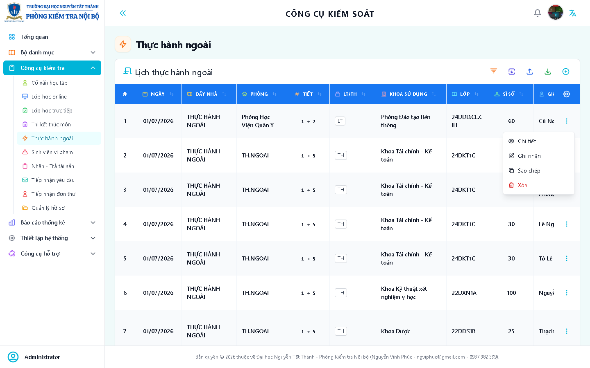

#### 📋 Hướng dẫn thao tác chỉnh sửa:
- Cập nhật số sinh viên có mặt thực tế và các trường hợp vắng thực tập không có lý do.
- Chụp ảnh đoàn sinh viên tại cơ sở đối tác kèm định vị GPS để xác thực việc đi kiểm tra thực tế.
- Nhấp nút **Cập nhật** để lưu lại thông tin mới.

---

### Bước 6: Xóa Bản ghi & Hộp thoại Xác nhận An toàn
Khi một bản ghi bị nhập trùng hoặc hủy bỏ, nhấp vào nút **Xóa (Hình thùng rác)** ở cột Hành động:

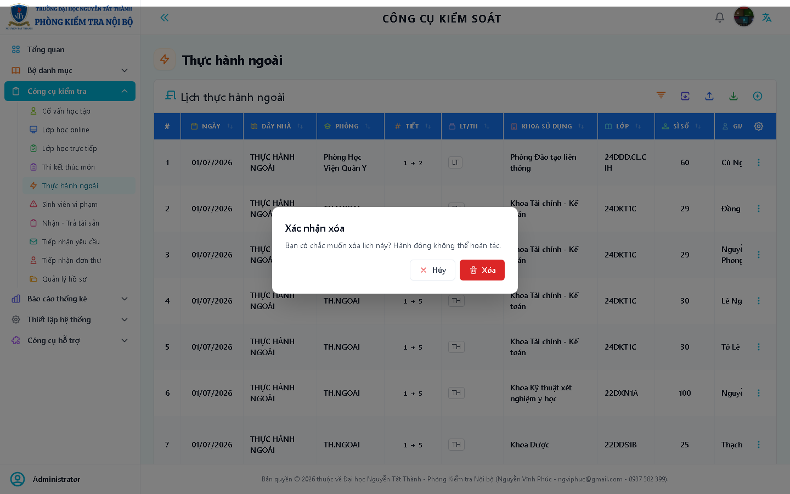

#### 📋 Hướng dẫn thao tác xóa dữ liệu an toàn:
- Chỉ xóa khi đoàn thực tập bị hủy lịch hoặc thay đổi đơn vị tiếp nhận.
- **Nút Xác nhận Xóa (Màu đỏ):** Nhấp để xóa vĩnh viễn bản ghi khỏi hệ thống.
- **Nút Hủy bỏ (Màu xám):** Đóng hộp thoại và giữ nguyên dữ liệu.

---
## 5.9. Quản lý Nhận - Trả tài sản & Báo hỏng CSVC phòng học (Asset Check)
- **Đường dẫn truy cập:** `/monitoring/asset-check`
- **Đối tượng sử dụng chính:** Thanh tra viên trực ca, Cán bộ quản trị thiết bị
- **Mục đích nghiệp vụ:** Quản lý việc mượn - trả thiết bị giảng dạy (Micro, Remote, Dây HDMI) của giảng viên và ghi nhận hư hỏng cơ sở vật chất phòng học.

---

### Bước 1: Truy cập và Quan sát Màn hình Danh sách Chính
Thanh tra viên đăng nhập hệ thống, chọn menu `Quản lý Nhận - Trả tài sản & Báo hỏng CSVC phòng học (Asset Check)` trên thanh Sidebar. Màn hình danh sách chính sẽ hiển thị như hình minh chứng bên dưới:

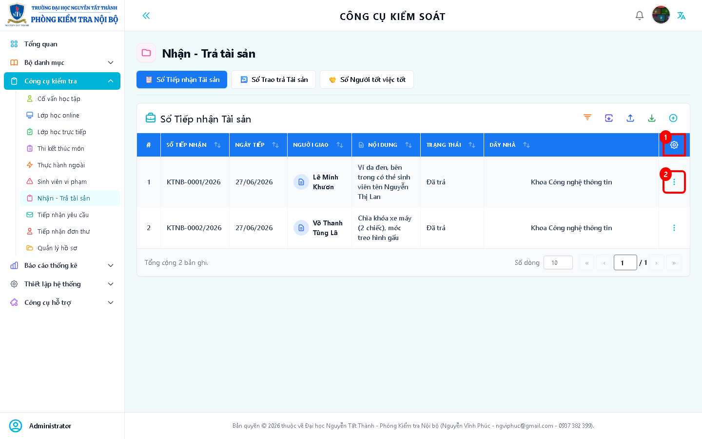

#### 📋 Chú giải các nút tác vụ trên màn hình danh sách (Theo số khoanh đỏ):
- **[1] Nút Cho mượn thiết bị mới**: Bấm khi giảng viên đến mượn Micro, Remote máy chiếu đầu ca dạy.\n- **[2] Nút Cài đặt hiển thị cột**: Bật/tắt các cột: Giảng viên, Thiết bị, Phòng học, Tình trạng mượn/trả.\n- **[3] Nút Menu hành động dòng**: Bấm nút Xác nhận đã trả khi giảng viên mang trả thiết bị sau ca dạy.\n- **[4] Ô tìm kiếm giao dịch**: Tìm nhanh theo tên giảng viên mượn hoặc số phòng học.\n
---

### Bước 2: Tùy biến Hiển thị Cột Dữ liệu (Ẩn / Hiện Cột)
Nhấp vào nút **Cài đặt hiển thị cột** (biểu tượng con mắt trên thanh tiêu đề bảng) để mở bảng chọn cột:

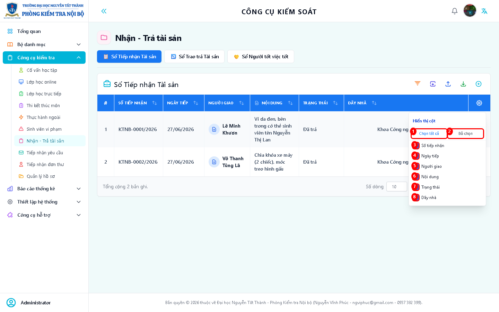

#### 📋 Hướng dẫn thao tác cài đặt cột:
- **Bật cột:** Nhấp chuột vào ô vuông để xuất hiện dấu tick xanh $\rightarrow$ Cột dữ liệu đó sẽ hiển thị trên bảng.
- **Ẩn cột:** Bỏ dấu tick xanh $\rightarrow$ Cột dữ liệu đó sẽ ẩn đi để giao diện gọn gàng hơn.
- **Giảng viên mượn thiết bị**: Họ tên giảng viên sử dụng thiết bị.\n- **Loại thiết bị mượn**: Micro không dây, Remote điều khiển máy chiếu, Cáp chuyển đổi...\n- **Phòng học sử dụng**: Mã phòng học giảng viên đang dạy (VD: A.205).\n- **Thời gian mượn - trả**: Giờ nhận thiết bị và giờ trả thiết bị.\n- **Trạng thái**: Đang mượn / Đã hoàn trả / Hư hỏng báo sửa chữa.\n- **Lưu ý:** Cấu hình cột được lưu tự động trên trình duyệt của bạn.\n\n---\n\n### Bước 3: Lọc Dữ liệu Nâng cao theo Nhiều Tiêu chí
Khi cần tìm kiếm các bản ghi thỏa mãn nhiều điều kiện kết hợp, nhấp vào nút **Bộ lọc nâng cao (Chiếc phễu)**:

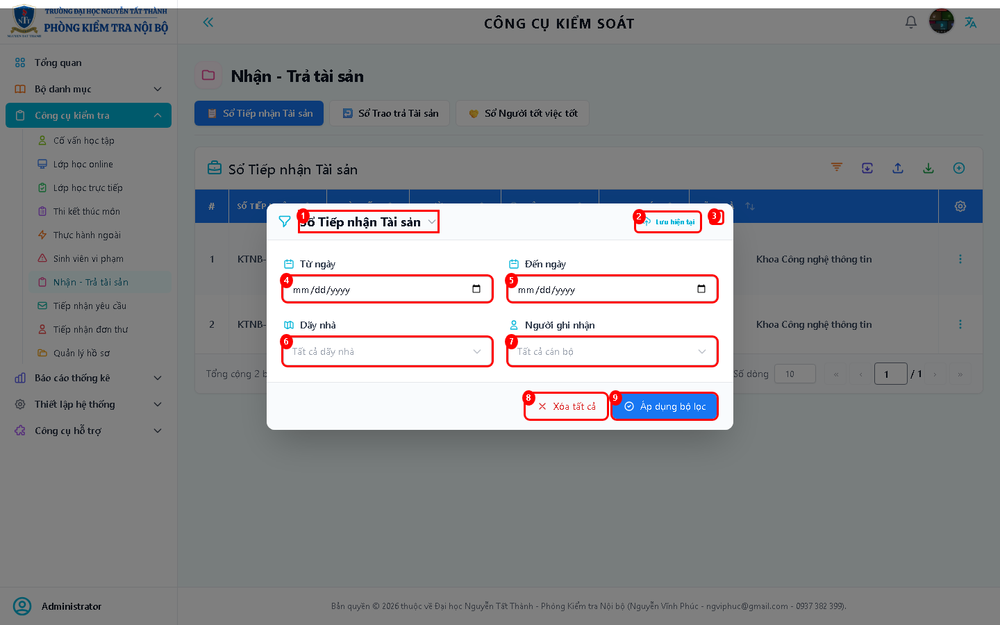

#### 📋 Hướng dẫn thiết lập các tiêu chí lọc:
- **Lọc theo Trạng thái mượn**: Lọc các thiết bị đang được mượn chưa trả để nhắc nhở cuối ca.\n- **Lọc theo Cơ sở & Dãy nhà**: Lọc theo khu vực mượn thiết bị.\n- **Lọc theo Loại thiết bị**: Lọc riêng Micro, Remote hoặc Báo hỏng thiết bị phòng học.\n- **Thực thi lọc:** Sau khi chọn xong các tiêu chí, nhấp nút màu xanh **Áp dụng** để bảng làm mới số liệu.
- **Xóa bộ lọc:** Nhấp nút **Đặt lại** để hủy tất cả điều kiện lọc và quay về danh sách ban đầu.

---

### Bước 4: Thêm mới Bản ghi Dữ liệu (Form Nhập Liệu)
Trên màn hình chính, nhấp vào nút **Thêm mới (+)** màu nổi bật:

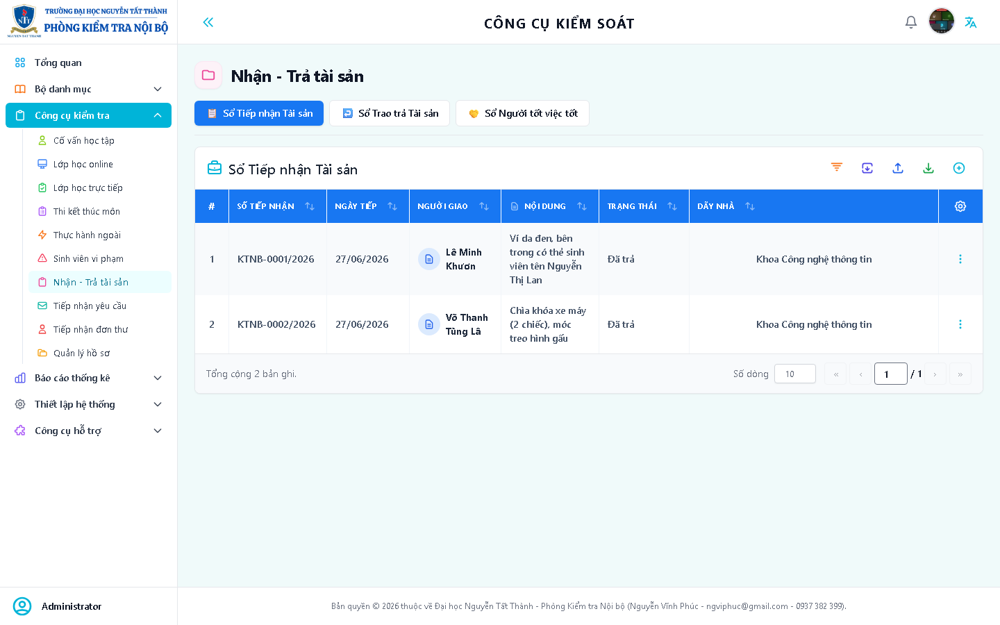

#### 📋 Bảng hướng dẫn chi tiết từng ô nhập liệu trên Form:

| Số hiệu | Tên trường / Ô nhập | Bắt buộc | Kiểu nhập liệu | Ý nghĩa nghiệp vụ & Hướng dẫn nhập |
| :---: | :--- | :---: | :---: | :--- |
| **`1`** | **Tên giảng viên** | Có (*) | `Select` | Chọn giảng viên đến mượn thiết bị từ danh mục. |\n| **`2`** | **Phòng học giảng dạy** | Có (*) | `Select` | Chọn phòng học giảng viên sẽ sử dụng thiết bị. |\n| **`3`** | **Thiết bị bàn giao** | Có (*) | `Select` | Chọn Micro, Remote máy chiếu hoặc Thiết bị khác. |\n| **`4`** | **Tình trạng khi bàn giao** | Có (*) | `Select` | Chọn Tốt, Bình thường hoặc Có lỗi nhẹ. |\n| **`5`** | **Ghi chú thêm** | Không | `Text` | Ghi chú mã số serial của micro hoặc phụ kiện đi kèm. |\n
- **Hoàn tất thêm mới:** Điền đầy đủ các trường bắt buộc (có dấu `*`), nhấp nút **Lưu dữ liệu**.

---

### Bước 5: Chỉnh sửa / Cập nhật Bản ghi Dữ liệu
Khi cần điều chỉnh thông tin, nhấp vào nút **Chỉnh sửa (Hình cây bút)** ở cột Hành động:

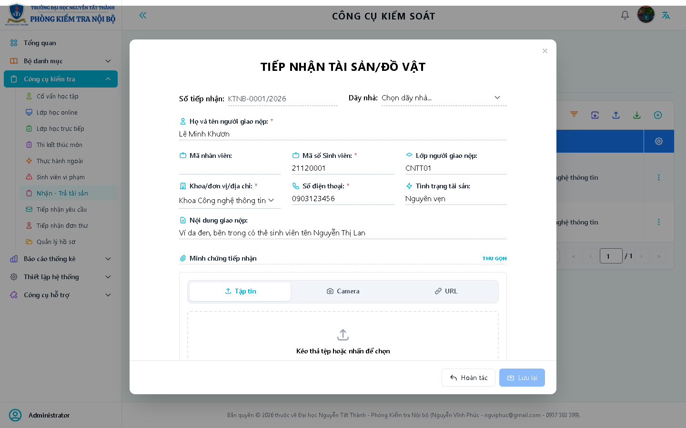

#### 📋 Hướng dẫn thao tác chỉnh sửa:
- Khi giảng viên mang trả thiết bị: Mở giao dịch mượn $
ightarrow$ Kiểm tra thiết bị hoạt động tốt $
ightarrow$ Đổi trạng thái sang *Đã hoàn trả*.
- Nếu phát hiện thiết bị hư hỏng: Tích chọn *Báo hỏng* kèm mô tả lỗi để chuyển sang kỹ thuật sửa chữa.
- Nhấp nút **Cập nhật** để lưu lại thông tin mới.

---

### Bước 6: Xóa Bản ghi & Hộp thoại Xác nhận An toàn
Khi một bản ghi bị nhập trùng hoặc hủy bỏ, nhấp vào nút **Xóa (Hình thùng rác)** ở cột Hành động:

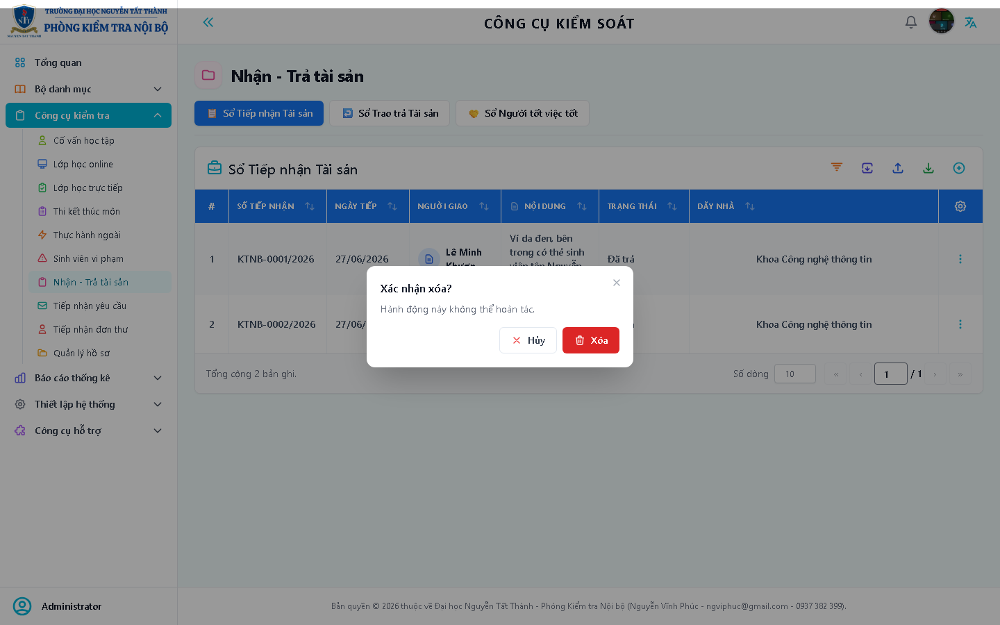

#### 📋 Hướng dẫn thao tác xóa dữ liệu an toàn:
- Chỉ xóa các giao dịch ghi nhầm phòng hoặc trùng lặp do thao tác bấm hai lần.
- **Nút Xác nhận Xóa (Màu đỏ):** Nhấp để xóa vĩnh viễn bản ghi khỏi hệ thống.
- **Nút Hủy bỏ (Màu xám):** Đóng hộp thoại và giữ nguyên dữ liệu.

---
## 5.10. Tiếp nhận & Xử lý Yêu cầu kiểm tra đột xuất (Requests)
- **Đường dẫn truy cập:** `/monitoring/requests`
- **Đối tượng sử dụng chính:** Lãnh đạo phòng KTNB, Chuyên viên xử lý yêu cầu
- **Mục đích nghiệp vụ:** Tiếp nhận và quản lý tiến độ xử lý các chỉ đạo kiểm tra đột xuất từ Ban Giám hiệu hoặc yêu cầu từ các Khoa/Phòng.

---

### Bước 1: Truy cập và Quan sát Màn hình Danh sách Chính
Thanh tra viên đăng nhập hệ thống, chọn menu `Tiếp nhận & Xử lý Yêu cầu kiểm tra đột xuất (Requests)` trên thanh Sidebar. Màn hình danh sách chính sẽ hiển thị như hình minh chứng bên dưới:

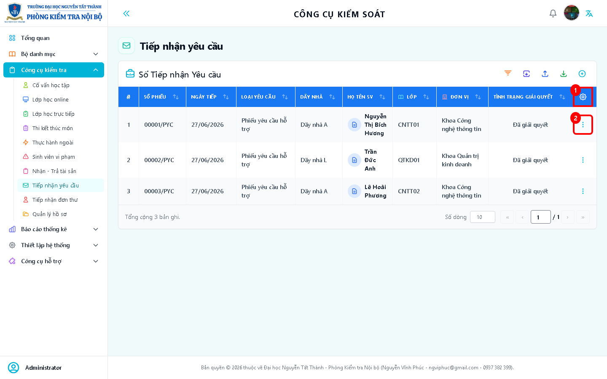

#### 📋 Chú giải các nút tác vụ trên màn hình danh sách (Theo số khoanh đỏ):
- **[1] Nút + Tạo yêu cầu mới**: Bấm để nhập mới một yêu cầu kiểm tra chuyên đề hoặc đột xuất.\n- **[2] Nút Cài đặt hiển thị cột**: Bật/tắt các cột: Đơn vị yêu cầu, Nội dung, Mức độ ưu tiên, Tiến độ xử lý.\n- **[3] Nút Menu hành động dòng**: Bấm để phân công cán bộ thực hiện hoặc cập nhật kết quả xử lý.\n- **[4] Ô tìm kiếm yêu cầu**: Tìm theo mã yêu cầu, người yêu cầu hoặc từ khóa nội dung.\n
---

### Bước 2: Tùy biến Hiển thị Cột Dữ liệu (Ẩn / Hiện Cột)
Nhấp vào nút **Cài đặt hiển thị cột** (biểu tượng con mắt trên thanh tiêu đề bảng) để mở bảng chọn cột:

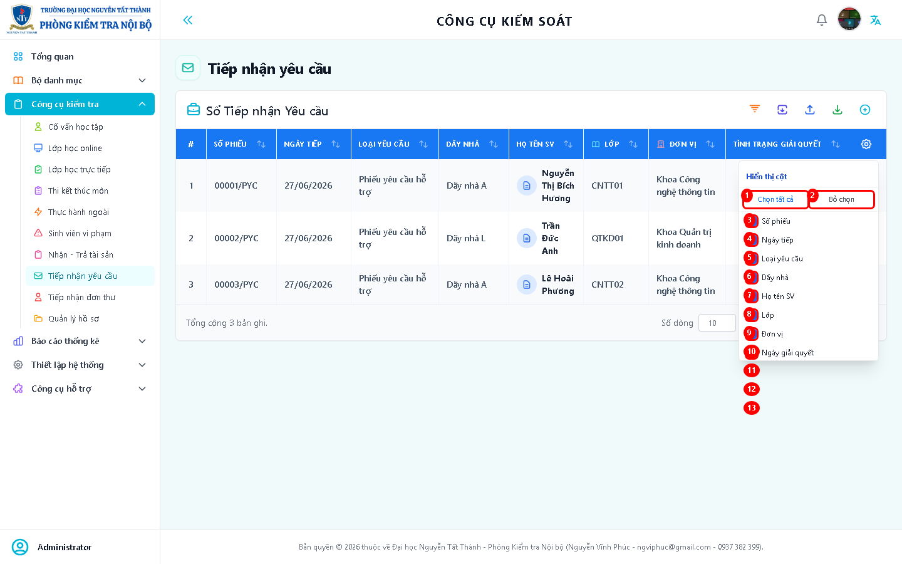

#### 📋 Hướng dẫn thao tác cài đặt cột:
- **Bật cột:** Nhấp chuột vào ô vuông để xuất hiện dấu tick xanh $\rightarrow$ Cột dữ liệu đó sẽ hiển thị trên bảng.
- **Ẩn cột:** Bỏ dấu tick xanh $\rightarrow$ Cột dữ liệu đó sẽ ẩn đi để giao diện gọn gàng hơn.
- **Đơn vị / Người yêu cầu**: Ban Giám hiệu, Phòng Đào tạo, Khoa CNTT...\n- **Nội dung yêu cầu**: Trích yếu nhiệm vụ kiểm tra đột xuất.\n- **Mức độ ưu tiên**: Khẩn cấp / Cao / Bình thường.\n- **Cán bộ thụ lý**: Tên thanh tra viên được phân công thực hiện.\n- **Trạng thái tiến độ**: Chờ tiếp nhận / Đang xử lý / Đã có kết luận.\n- **Lưu ý:** Cấu hình cột được lưu tự động trên trình duyệt của bạn.\n\n---\n\n### Bước 3: Lọc Dữ liệu Nâng cao theo Nhiều Tiêu chí
Khi cần tìm kiếm các bản ghi thỏa mãn nhiều điều kiện kết hợp, nhấp vào nút **Bộ lọc nâng cao (Chiếc phễu)**:

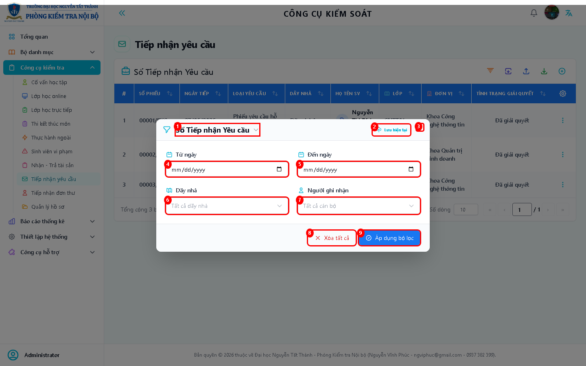

#### 📋 Hướng dẫn thiết lập các tiêu chí lọc:
- **Lọc theo Mức độ ưu tiên**: Lọc các yêu cầu Khẩn cấp cần giải quyết ngay trong ngày.\n- **Lọc theo Trạng thái**: Lọc các yêu cầu Đang xử lý hoặc Chờ tiếp nhận.\n- **Lọc theo Đơn vị gửi**: Lọc các yêu cầu xuất phát từ Ban Giám hiệu.\n- **Thực thi lọc:** Sau khi chọn xong các tiêu chí, nhấp nút màu xanh **Áp dụng** để bảng làm mới số liệu.
- **Xóa bộ lọc:** Nhấp nút **Đặt lại** để hủy tất cả điều kiện lọc và quay về danh sách ban đầu.

---

### Bước 4: Thêm mới Bản ghi Dữ liệu (Form Nhập Liệu)
Trên màn hình chính, nhấp vào nút **Thêm mới (+)** màu nổi bật:

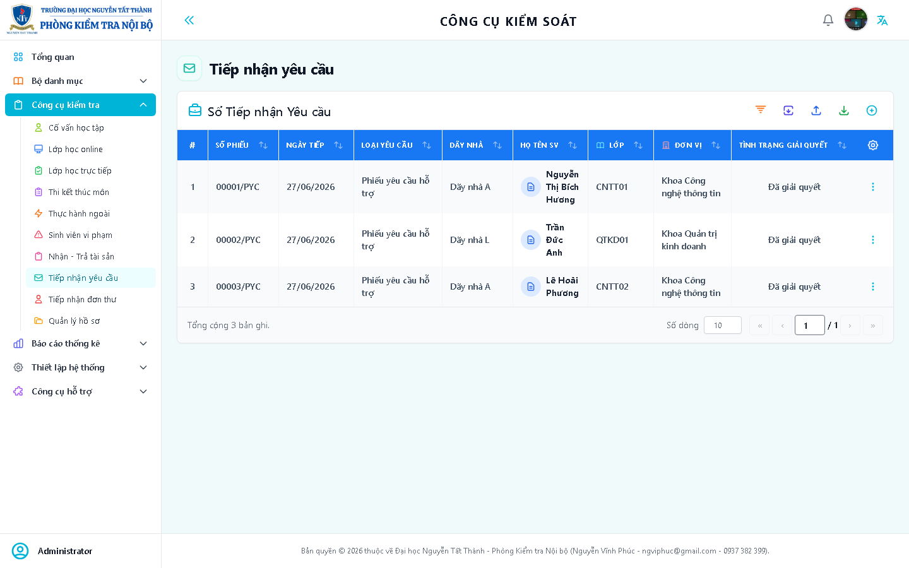

#### 📋 Bảng hướng dẫn chi tiết từng ô nhập liệu trên Form:

| Số hiệu | Tên trường / Ô nhập | Bắt buộc | Kiểu nhập liệu | Ý nghĩa nghiệp vụ & Hướng dẫn nhập |
| :---: | :--- | :---: | :---: | :--- |
| **`1`** | **Đơn vị / Người yêu cầu** | Có (*) | `Text` | Nhập tên đơn vị hoặc lãnh đạo ban hành chỉ đạo. |\n| **`2`** | **Nội dung kiểm tra** | Có (*) | `Textarea` | Mô tả chi tiết nội dung cần thanh tra, kiểm tra đột xuất. |\n| **`3`** | **Thời hạn hoàn thành** | Có (*) | `Date Picker` | Hạn chót phải có báo cáo kết quả kiểm tra. |\n| **`4`** | **Mức độ ưu tiên** | Có (*) | `Select` | Chọn Khẩn cấp, Cao hoặc Bình thường. |\n| **`5`** | **Phân công cán bộ** | Không | `Select` | Chọn chuyên viên phụ trách thực hiện nhiệm vụ. |\n
- **Hoàn tất thêm mới:** Điền đầy đủ các trường bắt buộc (có dấu `*`), nhấp nút **Lưu dữ liệu**.

---

### Bước 5: Chỉnh sửa / Cập nhật Bản ghi Dữ liệu
Khi cần điều chỉnh thông tin, nhấp vào nút **Chỉnh sửa (Hình cây bút)** ở cột Hành động:

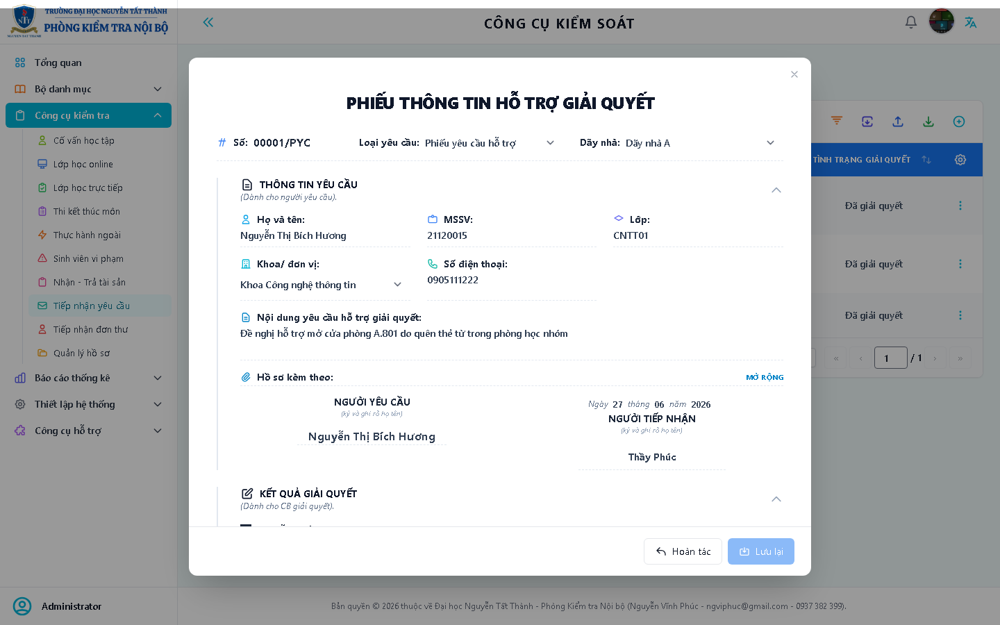

#### 📋 Hướng dẫn thao tác chỉnh sửa:
- Cập nhật tiến độ điều tra, kết quả đối soát hiện trường và đính kèm báo cáo kết luận thanh tra.
- Nhấp nút **Cập nhật** để lưu lại thông tin mới.

---

### Bước 6: Xóa Bản ghi & Hộp thoại Xác nhận An toàn
Khi một bản ghi bị nhập trùng hoặc hủy bỏ, nhấp vào nút **Xóa (Hình thùng rác)** ở cột Hành động:

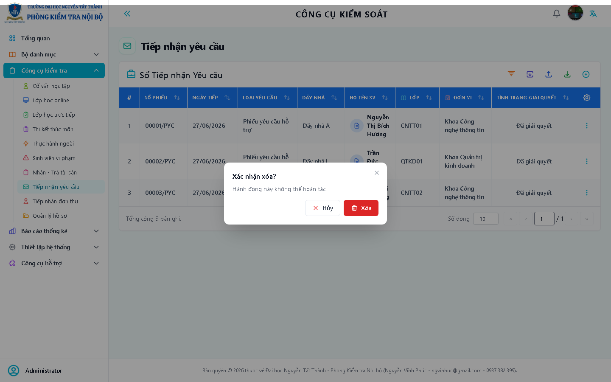

#### 📋 Hướng dẫn thao tác xóa dữ liệu an toàn:
- Chỉ xóa các yêu cầu thử nghiệm hoặc yêu cầu đã bị hủy bằng văn bản chính thức.
- **Nút Xác nhận Xóa (Màu đỏ):** Nhấp để xóa vĩnh viễn bản ghi khỏi hệ thống.
- **Nút Hủy bỏ (Màu xám):** Đóng hộp thoại và giữ nguyên dữ liệu.

---
## 5.11. Tiếp nhận & Xử lý Đơn thư Khiếu nại (Petitions)
- **Đường dẫn truy cập:** `/monitoring/petitions`
- **Đối tượng sử dụng chính:** Lãnh đạo phòng KTNB, Cán bộ pháp chế thanh tra
- **Mục đích nghiệp vụ:** Tiếp nhận, thụ lý và theo dõi tiến độ giải quyết các đơn phản ánh, khiếu nại của sinh viên, giảng viên theo đúng luật định.

---

### Bước 1: Truy cập và Quan sát Màn hình Danh sách Chính
Thanh tra viên đăng nhập hệ thống, chọn menu `Tiếp nhận & Xử lý Đơn thư Khiếu nại (Petitions)` trên thanh Sidebar. Màn hình danh sách chính sẽ hiển thị như hình minh chứng bên dưới:

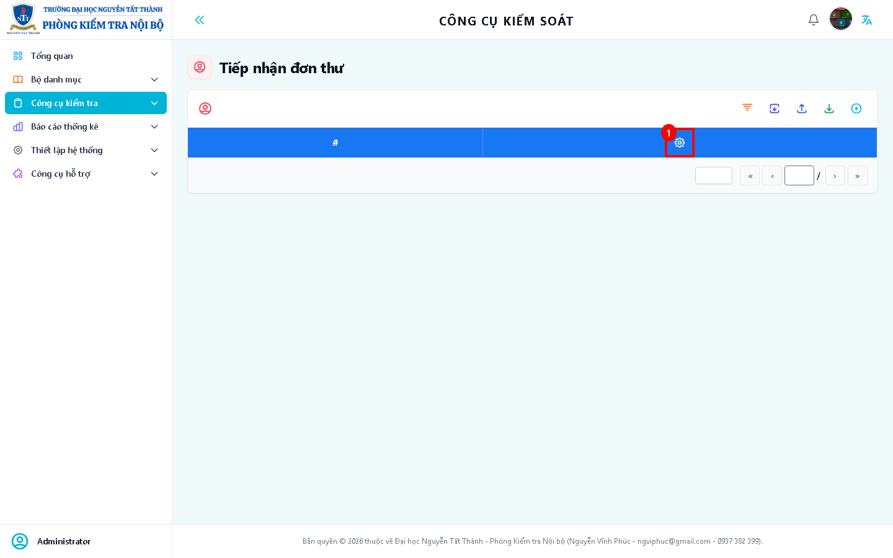

#### 📋 Chú giải các nút tác vụ trên màn hình danh sách (Theo số khoanh đỏ):
- **[1] Nút + Tiếp nhận đơn thư mới**: Bấm để vào sổ thụ lý một đơn thư khiếu nại mới.\n- **[2] Nút Cài đặt hiển thị cột**: Bật/tắt các cột: Số hiệu đơn, Người làm đơn, Nội dung phản ánh, Hạn giải quyết.\n- **[3] Nút Menu hành động dòng**: Xem chi tiết hồ sơ, cập nhật kết quả xác minh hoặc xuất phiếu trả lời.\n- **[4] Ô tìm kiếm đơn thư**: Tìm theo số hiệu công văn, tên người làm đơn hoặc MSSV.\n
---

### Bước 2: Tùy biến Hiển thị Cột Dữ liệu (Ẩn / Hiện Cột)
Nhấp vào nút **Cài đặt hiển thị cột** (biểu tượng con mắt trên thanh tiêu đề bảng) để mở bảng chọn cột:

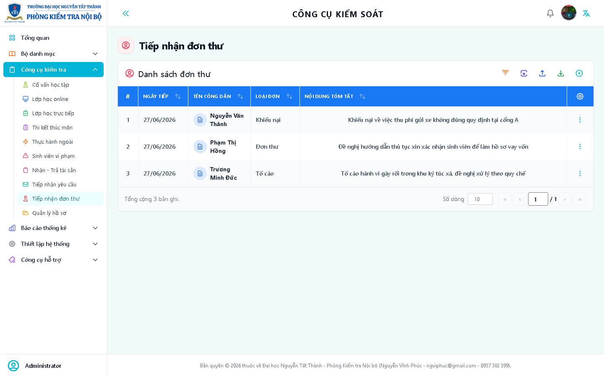

#### 📋 Hướng dẫn thao tác cài đặt cột:
- **Bật cột:** Nhấp chuột vào ô vuông để xuất hiện dấu tick xanh $\rightarrow$ Cột dữ liệu đó sẽ hiển thị trên bảng.
- **Ẩn cột:** Bỏ dấu tick xanh $\rightarrow$ Cột dữ liệu đó sẽ ẩn đi để giao diện gọn gàng hơn.
- **Số hiệu đơn thư**: Mã số vào sổ công văn đến (VD: ĐT-2026-045).\n- **Người làm đơn**: Họ tên sinh viên, phụ huynh hoặc giảng viên.\n- **Nội dung trích yếu**: Tóm tắt nội dung khiếu nại về điểm thi, quy chế...\n- **Hạn chót giải quyết**: Thời hạn luật định phải có văn bản trả lời.\n- **Tình trạng xử lý**: Đang thụ lý / Đã có kết luận giải quyết.\n- **Lưu ý:** Cấu hình cột được lưu tự động trên trình duyệt của bạn.\n\n---\n\n### Bước 3: Lọc Dữ liệu Nâng cao theo Nhiều Tiêu chí
Khi cần tìm kiếm các bản ghi thỏa mãn nhiều điều kiện kết hợp, nhấp vào nút **Bộ lọc nâng cao (Chiếc phễu)**:

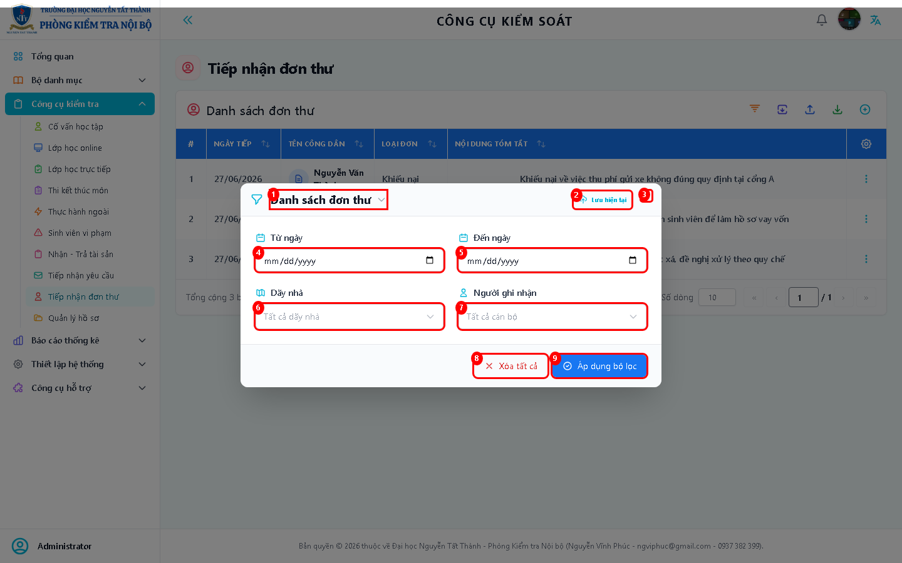

#### 📋 Hướng dẫn thiết lập các tiêu chí lọc:
- **Lọc theo Tình trạng**: Lọc các đơn thư đang chờ xử lý hoặc sắp đến hạn.\n- **Lọc theo Loại khiếu nại**: Khiếu nại điểm thi, Khiếu nại kỷ luật, Phản ánh nề nếp...\n- **Lọc theo Năm / Quý**: Thống kê đơn thư theo từng giai đoạn.\n- **Thực thi lọc:** Sau khi chọn xong các tiêu chí, nhấp nút màu xanh **Áp dụng** để bảng làm mới số liệu.
- **Xóa bộ lọc:** Nhấp nút **Đặt lại** để hủy tất cả điều kiện lọc và quay về danh sách ban đầu.

---

### Bước 4: Thêm mới Bản ghi Dữ liệu (Form Nhập Liệu)
Trên màn hình chính, nhấp vào nút **Thêm mới (+)** màu nổi bật:

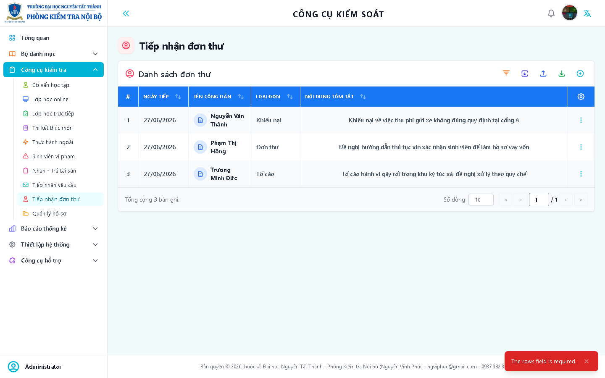

#### 📋 Bảng hướng dẫn chi tiết từng ô nhập liệu trên Form:

| Số hiệu | Tên trường / Ô nhập | Bắt buộc | Kiểu nhập liệu | Ý nghĩa nghiệp vụ & Hướng dẫn nhập |
| :---: | :--- | :---: | :---: | :--- |
| **`1`** | **Số hiệu đơn thư** | Có (*) | `Text` | Nhập số vào sổ theo dõi của văn thư phòng. |\n| **`2`** | **Họ tên người làm đơn** | Có (*) | `Text` | Họ tên người gửi đơn phản ánh. |\n| **`3`** | **Số điện thoại / Email** | Có (*) | `Text` | Thông tin liên hệ để gửi thông báo kết quả. |\n| **`4`** | **Nội dung tóm tắt** | Có (*) | `Textarea` | Ghi ngắn gọn bản chất vấn đề cần xác minh. |\n| **`5`** | **Hồ sơ đính kèm** | Không | `File Upload` | Tải lên file scan đơn thư có chữ ký của người làm đơn. |\n
- **Hoàn tất thêm mới:** Điền đầy đủ các trường bắt buộc (có dấu `*`), nhấp nút **Lưu dữ liệu**.

---

### Bước 5: Chỉnh sửa / Cập nhật Bản ghi Dữ liệu
Khi cần điều chỉnh thông tin, nhấp vào nút **Chỉnh sửa (Hình cây bút)** ở cột Hành động:

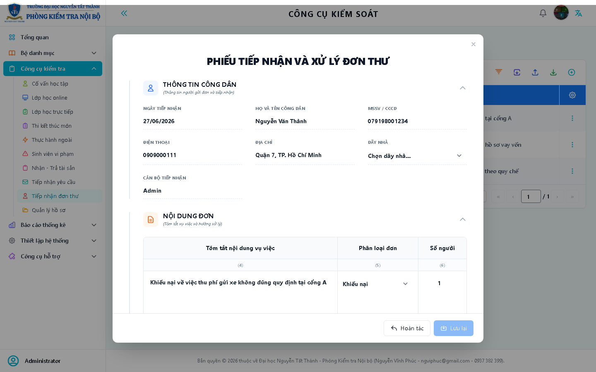

#### 📋 Hướng dẫn thao tác chỉnh sửa:
- Cập nhật các biên bản làm việc với người khiếu nại, các chứng cứ xác minh và kết luận cuối cùng.
- Nhấp nút **Cập nhật** để lưu lại thông tin mới.

---

### Bước 6: Xóa Bản ghi & Hộp thoại Xác nhận An toàn
Khi một bản ghi bị nhập trùng hoặc hủy bỏ, nhấp vào nút **Xóa (Hình thùng rác)** ở cột Hành động:

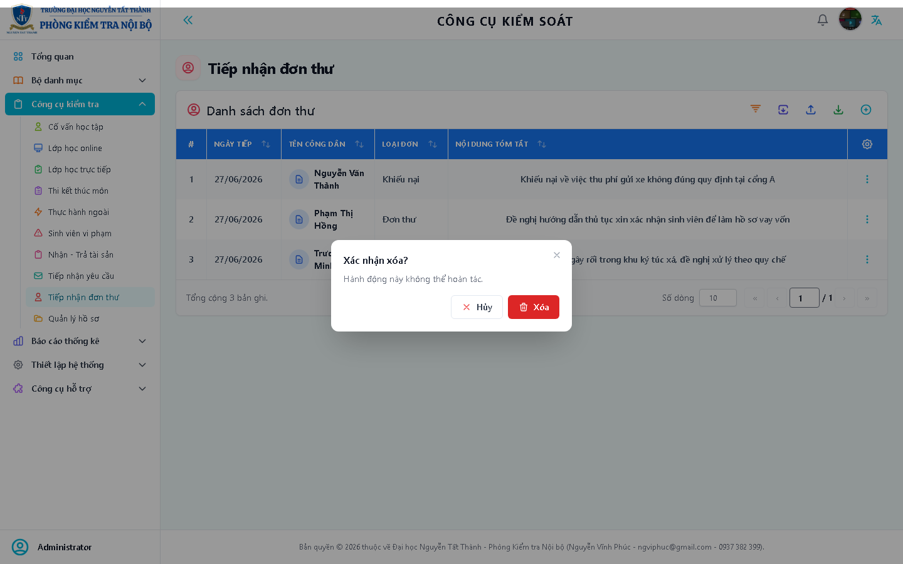

#### 📋 Hướng dẫn thao tác xóa dữ liệu an toàn:
- Đơn thư là tài liệu lưu trữ có tính pháp lý cao, chỉ xóa khi có quyết định bằng văn bản của Lãnh đạo.
- **Nút Xác nhận Xóa (Màu đỏ):** Nhấp để xóa vĩnh viễn bản ghi khỏi hệ thống.
- **Nút Hủy bỏ (Màu xám):** Đóng hộp thoại và giữ nguyên dữ liệu.

---
## 5.12. Quản lý Hồ sơ & Minh chứng kiểm tra lưu trữ (Document Records)
- **Đường dẫn truy cập:** `/monitoring/document-records`
- **Đối tượng sử dụng chính:** Cán bộ lưu trữ, Thư ký phòng KTNB
- **Mục đích nghiệp vụ:** Lưu trữ số hóa các văn bản, kết luận thanh tra, biên bản kiểm tra chuyên đề phục vụ kiểm định chất lượng giáo dục.

---

### Bước 1: Truy cập và Quan sát Màn hình Danh sách Chính
Thanh tra viên đăng nhập hệ thống, chọn menu `Quản lý Hồ sơ & Minh chứng kiểm tra lưu trữ (Document Records)` trên thanh Sidebar. Màn hình danh sách chính sẽ hiển thị như hình minh chứng bên dưới:

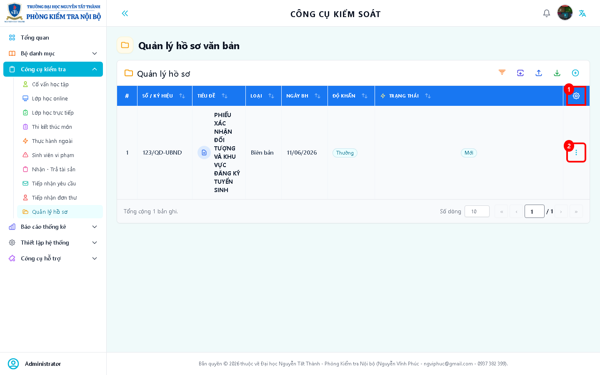

#### 📋 Chú giải các nút tác vụ trên màn hình danh sách (Theo số khoanh đỏ):
- **[1] Nút + Tải lên hồ sơ mới**: Bấm để nạp văn bản tài liệu mới vào kho lưu trữ số.\n- **[2] Nút Cài đặt hiển thị cột**: Bật/tắt các cột: Số hiệu, Tên văn bản, Loại tài liệu, Ngày ban hành, File tải về.\n- **[3] Nút Menu hành động dòng**: Bấm để tải file đính kèm (PDF/Word), xem chi tiết hoặc sửa thông tin trích yếu.\n- **[4] Ô tìm kiếm văn bản**: Tìm theo số hiệu văn bản, trích yếu hoặc cơ quan ban hành.\n
---

### Bước 2: Tùy biến Hiển thị Cột Dữ liệu (Ẩn / Hiện Cột)
Nhấp vào nút **Cài đặt hiển thị cột** (biểu tượng con mắt trên thanh tiêu đề bảng) để mở bảng chọn cột:

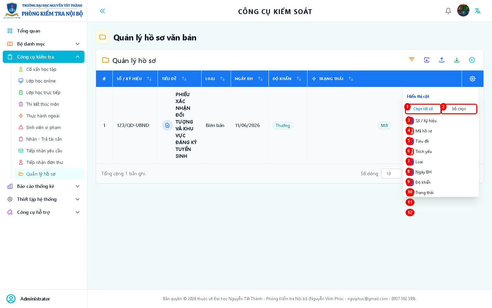

#### 📋 Hướng dẫn thao tác cài đặt cột:
- **Bật cột:** Nhấp chuột vào ô vuông để xuất hiện dấu tick xanh $\rightarrow$ Cột dữ liệu đó sẽ hiển thị trên bảng.
- **Ẩn cột:** Bỏ dấu tick xanh $\rightarrow$ Cột dữ liệu đó sẽ ẩn đi để giao diện gọn gàng hơn.
- **Số hiệu văn bản**: Số công văn, quyết định (VD: 125/QĐ-ĐHNTT).\n- **Trích yếu nội dung**: Tóm tắt nội dung văn bản chỉ đạo hoặc kết luận thanh tra.\n- **Loại văn bản**: Biên bản, Quyết định, Tờ trình, Báo cáo...\n- **Ngày ban hành**: Ngày ký duyệt văn bản.\n- **Tệp đính kèm**: File scan PDF hoặc file Word để tải về.\n- **Lưu ý:** Cấu hình cột được lưu tự động trên trình duyệt của bạn.\n\n---\n\n### Bước 3: Lọc Dữ liệu Nâng cao theo Nhiều Tiêu chí
Khi cần tìm kiếm các bản ghi thỏa mãn nhiều điều kiện kết hợp, nhấp vào nút **Bộ lọc nâng cao (Chiếc phễu)**:

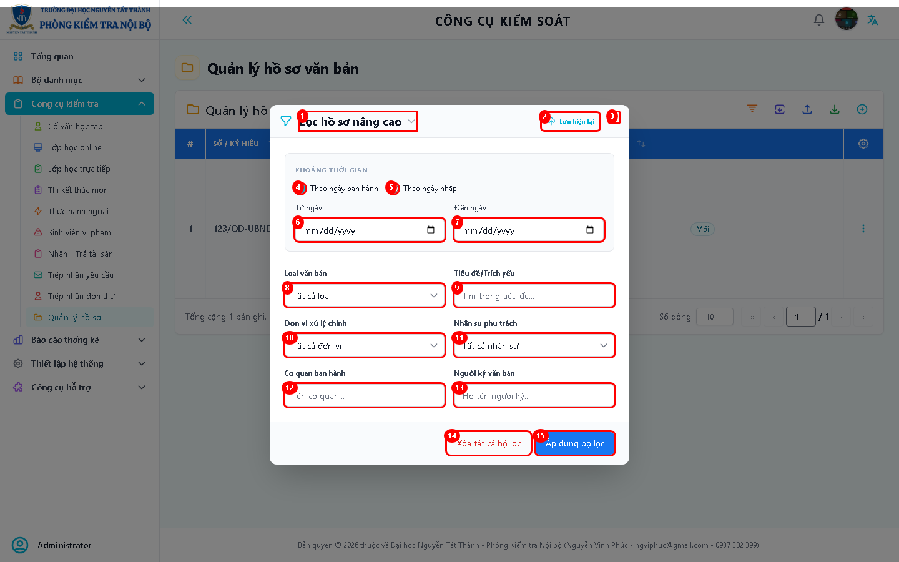

#### 📋 Hướng dẫn thiết lập các tiêu chí lọc:
- **Lọc theo Loại văn bản**: Lọc Biên bản, Quyết định kỷ luật hoặc Kế hoạch thanh tra.\n- **Lọc theo Năm ban hành**: Lọc các hồ sơ tài liệu của năm 2025, 2026...\n- **Lọc theo Đơn vị ban hành**: Ban Giám hiệu, Phòng KTNB, Hội đồng Kỷ luật...\n- **Thực thi lọc:** Sau khi chọn xong các tiêu chí, nhấp nút màu xanh **Áp dụng** để bảng làm mới số liệu.
- **Xóa bộ lọc:** Nhấp nút **Đặt lại** để hủy tất cả điều kiện lọc và quay về danh sách ban đầu.

---

### Bước 4: Thêm mới Bản ghi Dữ liệu (Form Nhập Liệu)
Trên màn hình chính, nhấp vào nút **Thêm mới (+)** màu nổi bật:

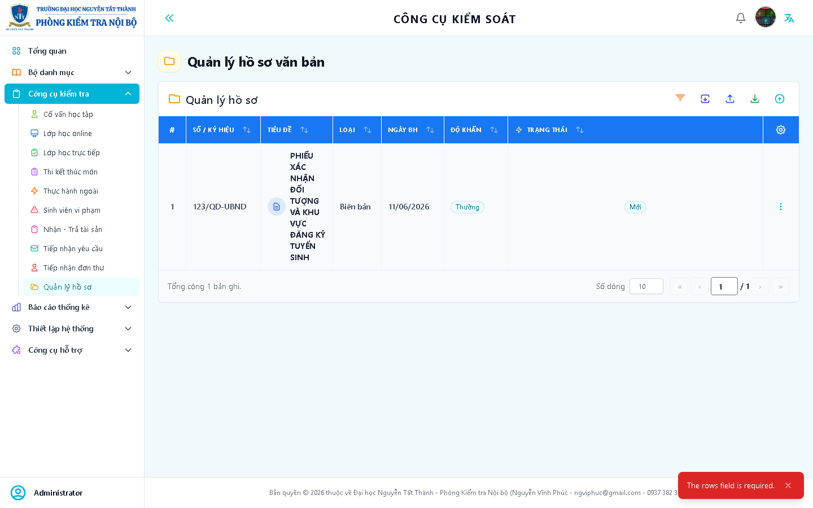

#### 📋 Bảng hướng dẫn chi tiết từng ô nhập liệu trên Form:

| Số hiệu | Tên trường / Ô nhập | Bắt buộc | Kiểu nhập liệu | Ý nghĩa nghiệp vụ & Hướng dẫn nhập |
| :---: | :--- | :---: | :---: | :--- |
| **`1`** | **Số hiệu văn bản** | Có (*) | `Text` | Nhập số hiệu chính thức in trên đầu văn bản. |\n| **`2`** | **Trích yếu văn bản** | Có (*) | `Text` | Nhập tóm tắt nội dung văn bản. |\n| **`3`** | **Loại văn bản** | Có (*) | `Select` | Chọn Biên bản, Quyết định, Kế hoạch... |\n| **`4`** | **Ngày ký ban hành** | Có (*) | `Date Picker` | Chọn ngày ký duyệt chính thức. |\n| **`5`** | **Tệp văn bản số hóa** | Có (*) | `File (PDF/Word)` | Chọn file từ máy tính để tải lên kho lưu trữ. |\n
- **Hoàn tất thêm mới:** Điền đầy đủ các trường bắt buộc (có dấu `*`), nhấp nút **Lưu dữ liệu**.

---

### Bước 5: Chỉnh sửa / Cập nhật Bản ghi Dữ liệu
Khi cần điều chỉnh thông tin, nhấp vào nút **Chỉnh sửa (Hình cây bút)** ở cột Hành động:


#### 📋 Hướng dẫn thao tác chỉnh sửa:
- Cho phép đính chính trích yếu hoặc tải lên bản scan có dấu mộc đỏ thay thế bản nháp ban đầu.
- Nhấp nút **Cập nhật** để lưu lại thông tin mới.

---

### Bước 6: Xóa Bản ghi & Hộp thoại Xác nhận An toàn
Khi một bản ghi bị nhập trùng hoặc hủy bỏ, nhấp vào nút **Xóa (Hình thùng rác)** ở cột Hành động:


#### 📋 Hướng dẫn thao tác xóa dữ liệu an toàn:
- Thao tác xóa văn bản cần được cấp quyền quản trị cao nhất để tránh mất mát hồ sơ kiểm định.
- **Nút Xác nhận Xóa (Màu đỏ):** Nhấp để xóa vĩnh viễn bản ghi khỏi hệ thống.
- **Nút Hủy bỏ (Màu xám):** Đóng hộp thoại và giữ nguyên dữ liệu.

---
## 5.19. Quản lý Danh mục Đơn vị / Khoa / Phòng ban (Departments)
- **Đường dẫn truy cập:** `/personnel/departments`
- **Đối tượng sử dụng chính:** Quản trị viên hệ thống, Lãnh đạo phòng KTNB
- **Mục đích nghiệp vụ:** Quản lý danh mục cơ cấu tổ chức gồm các Khoa đào tạo, Phòng ban chức năng, Viện nghiên cứu và Trung tâm trực thuộc NTTU.

---

### Bước 1: Truy cập và Quan sát Màn hình Danh sách Chính
Thanh tra viên đăng nhập hệ thống, chọn menu `Quản lý Danh mục Đơn vị / Khoa / Phòng ban (Departments)` trên thanh Sidebar. Màn hình danh sách chính sẽ hiển thị như hình minh chứng bên dưới:


#### 📋 Chú giải các nút tác vụ trên màn hình danh sách (Theo số khoanh đỏ):
- **[1] Nút + Thêm mới đơn vị**: Bấm để khai báo một Khoa hoặc Phòng ban mới trong trường.\n- **[2] Nút Cài đặt hiển thị cột**: Bật/tắt các cột: Mã đơn vị, Tên đơn vị, Loại đơn vị, Trưởng đơn vị, Email.\n- **[3] Nút Menu hành động dòng**: Bấm để sửa tên đơn vị, cập nhật lãnh đạo khoa hoặc xóa đơn vị.\n- **[4] Ô tìm kiếm đơn vị**: Tìm nhanh theo mã viết tắt (CNTT, DUOC) hoặc tên đầy đủ của khoa.\n
---

### Bước 2: Tùy biến Hiển thị Cột Dữ liệu (Ẩn / Hiện Cột)
Nhấp vào nút **Cài đặt hiển thị cột** (biểu tượng con mắt trên thanh tiêu đề bảng) để mở bảng chọn cột:


#### 📋 Hướng dẫn thao tác cài đặt cột:
- **Bật cột:** Nhấp chuột vào ô vuông để xuất hiện dấu tick xanh $\rightarrow$ Cột dữ liệu đó sẽ hiển thị trên bảng.
- **Ẩn cột:** Bỏ dấu tick xanh $\rightarrow$ Cột dữ liệu đó sẽ ẩn đi để giao diện gọn gàng hơn.
- **Mã đơn vị**: Mã viết tắt chuẩn hóa (VD: CNTT, YHOA, DUOC, TCKT).\n- **Tên đầy đủ đơn vị**: Tên chính thức của Khoa / Phòng / Viện.\n- **Phân loại đơn vị**: Khoa đào tạo / Phòng ban chức năng / Viện nghiên cứu.\n- **Trưởng đơn vị**: Họ tên Thầy/Cô Trưởng khoa hoặc Trưởng phòng.\n- **Email liên hệ**: Địa chỉ email chính thức dùng để nhận thông báo vi phạm.\n- **Lưu ý:** Cấu hình cột được lưu tự động trên trình duyệt của bạn.\n\n---\n\n### Bước 3: Lọc Dữ liệu Nâng cao theo Nhiều Tiêu chí
Khi cần tìm kiếm các bản ghi thỏa mãn nhiều điều kiện kết hợp, nhấp vào nút **Bộ lọc nâng cao (Chiếc phễu)**:


#### 📋 Hướng dẫn thiết lập các tiêu chí lọc:
- **Lọc theo Loại đơn vị**: Lọc riêng các Khoa đào tạo hoặc riêng các Phòng ban.\n- **Lọc theo Trạng thái**: Đang hoạt động / Tạm dừng tiếp nhận sinh viên.\n- **Thực thi lọc:** Sau khi chọn xong các tiêu chí, nhấp nút màu xanh **Áp dụng** để bảng làm mới số liệu.
- **Xóa bộ lọc:** Nhấp nút **Đặt lại** để hủy tất cả điều kiện lọc và quay về danh sách ban đầu.

---

### Bước 4: Thêm mới Bản ghi Dữ liệu (Form Nhập Liệu)
Trên màn hình chính, nhấp vào nút **Thêm mới (+)** màu nổi bật:


#### 📋 Bảng hướng dẫn chi tiết từng ô nhập liệu trên Form:

| Số hiệu | Tên trường / Ô nhập | Bắt buộc | Kiểu nhập liệu | Ý nghĩa nghiệp vụ & Hướng dẫn nhập |
| :---: | :--- | :---: | :---: | :--- |
| **`1`** | **Mã đơn vị** | Có (*) | `Text` | Gõ mã viết tắt duy nhất (không trùng lặp). |\n| **`2`** | **Tên đầy đủ đơn vị** | Có (*) | `Text` | Nhập tên tiếng Việt đầy đủ có dấu. |\n| **`3`** | **Phân loại đơn vị** | Có (*) | `Select` | Chọn Khoa đào tạo, Phòng ban hoặc Viện nghiên cứu. |\n| **`4`** | **Trưởng đơn vị** | Không | `Select` | Chọn nhân sự lãnh đạo phụ trách đơn vị. |\n| **`5`** | **Email & Số điện thoại** | Không | `Text` | Nhập thông tin liên hệ của văn phòng khoa. |\n
- **Hoàn tất thêm mới:** Điền đầy đủ các trường bắt buộc (có dấu `*`), nhấp nút **Lưu dữ liệu**.

---

### Bước 5: Chỉnh sửa / Cập nhật Bản ghi Dữ liệu
Khi cần điều chỉnh thông tin, nhấp vào nút **Chỉnh sửa (Hình cây bút)** ở cột Hành động:


#### 📋 Hướng dẫn thao tác chỉnh sửa:
- Cập nhật lại tên đơn vị khi có quyết định sáp nhập hoặc đổi tên Khoa từ Nhà trường.
- Thay đổi nhân sự Trưởng đơn vị mới khi có quyết định bổ nhiệm.
- Nhấp nút **Cập nhật** để lưu lại thông tin mới.

---

### Bước 6: Xóa Bản ghi & Hộp thoại Xác nhận An toàn
Khi một bản ghi bị nhập trùng hoặc hủy bỏ, nhấp vào nút **Xóa (Hình thùng rác)** ở cột Hành động:


#### 📋 Hướng dẫn thao tác xóa dữ liệu an toàn:
- Chỉ được phép xóa đơn vị khi không còn bất kỳ giảng viên, sinh viên hoặc lớp học nào gắn với đơn vị đó.
- **Nút Xác nhận Xóa (Màu đỏ):** Nhấp để xóa vĩnh viễn bản ghi khỏi hệ thống.
- **Nút Hủy bỏ (Màu xám):** Đóng hộp thoại và giữ nguyên dữ liệu.

---
## 5.25. Quản trị Phân quyền Người dùng & Nhóm quyền (Permissions)
- **Đường dẫn truy cập:** `/settings/permissions`
- **Đối tượng sử dụng chính:** Quản trị viên tối cao (Super Admin)
- **Mục đích nghiệp vụ:** Thiết lập ma trận phân quyền dựa trên vai trò (RBAC) để kiểm soát quyền Xem, Thêm, Sửa, Xóa, Xuất file của từng tài khoản.

---

### Bước 1: Truy cập và Quan sát Màn hình Danh sách Chính
Thanh tra viên đăng nhập hệ thống, chọn menu `Quản trị Phân quyền Người dùng & Nhóm quyền (Permissions)` trên thanh Sidebar. Màn hình danh sách chính sẽ hiển thị như hình minh chứng bên dưới:


#### 📋 Chú giải các nút tác vụ trên màn hình danh sách (Theo số khoanh đỏ):
- **[1] Nút + Thêm phân quyền mới**: Tạo thêm một quyền hạn mới trong hệ thống.\n- **[2] Nút Cài đặt hiển thị cột**: Bật/tắt các cột cấu hình quyền.\n- **[3] Nút Menu hành động dòng**: Bấm để gán quyền cho một vai trò hoặc chỉnh sửa mã quyền.\n- **[4] Ô tìm kiếm quyền**: Tìm nhanh theo mã quyền (ví dụ: `schedules.view`, `violations.create`).\n
---

### Bước 2: Tùy biến Hiển thị Cột Dữ liệu (Ẩn / Hiện Cột)
Nhấp vào nút **Cài đặt hiển thị cột** (biểu tượng con mắt trên thanh tiêu đề bảng) để mở bảng chọn cột:


#### 📋 Hướng dẫn thao tác cài đặt cột:
- **Bật cột:** Nhấp chuột vào ô vuông để xuất hiện dấu tick xanh $\rightarrow$ Cột dữ liệu đó sẽ hiển thị trên bảng.
- **Ẩn cột:** Bỏ dấu tick xanh $\rightarrow$ Cột dữ liệu đó sẽ ẩn đi để giao diện gọn gàng hơn.
- **Tên quyền hạn**: Mã định danh kỹ thuật của quyền.\n- **Nhóm chức năng**: Nhóm Lịch học, Nhóm Vi phạm, Nhóm Báo cáo...\n- **Mô tả quyền**: Diễn giải ý nghĩa nghiệp vụ của quyền hạn bằng tiếng Việt.\n- **Các vai trò được gán**: Danh sách các vai trò đang sở hữu quyền này.\n- **Lưu ý:** Cấu hình cột được lưu tự động trên trình duyệt của bạn.\n\n---\n\n### Bước 3: Lọc Dữ liệu Nâng cao theo Nhiều Tiêu chí
Khi cần tìm kiếm các bản ghi thỏa mãn nhiều điều kiện kết hợp, nhấp vào nút **Bộ lọc nâng cao (Chiếc phễu)**:


#### 📋 Hướng dẫn thiết lập các tiêu chí lọc:
- **Lọc theo Nhóm chức năng**: Lọc các quyền liên quan đến Giám sát, Báo cáo hay Quản trị.\n- **Lọc theo Vai trò sử dụng**: Lọc các quyền đang được cấp cho vai trò Thanh tra viên.\n- **Thực thi lọc:** Sau khi chọn xong các tiêu chí, nhấp nút màu xanh **Áp dụng** để bảng làm mới số liệu.
- **Xóa bộ lọc:** Nhấp nút **Đặt lại** để hủy tất cả điều kiện lọc và quay về danh sách ban đầu.

---

### Bước 4: Thêm mới Bản ghi Dữ liệu (Form Nhập Liệu)
Trên màn hình chính, nhấp vào nút **Thêm mới (+)** màu nổi bật:


#### 📋 Bảng hướng dẫn chi tiết từng ô nhập liệu trên Form:

| Số hiệu | Tên trường / Ô nhập | Bắt buộc | Kiểu nhập liệu | Ý nghĩa nghiệp vụ & Hướng dẫn nhập |
| :---: | :--- | :---: | :---: | :--- |
| **`1`** | **Mã quyền hạn** | Có (*) | `Text` | Nhập mã quyền chuẩn cú pháp (VD: `violations.export`). |\n| **`2`** | **Tên hiển thị quyền** | Có (*) | `Text` | Nhập tên tiếng Việt dễ hiểu (VD: Xuất file vi phạm). |\n| **`3`** | **Nhóm phân hệ** | Có (*) | `Select` | Chọn phân hệ nghiệp vụ chứa quyền hạn. |\n| **`4`** | **Gán cho các vai trò** | Không | `Checkbox Multi` | Tích chọn các vai trò được phép thực thi quyền này. |\n
- **Hoàn tất thêm mới:** Điền đầy đủ các trường bắt buộc (có dấu `*`), nhấp nút **Lưu dữ liệu**.

---

### Bước 5: Chỉnh sửa / Cập nhật Bản ghi Dữ liệu
Khi cần điều chỉnh thông tin, nhấp vào nút **Chỉnh sửa (Hình cây bút)** ở cột Hành động:


#### 📋 Hướng dẫn thao tác chỉnh sửa:
- Điều chỉnh phạm vi quyền hạn khi có thay đổi trong quy trình nghiệp vụ kiểm tra.
- Thêm hoặc bớt quyền của một nhóm vai trò mà không cần chỉnh sửa mã nguồn phần mềm.
- Nhấp nút **Cập nhật** để lưu lại thông tin mới.

---

### Bước 6: Xóa Bản ghi & Hộp thoại Xác nhận An toàn
Khi một bản ghi bị nhập trùng hoặc hủy bỏ, nhấp vào nút **Xóa (Hình thùng rác)** ở cột Hành động:


#### 📋 Hướng dẫn thao tác xóa dữ liệu an toàn:
- Thao tác xóa quyền cần hết sức cẩn trọng vì có thể làm vô hiệu hóa chức năng đối với người dùng đang hoạt động.
- **Nút Xác nhận Xóa (Màu đỏ):** Nhấp để xóa vĩnh viễn bản ghi khỏi hệ thống.
- **Nút Hủy bỏ (Màu xám):** Đóng hộp thoại và giữ nguyên dữ liệu.

---
## 5.14. Báo cáo Cuối ngày & Đồng bộ Google Sheets (Daily Report)
- **Đường dẫn truy cập:** `/reports/daily`
- **Đối tượng sử dụng chính:** Lãnh đạo phòng KTNB, Cán bộ trực tổng hợp
- **Mục đích nghiệp vụ:** Tổng hợp toàn bộ kết quả kiểm tra các ca học trong ngày, các trường hợp bất thường và đồng bộ báo cáo lên Google Sheets của Nhà trường.

---

### Bước 1: Màn hình Số liệu Tổng hợp & Danh sách Báo cáo
Truy cập menu `Báo cáo Cuối ngày & Đồng bộ Google Sheets (Daily Report)` trên thanh Sidebar:


#### 📋 Chú giải các thành phần trên màn hình báo cáo:
- **[1] Các Tab ca học**: Tab Toàn trường, Tab Ca Sáng, Tab Ca Chiều, Tab Ca Tối, Tab Sinh viên vi phạm.\n- **[2] Nút Đồng bộ Google Sheets**: Màu xanh lá, bấm để bắn dữ liệu tức thời sang bảng tính của trường trong 3 giây.\n- **[3] Nút Xuất Báo cáo Word**: Tải file văn bản `.docx` chuẩn mẫu hành chính NTTU gửi Ban Giám hiệu ký duyệt.\n- **[4] Bảng số liệu tổng hợp**: Tổng số tiết kiểm tra, số lớp vắng, vào trễ, KPH, số vi phạm học đường.\n
---

### Bước 2: Tùy biến Cột Số liệu Hiển thị
Nhấp vào nút **Cài đặt hiển thị cột** trên góc phải bảng:


#### 📋 Hướng dẫn chọn cột báo cáo:
- **Tổng số tiết kế hoạch**: Số tiết được xếp thời khóa biểu.\n- **Số tiết đã kiểm tra**: Số tiết cán bộ đã đi tuần tra thực tế.\n- **Tỷ lệ hoàn thành (%)**: Phần trăm hoàn thành kế hoạch thanh tra.\n- **Số ca phát sinh KPH**: Tổng số trường hợp bất thường cần giải trình.\n
---

### Bước 3: Lọc Mốc Thời gian & Tiêu chí Thống kê
Nhấp vào nút **Bộ lọc nâng cao (Chiếc phễu)**:


#### 📋 Hướng dẫn thiết lập mốc báo cáo:
- **Chọn Ngày báo cáo**: Mặc định là ngày hôm nay. Chọn ngày bất kỳ để xem lại lịch sử báo cáo các ngày trước.\n- **Chọn Cơ sở đào tạo**: Lọc số liệu riêng cho Cơ sở Q.12, Cơ sở Q.4 hoặc toàn trường.\n- **Chọn Buổi học**: Xem riêng số liệu ca Sáng, ca Chiều hoặc ca Tối.\n- Nhấp nút **Áp dụng** để hệ thống tính toán lại toàn bộ số liệu thống kê.

---

### Bước 4: Xuất File Báo cáo (Word / Excel) & Đồng bộ Dữ liệu Đám mây
#### 📋 Hướng dẫn xuất báo cáo và đồng bộ Google Sheets:
1. **Đồng bộ Google Sheets (Khuyên dùng):** Nhấp nút **Đồng bộ Google Sheets**. Hệ thống sẽ tự động xác thực qua Google Service Account và ghi kết quả kiểm tra vào sheet dùng chung của Nhà trường.
2. **Xuất báo cáo Word gửi BGH:** Nhấp nút **Xuất Báo cáo Word (.docx)**. File tải về đã có sẵn tiêu đề trường, bảng thống kê và 3 ô ký tên chuẩn thể thức văn bản hành chính Việt Nam.

---
## 5.15. Báo cáo Tổng hợp Việc Không Phù Hợp (KPH Report)
- **Đường dẫn truy cập:** `/reports/comprehensive`
- **Đối tượng sử dụng chính:** Lãnh đạo phòng KTNB, Ban Giám hiệu
- **Mục đích nghiệp vụ:** Thống kê định kỳ các vi phạm không phù hợp của Giảng viên (vắng, trễ, đổi phòng không báo) phục vụ đánh giá thi đua cuối kỳ.

---

### Bước 1: Màn hình Số liệu Tổng hợp & Danh sách Báo cáo
Truy cập menu `Báo cáo Tổng hợp Việc Không Phù Hợp (KPH Report)` trên thanh Sidebar:


#### 📋 Chú giải các thành phần trên màn hình báo cáo:
- **[1] Biểu đồ phân tích KPH**: Biểu đồ cột trực quan phân bổ lỗi KPH theo từng Khoa/Viện.\n- **[2] Nút Xuất Báo cáo Excel / Word**: Tải bảng thống kê chi tiết phục vụ họp giao ban trường.\n- **[3] Bảng danh sách chi tiết**: Hiển thị từng tiết học có lỗi KPH kèm minh chứng hình ảnh.\n
---

### Bước 2: Tùy biến Cột Số liệu Hiển thị
Nhấp vào nút **Cài đặt hiển thị cột** trên góc phải bảng:


#### 📋 Hướng dẫn chọn cột báo cáo:
- **Họ tên Giảng viên**: Tên giảng viên có vi phạm KPH.\n- **Khoa / Bộ môn**: Đơn vị quản lý giảng viên.\n- **Lỗi vi phạm cụ thể**: Vắng không báo trước, Vào trễ >15 phút, Ra sớm...\n- **Tình trạng giải trình**: Đã giải trình / Chưa giải trình / Giải trình được duyệt.\n
---

### Bước 3: Lọc Mốc Thời gian & Tiêu chí Thống kê
Nhấp vào nút **Bộ lọc nâng cao (Chiếc phễu)**:


#### 📋 Hướng dẫn thiết lập mốc báo cáo:
- **Chọn Khoảng ngày**: Chọn Từ ngày... Đến ngày... (thường là 1 tháng hoặc 1 học kỳ).\n- **Lọc theo Khoa / Viện**: Lọc các vi phạm của một khoa cụ thể để gửi văn bản nhắc nhở.\n- **Lọc theo Loại vi phạm**: Lọc riêng các trường hợp vắng không phép.\n- Nhấp nút **Áp dụng** để hệ thống tính toán lại toàn bộ số liệu thống kê.

---

### Bước 4: Xuất File Báo cáo (Word / Excel) & Đồng bộ Dữ liệu Đám mây
- Nhấp nút **Xuất Excel** để gửi danh sách cho các Trưởng khoa đối soát và nhắc nhở giảng viên trong buổi họp khoa định kỳ.

---
## 5.16. Báo cáo Tổng hợp Sinh viên Vi phạm Quy chế
- **Đường dẫn truy cập:** `/reports/student-violations`
- **Đối tượng sử dụng chính:** Phòng KTNB, Phòng Công tác Sinh viên, Cố vấn học tập
- **Mục đích nghiệp vụ:** Thống kê toàn diện các trường hợp sinh viên vi phạm nề nếp học đường, phục vụ trừ điểm rèn luyện và xét kỷ luật học kỳ.

---

### Bước 1: Màn hình Số liệu Tổng hợp & Danh sách Báo cáo
Truy cập menu `Báo cáo Tổng hợp Sinh viên Vi phạm Quy chế` trên thanh Sidebar:


#### 📋 Chú giải các thành phần trên màn hình báo cáo:
- **[1] Tổng số biên bản vi phạm**: Số lượng sinh viên bị lập biên bản trong kỳ báo cáo.\n- **[2] Biểu đồ phân bố lỗi vi phạm**: Tỷ lệ vi phạm thẻ, đồng phục, hút thuốc, kỷ luật thi.\n- **[3] Nút Xuất file Excel tổng hợp**: Xuất file gửi Phòng Công tác Sinh viên trừ điểm rèn luyện.\n
---

### Bước 2: Tùy biến Cột Số liệu Hiển thị
Nhấp vào nút **Cài đặt hiển thị cột** trên góc phải bảng:


#### 📋 Hướng dẫn chọn cột báo cáo:
- **Mã số sinh viên (MSSV)**: Mã định danh sinh viên.\n- **Họ tên & Lớp**: Thông tin sinh viên vi phạm.\n- **Khoa đào tạo**: Khoa chủ quản của sinh viên.\n- **Hành vi vi phạm**: Tên lỗi vi phạm cụ thể.\n- **Số lần tái phạm**: Cảnh báo nếu sinh viên vi phạm từ lần thứ 2 trở lên.\n
---

### Bước 3: Lọc Mốc Thời gian & Tiêu chí Thống kê
Nhấp vào nút **Bộ lọc nâng cao (Chiếc phễu)**:


#### 📋 Hướng dẫn thiết lập mốc báo cáo:
- **Lọc theo Học kỳ / Tháng**: Chọn khoảng thời gian tính điểm rèn luyện.\n- **Lọc theo Khoa**: Lọc riêng sinh viên của từng khoa.\n- **Lọc theo Lỗi vi phạm**: Lọc các trường hợp vi phạm nghiêm trọng cần cảnh cáo.\n- Nhấp nút **Áp dụng** để hệ thống tính toán lại toàn bộ số liệu thống kê.

---

### Bước 4: Xuất File Báo cáo (Word / Excel) & Đồng bộ Dữ liệu Đám mây
- Nhấp nút **Xuất Excel** để trích xuất danh sách gửi sang phần mềm Quản lý Sinh viên trừ điểm rèn luyện tự động.

---
## 5.26. Kiểm toán Nhật ký Truy cập Hệ thống (Audit Access Log)
- **Đường dẫn truy cập:** `/settings/access-log`
- **Đối tượng sử dụng chính:** Quản trị viên an toàn thông tin, Lãnh đạo phòng KTNB
- **Mục đích nghiệp vụ:** Kiểm soát và truy vết 100% các thao tác của người dùng trên toàn hệ thống, phục vụ công tác thanh tra bảo mật và đối soát trách nhiệm.

---

### Bước 1: Màn hình Số liệu Tổng hợp & Danh sách Báo cáo
Truy cập menu `Kiểm toán Nhật ký Truy cập Hệ thống (Audit Access Log)` trên thanh Sidebar:


#### 📋 Chú giải các thành phần trên màn hình báo cáo:
- **[1] Bảng nhật ký thời gian thực**: Hiển thị từng hành động diễn ra trong hệ thống kèm thời gian chính xác đến từng giây.\n- **[2] Nút Cài đặt cột**: Bật/tắt các cột: Tài khoản, Hành vi, Bảng dữ liệu, Địa chỉ IP, Trình duyệt.\n- **[3] Nút Bộ lọc sự kiện**: Lọc theo tài khoản nghi vấn hoặc khoảng thời gian xảy ra sự cố.\n
---

### Bước 2: Tùy biến Cột Số liệu Hiển thị
Nhấp vào nút **Cài đặt hiển thị cột** trên góc phải bảng:


#### 📋 Hướng dẫn chọn cột báo cáo:
- **Thời gian thực hiện**: Ngày giờ chính xác (giờ Việt Nam).\n- **Tài khoản & Vai trò**: Ai là người thực hiện hành động.\n- **Hành vi tác động**: Đăng nhập, Xem, Thêm mới, Chỉnh sửa, Xóa, Xuất file.\n- **Bản ghi bị tác động**: Mã số ID và nội dung dữ liệu thay đổi.\n- **Địa chỉ IP mạng**: IP public và User Agent thiết bị.\n
---

### Bước 3: Lọc Mốc Thời gian & Tiêu chí Thống kê
Nhấp vào nút **Bộ lọc nâng cao (Chiếc phễu)**:


#### 📋 Hướng dẫn thiết lập mốc báo cáo:
- **Lọc theo Tài khoản**: Nhập tên đăng nhập của nhân sự cần truy vết.\n- **Lọc theo Hành vi**: Lọc riêng các thao tác XÓA (DELETE) hoặc SỬA (UPDATE).\n- **Lọc theo Khoảng ngày giờ**: Khoanh vùng thời điểm nghi ngờ có sự can thiệp dữ liệu.\n- Nhấp nút **Áp dụng** để hệ thống tính toán lại toàn bộ số liệu thống kê.

---

### Bước 4: Xuất File Báo cáo (Word / Excel) & Đồng bộ Dữ liệu Đám mây
- Dữ liệu nhật ký kiểm toán được hệ thống ghi nhận tự động vào cơ sở dữ liệu và không thể chỉnh sửa bởi bất kỳ người dùng nào, đảm bảo tính khách quan tuyệt đối.

---
## 5.1. Bảng điều khiển Tổng quan (Dashboard)
- **Đường dẫn:** `/dashboard`


#### 📋 Các bước theo dõi trên Dashboard:
1. **Bước 1:** Đăng nhập hệ thống $
ightarrow$ Màn hình Dashboard tự động hiển thị đầu tiên.
2. **Bước 2: Xem các chỉ số KPI nhanh:** Kiểm tra tổng số tiết học trong ngày, tỷ lệ hoàn thành ca trực, số ca phát sinh KPH và số sinh viên vi phạm.
3. **Bước 3: Xem Lịch trực thanh tra viên:** Nắm rõ cán bộ nào đang trực tại Cơ sở Q.12, Cơ sở Q.4 và số điện thoại liên hệ.
4. **Bước 4: Theo dõi thời khóa biểu realtime:** Xem dòng thời gian các phòng học đang học tiết hiện tại, nhận diện nhanh các phòng chớp vàng (vào trễ) hoặc đỏ (nghỉ).

---

## 5.13. Kho Minh chứng Hình ảnh Điện tử (Evidence Storage)
- **Đường dẫn:** `/monitoring/evidence`


#### 📋 Các bước tra cứu minh chứng:
1. **Bước 1:** Truy cập menu **Minh chứng**.
2. **Bước 2:** Chọn Ngày kiểm tra hoặc Cơ sở để lọc hình ảnh.
3. **Bước 3:** Nhấp chuột vào từng ảnh nhỏ (thumbnail) để mở xem kích thước lớn toàn màn hình.
4. **Bước 4:** Xem thông tin chi tiết đính kèm ảnh: Thời điểm chụp, Tọa độ GPS, Tên cán bộ chụp và Mã số biên bản liên kết.

---

## 5.17. Báo cáo Người tốt - Việc tốt & Tuyên dương
- **Đường dẫn:** `/reports/good-deeds`


#### 📋 Các bước thao tác:
1. **Bước 1:** Nhấp nút **Ghi nhận việc tốt**.
2. **Bước 2:** Nhập MSSV hoặc họ tên người thực hiện việc tốt, mô tả hành động đẹp.
3. **Bước 3:** Chọn phần quà khen thưởng từ kho quà tặng $
ightarrow$ Nhấn **Lưu và Tuyên dương**.

---

## 5.18. Báo cáo Sự cố Phòng học & Thiết bị hư hỏng
- **Đường dẫn:** `/reports/incidents`


#### 📋 Các bước tra cứu:
1. **Bước 1:** Chọn Dãy nhà (Dãy A, Dãy B, Dãy C) và khoảng thời gian.
2. **Bước 2:** Xem số lượng sự cố đã được sửa chữa và số lượng còn đang chờ khắc phục.
3. **Bước 3:** Xuất báo cáo gửi Phòng Quản trị thiết bị để đôn đốc tiến độ sửa chữa.

---

## 5.20. Quản lý Hồ sơ Giảng viên toàn trường (Lecturers)
- **Đường dẫn:** `/personnel/lecturers`


- Hỗ trợ tính năng **Tải lên Excel (Import)** để nạp hàng ngàn hồ sơ giảng viên trong 10 giây.

---

## 5.21. Quản lý Cán bộ Nhân viên & Thanh tra viên (Employees)
- **Đường dẫn:** `/personnel/employees`


---

## 5.22. Quản lý Hồ sơ Sinh viên toàn trường (Students)
- **Đường dẫn:** `/personnel/students`


- Cơ sở dữ liệu hơn 30.000 sinh viên phục vụ tự động nhận diện Barcode khi lập biên bản.

---

## 5.23. Quản lý Phòng học (Classrooms) & Dãy nhà Cơ sở (Building Blocks)
- **Đường dẫn:** `/personnel/classrooms` và `/personnel/building-blocks`


---

## 5.24. Quản lý Danh mục Bổ trợ (Chức vụ, Vai trò, Lỗi vi phạm, Quà tặng)
- **Chức vụ (`/personnel/positions`):**


- **Vai trò (`/settings/roles`):**


- **Lỗi vi phạm (`/settings/recognitions`):**


- **Việc phát sinh (`/settings/incident-categories`):**


- **Loại văn bản (`/settings/document-types`):**


- **Quà tặng (`/settings/gifts`):**


---

## 5.27. Sao lưu & Khôi phục Cơ sở Dữ liệu một chạm (Backup & Restore)
- **Đường dẫn:** `/settings/backup`


#### 📋 Các bước sao lưu:
1. **Bước 1:** Nhấp nút **Tạo bản sao lưu mới (Backup Database Now)**.
2. **Bước 2:** Hệ thống tự động nén CSDL thành tệp `.sql.gz` và đồng bộ lên Google Drive.
3. **Bước 3:** Khi cần phục hồi, nhấp nút **Khôi phục (Restore)** bên cạnh bản sao lưu mong muốn.

---

## 5.28. Quản lý Tệp mã nguồn & Tài nguyên dự án (Project Files)
- **Đường dẫn:** `/settings/project-files`


---

## 5.29. Kênh Tin nhắn Nội bộ & Diễn đàn Thảo luận (Messaging & Discussion)
- **Tin nhắn nội bộ (`/messaging`):**


- **Thảo luận việc phát sinh (`/discussion`):**


- **Cổng tiếp nhận phản hồi (`/feedback`):**


---

## 5.30. Cổng Giảng viên Tra cứu Lịch & Giải trình (Lecturer Portal)
- **Đường dẫn:** `/lecturer-portal`
- Giảng viên tra cứu thời khóa biểu cá nhân, nhận thông báo kiểm tra và gửi đơn giải trình trực tuyến khi có sự cố bất khả kháng.

---

# PHẦN VI: QUY TRÌNH VẬN HÀNH, BẢO TRÌ & XỬ LÝ SỰ CỐ (SOP)

## 6.1. Quy trình Cập nhật mã nguồn & Triển khai (Deployment SOP)
1. **Kéo mã nguồn mới nhất:**
   ```bash
   cd /www/wwwroot/kiemtranoibo-ccks.ntt.edu.vn
   git fetch origin kiemtranoibo
   git reset --hard origin/kiemtranoibo
   ```
2. **Kích hoạt cập nhật tự động:** Truy cập `https://kiemtranoibo-ccks.ntt.edu.vn/update_frontend.php`.

## 6.2. Quy trình Xóa bộ nhớ đệm
Truy cập `https://kiemtranoibo-ccks.ntt.edu.vn/clear_cache.php`.

## 6.3. Xử lý các sự cố kỹ thuật thường gặp
1. **Lỗi HTTP 414 Request-URI Too Large:** Hệ thống đã chuyển đổi 100% sang HTTP POST an toàn.
2. **Lỗi phân quyền storage:** Chạy `chmod -R 775 storage bootstrap/cache`.
3. **Lệch múi giờ:** Đặt `'timezone' => 'Asia/Ho_Chi_Minh'` trong config/app.php.

## 6.4. Kế hoạch Sao lưu định kỳ & Phục hồi thảm họa
- Cronjob tự động chạy lúc 02:00 sáng hàng ngày sao lưu CSDL lên Google Drive.
- RTO dưới 30 phút, RPO dưới 24 giờ.

---

> [!NOTE]
> **LỜI KẾT & CAM KẾT ĐỒNG HÀNH:**  
> Hệ thống Quản trị & Giám sát Kiểm tra Nội bộ Trường Đại học Nguyễn Tất Thành là giải pháp công nghệ toàn diện, hiện đại, vận hành với độ ổn định cao, bảo mật tuyệt đối và chi phí đầu tư hạ tầng cực kỳ tối ưu. Cẩm nang này đóng vai trò là cẩm nang hướng dẫn chuẩn mực cho toàn thể cán bộ thanh tra, giảng viên và quản trị viên trong suốt quá trình khai thác và mở rộng hệ thống sau này.
