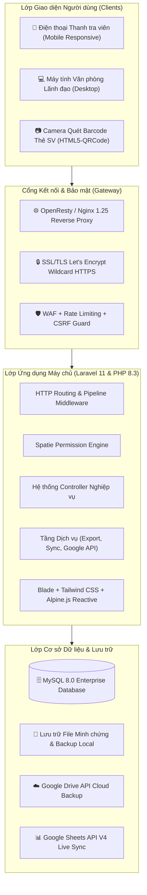

# TÀI LIỆU TOÀN DIỆN VÀ CẨM NANG HƯỚNG DẪN SỬ DỤNG HỆ THỐNG QUẢN TRỊ & GIÁM SÁT KIỂM TRA NỘI BỘ (KTNB - NTTU)
## BẢN HƯỚNG DẪN CHI TIẾT TỪNG BƯỚC THAO TÁC - 100% CÓ ẢNH MINH HỌA MINH CHỨNG

---

**Đơn vị chủ quản:** Trường Đại học Nguyễn Tất Thành (NTTU)  
**Đơn vị quản lý nghiệp vụ:** Phòng Kiểm tra Nội bộ  
**Hệ thống phần mềm:** Hệ thống Quản trị & Giám sát Kiểm tra Nội bộ Trực tuyến (KTNB Online System)  
**Địa chỉ truy cập máy chủ:** [https://kiemtranoibo-ccks.ntt.edu.vn](https://kiemtranoibo-ccks.ntt.edu.vn)  
**Đường dẫn tải tài liệu:** [https://kiemtranoibo-ccks.ntt.edu.vn/tai-lieu-ktnb](https://kiemtranoibo-ccks.ntt.edu.vn/tai-lieu-ktnb)  
**Tác giả & Kiến trúc sư hệ thống:** Nguyễn Vĩnh Phúc  
**Phiên bản phát hành:** v2.6.5 (Production Enterprise)  
**Năm học:** 2025 - 2026  

---

> [!IMPORTANT]
> **TIÊU CHUẨN THIẾT KẾ CẨM NANG:**  
> Tài liệu này được thiết kế theo tiêu chuẩn **"Cầm tay chỉ việc - Từng bước có ảnh minh họa" (Step-by-Step Annotated Visual Manual)**. Mọi chức năng nghiệp vụ đều được mổ xẻ thành chuỗi 6 bước tác nghiệp chuẩn mực (Xem danh sách $
ightarrow$ Cài đặt hiển thị cột $
ightarrow$ Lọc dữ liệu nâng cao $
ightarrow$ Thêm mới dữ liệu $
ightarrow$ Chỉnh sửa dữ liệu $
ightarrow$ Xóa dữ liệu an toàn). Mọi bước đều đi kèm hình ảnh chụp thực tế có đánh số khoanh tròn đỏ `[1]`, `[2]`, `[3]`, `[4]`... và bảng giải thích chi tiết từng ô nhập liệu để người dùng mới đọc là hiểu và thực hiện được ngay.

---

## MỤC LỤC TỔNG QUAN

1. [PHẦN I: TỔNG QUAN, BỐI CẢNH & MA TRẬN PHÂN QUYỀN](#phần-i-tổng-quan-bối-cảnh--ma-trận-phân-quyền)
   - [1.1. Bối cảnh thực tiễn tại Trường ĐH Nguyễn Tất Thành](#11-bối-cảnh-thực-tiễn-tại-trường-đh-nguyễn-tất-thành)
   - [1.2. Mục tiêu chiến lược của hệ thống KTNB](#12-mục-tiêu-chiến-lược-của-hệ-thống-ktnb)
   - [1.3. Ma trận phân quyền người dùng (RBAC Matrix)](#13-ma-trận-phân-quyền-người-dùng-rbac-matrix)
2. [PHẦN II: KIẾN TRÚC HỆ THỐNG & CÔNG NGHỆ ÁP DỤNG](#phần-ii-kiến-trúc-hệ-thống--công-nghệ-áp-dụng)
   - [2.1. Sơ đồ kiến trúc giải pháp tổng thể](#21-sơ-đồ-kiến-trúc-giải-pháp-tổng-thể)
   - [2.2. Công nghệ Backend & Xử lý cơ sở dữ liệu](#22-công-nghệ-backend--xử-lý-cơ-sở-dữ-liệu)
   - [2.3. Công nghệ Frontend & Động cơ tương tác dữ liệu](#23-công-nghệ-frontend--động-cơ-tương-tác-dữ-liệu)
   - [2.4. Công cụ xuất/nhập văn phòng & In ấn chuẩn A4](#24-công-cụ-xuấtnhập-văn-phòng--in-ấn-chuẩn-a4)
   - [2.5. Cơ chế Đồng bộ thời gian thực & Bảo mật 100%](#25-cơ-chế-đồng-bộ-thời-gian-thực--bảo-mật-100)
3. [PHẦN III: DỰ TOÁN CHI PHÍ HẠ TẦNG, BẢN QUYỀN & VẬN HÀNH](#phần-iii-dự-toán-chi-phí-hạ-tầng-bản-quyền--vận-hành)
   - [3.1. Cấu hình máy chủ phần cứng khuyến nghị](#31-cấu-hình-máy-chủ-phần-cứng-khuyến-nghị)
   - [3.2. Bảng dự toán chi phí đầu tư ban đầu & vận hành hàng năm](#32-bảng-dự-toán-chi-phí-đầu-tư-ban-đầu--vận-hàng-năm)
   - [3.3. Phân tích bài toán hiệu quả kinh tế & ROI](#33-phân-tích-bài-toán-hiệu-quả-kinh-tế--roi)
4. [PHẦN IV: QUY CHUẨN GIAO DIỆN & THAO TÁC CƠ BẢN DÙNG CHUNG](#phần-iv-quy-chuẩn-giao-diện--thao-tác-cơ-bản-dùng-chung)
   - [4.1. Bố cục 3 vùng tiêu chuẩn của hệ thống](#41-bố-cục-3-vùng-tiêu-chuẩn-của-hệ-thống)
   - [4.2. Thanh công cụ tác nghiệp bảng dữ liệu (Action Bar)](#42-thanh-công-cụ-tác-nghiệp-bảng-dữ-liệu-action-bar)
   - [4.3. Quy chuẩn 3 nút sắp xếp trên tiêu đề cột](#43-quy-chuẩn-3-nút-sắp-xếp-trên-tiêu-đề-cột)
   - [4.4. Quy trình Ẩn/Hiện cột dữ liệu cá nhân hóa](#44-quy-trình-ẩnhiện-cột-dữ-liệu-cá-nhân-hóa)
   - [4.5. Quy trình Lọc dữ liệu đa điều kiện](#45-quy-trình-lọc-dữ-liệu-đa-điều-kiện)
5. [PHẦN V: CẨM NANG HƯỚNG DẪN CHI TIẾT TỪNG CHỨC NĂNG (TỪNG BƯỚC CÓ ẢNH MINH HỌA)](#phần-v-cẩm-nang-hướng-dẫn-chi-tiết-từng-chức-năng-từng-bước-có-ảnh-minh-họa)
   - [5.1. Bảng điều khiển Tổng quan (Dashboard)](#51-bảng-điều-khiển-tổng-quan-dashboard)
   - [5.2. Giám sát Lớp học Trực tiếp (In-person Classes)](#52-giám-sát-lớp-học-trực-tiếp-in-person-classes)
   - [5.3. Quản lý Lịch học theo ngày & Xuất Excel In ấn chuẩn A4 (Schedule)](#53-quản-lý-lịch-học-theo-ngày--xuất-excel-in-ấn-chuẩn-a4-schedule)
   - [5.4. Lập biên bản Sinh viên Vi phạm (Quét Barcode & Chụp ảnh)](#54-lập-biên-bản-sinh-viên-vi-phạm-quét-barcode--chụp-ảnh)
   - [5.5. Giám sát Thi Kết thúc học phần (Exams)](#55-giám-sát-thi-kết-thúc-học-phần-exams)
   - [5.6. Giám sát Thực hành Ngoài trường (External Practice)](#56-giám-sát-thực-hành-ngoài-trường-external-practice)
   - [5.7. Giám sát Lớp học Trực tuyến (Online Classes)](#57-giám-sát-lớp-học-trực-tuyến-online-classes)
   - [5.8. Giám sát Sinh hoạt Cố vấn Học tập (Homeroom)](#58-giám-sát-sinh-hoạt-cố-vấn-học-tập-homeroom)
   - [5.9. Quản lý Nhận - Trả tài sản & Báo hỏng CSVC phòng học (Asset Check)](#59-quản-lý-nhận---trả-tài-sản--báo-hỏng-csvc-phòng-học-asset-check)
   - [5.10. Tiếp nhận & Xử lý Yêu cầu kiểm tra đột xuất (Requests)](#510-tiếp-nhận--xử-lý-yêu-cầu-kiểm-tra-đột-xuất-requests)
   - [5.11. Tiếp nhận & Xử lý Đơn thư Khiếu nại (Petitions)](#511-tiếp-nhận--xử-lý-đơn-thư-khiếu-nại-petitions)
   - [5.12. Quản lý Hồ sơ & Minh chứng kiểm tra lưu trữ (Document Records)](#512-quản-lý-hồ-sơ--minh-chứng-kiểm-tra-lưu-trữ-document-records)
   - [5.13. Kho Minh chứng Hình ảnh Điện tử (Evidence Storage)](#513-kho-minh-chứng-hình-ảnh-điện-tử-evidence-storage)
   - [5.14. Báo cáo Cuối ngày & Đồng bộ Google Sheets (Daily Report)](#514-báo-cáo-cuối-ngày--đồng-bộ-google-sheets-daily-report)
   - [5.15. Báo cáo Tổng hợp Việc Không Phù Hợp (KPH Report)](#515-báo-cáo-tổng-hợp-việc-không-phù-hợp-kph-report)
   - [5.16. Báo cáo Tổng hợp Sinh viên Vi phạm Quy chế](#516-báo-cáo-tổng-hợp-sinh-viên-vi-phạm-quy-chế)
   - [5.17. Báo cáo Người tốt - Việc tốt & Tuyên dương](#517-báo-cáo-người-tốt---việc-tốt--tuyên-dương)
   - [5.18. Báo cáo Sự cố Phòng học & Thiết bị hư hỏng](#518-báo-cáo-sự-cố-phòng-học--thiết-bị-hư-hỏng)
   - [5.19. Quản lý Danh mục Đơn vị / Khoa / Phòng ban (Departments)](#519-quản-lý-danh-mục-đơn-vị--khoa--phòng-ban-departments)
   - [5.20. Quản lý Hồ sơ Giảng viên toàn trường (Lecturers)](#520-quản-lý-hồ-sơ-giảng-viên-toàn-trường-lecturers)
   - [5.21. Quản lý Cán bộ Nhân viên & Thanh tra viên (Employees)](#521-quản-lý-cán-bộ-nhân-viên--thanh-tra-viên-employees)
   - [5.22. Quản lý Hồ sơ Sinh viên toàn trường (Students)](#522-quản-lý-hồ-sơ-sinh-viên-toàn-trường-students)
   - [5.23. Quản lý Phòng học (Classrooms) & Dãy nhà Cơ sở (Building Blocks)](#523-quản-lý-phòng-học-classrooms--dãy-nhà-cơ-sở-building-blocks)
   - [5.24. Quản lý Danh mục Bổ trợ (Chức vụ, Vai trò, Lỗi vi phạm, Quà tặng)](#524-quản-lý-danh-mục-bổ-trợ-chức-vụ-vai-trò-lỗi-vi-phạm-quà-tặng)
   - [5.25. Quản trị Phân quyền Người dùng & Nhóm quyền (Permissions)](#525-quản-trị-phân-quyền-người-dùng--nhóm-quyền-permissions)
   - [5.26. Kiểm toán Nhật ký Truy cập Hệ thống (Audit Access Log)](#526-kiểm-toán-nhật-ký-truy-cập-hệ-thống-audit-access-log)
   - [5.27. Sao lưu & Khôi phục Cơ sở Dữ liệu một chạm (Backup & Restore)](#527-sao-lưu--khôi-phục-cơ-sở-dữ-liệu-một-chạm-backup--restore)
   - [5.28. Quản lý Tệp mã nguồn & Tài nguyên dự án (Project Files)](#528-quản-lý-tệp-mã-nguồn--tài-nguyên-dự-án-project-files)
   - [5.29. Kênh Tin nhắn Nội bộ & Diễn đàn Thảo luận (Messaging & Discussion)](#529-kênh-tin-nhắn-nội-bộ--diễn-đàn-thảo-luận-messaging--discussion)
   - [5.30. Cổng Giảng viên Tra cứu Lịch & Giải trình (Lecturer Portal)](#530-cổng-giảng-viên-tra-cứu-lịch--giải-trình-lecturer-portal)
6. [PHẦN VI: QUY TRÌNH VẬN HÀNH, BẢO TRÌ & XỬ LÝ SỰ CỐ (SOP)](#phần-vi-quy-trình-vận-hành-bảo-trì--xử-lý-sự-cố-sop)
   - [6.1. Quy trình Cập nhật mã nguồn & Triển khai (Deployment SOP)](#61-quy-trình-cập-nhật-mã-nguồn--triển-khai-deployment-sop)
   - [6.2. Quy trình Xóa bộ nhớ đệm & Tối ưu hiệu năng](#62-quy-trình-xóa-bộ-nhớ-đệm--tối-ưu-hiệu-năng)
   - [6.3. Xử lý các sự cố kỹ thuật thường gặp (Troubleshooting)](#63-xử-lý-các-sự-cố-kỹ-thuật-thường-gặp-troubleshooting)
   - [6.4. Kế hoạch Sao lưu định kỳ & Phục hồi thảm họa (Disaster Recovery)](#64-kế-hoạch-sao-lưu-định-kỳ--phục-hồi-thảm-họa-disaster-recovery)

---
# PHẦN I: TỔNG QUAN, BỐI CẢNH & MA TRẬN PHÂN QUYỀN

## 1.1. Bối cảnh thực tiễn tại Trường ĐH Nguyễn Tất Thành
Trường Đại học Nguyễn Tất Thành là trường đại học định hướng ứng dụng đa ngành quy mô lớn với hơn **30.000 sinh viên**, hàng ngàn giảng viên và hơn 50 ngành đào tạo phân bổ trên 4 cụm cơ sở chính tại TP. Hồ Chí Minh (Cơ sở Quận 4, Cơ sở Quận 12, Cơ sở Quận 7 và Khu Công nghệ cao TP. Thủ Đức).

Trước khi có phần mềm KTNB, công tác thanh tra kiểm tra gặp nhiều rào cản do quy trình thủ công:
- **Thời khóa biểu khổng lồ:** Hàng ngàn tiết học mỗi tuần trải rộng khắp các cơ sở, việc theo dõi biến động lớp học (dạy bù, đổi phòng, vắng) bằng file Excel gửi email dẫn đến việc phát hiện vi phạm bị trễ 24 - 48 giờ.
- **Minh chứng vi phạm tản mác:** Hình ảnh chụp phòng học hỏng thiết bị, ảnh sinh viên vi phạm, biên bản coi thi lưu trên điện thoại cá nhân cán bộ hoặc Zalo, dễ thất lạc và khó tra cứu khi có khiếu nại.
- **Áp lực tổng hợp số liệu:** Sau mỗi ca trực, cán bộ mất 1-2 tiếng để cộng dồn số tiết kiểm tra, số lớp vắng để làm báo cáo hành chính.

## 1.2. Mục tiêu chiến lược của hệ thống KTNB
1. **Số hóa 100% quy trình:** Chuyển đổi toàn bộ sổ tay thanh tra, biên bản kiểm tra sang nền tảng số.
2. **Giám sát thời gian thực (Real-time):** Lãnh đạo quan sát được ngay lớp nào đang học, lớp nào có việc phát sinh tại hiện trường trong vòng vài giây.
3. **Quét mã vạch thẻ sinh viên bằng Camera (5 giây):** Thay vì gõ tay, chỉ cần đưa thẻ sinh viên trước camera điện thoại là lập biên bản tức thời.
4. **Tự động hóa báo cáo & In ấn chuẩn A4:** Tự động tổng hợp báo cáo ngày, xuất Word, Excel mẫu in vừa khít khổ A4, đồng bộ Google Sheets dùng chung.

## 1.3. Ma trận phân quyền người dùng (RBAC Matrix)

| Vai trò người dùng | Xem Dashboard | Giám sát Lịch học | Lập BB Vi phạm | Báo cáo Ngày | Danh mục | Phân quyền & Backup |
| :--- | :---: | :---: | :---: | :---: | :---: | :---: |
| **Ban Giám hiệu (Super Admin)** | Toàn quyền | Xem toàn trường | Xem kết quả | Phê duyệt | Xem | Xem / Cấu hình |
| **Lãnh đạo Phòng KTNB (Admin)** | Toàn quyền | Điều phối / Duyệt | Duyệt / Xử lý | Xuất / Đồng bộ | Quản trị | Quản trị toàn quyền |
| **Thanh tra viên (Inspector)** | Cá nhân | Cập nhật ca trực | Lập biên bản | Lập ca trực | Tra cứu | Không |
| **Giảng viên (Lecturer)** | Không | Lịch cá nhân | Phản hồi giải trình | Không | Tra cứu | Không |

---

# PHẦN II: KIẾN TRÚC HỆ THỐNG & CÔNG NGHỆ ÁP DỤNG

## 2.1. Sơ đồ kiến trúc giải pháp tổng thể



## 2.2. Công nghệ Backend & Xử lý cơ sở dữ liệu
- **PHP 8.3 Enterprise:** JIT Compiler, Typed Properties, Readonly Classes, xử lý thuật toán đối soát hàng chục ngàn dòng lịch học dưới 25ms.
- **Laravel 11.x:** Cấu trúc khởi tạo tối giản (`bootstrap/app.php`), giảm overhead tài nguyên máy chủ.
- **MySQL 8.0 Enterprise:** InnoDB Storage Engine, Indexing B-Tree phức hợp trên `(date, room_id, session, student_code)`, bảng mã `utf8mb4_unicode_ci` chuẩn tiếng Việt 100%.
- **Spatie Laravel-Permission v6:** Quản lý quyền theo vai trò (Role) và quyền hạt mịn (Permission).

## 2.3. Công nghệ Frontend & Động cơ tương tác dữ liệu
- **Tailwind CSS v3/v4:** Bộ nhận diện thương hiệu Đại học Nguyễn Tất Thành (Navy `#003B7A`, Red `#C8102E`, Gold `#F5A623`).
- **Alpine.js v3.x:** Quản lý trạng thái Client mượt mà không cần nạp lại trang (Zero-build latency, Virtual DOM siêu nhẹ).
- **CKEditor 5 Classic:** Định dạng biên bản, văn bản hành chính chuyên nghiệp.
- **Chart.js v4:** Trực quan hóa số liệu KPI, biểu đồ tuần, tỷ lệ tuân thủ.
- **HTML5-QRCode & ZXing-JS:** Quét camera tức thời mã vạch Code 128/Code 39 trên thẻ sinh viên.

## 2.4. Công cụ xuất/nhập văn phòng & In ấn chuẩn A4
- **PhpOffice / PhpSpreadsheet (v5.8+):** Kết xuất Excel `.xlsx` tự động kẻ khung, gộp ô, căn lề, chèn chữ ký, định dạng khổ giấy A4 ngang/dọc vừa khít 1 trang in.
- **PhpOffice / PhpWord (v1.4+):** Tạo biên bản vi phạm, báo cáo tổng hợp Microsoft Word `.docx`.
- **SheetJS & ExcelJS Client-side:** Xuất dữ liệu trực tiếp trên trình duyệt tốc độ cao.

## 2.5. Cơ chế Đồng bộ thời gian thực & Bảo mật 100%
- **Adaptive Polling (10-15s):** Tự động phát hiện thay đổi việc phát sinh tại phòng học và cập nhật màn hình Dashboard của Lãnh đạo không cần F5.
- **Google Sheets API V4:** Đẩy trực tiếp số liệu báo cáo lên trang tính Nhà trường.
- **Bảo mật tuyệt đối:** Mã hóa HTTPS TLS 1.3, Prepared Statements chống SQL Injection 100%, XSS Clean, CSRF Token, Rate Limiting, Audit Access Log lưu vết từng mili-giây.

---

# PHẦN III: DỰ TOÁN CHI PHÍ HẠ TẦNG, BẢN QUYỀN & VẬN HÀNH

## 3.1. Cấu hình máy chủ phần cứng khuyến nghị

| Phần cứng | Cấu hình Tiêu chuẩn (Đang vận hành) | Cấu hình Mở rộng (Cao điểm toàn trường) |
| :--- | :--- | :--- |
| **Hệ điều hành** | Ubuntu Server 22.04 LTS x86_64 | Ubuntu Server 24.04 LTS x86_64 |
| **CPU** | **4 vCPU** (Intel Xeon Gold / AMD EPYC 3.0GHz+) | **8 vCPU** (AMD EPYC High Frequency) |
| **RAM** | **8 GB RAM** (ECC DDR4) | **16 GB RAM** (ECC DDR4) |
| **Ổ cứng lưu trữ** | **100 GB NVMe SSD** (Tốc độ đọc > 2.500 MB/s) | **250 GB NVMe SSD Enterprise** |
| **Băng thông mạng** | 100 Mbps - 1 Gbps (Không giới hạn lưu lượng) | 1 Gbps Dedicated Port |
| **Địa chỉ IP tĩnh** | 01 IPv4 Public Tĩnh | 01 IPv4 Public Tĩnh + IPv6 Subnet |

## 3.2. Bảng dự toán chi phí đầu tư ban đầu & vận hành hàng năm

### Bảng 1: Chi phí Bản quyền phần mềm & Nền tảng (Software Licenses)

| STT | Tên phần mềm / Dịch vụ | Loại bản quyền | Chi phí (VNĐ) | Ghi chú |
| :---: | :--- | :--- | :---: | :--- |
| 1 | Hệ điều hành Linux (Ubuntu Server) | Mã nguồn mở (GPL/MIT) | **0 đ** | Miễn phí trọn đời |
| 2 | Nền tảng Laravel 11 & PHP 8.3 | Mã nguồn mở (MIT) | **0 đ** | Miễn phí trọn đời |
| 3 | CSDL MySQL 8.0 Community | Mã nguồn mở (GPL) | **0 đ** | Đầy đủ tính năng doanh nghiệp |
| 4 | Bộ giao diện Tailwind CSS & Alpine.js | Mã nguồn mở (MIT) | **0 đ** | Miễn phí thương mại |
| 5 | Chứng chỉ SSL/TLS HTTPS | Let's Encrypt Wildcard | **0 đ** | Tự động gia hạn vĩnh viễn |
| 6 | Tên miền phân cấp (`ntt.edu.vn`) | Subdomain trường NTTU | **0 đ** | Tận dụng hạ tầng DNS sẵn có |
| 7 | Bộ thư viện PhpOffice (Excel/Word) | Mã nguồn mở (LGPL) | **0 đ** | Miễn phí sử dụng |
| **TỔNG** | **CHI PHÍ BẢN QUYỀN PHẦN MỀM** | | **0 đ** | **Tiết kiệm 100% ngân sách** |

### Bảng 2: Chi phí Hạ tầng Máy chủ & Lưu trữ Đám mây (Hosting & Cloud)

| STT | Hạng mục hạ tầng | Đơn vị tính | Đơn giá / Tháng (VNĐ) | Thành tiền / Năm (VNĐ) | Ghi chú |
| :---: | :--- | :---: | :---: | :---: | :--- |
| 1 | Máy chủ Cloud VPS (4 Core, 8GB RAM, 100GB NVMe) | Máy chủ | 650.000 đ | 7.800.000 đ | Viettel IDC / VNPT / Vietnix |
| 2 | Dịch vụ Lưu trữ Đám mây (Cloud Backup Storage) | Gói 200 GB | 150.000 đ | 1.800.000 đ | Lưu snapshot tự động + ảnh minh chứng |
| 3 | Dung lượng Google Workspace for Education API | Dung lượng trường | 0 đ | 0 đ | Tận dụng tài khoản Google Workspace Edu |
| 4 | Dự phòng mở rộng tài nguyên (Buffer Capacity) | Năm | — | 1.500.000 đ | Nâng cấp RAM/CPU trong kỳ thi cao điểm |
| **TỔNG** | **CHI PHÍ HẠ TẦNG VẬN HÀNH (1 NĂM)** | | | **11.100.000 đ** | *(Mười một triệu một trăm ngàn đồng)* |

## 3.3. Phân tích bài toán hiệu quả kinh tế & ROI
- **Tiết kiệm in ấn giấy tờ:** Giảm hơn 30.000 tờ giấy A4, mực in và sổ tay ghi chép hàng năm, tiết kiệm ước tính **~25.000.000 VNĐ / năm**.
- **Tiết kiệm thời gian lao động:** Giải phóng hơn **5.200 giờ công lao động / năm** cho đội ngũ 10 thanh tra viên, cho phép tập trung nâng cao chất lượng sư phạm và giải quyết các vấn đề trọng điểm.
- **Minh bạch hóa 100%:** Minh chứng có hình ảnh, có thời gian chính xác, loại bỏ triệt để các tranh cãi và khiếu nại không đáng có.

---

# PHẦN IV: QUY CHUẨN GIAO DIỆN & THAO TÁC CƠ BẢN DÙNG CHUNG

Giao diện hệ thống KTNB được thiết kế **chuẩn hóa đồng bộ 100%**. Dưới đây là các quy tắc thao tác dùng chung trên mọi trang:

## 4.1. Bố cục 3 vùng tiêu chuẩn của hệ thống
- **Thanh Header (Trên cùng):** Logo NTTU, đơn vị Phòng Kiểm tra Nội bộ, ô tìm kiếm nhanh, chuông thông báo Việc phát sinh realtime, nút chuyển giao diện, menu tài khoản cá nhân.
- **Thanh Sidebar (Cột bên trái):** Danh mục điều hướng phân cấp: *Tổng quan, Công cụ kiểm tra, Báo cáo thống kê, Bộ danh mục, Quản trị hệ thống*. Có thể thu gọn/mở rộng linh hoạt.
- **Vùng nội dung chính (Content Area):** Tiêu đề trang kèm biểu tượng nhận diện, thanh công cụ tác nghiệp và bảng dữ liệu chính.

## 4.2. Thanh công cụ tác nghiệp bảng dữ liệu (Action Bar)
Ở góc trên bên phải mỗi bảng dữ liệu luôn có nhóm nút thao tác tiêu chuẩn:


1. **Nút Thêm mới (+):** Màu xanh dương hoặc đỏ nổi bật $
ightarrow$ Mở popup hoặc chuyển form thêm mới bản ghi.
2. **Nút Tải mẫu file (Import Template):** Tải file Excel mẫu đúng định dạng cột quy định.
3. **Nút Tải lên (Import Excel):** Chọn file Excel từ máy tính để nạp dữ liệu hàng loạt vào hệ thống.
4. **Nút Tải xuống (Export Excel):** Xuất bảng dữ liệu hiện tại ra file Excel.
5. **Nút Bộ lọc nâng cao (Biểu tượng phễu):** Mở cửa sổ thiết lập điều kiện lọc nhiều trường.
6. **Nút Cài đặt hiển thị cột (Biểu tượng con mắt / bánh răng):** Mở bảng chọn bật/tắt các cột dữ liệu.

## 4.3. Quy chuẩn 3 nút sắp xếp trên tiêu đề cột


Trên mỗi tiêu đề cột (`<th>`) của bảng dữ liệu, hệ thống bố trí cụm 3 nút bấm hình tròn màu trắng với biểu tượng màu đỏ trực quan:
- **Nút 1: Mũi tên hướng lên `(^) `:** Sắp xếp cột theo thứ tự **Tăng dần** (A $
ightarrow$ Z, hoặc số nhỏ $
ightarrow$ số lớn).
- **Nút 2: Mũi tên hướng xuống `(v)`:** Sắp xếp cột theo thứ tự **Giảm dần** (Z $
ightarrow$ A, hoặc số lớn $
ightarrow$ số nhỏ).
- **Nút 3: Mũi tên đảo chiều 2 đầu `(⇅)`:** **Hủy sắp xếp** (trả về thứ tự mặc định ban đầu).

## 4.4. Quy trình Ẩn/Hiện cột dữ liệu cá nhân hóa
Khi nhấp vào nút **Cài đặt hiển thị cột** trên góc phải:
- Một ngăn kéo hoặc modal sẽ hiển thị danh sách tất cả các cột của bảng.
- Cột nào được **tích chọn dấu tick xanh** sẽ hiển thị trên màn hình.
- Cột nào bị **bỏ chọn** sẽ được ẩn đi để màn hình thoáng hơn, phù hợp với màn hình điện thoại hoặc máy tính bảng nhỏ.
- Cấu hình này được hệ thống tự động ghi nhớ vào tài khoản của bạn, lần sau đăng nhập không cần chỉnh lại.

## 4.5. Quy trình Lọc dữ liệu đa điều kiện
Khi nhấp vào nút **Bộ lọc nâng cao (Phễu)**:
- Cửa sổ bộ lọc cho phép người dùng kết hợp nhiều điều kiện: Từ ngày ... Đến ngày, Khoa/Viện, Cơ sở, Ca học, Tình trạng vi phạm...
- Nhấn nút **Áp dụng** để bảng tự động lọc dữ liệu.
- Nhấn nút **Đặt lại (Reset)** để xóa toàn bộ điều kiện và hiển thị lại toàn bộ dữ liệu.

---
# PHẦN V: CẨM NANG HƯỚNG DẪN CHI TIẾT TỪNG CHỨC NĂNG (TỪNG BƯỚC CÓ ẢNH MINH HỌA)

## 5.2. Giám sát Lớp học Trực tiếp (In-person Classes)
- **Đường dẫn truy cập:** `/monitoring/in-person`
- **Đối tượng sử dụng chính:** Thanh tra viên, Cán bộ kiểm tra ca trực
- **Mục đích nghiệp vụ:** Kiểm tra nề nếp giảng dạy và học tập trực tiếp tại các phòng học thuộc các cơ sở đào tạo của Nhà trường.

---

### Bước 1: Truy cập và Quan sát Màn hình Danh sách Chính
Thanh tra viên hoặc người dùng đăng nhập hệ thống, chọn menu `Giám sát Lớp học Trực tiếp (In-person Classes)` trên thanh Sidebar. Màn hình danh sách chính sẽ hiển thị như hình minh chứng bên dưới:


#### 📋 Chú giải các nút tác vụ trên màn hình danh sách (Theo số khoanh đỏ):
- **[1] Nhóm nút tác vụ thanh công cụ**: Gồm các nút Tải lên file Excel, Tải file mẫu import, Xuất file Excel báo cáo và Thêm lớp học mới.
- **[2] Nút Cài đặt hiển thị cột**: Bấm để mở ngăn kéo bật/tắt các cột thông tin cần xem trên bảng lớp học.
- **[3] Nút Menu hành động dòng**: Nằm ở cột cuối cùng mỗi phòng học, bấm để mở menu: Cập nhật tình trạng, Ghi nhận việc phát sinh, Đổi phòng, Sửa, Xóa.
- **[4] Ô tìm kiếm nhanh**: Nhập mã phòng (A.101, B.203), tên giảng viên hoặc môn học để lọc tức thì.

---

### Bước 2: Tùy biến Hiển thị Cột Dữ liệu (Ẩn / Hiện Cột)
Nhấp vào nút **Cài đặt hiển thị cột** (biểu tượng con mắt trên thanh tiêu đề bảng). Ngăn kéo cài đặt cột sẽ hiển thị như hình minh chứng bên dưới:


#### 📋 Hướng dẫn thao tác cài đặt cột:
- **Nguyên tắc hoạt động:** Danh sách hiển thị toàn bộ các trường thông tin có thể xem của phân hệ.
- **Bật cột:** Nhấp chuột vào ô vuông để xuất hiện dấu tick xanh $
ightarrow$ Cột dữ liệu đó sẽ hiển thị trên bảng.
- **Ẩn cột:** Nhấp chuột để bỏ dấu tick xanh $
ightarrow$ Cột dữ liệu đó sẽ ẩn đi để giao diện gọn gàng hơn khi dùng trên điện thoại.
- **Mã lớp học phần / Môn học**: Hiển thị mã số lớp và tên học phần đang giảng dạy.
- **Giảng viên giảng dạy**: Hiển thị họ và tên giảng viên được phân công trên thời khóa biểu.
- **Sĩ số sinh viên**: Hiển thị sĩ số đăng ký và sĩ số sinh viên có mặt thực tế.
- **Tình trạng lớp học**: Hiển thị nhãn trạng thái: Đang học, Vào trễ, Nghỉ, Đổi phòng...
- **Việc phát sinh / Ghi chú**: Hiển thị nội dung sự cố hoặc việc bất thường phát hiện tại phòng.
- **Lưu ý:** Cấu hình cột được lưu tự động trên trình duyệt của bạn.

---

### Bước 3: Lọc Dữ liệu Nâng cao theo Nhiều Tiêu chí
Khi cần tìm kiếm các bản ghi thỏa mãn nhiều điều kiện kết hợp, nhấp vào nút **Bộ lọc nâng cao** (biểu tượng chiếc phễu). Cửa sổ bộ lọc sẽ hiển thị như hình minh chứng bên dưới:


#### 📋 Hướng dẫn thiết lập các tiêu chí lọc:
- **Chọn Ngày kiểm tra**: Mặc định là ngày hôm nay. Chọn ngày bất kỳ để xem lịch kiểm tra cũ hoặc tương lai.
- **Chọn Cơ sở đào tạo**: Chọn Cơ sở Q.4, Cơ sở Q.12 hoặc Cơ sở Q.7 nơi cán bộ đang thực hiện ca trực.
- **Chọn Buổi học / Ca trực**: Chọn Buổi Sáng (Tiết 1-5), Buổi Chiều (Tiết 6-10) hoặc Buổi Tối (Tiết 11-15).
- **Chọn Tiết học cụ thể**: Chọn tiết học đang diễn ra (ví dụ: Tiết 3) để hệ thống lọc ra danh sách đúng các phòng đang học tiết đó.
- **Thực thi lọc:** Sau khi chọn xong các tiêu chí, nhấp nút màu xanh **Áp dụng** để bảng làm mới số liệu.
- **Xóa bộ lọc:** Nhấp nút **Đặt lại** để hủy tất cả điều kiện lọc và quay về danh sách toàn bộ ban đầu.

---

### Bước 4: Thêm mới Bản ghi Dữ liệu (Form Nhập Liệu)
Trên màn hình chính, nhấp vào nút **Thêm mới (+)** màu nổi bật. Cửa sổ form nhập liệu thêm mới sẽ hiển thị như hình minh chứng bên dưới:


#### 📋 Bảng hướng dẫn chi tiết từng ô nhập liệu trên Form:

| Số hiệu | Tên trường / Ô nhập | Bắt buộc | Kiểu nhập liệu | Ý nghĩa nghiệp vụ & Hướng dẫn nhập |
| :---: | :--- | :---: | :---: | :--- |
| **`1`** | **Mã học phần / Tên môn học** | Có (*) | `Text / Select` | Chọn hoặc gõ mã môn học và tên môn học. |
| **`2`** | **Phòng học** | Có (*) | `Select` | Chọn mã phòng học diễn ra tiết học (VD: A.301, B.202). |
| **`3`** | **Giảng viên** | Có (*) | `Select` | Chọn tên giảng viên phụ trách giảng dạy từ danh mục. |
| **`4`** | **Ngày học & Tiết học** | Có (*) | `Date & Select` | Chọn ngày và khoảng tiết học (VD: Tiết 1 đến Tiết 5). |
| **`5`** | **Sĩ số đăng ký** | Không | `Number` | Nhập số lượng sinh viên đăng ký môn học theo danh sách. |

- **Hoàn tất thêm mới:** Sau khi điền đầy đủ các trường bắt buộc (có dấu `*`), nhấp nút **Lưu dữ liệu** (hoặc **Hoàn tất**). Hệ thống sẽ thông báo thành công và bổ sung ngay dòng dữ liệu mới vào bảng.

---

### Bước 5: Chỉnh sửa / Cập nhật Bản ghi Dữ liệu
Khi cần điều chỉnh thông tin của một bản ghi đã có trong hệ thống, tìm đến dòng tương ứng trong bảng $
ightarrow$ Nhấp vào nút **Chỉnh sửa (Hình cây bút)** ở cột Hành động. Cửa sổ chỉnh sửa sẽ hiển thị như hình minh chứng bên dưới:


#### 📋 Hướng dẫn thao tác chỉnh sửa:
- Form chỉnh sửa cho phép thanh tra viên cập nhật trạng thái lớp học tại hiện trường:
  1. **Đổi trạng thái lớp:** Chọn *Bình thường*, *Giảng viên vào trễ* (nhập số phút trễ), *Nghỉ không báo trước*, *Đổi phòng học*, *Dạy bù*.
  2. **Cập nhật sĩ số thực tế:** Đếm nhanh số sinh viên đang ngồi trong lớp và điền vào ô sĩ số.
  3. **Ghi nhận Việc phát sinh (ĐẶC BIỆT QUAN TRỌNG):** Gõ chi tiết bất kỳ sự cố nào xảy ra tại phòng (ví dụ: *Máy chiếu hỏng nguồn, Máy lạnh chảy nước, Giảng viên vắng tiết 1-2*).
  4. **Quy tắc trích xuất tự động:** Nội dung trong ô này sẽ tự động chuyển thành cột Ghi chú khi xuất file Excel báo cáo cuối ngày!
- Nhấp nút **Cập nhật** (hoặc **Lưu thay đổi**) để lưu lại thông tin mới.

---

### Bước 6: Xóa Bản ghi & Hộp thoại Xác nhận An toàn
Khi một bản ghi bị nhập trùng hoặc không còn giá trị sử dụng, tìm đến dòng cần xóa $
ightarrow$ Nhấp vào nút **Xóa (Hình thùng rác)** ở cột Hành động. Hộp thoại xác nhận an toàn sẽ hiển thị như hình minh chứng bên dưới:


#### 📋 Hướng dẫn thao tác xóa dữ liệu an toàn:
- Hệ thống sẽ hiển thị hộp thoại xác nhận: *"Bạn có chắc chắn muốn xóa bản ghi lớp học này không?"*.
- Chỉ xóa khi lớp học bị trùng lặp hoặc hủy lịch giảng dạy chính thức.
- Thao tác xóa sẽ được ghi nhận vào Nhật ký kiểm toán hệ thống để phục vụ đối soát.
- **Nút Xác nhận Xóa (Màu đỏ):** Nhấp để xóa vĩnh viễn bản ghi khỏi hệ thống.
- **Nút Hủy bỏ (Màu xám):** Nhấp để đóng hộp thoại và giữ nguyên dữ liệu, không thực hiện thao tác xóa.

---
# PHẦN V: CẨM NANG HƯỚNG DẪN CHI TIẾT TỪNG CHỨC NĂNG (TỪNG BƯỚC CÓ ẢNH MINH HỌA)

## 5.3. Quản lý Lịch học theo ngày & Xuất Excel In ấn chuẩn A4 (Schedule)
- **Đường dẫn truy cập:** `/settings/schedule`
- **Đối tượng sử dụng chính:** Lãnh đạo phòng, Chuyên viên quản lý lịch kiểm tra
- **Mục đích nghiệp vụ:** Quản lý toàn bộ thời khóa biểu các lớp học theo từng ngày và xuất file Excel mẫu in kiểm tra phòng học chuẩn A4.

---

### Bước 1: Truy cập và Quan sát Màn hình Danh sách Chính
Thanh tra viên hoặc người dùng đăng nhập hệ thống, chọn menu `Quản lý Lịch học theo ngày & Xuất Excel In ấn chuẩn A4 (Schedule)` trên thanh Sidebar. Màn hình danh sách chính sẽ hiển thị như hình minh chứng bên dưới:


#### 📋 Chú giải các nút tác vụ trên màn hình danh sách (Theo số khoanh đỏ):
- **[1] Nút Thêm lịch học mới**: Bấm để thêm mới một buổi học vào lịch trình kiểm tra ngày.
- **[2] Nút Cài đặt hiển thị cột**: Bật/tắt các cột chi tiết trên bảng thời khóa biểu.
- **[3] Nút Xuất file Excel (POST an toàn)**: Xuất toàn bộ bảng lịch học ra file Excel mẫu in kiểm tra chuẩn A4 không bao giờ gặp lỗi đường dẫn quá dài (HTTP 414).
- **[4] Ô tìm kiếm lịch học**: Tìm theo tên môn, mã phòng, mã lớp hoặc tên giảng viên.

---

### Bước 2: Tùy biến Hiển thị Cột Dữ liệu (Ẩn / Hiện Cột)
Nhấp vào nút **Cài đặt hiển thị cột** (biểu tượng con mắt trên thanh tiêu đề bảng). Ngăn kéo cài đặt cột sẽ hiển thị như hình minh chứng bên dưới:


#### 📋 Hướng dẫn thao tác cài đặt cột:
- **Nguyên tắc hoạt động:** Danh sách hiển thị toàn bộ các trường thông tin có thể xem của phân hệ.
- **Bật cột:** Nhấp chuột vào ô vuông để xuất hiện dấu tick xanh $
ightarrow$ Cột dữ liệu đó sẽ hiển thị trên bảng.
- **Ẩn cột:** Nhấp chuột để bỏ dấu tick xanh $
ightarrow$ Cột dữ liệu đó sẽ ẩn đi để giao diện gọn gàng hơn khi dùng trên điện thoại.
- **Mã môn & Tên lớp**: Hiển thị thông tin lớp học phần.
- **Thứ & Ngày học**: Hiển thị ngày tháng diễn ra tiết học.
- **Phòng học & Dãy nhà**: Hiển thị phòng học và cơ sở đào tạo.
- **Tiết bắt đầu - Tiết kết thúc**: Hiển thị khung giờ học.
- **Ghi chú / Việc phát sinh**: Hiển thị các ghi chú theo dõi đặc biệt.
- **Lưu ý:** Cấu hình cột được lưu tự động trên trình duyệt của bạn.

---

### Bước 3: Lọc Dữ liệu Nâng cao theo Nhiều Tiêu chí
Khi cần tìm kiếm các bản ghi thỏa mãn nhiều điều kiện kết hợp, nhấp vào nút **Bộ lọc nâng cao** (biểu tượng chiếc phễu). Cửa sổ bộ lọc sẽ hiển thị như hình minh chứng bên dưới:


#### 📋 Hướng dẫn thiết lập các tiêu chí lọc:
- **Lọc theo Khoảng ngày**: Chọn Từ ngày... Đến ngày... để xuất lịch nhiều ngày cùng lúc.
- **Lọc theo Cơ sở**: Chọn Cơ sở Quận 4, Quận 12 hoặc Quận 7.
- **Lọc theo Khoa quản lý môn**: Lọc các môn thuộc Khoa CNTT, Dược, Ngoại ngữ...
- **Lọc theo Loại hình lớp**: Lọc lớp Lý thuyết, Thực hành xưởng, hay Sinh hoạt cố vấn.
- **Thực thi lọc:** Sau khi chọn xong các tiêu chí, nhấp nút màu xanh **Áp dụng** để bảng làm mới số liệu.
- **Xóa bộ lọc:** Nhấp nút **Đặt lại** để hủy tất cả điều kiện lọc và quay về danh sách toàn bộ ban đầu.

---

### Bước 4: Thêm mới Bản ghi Dữ liệu (Form Nhập Liệu)
Trên màn hình chính, nhấp vào nút **Thêm mới (+)** màu nổi bật. Cửa sổ form nhập liệu thêm mới sẽ hiển thị như hình minh chứng bên dưới:


#### 📋 Bảng hướng dẫn chi tiết từng ô nhập liệu trên Form:

| Số hiệu | Tên trường / Ô nhập | Bắt buộc | Kiểu nhập liệu | Ý nghĩa nghiệp vụ & Hướng dẫn nhập |
| :---: | :--- | :---: | :---: | :--- |
| **`1`** | **Ngày học** | Có (*) | `Date Picker` | Chọn ngày diễn ra lớp học. |
| **`2`** | **Phòng học** | Có (*) | `Dropdown` | Chọn phòng học từ danh mục cơ sở. |
| **`3`** | **Khung tiết học** | Có (*) | `Select` | Chọn Tiết bắt đầu và Tiết kết thúc. |
| **`4`** | **Giảng viên** | Có (*) | `Select` | Chọn giảng viên giảng dạy. |
| **`5`** | **Lớp học phần** | Có (*) | `Text` | Nhập mã lớp học phần theo chuẩn đào tạo. |

- **Hoàn tất thêm mới:** Sau khi điền đầy đủ các trường bắt buộc (có dấu `*`), nhấp nút **Lưu dữ liệu** (hoặc **Hoàn tất**). Hệ thống sẽ thông báo thành công và bổ sung ngay dòng dữ liệu mới vào bảng.

---

### Bước 5: Chỉnh sửa / Cập nhật Bản ghi Dữ liệu
Khi cần điều chỉnh thông tin của một bản ghi đã có trong hệ thống, tìm đến dòng tương ứng trong bảng $
ightarrow$ Nhấp vào nút **Chỉnh sửa (Hình cây bút)** ở cột Hành động. Cửa sổ chỉnh sửa sẽ hiển thị như hình minh chứng bên dưới:


#### 📋 Hướng dẫn thao tác chỉnh sửa:
- Dùng để điều chỉnh phòng học hoặc giảng viên khi có thông báo đổi lịch chính thức từ Phòng Quản lý Đào tạo.
- Cập nhật thông tin giảng viên dạy thay hoặc phòng học thay thế trước khi thanh tra viên đi kiểm tra hiện trường.
- Nhấp nút **Cập nhật** (hoặc **Lưu thay đổi**) để lưu lại thông tin mới.

---

### Bước 6: Xóa Bản ghi & Hộp thoại Xác nhận An toàn
Khi một bản ghi bị nhập trùng hoặc không còn giá trị sử dụng, tìm đến dòng cần xóa $
ightarrow$ Nhấp vào nút **Xóa (Hình thùng rác)** ở cột Hành động. Hộp thoại xác nhận an toàn sẽ hiển thị như hình minh chứng bên dưới:


#### 📋 Hướng dẫn thao tác xóa dữ liệu an toàn:
- Chỉ xóa các bản ghi lịch học khi môn học đó có thông báo hủy lớp hoặc hoãn thi từ Nhà trường.
- Sau khi xóa, phòng học đó sẽ trống trên lịch kiểm tra của thanh tra viên.
- **Nút Xác nhận Xóa (Màu đỏ):** Nhấp để xóa vĩnh viễn bản ghi khỏi hệ thống.
- **Nút Hủy bỏ (Màu xám):** Nhấp để đóng hộp thoại và giữ nguyên dữ liệu, không thực hiện thao tác xóa.

---
# PHẦN V: CẨM NANG HƯỚNG DẪN CHI TIẾT TỪNG CHỨC NĂNG (TỪNG BƯỚC CÓ ẢNH MINH HỌA)

## 5.4. Lập biên bản Sinh viên Vi phạm (Quét Barcode & Chụp ảnh)
- **Đường dẫn truy cập:** `/monitoring/student-violations`
- **Đối tượng sử dụng chính:** Thanh tra viên kiểm tra, Giám thị coi thi
- **Mục đích nghiệp vụ:** Ghi nhận, lập biên bản và quản lý danh sách sinh viên vi phạm nội quy, quy chế học đường và quy chế thi cử.

---

### Bước 1: Truy cập và Quan sát Màn hình Danh sách Chính
Thanh tra viên hoặc người dùng đăng nhập hệ thống, chọn menu `Lập biên bản Sinh viên Vi phạm (Quét Barcode & Chụp ảnh)` trên thanh Sidebar. Màn hình danh sách chính sẽ hiển thị như hình minh chứng bên dưới:


#### 📋 Chú giải các nút tác vụ trên màn hình danh sách (Theo số khoanh đỏ):
- **[1] Nút + Thêm vi phạm mới**: Màu đỏ nổi bật, bấm để mở cửa sổ lập biên bản vi phạm siêu tốc.
- **[2] Nút Cài đặt hiển thị cột**: Tùy biến các cột: MSSV, Họ tên, Lớp, Hành vi vi phạm, Mức phạt, Ảnh minh chứng.
- **[3] Nút Menu hành động dòng**: Bấm để Xem biên bản in, Sửa thông tin, Tải ảnh minh chứng hoặc Xóa biên bản.
- **[4] Ô tìm kiếm sinh viên**: Tìm nhanh theo Mã số sinh viên (MSSV) hoặc Họ và tên sinh viên.

---

### Bước 2: Tùy biến Hiển thị Cột Dữ liệu (Ẩn / Hiện Cột)
Nhấp vào nút **Cài đặt hiển thị cột** (biểu tượng con mắt trên thanh tiêu đề bảng). Ngăn kéo cài đặt cột sẽ hiển thị như hình minh chứng bên dưới:


#### 📋 Hướng dẫn thao tác cài đặt cột:
- **Nguyên tắc hoạt động:** Danh sách hiển thị toàn bộ các trường thông tin có thể xem của phân hệ.
- **Bật cột:** Nhấp chuột vào ô vuông để xuất hiện dấu tick xanh $
ightarrow$ Cột dữ liệu đó sẽ hiển thị trên bảng.
- **Ẩn cột:** Nhấp chuột để bỏ dấu tick xanh $
ightarrow$ Cột dữ liệu đó sẽ ẩn đi để giao diện gọn gàng hơn khi dùng trên điện thoại.
- **Mã số sinh viên (MSSV)**: Hiển thị mã số sinh viên NTTU.
- **Họ và tên sinh viên**: Họ tên đầy đủ của sinh viên vi phạm.
- **Lớp & Khoa đào tạo**: Lớp danh nghĩa và khoa chủ quản.
- **Hành vi vi phạm**: Tên lỗi vi phạm quy chế.
- **Địa điểm vi phạm**: Phòng học, dãy nhà hoặc khu vực sân trường.
- **Ảnh minh chứng**: Biểu tượng hình ảnh chụp hiện trường vi phạm.
- **Lưu ý:** Cấu hình cột được lưu tự động trên trình duyệt của bạn.

---

### Bước 3: Lọc Dữ liệu Nâng cao theo Nhiều Tiêu chí
Khi cần tìm kiếm các bản ghi thỏa mãn nhiều điều kiện kết hợp, nhấp vào nút **Bộ lọc nâng cao** (biểu tượng chiếc phễu). Cửa sổ bộ lọc sẽ hiển thị như hình minh chứng bên dưới:


#### 📋 Hướng dẫn thiết lập các tiêu chí lọc:
- **Lọc theo Ngày vi phạm**: Chọn ngày hoặc khoảng ngày lập biên bản.
- **Lọc theo Hành vi vi phạm**: Lọc theo lỗi: Không đeo thẻ, Sai trang phục, Hút thuốc, Gian lận thi...
- **Lọc theo Cơ sở & Dãy nhà**: Lọc các vi phạm xảy ra tại Cơ sở Q.12, Q.4...
- **Lọc theo Khoa / Viện**: Lọc vi phạm của sinh viên thuộc một khoa cụ thể để gửi báo cáo.
- **Thực thi lọc:** Sau khi chọn xong các tiêu chí, nhấp nút màu xanh **Áp dụng** để bảng làm mới số liệu.
- **Xóa bộ lọc:** Nhấp nút **Đặt lại** để hủy tất cả điều kiện lọc và quay về danh sách toàn bộ ban đầu.

---

### Bước 4: Thêm mới Bản ghi Dữ liệu (Form Nhập Liệu)
Trên màn hình chính, nhấp vào nút **Thêm mới (+)** màu nổi bật. Cửa sổ form nhập liệu thêm mới sẽ hiển thị như hình minh chứng bên dưới:


#### 📋 Bảng hướng dẫn chi tiết từng ô nhập liệu trên Form:

| Số hiệu | Tên trường / Ô nhập | Bắt buộc | Kiểu nhập liệu | Ý nghĩa nghiệp vụ & Hướng dẫn nhập |
| :---: | :--- | :---: | :---: | :--- |
| **`1`** | **Nút Quét Camera Barcode** | Khuyến nghị | `Camera Scan` | Bấm để bật camera điện thoại quét mã vạch thẻ sinh viên. Hệ thống tự động điền 100% MSSV, Họ tên, Lớp, Khoa trong 5 giây! |
| **`2`** | **Mã số sinh viên (MSSV)** | Có (*) | `Text` | Nhập MSSV nếu sinh viên không mang thẻ để quét. |
| **`3`** | **Họ tên, Lớp, Khoa** | Tự động | `Readonly` | Hệ thống tự động truy xuất từ CSDL Sinh viên. |
| **`4`** | **Hành vi vi phạm** | Có (*) | `Select` | Chọn lỗi vi phạm từ danh mục quy định của Nhà trường. |
| **`5`** | **Địa điểm xảy ra** | Có (*) | `Select` | Chọn Cơ sở, Dãy nhà, Số phòng học hoặc Sân trường. |
| **`6`** | **Chụp ảnh minh chứng** | Có (*) | `File / Camera` | Bấm chụp ảnh trực tiếp sinh viên vi phạm hoặc hiện trường vi phạm đính kèm biên bản. |

- **Hoàn tất thêm mới:** Sau khi điền đầy đủ các trường bắt buộc (có dấu `*`), nhấp nút **Lưu dữ liệu** (hoặc **Hoàn tất**). Hệ thống sẽ thông báo thành công và bổ sung ngay dòng dữ liệu mới vào bảng.

---

### Bước 5: Chỉnh sửa / Cập nhật Bản ghi Dữ liệu
Khi cần điều chỉnh thông tin của một bản ghi đã có trong hệ thống, tìm đến dòng tương ứng trong bảng $
ightarrow$ Nhấp vào nút **Chỉnh sửa (Hình cây bút)** ở cột Hành động. Cửa sổ chỉnh sửa sẽ hiển thị như hình minh chứng bên dưới:


#### 📋 Hướng dẫn thao tác chỉnh sửa:
- Cho phép bổ sung thêm nội dung tường trình của sinh viên hoặc ý kiến của giảng viên/giám thị.
- Cập nhật lại hình thức xử lý kỷ luật sau khi có kết luận của Hội đồng Kỷ luật Nhà trường.
- Nhấp nút **Cập nhật** (hoặc **Lưu thay đổi**) để lưu lại thông tin mới.

---

### Bước 6: Xóa Bản ghi & Hộp thoại Xác nhận An toàn
Khi một bản ghi bị nhập trùng hoặc không còn giá trị sử dụng, tìm đến dòng cần xóa $
ightarrow$ Nhấp vào nút **Xóa (Hình thùng rác)** ở cột Hành động. Hộp thoại xác nhận an toàn sẽ hiển thị như hình minh chứng bên dưới:


#### 📋 Hướng dẫn thao tác xóa dữ liệu an toàn:
- Chỉ xóa biên bản khi có văn bản đính chính chính thức từ Lãnh đạo Phòng KTNB hoặc giải trình khiếu nại được chấp thuận.
- Mọi thao tác xóa biên bản vi phạm đều được lưu vết chặt chẽ vào Audit Access Log.
- **Nút Xác nhận Xóa (Màu đỏ):** Nhấp để xóa vĩnh viễn bản ghi khỏi hệ thống.
- **Nút Hủy bỏ (Màu xám):** Nhấp để đóng hộp thoại và giữ nguyên dữ liệu, không thực hiện thao tác xóa.

---
# PHẦN V: CẨM NANG HƯỚNG DẪN CHI TIẾT TỪNG CHỨC NĂNG (TỪNG BƯỚC CÓ ẢNH MINH HỌA)

## 5.5. Giám sát Thi Kết thúc học phần (Exams)
- **Đường dẫn truy cập:** `/monitoring/exams`
- **Đối tượng sử dụng chính:** Thanh tra viên trực thi, Lãnh đạo hội đồng thi
- **Mục đích nghiệp vụ:** Giám sát nề nếp coi thi, sự có mặt của cán bộ coi thi (giám thị), kỷ luật phòng thi và sự cố đề thi.

---

### Bước 1: Truy cập và Quan sát Màn hình Danh sách Chính
Thanh tra viên hoặc người dùng đăng nhập hệ thống, chọn menu `Giám sát Thi Kết thúc học phần (Exams)` trên thanh Sidebar. Màn hình danh sách chính sẽ hiển thị như hình minh chứng bên dưới:


#### 📋 Chú giải các nút tác vụ trên màn hình danh sách (Theo số khoanh đỏ):
- **[1] Nhóm nút tác vụ kỳ thi**: Tải lên lịch thi, Tải mẫu, Xuất danh sách phòng thi và Thêm ca thi mới.
- **[2] Nút Cài đặt hiển thị cột**: Bật/tắt các cột: Môn thi, Phòng thi, Giám thị 1, Giám thị 2, Sĩ số dự thi.
- **[3] Nút Menu hành động dòng**: Cập nhật tình trạng phòng thi, ghi nhận thí sinh vắng thi, lập biên bản đình chỉ thi.
- **[4] Ô tìm kiếm phòng thi**: Tìm theo tên môn thi, mã phòng thi hoặc tên cán bộ coi thi.

---

### Bước 2: Tùy biến Hiển thị Cột Dữ liệu (Ẩn / Hiện Cột)
Nhấp vào nút **Cài đặt hiển thị cột** (biểu tượng con mắt trên thanh tiêu đề bảng). Ngăn kéo cài đặt cột sẽ hiển thị như hình minh chứng bên dưới:


#### 📋 Hướng dẫn thao tác cài đặt cột:
- **Nguyên tắc hoạt động:** Danh sách hiển thị toàn bộ các trường thông tin có thể xem của phân hệ.
- **Bật cột:** Nhấp chuột vào ô vuông để xuất hiện dấu tick xanh $
ightarrow$ Cột dữ liệu đó sẽ hiển thị trên bảng.
- **Ẩn cột:** Nhấp chuột để bỏ dấu tick xanh $
ightarrow$ Cột dữ liệu đó sẽ ẩn đi để giao diện gọn gàng hơn khi dùng trên điện thoại.
- **Môn thi & Ca thi**: Hiển thị tên học phần thi và ca thi (Ca 1, Ca 2, Ca 3...).
- **Phòng thi & Điểm thi**: Hiển thị số phòng và cơ sở tổ chức thi.
- **Cán bộ coi thi 1 & 2**: Hiển thị họ tên 2 giám thị được phân công coi thi.
- **Sĩ số dự thi**: Hiển thị số lượng thí sinh có mặt và vắng mặt.
- **Tình trạng phòng thi**: Hiển thị trạng thái: Đang thi nghiêm túc, Giám thị trễ, Có vi phạm quy chế...
- **Lưu ý:** Cấu hình cột được lưu tự động trên trình duyệt của bạn.

---

### Bước 3: Lọc Dữ liệu Nâng cao theo Nhiều Tiêu chí
Khi cần tìm kiếm các bản ghi thỏa mãn nhiều điều kiện kết hợp, nhấp vào nút **Bộ lọc nâng cao** (biểu tượng chiếc phễu). Cửa sổ bộ lọc sẽ hiển thị như hình minh chứng bên dưới:


#### 📋 Hướng dẫn thiết lập các tiêu chí lọc:
- **Lọc theo Ngày thi**: Chọn ngày diễn ra đợt thi kết thúc môn.
- **Lọc theo Điểm thi (Cơ sở)**: Chọn Cơ sở Q.12, Cơ sở Q.4 nơi đặt hội đồng thi.
- **Lọc theo Ca thi**: Chọn Ca 1 (07h30), Ca 2 (09h30), Ca 3 (13h30), Ca 4 (15h30)...
- **Lọc theo Tình trạng vi phạm**: Lọc các phòng thi có ghi nhận thí sinh hoặc giám thị vi phạm.
- **Thực thi lọc:** Sau khi chọn xong các tiêu chí, nhấp nút màu xanh **Áp dụng** để bảng làm mới số liệu.
- **Xóa bộ lọc:** Nhấp nút **Đặt lại** để hủy tất cả điều kiện lọc và quay về danh sách toàn bộ ban đầu.

---

### Bước 4: Thêm mới Bản ghi Dữ liệu (Form Nhập Liệu)
Trên màn hình chính, nhấp vào nút **Thêm mới (+)** màu nổi bật. Cửa sổ form nhập liệu thêm mới sẽ hiển thị như hình minh chứng bên dưới:


#### 📋 Bảng hướng dẫn chi tiết từng ô nhập liệu trên Form:

| Số hiệu | Tên trường / Ô nhập | Bắt buộc | Kiểu nhập liệu | Ý nghĩa nghiệp vụ & Hướng dẫn nhập |
| :---: | :--- | :---: | :---: | :--- |
| **`1`** | **Tên môn thi** | Có (*) | `Select / Text` | Chọn học phần kết thúc môn tổ chức thi. |
| **`2`** | **Phòng thi & Ca thi** | Có (*) | `Select` | Chọn phòng thi và khung giờ ca thi. |
| **`3`** | **Cán bộ coi thi 1 & 2** | Có (*) | `Select` | Chọn 2 cán bộ giám thị coi thi từ danh mục. |
| **`4`** | **Sĩ số phòng thi** | Có (*) | `Number` | Nhập tổng số thí sinh trong danh sách phòng thi. |
| **`5`** | **Hình thức thi** | Có (*) | `Select` | Chọn Tự luận, Trắc nghiệm trên máy, Tiểu luận hoặc Vấn đáp. |

- **Hoàn tất thêm mới:** Sau khi điền đầy đủ các trường bắt buộc (có dấu `*`), nhấp nút **Lưu dữ liệu** (hoặc **Hoàn tất**). Hệ thống sẽ thông báo thành công và bổ sung ngay dòng dữ liệu mới vào bảng.

---

### Bước 5: Chỉnh sửa / Cập nhật Bản ghi Dữ liệu
Khi cần điều chỉnh thông tin của một bản ghi đã có trong hệ thống, tìm đến dòng tương ứng trong bảng $
ightarrow$ Nhấp vào nút **Chỉnh sửa (Hình cây bút)** ở cột Hành động. Cửa sổ chỉnh sửa sẽ hiển thị như hình minh chứng bên dưới:


#### 📋 Hướng dẫn thao tác chỉnh sửa:
- Cập nhật số thí sinh vắng thi thực tế khi cán bộ thanh tra vào điểm danh phòng thi.
- Ghi nhận cán bộ coi thi đi trễ hoặc vắng mặt để Hội đồng thi điều động giám thị dự phòng thay thế kịp thời.
- Nhấp nút **Cập nhật** (hoặc **Lưu thay đổi**) để lưu lại thông tin mới.

---

### Bước 6: Xóa Bản ghi & Hộp thoại Xác nhận An toàn
Khi một bản ghi bị nhập trùng hoặc không còn giá trị sử dụng, tìm đến dòng cần xóa $
ightarrow$ Nhấp vào nút **Xóa (Hình thùng rác)** ở cột Hành động. Hộp thoại xác nhận an toàn sẽ hiển thị như hình minh chứng bên dưới:


#### 📋 Hướng dẫn thao tác xóa dữ liệu an toàn:
- Xóa ca thi khi môn thi đó có quyết định dời ngày thi của Phòng Khảo thí.
- Cần đối soát kỹ danh sách phòng thi trước khi thực hiện xóa.
- **Nút Xác nhận Xóa (Màu đỏ):** Nhấp để xóa vĩnh viễn bản ghi khỏi hệ thống.
- **Nút Hủy bỏ (Màu xám):** Nhấp để đóng hộp thoại và giữ nguyên dữ liệu, không thực hiện thao tác xóa.

---
# PHẦN V: CẨM NANG HƯỚNG DẪN CHI TIẾT TỪNG CHỨC NĂNG (TỪNG BƯỚC CÓ ẢNH MINH HỌA)

## 5.6. Giám sát Thực hành Ngoài trường (External Practice)
- **Đường dẫn truy cập:** `/monitoring/external-practice`
- **Đối tượng sử dụng chính:** Thanh tra viên kiểm tra thực tập ngoài
- **Mục đích nghiệp vụ:** Giám sát các đoàn sinh viên thực tập, thực hành lâm sàng tại Bệnh viện, Nhà máy, Khách sạn và Công ty đối tác ngoài trường.

---

### Bước 1: Truy cập và Quan sát Màn hình Danh sách Chính
Thanh tra viên hoặc người dùng đăng nhập hệ thống, chọn menu `Giám sát Thực hành Ngoài trường (External Practice)` trên thanh Sidebar. Màn hình danh sách chính sẽ hiển thị như hình minh chứng bên dưới:


#### 📋 Chú giải các nút tác vụ trên màn hình danh sách (Theo số khoanh đỏ):
- **[1] Nút Thêm mới đoàn thực hành**: Tạo mới lịch trình kiểm tra đoàn thực tập ngoài trường.
- **[2] Nút Cài đặt hiển thị cột**: Bật/tắt các cột: Đơn vị tiếp nhận, Số lượng SV, Giảng viên phụ trách, Định vị GPS.
- **[3] Nút Menu hành động dòng**: Cập nhật tình trạng điểm danh, tải ảnh kiểm tra hiện trường tại bệnh viện/nhà máy.
- **[4] Ô tìm kiếm cơ sở thực tập**: Tìm theo tên Bệnh viện (VD: BV Chợ Rẫy, BV 175...), tên giảng viên hoặc ngành học.

---

### Bước 2: Tùy biến Hiển thị Cột Dữ liệu (Ẩn / Hiện Cột)
Nhấp vào nút **Cài đặt hiển thị cột** (biểu tượng con mắt trên thanh tiêu đề bảng). Ngăn kéo cài đặt cột sẽ hiển thị như hình minh chứng bên dưới:


#### 📋 Hướng dẫn thao tác cài đặt cột:
- **Nguyên tắc hoạt động:** Danh sách hiển thị toàn bộ các trường thông tin có thể xem của phân hệ.
- **Bật cột:** Nhấp chuột vào ô vuông để xuất hiện dấu tick xanh $
ightarrow$ Cột dữ liệu đó sẽ hiển thị trên bảng.
- **Ẩn cột:** Nhấp chuột để bỏ dấu tick xanh $
ightarrow$ Cột dữ liệu đó sẽ ẩn đi để giao diện gọn gàng hơn khi dùng trên điện thoại.
- **Đơn vị tiếp nhận thực tập**: Tên bệnh viện, doanh nghiệp, cơ sở đối tác.
- **Khoa & Ngành đào tạo**: Khoa Y, Dược, Điều dưỡng, Kỹ thuật...
- **Giảng viên hướng dẫn**: Cán bộ giảng viên phụ trách dẫn đoàn.
- **Quân số thực tế**: Số lượng sinh viên có mặt thực tế tại cơ sở ngoài trường.
- **Tọa độ GPS kiểm tra**: Vị trí địa lý xác nhận thanh tra viên có mặt tại hiện trường.
- **Lưu ý:** Cấu hình cột được lưu tự động trên trình duyệt của bạn.

---

### Bước 3: Lọc Dữ liệu Nâng cao theo Nhiều Tiêu chí
Khi cần tìm kiếm các bản ghi thỏa mãn nhiều điều kiện kết hợp, nhấp vào nút **Bộ lọc nâng cao** (biểu tượng chiếc phễu). Cửa sổ bộ lọc sẽ hiển thị như hình minh chứng bên dưới:


#### 📋 Hướng dẫn thiết lập các tiêu chí lọc:
- **Lọc theo Đơn vị thực tập**: Chọn bệnh viện hoặc công ty đối tác cụ thể.
- **Lọc theo Khoa / Viện**: Lọc các đoàn thuộc Khoa Y, Khoa Dược, Khoa Du lịch...
- **Lọc theo Ngày kiểm tra**: Chọn ngày thanh tra viên đi kiểm tra hiện trường.
- **Thực thi lọc:** Sau khi chọn xong các tiêu chí, nhấp nút màu xanh **Áp dụng** để bảng làm mới số liệu.
- **Xóa bộ lọc:** Nhấp nút **Đặt lại** để hủy tất cả điều kiện lọc và quay về danh sách toàn bộ ban đầu.

---

### Bước 4: Thêm mới Bản ghi Dữ liệu (Form Nhập Liệu)
Trên màn hình chính, nhấp vào nút **Thêm mới (+)** màu nổi bật. Cửa sổ form nhập liệu thêm mới sẽ hiển thị như hình minh chứng bên dưới:


#### 📋 Bảng hướng dẫn chi tiết từng ô nhập liệu trên Form:

| Số hiệu | Tên trường / Ô nhập | Bắt buộc | Kiểu nhập liệu | Ý nghĩa nghiệp vụ & Hướng dẫn nhập |
| :---: | :--- | :---: | :---: | :--- |
| **`1`** | **Tên cơ sở tiếp nhận** | Có (*) | `Text` | Nhập tên bệnh viện hoặc doanh nghiệp đối tác. |
| **`2`** | **Địa chỉ cơ sở** | Có (*) | `Text` | Địa chỉ thực tế nơi sinh viên đang thực tập. |
| **`3`** | **Giảng viên phụ trách** | Có (*) | `Select` | Chọn tên giảng viên phụ trách hướng dẫn đoàn. |
| **`4`** | **Số lượng sinh viên** | Có (*) | `Number` | Nhập quân số sinh viên tham gia thực tập. |
| **`5`** | **Khoảng thời gian** | Có (*) | `Date Range` | Từ ngày bắt đầu đến ngày kết thúc đợt thực tập. |

- **Hoàn tất thêm mới:** Sau khi điền đầy đủ các trường bắt buộc (có dấu `*`), nhấp nút **Lưu dữ liệu** (hoặc **Hoàn tất**). Hệ thống sẽ thông báo thành công và bổ sung ngay dòng dữ liệu mới vào bảng.

---

### Bước 5: Chỉnh sửa / Cập nhật Bản ghi Dữ liệu
Khi cần điều chỉnh thông tin của một bản ghi đã có trong hệ thống, tìm đến dòng tương ứng trong bảng $
ightarrow$ Nhấp vào nút **Chỉnh sửa (Hình cây bút)** ở cột Hành động. Cửa sổ chỉnh sửa sẽ hiển thị như hình minh chứng bên dưới:


#### 📋 Hướng dẫn thao tác chỉnh sửa:
- Cập nhật số sinh viên có mặt thực tế và các trường hợp vắng thực tập không có lý do.
- Chụp ảnh đoàn sinh viên tại cơ sở đối tác kèm định vị GPS để xác thực việc đi kiểm tra thực tế.
- Nhấp nút **Cập nhật** (hoặc **Lưu thay đổi**) để lưu lại thông tin mới.

---

### Bước 6: Xóa Bản ghi & Hộp thoại Xác nhận An toàn
Khi một bản ghi bị nhập trùng hoặc không còn giá trị sử dụng, tìm đến dòng cần xóa $
ightarrow$ Nhấp vào nút **Xóa (Hình thùng rác)** ở cột Hành động. Hộp thoại xác nhận an toàn sẽ hiển thị như hình minh chứng bên dưới:


#### 📋 Hướng dẫn thao tác xóa dữ liệu an toàn:
- Chỉ xóa khi đoàn thực tập bị hủy lịch hoặc thay đổi đơn vị tiếp nhận.
- **Nút Xác nhận Xóa (Màu đỏ):** Nhấp để xóa vĩnh viễn bản ghi khỏi hệ thống.
- **Nút Hủy bỏ (Màu xám):** Nhấp để đóng hộp thoại và giữ nguyên dữ liệu, không thực hiện thao tác xóa.

---
# PHẦN V: CẨM NANG HƯỚNG DẪN CHI TIẾT TỪNG CHỨC NĂNG (TỪNG BƯỚC CÓ ẢNH MINH HỌA)

## 5.9. Quản lý Nhận - Trả tài sản & Báo hỏng CSVC phòng học (Asset Check)
- **Đường dẫn truy cập:** `/monitoring/asset-check`
- **Đối tượng sử dụng chính:** Thanh tra viên trực ca, Cán bộ quản trị thiết bị
- **Mục đích nghiệp vụ:** Quản lý việc mượn - trả thiết bị giảng dạy (Micro, Remote, Dây HDMI) của giảng viên và ghi nhận hư hỏng cơ sở vật chất phòng học.

---

### Bước 1: Truy cập và Quan sát Màn hình Danh sách Chính
Thanh tra viên hoặc người dùng đăng nhập hệ thống, chọn menu `Quản lý Nhận - Trả tài sản & Báo hỏng CSVC phòng học (Asset Check)` trên thanh Sidebar. Màn hình danh sách chính sẽ hiển thị như hình minh chứng bên dưới:


#### 📋 Chú giải các nút tác vụ trên màn hình danh sách (Theo số khoanh đỏ):
- **[1] Nút Cho mượn thiết bị mới**: Bấm khi giảng viên đến mượn Micro, Remote máy chiếu đầu ca dạy.
- **[2] Nút Cài đặt hiển thị cột**: Bật/tắt các cột: Giảng viên, Thiết bị, Phòng học, Tình trạng mượn/trả.
- **[3] Nút Menu hành động dòng**: Bấm nút Xác nhận đã trả khi giảng viên mang trả thiết bị sau ca dạy.
- **[4] Ô tìm kiếm giao dịch**: Tìm nhanh theo tên giảng viên mượn hoặc số phòng học.

---

### Bước 2: Tùy biến Hiển thị Cột Dữ liệu (Ẩn / Hiện Cột)
Nhấp vào nút **Cài đặt hiển thị cột** (biểu tượng con mắt trên thanh tiêu đề bảng). Ngăn kéo cài đặt cột sẽ hiển thị như hình minh chứng bên dưới:


#### 📋 Hướng dẫn thao tác cài đặt cột:
- **Nguyên tắc hoạt động:** Danh sách hiển thị toàn bộ các trường thông tin có thể xem của phân hệ.
- **Bật cột:** Nhấp chuột vào ô vuông để xuất hiện dấu tick xanh $
ightarrow$ Cột dữ liệu đó sẽ hiển thị trên bảng.
- **Ẩn cột:** Nhấp chuột để bỏ dấu tick xanh $
ightarrow$ Cột dữ liệu đó sẽ ẩn đi để giao diện gọn gàng hơn khi dùng trên điện thoại.
- **Giảng viên mượn thiết bị**: Họ tên giảng viên sử dụng thiết bị.
- **Loại thiết bị mượn**: Micro không dây, Remote điều khiển máy chiếu, Cáp chuyển đổi...
- **Phòng học sử dụng**: Mã phòng học giảng viên đang dạy (VD: A.205).
- **Thời gian mượn - trả**: Giờ nhận thiết bị và giờ trả thiết bị.
- **Trạng thái**: Đang mượn / Đã hoàn trả / Hư hỏng báo sửa chữa.
- **Lưu ý:** Cấu hình cột được lưu tự động trên trình duyệt của bạn.

---

### Bước 3: Lọc Dữ liệu Nâng cao theo Nhiều Tiêu chí
Khi cần tìm kiếm các bản ghi thỏa mãn nhiều điều kiện kết hợp, nhấp vào nút **Bộ lọc nâng cao** (biểu tượng chiếc phễu). Cửa sổ bộ lọc sẽ hiển thị như hình minh chứng bên dưới:


#### 📋 Hướng dẫn thiết lập các tiêu chí lọc:
- **Lọc theo Trạng thái mượn**: Lọc các thiết bị đang được mượn chưa trả để nhắc nhở cuối ca.
- **Lọc theo Cơ sở & Dãy nhà**: Lọc theo khu vực mượn thiết bị.
- **Lọc theo Loại thiết bị**: Lọc riêng Micro, Remote hoặc Báo hỏng thiết bị phòng học.
- **Thực thi lọc:** Sau khi chọn xong các tiêu chí, nhấp nút màu xanh **Áp dụng** để bảng làm mới số liệu.
- **Xóa bộ lọc:** Nhấp nút **Đặt lại** để hủy tất cả điều kiện lọc và quay về danh sách toàn bộ ban đầu.

---

### Bước 4: Thêm mới Bản ghi Dữ liệu (Form Nhập Liệu)
Trên màn hình chính, nhấp vào nút **Thêm mới (+)** màu nổi bật. Cửa sổ form nhập liệu thêm mới sẽ hiển thị như hình minh chứng bên dưới:


#### 📋 Bảng hướng dẫn chi tiết từng ô nhập liệu trên Form:

| Số hiệu | Tên trường / Ô nhập | Bắt buộc | Kiểu nhập liệu | Ý nghĩa nghiệp vụ & Hướng dẫn nhập |
| :---: | :--- | :---: | :---: | :--- |
| **`1`** | **Tên giảng viên** | Có (*) | `Select` | Chọn giảng viên đến mượn thiết bị từ danh mục. |
| **`2`** | **Phòng học giảng dạy** | Có (*) | `Select` | Chọn phòng học giảng viên sẽ sử dụng thiết bị. |
| **`3`** | **Thiết bị bàn giao** | Có (*) | `Select` | Chọn Micro, Remote máy chiếu hoặc Thiết bị khác. |
| **`4`** | **Tình trạng khi bàn giao** | Có (*) | `Select` | Chọn Tốt, Bình thường hoặc Có lỗi nhẹ. |
| **`5`** | **Ghi chú thêm** | Không | `Text` | Ghi chú mã số serial của micro hoặc phụ kiện đi kèm. |

- **Hoàn tất thêm mới:** Sau khi điền đầy đủ các trường bắt buộc (có dấu `*`), nhấp nút **Lưu dữ liệu** (hoặc **Hoàn tất**). Hệ thống sẽ thông báo thành công và bổ sung ngay dòng dữ liệu mới vào bảng.

---

### Bước 5: Chỉnh sửa / Cập nhật Bản ghi Dữ liệu
Khi cần điều chỉnh thông tin của một bản ghi đã có trong hệ thống, tìm đến dòng tương ứng trong bảng $
ightarrow$ Nhấp vào nút **Chỉnh sửa (Hình cây bút)** ở cột Hành động. Cửa sổ chỉnh sửa sẽ hiển thị như hình minh chứng bên dưới:


#### 📋 Hướng dẫn thao tác chỉnh sửa:
- Khi giảng viên mang trả thiết bị: Mở giao dịch mượn $
ightarrow$ Kiểm tra thiết bị hoạt động tốt $
ightarrow$ Đổi trạng thái sang *Đã hoàn trả*.
- Nếu phát hiện thiết bị hư hỏng: Tích chọn *Báo hỏng* kèm mô tả lỗi để chuyển sang kỹ thuật sửa chữa.
- Nhấp nút **Cập nhật** (hoặc **Lưu thay đổi**) để lưu lại thông tin mới.

---

### Bước 6: Xóa Bản ghi & Hộp thoại Xác nhận An toàn
Khi một bản ghi bị nhập trùng hoặc không còn giá trị sử dụng, tìm đến dòng cần xóa $
ightarrow$ Nhấp vào nút **Xóa (Hình thùng rác)** ở cột Hành động. Hộp thoại xác nhận an toàn sẽ hiển thị như hình minh chứng bên dưới:


#### 📋 Hướng dẫn thao tác xóa dữ liệu an toàn:
- Chỉ xóa các giao dịch ghi nhầm phòng hoặc trùng lặp do thao tác bấm hai lần.
- **Nút Xác nhận Xóa (Màu đỏ):** Nhấp để xóa vĩnh viễn bản ghi khỏi hệ thống.
- **Nút Hủy bỏ (Màu xám):** Nhấp để đóng hộp thoại và giữ nguyên dữ liệu, không thực hiện thao tác xóa.

---
# PHẦN V: CẨM NANG HƯỚNG DẪN CHI TIẾT TỪNG CHỨC NĂNG (TỪNG BƯỚC CÓ ẢNH MINH HỌA)

## 5.10. Tiếp nhận & Xử lý Yêu cầu kiểm tra đột xuất (Requests)
- **Đường dẫn truy cập:** `/monitoring/requests`
- **Đối tượng sử dụng chính:** Lãnh đạo phòng KTNB, Chuyên viên xử lý yêu cầu
- **Mục đích nghiệp vụ:** Tiếp nhận và quản lý tiến độ xử lý các chỉ đạo kiểm tra đột xuất từ Ban Giám hiệu hoặc yêu cầu từ các Khoa/Phòng.

---

### Bước 1: Truy cập và Quan sát Màn hình Danh sách Chính
Thanh tra viên hoặc người dùng đăng nhập hệ thống, chọn menu `Tiếp nhận & Xử lý Yêu cầu kiểm tra đột xuất (Requests)` trên thanh Sidebar. Màn hình danh sách chính sẽ hiển thị như hình minh chứng bên dưới:


#### 📋 Chú giải các nút tác vụ trên màn hình danh sách (Theo số khoanh đỏ):
- **[1] Nút + Tạo yêu cầu mới**: Bấm để nhập mới một yêu cầu kiểm tra chuyên đề hoặc đột xuất.
- **[2] Nút Cài đặt hiển thị cột**: Bật/tắt các cột: Đơn vị yêu cầu, Nội dung, Mức độ ưu tiên, Tiến độ xử lý.
- **[3] Nút Menu hành động dòng**: Bấm để phân công cán bộ thực hiện hoặc cập nhật kết quả xử lý.
- **[4] Ô tìm kiếm yêu cầu**: Tìm theo mã yêu cầu, người yêu cầu hoặc từ khóa nội dung.

---

### Bước 2: Tùy biến Hiển thị Cột Dữ liệu (Ẩn / Hiện Cột)
Nhấp vào nút **Cài đặt hiển thị cột** (biểu tượng con mắt trên thanh tiêu đề bảng). Ngăn kéo cài đặt cột sẽ hiển thị như hình minh chứng bên dưới:


#### 📋 Hướng dẫn thao tác cài đặt cột:
- **Nguyên tắc hoạt động:** Danh sách hiển thị toàn bộ các trường thông tin có thể xem của phân hệ.
- **Bật cột:** Nhấp chuột vào ô vuông để xuất hiện dấu tick xanh $
ightarrow$ Cột dữ liệu đó sẽ hiển thị trên bảng.
- **Ẩn cột:** Nhấp chuột để bỏ dấu tick xanh $
ightarrow$ Cột dữ liệu đó sẽ ẩn đi để giao diện gọn gàng hơn khi dùng trên điện thoại.
- **Đơn vị / Người yêu cầu**: Ban Giám hiệu, Phòng Đào tạo, Khoa CNTT...
- **Nội dung yêu cầu**: Trích yếu nhiệm vụ kiểm tra đột xuất.
- **Mức độ ưu tiên**: Khẩn cấp / Cao / Bình thường.
- **Cán bộ thụ lý**: Tên thanh tra viên được phân công thực hiện.
- **Trạng thái tiến độ**: Chờ tiếp nhận / Đang xử lý / Đã có kết luận.
- **Lưu ý:** Cấu hình cột được lưu tự động trên trình duyệt của bạn.

---

### Bước 3: Lọc Dữ liệu Nâng cao theo Nhiều Tiêu chí
Khi cần tìm kiếm các bản ghi thỏa mãn nhiều điều kiện kết hợp, nhấp vào nút **Bộ lọc nâng cao** (biểu tượng chiếc phễu). Cửa sổ bộ lọc sẽ hiển thị như hình minh chứng bên dưới:


#### 📋 Hướng dẫn thiết lập các tiêu chí lọc:
- **Lọc theo Mức độ ưu tiên**: Lọc các yêu cầu Khẩn cấp cần giải quyết ngay trong ngày.
- **Lọc theo Trạng thái**: Lọc các yêu cầu Đang xử lý hoặc Chờ tiếp nhận.
- **Lọc theo Đơn vị gửi**: Lọc các yêu cầu xuất phát từ Ban Giám hiệu.
- **Thực thi lọc:** Sau khi chọn xong các tiêu chí, nhấp nút màu xanh **Áp dụng** để bảng làm mới số liệu.
- **Xóa bộ lọc:** Nhấp nút **Đặt lại** để hủy tất cả điều kiện lọc và quay về danh sách toàn bộ ban đầu.

---

### Bước 4: Thêm mới Bản ghi Dữ liệu (Form Nhập Liệu)
Trên màn hình chính, nhấp vào nút **Thêm mới (+)** màu nổi bật. Cửa sổ form nhập liệu thêm mới sẽ hiển thị như hình minh chứng bên dưới:


#### 📋 Bảng hướng dẫn chi tiết từng ô nhập liệu trên Form:

| Số hiệu | Tên trường / Ô nhập | Bắt buộc | Kiểu nhập liệu | Ý nghĩa nghiệp vụ & Hướng dẫn nhập |
| :---: | :--- | :---: | :---: | :--- |
| **`1`** | **Đơn vị / Người yêu cầu** | Có (*) | `Text` | Nhập tên đơn vị hoặc lãnh đạo ban hành chỉ đạo. |
| **`2`** | **Nội dung kiểm tra** | Có (*) | `Textarea` | Mô tả chi tiết nội dung cần thanh tra, kiểm tra đột xuất. |
| **`3`** | **Thời hạn hoàn thành** | Có (*) | `Date Picker` | Hạn chót phải có báo cáo kết quả kiểm tra. |
| **`4`** | **Mức độ ưu tiên** | Có (*) | `Select` | Chọn Khẩn cấp, Cao hoặc Bình thường. |
| **`5`** | **Phân công cán bộ** | Không | `Select` | Chọn chuyên viên phụ trách thực hiện nhiệm vụ. |

- **Hoàn tất thêm mới:** Sau khi điền đầy đủ các trường bắt buộc (có dấu `*`), nhấp nút **Lưu dữ liệu** (hoặc **Hoàn tất**). Hệ thống sẽ thông báo thành công và bổ sung ngay dòng dữ liệu mới vào bảng.

---

### Bước 5: Chỉnh sửa / Cập nhật Bản ghi Dữ liệu
Khi cần điều chỉnh thông tin của một bản ghi đã có trong hệ thống, tìm đến dòng tương ứng trong bảng $
ightarrow$ Nhấp vào nút **Chỉnh sửa (Hình cây bút)** ở cột Hành động. Cửa sổ chỉnh sửa sẽ hiển thị như hình minh chứng bên dưới:


#### 📋 Hướng dẫn thao tác chỉnh sửa:
- Cập nhật tiến độ điều tra, kết quả đối soát hiện trường và đính kèm báo cáo kết luận thanh tra.
- Nhấp nút **Cập nhật** (hoặc **Lưu thay đổi**) để lưu lại thông tin mới.

---

### Bước 6: Xóa Bản ghi & Hộp thoại Xác nhận An toàn
Khi một bản ghi bị nhập trùng hoặc không còn giá trị sử dụng, tìm đến dòng cần xóa $
ightarrow$ Nhấp vào nút **Xóa (Hình thùng rác)** ở cột Hành động. Hộp thoại xác nhận an toàn sẽ hiển thị như hình minh chứng bên dưới:


#### 📋 Hướng dẫn thao tác xóa dữ liệu an toàn:
- Chỉ xóa các yêu cầu thử nghiệm hoặc yêu cầu đã bị hủy bằng văn bản chính thức.
- **Nút Xác nhận Xóa (Màu đỏ):** Nhấp để xóa vĩnh viễn bản ghi khỏi hệ thống.
- **Nút Hủy bỏ (Màu xám):** Nhấp để đóng hộp thoại và giữ nguyên dữ liệu, không thực hiện thao tác xóa.

---
# PHẦN V: CẨM NANG HƯỚNG DẪN CHI TIẾT TỪNG CHỨC NĂNG (TỪNG BƯỚC CÓ ẢNH MINH HỌA)

## 5.11. Tiếp nhận & Xử lý Đơn thư Khiếu nại (Petitions)
- **Đường dẫn truy cập:** `/monitoring/petitions`
- **Đối tượng sử dụng chính:** Lãnh đạo phòng KTNB, Cán bộ pháp chế thanh tra
- **Mục đích nghiệp vụ:** Tiếp nhận, thụ lý và theo dõi tiến độ giải quyết các đơn phản ánh, khiếu nại của sinh viên, giảng viên theo đúng luật định.

---

### Bước 1: Truy cập và Quan sát Màn hình Danh sách Chính
Thanh tra viên hoặc người dùng đăng nhập hệ thống, chọn menu `Tiếp nhận & Xử lý Đơn thư Khiếu nại (Petitions)` trên thanh Sidebar. Màn hình danh sách chính sẽ hiển thị như hình minh chứng bên dưới:


#### 📋 Chú giải các nút tác vụ trên màn hình danh sách (Theo số khoanh đỏ):
- **[1] Nút + Tiếp nhận đơn thư mới**: Bấm để vào sổ thụ lý một đơn thư khiếu nại mới.
- **[2] Nút Cài đặt hiển thị cột**: Bật/tắt các cột: Số hiệu đơn, Người làm đơn, Nội dung phản ánh, Hạn giải quyết.
- **[3] Nút Menu hành động dòng**: Xem chi tiết hồ sơ, cập nhật kết quả xác minh hoặc xuất phiếu trả lời.
- **[4] Ô tìm kiếm đơn thư**: Tìm theo số hiệu công văn, tên người làm đơn hoặc MSSV.

---

### Bước 2: Tùy biến Hiển thị Cột Dữ liệu (Ẩn / Hiện Cột)
Nhấp vào nút **Cài đặt hiển thị cột** (biểu tượng con mắt trên thanh tiêu đề bảng). Ngăn kéo cài đặt cột sẽ hiển thị như hình minh chứng bên dưới:


#### 📋 Hướng dẫn thao tác cài đặt cột:
- **Nguyên tắc hoạt động:** Danh sách hiển thị toàn bộ các trường thông tin có thể xem của phân hệ.
- **Bật cột:** Nhấp chuột vào ô vuông để xuất hiện dấu tick xanh $
ightarrow$ Cột dữ liệu đó sẽ hiển thị trên bảng.
- **Ẩn cột:** Nhấp chuột để bỏ dấu tick xanh $
ightarrow$ Cột dữ liệu đó sẽ ẩn đi để giao diện gọn gàng hơn khi dùng trên điện thoại.
- **Số hiệu đơn thư**: Mã số vào sổ công văn đến (VD: ĐT-2026-045).
- **Người làm đơn**: Họ tên sinh viên, phụ huynh hoặc giảng viên.
- **Nội dung trích yếu**: Tóm tắt nội dung khiếu nại về điểm thi, quy chế...
- **Hạn chót giải quyết**: Thời hạn luật định phải có văn bản trả lời.
- **Tình trạng xử lý**: Đang thụ lý / Đã có kết luận giải quyết.
- **Lưu ý:** Cấu hình cột được lưu tự động trên trình duyệt của bạn.

---

### Bước 3: Lọc Dữ liệu Nâng cao theo Nhiều Tiêu chí
Khi cần tìm kiếm các bản ghi thỏa mãn nhiều điều kiện kết hợp, nhấp vào nút **Bộ lọc nâng cao** (biểu tượng chiếc phễu). Cửa sổ bộ lọc sẽ hiển thị như hình minh chứng bên dưới:


#### 📋 Hướng dẫn thiết lập các tiêu chí lọc:
- **Lọc theo Tình trạng**: Lọc các đơn thư đang chờ xử lý hoặc sắp đến hạn.
- **Lọc theo Loại khiếu nại**: Khiếu nại điểm thi, Khiếu nại kỷ luật, Phản ánh nề nếp...
- **Lọc theo Năm / Quý**: Thống kê đơn thư theo từng giai đoạn.
- **Thực thi lọc:** Sau khi chọn xong các tiêu chí, nhấp nút màu xanh **Áp dụng** để bảng làm mới số liệu.
- **Xóa bộ lọc:** Nhấp nút **Đặt lại** để hủy tất cả điều kiện lọc và quay về danh sách toàn bộ ban đầu.

---

### Bước 4: Thêm mới Bản ghi Dữ liệu (Form Nhập Liệu)
Trên màn hình chính, nhấp vào nút **Thêm mới (+)** màu nổi bật. Cửa sổ form nhập liệu thêm mới sẽ hiển thị như hình minh chứng bên dưới:


#### 📋 Bảng hướng dẫn chi tiết từng ô nhập liệu trên Form:

| Số hiệu | Tên trường / Ô nhập | Bắt buộc | Kiểu nhập liệu | Ý nghĩa nghiệp vụ & Hướng dẫn nhập |
| :---: | :--- | :---: | :---: | :--- |
| **`1`** | **Số hiệu đơn thư** | Có (*) | `Text` | Nhập số vào sổ theo dõi của văn thư phòng. |
| **`2`** | **Họ tên người làm đơn** | Có (*) | `Text` | Họ tên người gửi đơn phản ánh. |
| **`3`** | **Số điện thoại / Email** | Có (*) | `Text` | Thông tin liên hệ để gửi thông báo kết quả. |
| **`4`** | **Nội dung tóm tắt** | Có (*) | `Textarea` | Ghi ngắn gọn bản chất vấn đề cần xác minh. |
| **`5`** | **Hồ sơ đính kèm** | Không | `File Upload` | Tải lên file scan đơn thư có chữ ký của người làm đơn. |

- **Hoàn tất thêm mới:** Sau khi điền đầy đủ các trường bắt buộc (có dấu `*`), nhấp nút **Lưu dữ liệu** (hoặc **Hoàn tất**). Hệ thống sẽ thông báo thành công và bổ sung ngay dòng dữ liệu mới vào bảng.

---

### Bước 5: Chỉnh sửa / Cập nhật Bản ghi Dữ liệu
Khi cần điều chỉnh thông tin của một bản ghi đã có trong hệ thống, tìm đến dòng tương ứng trong bảng $
ightarrow$ Nhấp vào nút **Chỉnh sửa (Hình cây bút)** ở cột Hành động. Cửa sổ chỉnh sửa sẽ hiển thị như hình minh chứng bên dưới:


#### 📋 Hướng dẫn thao tác chỉnh sửa:
- Cập nhật các biên bản làm việc với người khiếu nại, các chứng cứ xác minh và kết luận cuối cùng.
- Nhấp nút **Cập nhật** (hoặc **Lưu thay đổi**) để lưu lại thông tin mới.

---

### Bước 6: Xóa Bản ghi & Hộp thoại Xác nhận An toàn
Khi một bản ghi bị nhập trùng hoặc không còn giá trị sử dụng, tìm đến dòng cần xóa $
ightarrow$ Nhấp vào nút **Xóa (Hình thùng rác)** ở cột Hành động. Hộp thoại xác nhận an toàn sẽ hiển thị như hình minh chứng bên dưới:


#### 📋 Hướng dẫn thao tác xóa dữ liệu an toàn:
- Đơn thư là tài liệu lưu trữ có tính pháp lý cao, chỉ xóa khi có quyết định bằng văn bản của Lãnh đạo.
- **Nút Xác nhận Xóa (Màu đỏ):** Nhấp để xóa vĩnh viễn bản ghi khỏi hệ thống.
- **Nút Hủy bỏ (Màu xám):** Nhấp để đóng hộp thoại và giữ nguyên dữ liệu, không thực hiện thao tác xóa.

---
# PHẦN V: CẨM NANG HƯỚNG DẪN CHI TIẾT TỪNG CHỨC NĂNG (TỪNG BƯỚC CÓ ẢNH MINH HỌA)

## 5.12. Quản lý Hồ sơ & Minh chứng kiểm tra lưu trữ (Document Records)
- **Đường dẫn truy cập:** `/monitoring/document-records`
- **Đối tượng sử dụng chính:** Cán bộ lưu trữ, Thư ký phòng KTNB
- **Mục đích nghiệp vụ:** Lưu trữ số hóa các văn bản, kết luận thanh tra, biên bản kiểm tra chuyên đề phục vụ kiểm định chất lượng giáo dục.

---

### Bước 1: Truy cập và Quan sát Màn hình Danh sách Chính
Thanh tra viên hoặc người dùng đăng nhập hệ thống, chọn menu `Quản lý Hồ sơ & Minh chứng kiểm tra lưu trữ (Document Records)` trên thanh Sidebar. Màn hình danh sách chính sẽ hiển thị như hình minh chứng bên dưới:


#### 📋 Chú giải các nút tác vụ trên màn hình danh sách (Theo số khoanh đỏ):
- **[1] Nút + Tải lên hồ sơ mới**: Bấm để nạp văn bản tài liệu mới vào kho lưu trữ số.
- **[2] Nút Cài đặt hiển thị cột**: Bật/tắt các cột: Số hiệu, Tên văn bản, Loại tài liệu, Ngày ban hành, File tải về.
- **[3] Nút Menu hành động dòng**: Bấm để tải file đính kèm (PDF/Word), xem chi tiết hoặc sửa thông tin trích yếu.
- **[4] Ô tìm kiếm văn bản**: Tìm theo số hiệu văn bản, trích yếu hoặc cơ quan ban hành.

---

### Bước 2: Tùy biến Hiển thị Cột Dữ liệu (Ẩn / Hiện Cột)
Nhấp vào nút **Cài đặt hiển thị cột** (biểu tượng con mắt trên thanh tiêu đề bảng). Ngăn kéo cài đặt cột sẽ hiển thị như hình minh chứng bên dưới:


#### 📋 Hướng dẫn thao tác cài đặt cột:
- **Nguyên tắc hoạt động:** Danh sách hiển thị toàn bộ các trường thông tin có thể xem của phân hệ.
- **Bật cột:** Nhấp chuột vào ô vuông để xuất hiện dấu tick xanh $
ightarrow$ Cột dữ liệu đó sẽ hiển thị trên bảng.
- **Ẩn cột:** Nhấp chuột để bỏ dấu tick xanh $
ightarrow$ Cột dữ liệu đó sẽ ẩn đi để giao diện gọn gàng hơn khi dùng trên điện thoại.
- **Số hiệu văn bản**: Số công văn, quyết định (VD: 125/QĐ-ĐHNTT).
- **Trích yếu nội dung**: Tóm tắt nội dung văn bản chỉ đạo hoặc kết luận thanh tra.
- **Loại văn bản**: Biên bản, Quyết định, Tờ trình, Báo cáo...
- **Ngày ban hành**: Ngày ký duyệt văn bản.
- **Tệp đính kèm**: File scan PDF hoặc file Word để tải về.
- **Lưu ý:** Cấu hình cột được lưu tự động trên trình duyệt của bạn.

---

### Bước 3: Lọc Dữ liệu Nâng cao theo Nhiều Tiêu chí
Khi cần tìm kiếm các bản ghi thỏa mãn nhiều điều kiện kết hợp, nhấp vào nút **Bộ lọc nâng cao** (biểu tượng chiếc phễu). Cửa sổ bộ lọc sẽ hiển thị như hình minh chứng bên dưới:


#### 📋 Hướng dẫn thiết lập các tiêu chí lọc:
- **Lọc theo Loại văn bản**: Lọc Biên bản, Quyết định kỷ luật hoặc Kế hoạch thanh tra.
- **Lọc theo Năm ban hành**: Lọc các hồ sơ tài liệu của năm 2025, 2026...
- **Lọc theo Đơn vị ban hành**: Ban Giám hiệu, Phòng KTNB, Hội đồng Kỷ luật...
- **Thực thi lọc:** Sau khi chọn xong các tiêu chí, nhấp nút màu xanh **Áp dụng** để bảng làm mới số liệu.
- **Xóa bộ lọc:** Nhấp nút **Đặt lại** để hủy tất cả điều kiện lọc và quay về danh sách toàn bộ ban đầu.

---

### Bước 4: Thêm mới Bản ghi Dữ liệu (Form Nhập Liệu)
Trên màn hình chính, nhấp vào nút **Thêm mới (+)** màu nổi bật. Cửa sổ form nhập liệu thêm mới sẽ hiển thị như hình minh chứng bên dưới:


#### 📋 Bảng hướng dẫn chi tiết từng ô nhập liệu trên Form:

| Số hiệu | Tên trường / Ô nhập | Bắt buộc | Kiểu nhập liệu | Ý nghĩa nghiệp vụ & Hướng dẫn nhập |
| :---: | :--- | :---: | :---: | :--- |
| **`1`** | **Số hiệu văn bản** | Có (*) | `Text` | Nhập số hiệu chính thức in trên đầu văn bản. |
| **`2`** | **Trích yếu văn bản** | Có (*) | `Text` | Nhập tóm tắt nội dung văn bản. |
| **`3`** | **Loại văn bản** | Có (*) | `Select` | Chọn Biên bản, Quyết định, Kế hoạch... |
| **`4`** | **Ngày ký ban hành** | Có (*) | `Date Picker` | Chọn ngày ký duyệt chính thức. |
| **`5`** | **Tệp văn bản số hóa** | Có (*) | `File (PDF/Word)` | Chọn file từ máy tính để tải lên kho lưu trữ. |

- **Hoàn tất thêm mới:** Sau khi điền đầy đủ các trường bắt buộc (có dấu `*`), nhấp nút **Lưu dữ liệu** (hoặc **Hoàn tất**). Hệ thống sẽ thông báo thành công và bổ sung ngay dòng dữ liệu mới vào bảng.

---

### Bước 5: Chỉnh sửa / Cập nhật Bản ghi Dữ liệu
Khi cần điều chỉnh thông tin của một bản ghi đã có trong hệ thống, tìm đến dòng tương ứng trong bảng $
ightarrow$ Nhấp vào nút **Chỉnh sửa (Hình cây bút)** ở cột Hành động. Cửa sổ chỉnh sửa sẽ hiển thị như hình minh chứng bên dưới:


#### 📋 Hướng dẫn thao tác chỉnh sửa:
- Cho phép đính chính trích yếu hoặc tải lên bản scan có dấu mộc đỏ thay thế bản nháp ban đầu.
- Nhấp nút **Cập nhật** (hoặc **Lưu thay đổi**) để lưu lại thông tin mới.

---

### Bước 6: Xóa Bản ghi & Hộp thoại Xác nhận An toàn
Khi một bản ghi bị nhập trùng hoặc không còn giá trị sử dụng, tìm đến dòng cần xóa $
ightarrow$ Nhấp vào nút **Xóa (Hình thùng rác)** ở cột Hành động. Hộp thoại xác nhận an toàn sẽ hiển thị như hình minh chứng bên dưới:


#### 📋 Hướng dẫn thao tác xóa dữ liệu an toàn:
- Thao tác xóa văn bản cần được cấp quyền quản trị cao nhất để tránh mất mát hồ sơ kiểm định.
- **Nút Xác nhận Xóa (Màu đỏ):** Nhấp để xóa vĩnh viễn bản ghi khỏi hệ thống.
- **Nút Hủy bỏ (Màu xám):** Nhấp để đóng hộp thoại và giữ nguyên dữ liệu, không thực hiện thao tác xóa.

---
# PHẦN V: CẨM NANG HƯỚNG DẪN CHI TIẾT TỪNG CHỨC NĂNG (TỪNG BƯỚC CÓ ẢNH MINH HỌA)

## 5.19. Quản lý Danh mục Đơn vị / Khoa / Phòng ban (Departments)
- **Đường dẫn truy cập:** `/personnel/departments`
- **Đối tượng sử dụng chính:** Quản trị viên hệ thống, Lãnh đạo phòng KTNB
- **Mục đích nghiệp vụ:** Quản lý danh mục cơ cấu tổ chức gồm các Khoa đào tạo, Phòng ban chức năng, Viện nghiên cứu và Trung tâm trực thuộc NTTU.

---

### Bước 1: Truy cập và Quan sát Màn hình Danh sách Chính
Thanh tra viên hoặc người dùng đăng nhập hệ thống, chọn menu `Quản lý Danh mục Đơn vị / Khoa / Phòng ban (Departments)` trên thanh Sidebar. Màn hình danh sách chính sẽ hiển thị như hình minh chứng bên dưới:


#### 📋 Chú giải các nút tác vụ trên màn hình danh sách (Theo số khoanh đỏ):
- **[1] Nút + Thêm mới đơn vị**: Bấm để khai báo một Khoa hoặc Phòng ban mới trong trường.
- **[2] Nút Cài đặt hiển thị cột**: Bật/tắt các cột: Mã đơn vị, Tên đơn vị, Loại đơn vị, Trưởng đơn vị, Email.
- **[3] Nút Menu hành động dòng**: Bấm để sửa tên đơn vị, cập nhật lãnh đạo khoa hoặc xóa đơn vị.
- **[4] Ô tìm kiếm đơn vị**: Tìm nhanh theo mã viết tắt (CNTT, DUOC) hoặc tên đầy đủ của khoa.

---

### Bước 2: Tùy biến Hiển thị Cột Dữ liệu (Ẩn / Hiện Cột)
Nhấp vào nút **Cài đặt hiển thị cột** (biểu tượng con mắt trên thanh tiêu đề bảng). Ngăn kéo cài đặt cột sẽ hiển thị như hình minh chứng bên dưới:


#### 📋 Hướng dẫn thao tác cài đặt cột:
- **Nguyên tắc hoạt động:** Danh sách hiển thị toàn bộ các trường thông tin có thể xem của phân hệ.
- **Bật cột:** Nhấp chuột vào ô vuông để xuất hiện dấu tick xanh $
ightarrow$ Cột dữ liệu đó sẽ hiển thị trên bảng.
- **Ẩn cột:** Nhấp chuột để bỏ dấu tick xanh $
ightarrow$ Cột dữ liệu đó sẽ ẩn đi để giao diện gọn gàng hơn khi dùng trên điện thoại.
- **Mã đơn vị**: Mã viết tắt chuẩn hóa (VD: CNTT, YHOA, DUOC, TCKT).
- **Tên đầy đủ đơn vị**: Tên chính thức của Khoa / Phòng / Viện.
- **Phân loại đơn vị**: Khoa đào tạo / Phòng ban chức năng / Viện nghiên cứu.
- **Trưởng đơn vị**: Họ tên Thầy/Cô Trưởng khoa hoặc Trưởng phòng.
- **Email liên hệ**: Địa chỉ email chính thức dùng để nhận thông báo vi phạm.
- **Lưu ý:** Cấu hình cột được lưu tự động trên trình duyệt của bạn.

---

### Bước 3: Lọc Dữ liệu Nâng cao theo Nhiều Tiêu chí
Khi cần tìm kiếm các bản ghi thỏa mãn nhiều điều kiện kết hợp, nhấp vào nút **Bộ lọc nâng cao** (biểu tượng chiếc phễu). Cửa sổ bộ lọc sẽ hiển thị như hình minh chứng bên dưới:


#### 📋 Hướng dẫn thiết lập các tiêu chí lọc:
- **Lọc theo Loại đơn vị**: Lọc riêng các Khoa đào tạo hoặc riêng các Phòng ban.
- **Lọc theo Trạng thái**: Đang hoạt động / Tạm dừng tiếp nhận sinh viên.
- **Thực thi lọc:** Sau khi chọn xong các tiêu chí, nhấp nút màu xanh **Áp dụng** để bảng làm mới số liệu.
- **Xóa bộ lọc:** Nhấp nút **Đặt lại** để hủy tất cả điều kiện lọc và quay về danh sách toàn bộ ban đầu.

---

### Bước 4: Thêm mới Bản ghi Dữ liệu (Form Nhập Liệu)
Trên màn hình chính, nhấp vào nút **Thêm mới (+)** màu nổi bật. Cửa sổ form nhập liệu thêm mới sẽ hiển thị như hình minh chứng bên dưới:


#### 📋 Bảng hướng dẫn chi tiết từng ô nhập liệu trên Form:

| Số hiệu | Tên trường / Ô nhập | Bắt buộc | Kiểu nhập liệu | Ý nghĩa nghiệp vụ & Hướng dẫn nhập |
| :---: | :--- | :---: | :---: | :--- |
| **`1`** | **Mã đơn vị** | Có (*) | `Text` | Gõ mã viết tắt duy nhất (không trùng lặp). |
| **`2`** | **Tên đầy đủ đơn vị** | Có (*) | `Text` | Nhập tên tiếng Việt đầy đủ có dấu. |
| **`3`** | **Phân loại đơn vị** | Có (*) | `Select` | Chọn Khoa đào tạo, Phòng ban hoặc Viện nghiên cứu. |
| **`4`** | **Trưởng đơn vị** | Không | `Select` | Chọn nhân sự lãnh đạo phụ trách đơn vị. |
| **`5`** | **Email & Số điện thoại** | Không | `Text` | Nhập thông tin liên hệ của văn phòng khoa. |

- **Hoàn tất thêm mới:** Sau khi điền đầy đủ các trường bắt buộc (có dấu `*`), nhấp nút **Lưu dữ liệu** (hoặc **Hoàn tất**). Hệ thống sẽ thông báo thành công và bổ sung ngay dòng dữ liệu mới vào bảng.

---

### Bước 5: Chỉnh sửa / Cập nhật Bản ghi Dữ liệu
Khi cần điều chỉnh thông tin của một bản ghi đã có trong hệ thống, tìm đến dòng tương ứng trong bảng $
ightarrow$ Nhấp vào nút **Chỉnh sửa (Hình cây bút)** ở cột Hành động. Cửa sổ chỉnh sửa sẽ hiển thị như hình minh chứng bên dưới:


#### 📋 Hướng dẫn thao tác chỉnh sửa:
- Cập nhật lại tên đơn vị khi có quyết định sáp nhập hoặc đổi tên Khoa từ Nhà trường.
- Thay đổi nhân sự Trưởng đơn vị mới khi có quyết định bổ nhiệm.
- Nhấp nút **Cập nhật** (hoặc **Lưu thay đổi**) để lưu lại thông tin mới.

---

### Bước 6: Xóa Bản ghi & Hộp thoại Xác nhận An toàn
Khi một bản ghi bị nhập trùng hoặc không còn giá trị sử dụng, tìm đến dòng cần xóa $
ightarrow$ Nhấp vào nút **Xóa (Hình thùng rác)** ở cột Hành động. Hộp thoại xác nhận an toàn sẽ hiển thị như hình minh chứng bên dưới:


#### 📋 Hướng dẫn thao tác xóa dữ liệu an toàn:
- Chỉ được phép xóa đơn vị khi không còn bất kỳ giảng viên, sinh viên hoặc lớp học nào gắn với đơn vị đó.
- **Nút Xác nhận Xóa (Màu đỏ):** Nhấp để xóa vĩnh viễn bản ghi khỏi hệ thống.
- **Nút Hủy bỏ (Màu xám):** Nhấp để đóng hộp thoại và giữ nguyên dữ liệu, không thực hiện thao tác xóa.

---
# PHẦN V: CẨM NANG HƯỚNG DẪN CHI TIẾT TỪNG CHỨC NĂNG (TỪNG BƯỚC CÓ ẢNH MINH HỌA)

## 5.25. Quản trị Phân quyền Người dùng & Nhóm quyền (Permissions)
- **Đường dẫn truy cập:** `/settings/permissions`
- **Đối tượng sử dụng chính:** Quản trị viên tối cao (Super Admin)
- **Mục đích nghiệp vụ:** Thiết lập ma trận phân quyền dựa trên vai trò (RBAC) để kiểm soát quyền Xem, Thêm, Sửa, Xóa, Xuất file của từng tài khoản.

---

### Bước 1: Truy cập và Quan sát Màn hình Danh sách Chính
Thanh tra viên hoặc người dùng đăng nhập hệ thống, chọn menu `Quản trị Phân quyền Người dùng & Nhóm quyền (Permissions)` trên thanh Sidebar. Màn hình danh sách chính sẽ hiển thị như hình minh chứng bên dưới:


#### 📋 Chú giải các nút tác vụ trên màn hình danh sách (Theo số khoanh đỏ):
- **[1] Nút + Thêm phân quyền mới**: Tạo thêm một quyền hạn mới trong hệ thống.
- **[2] Nút Cài đặt hiển thị cột**: Bật/tắt các cột cấu hình quyền.
- **[3] Nút Menu hành động dòng**: Bấm để gán quyền cho một vai trò hoặc chỉnh sửa mã quyền.
- **[4] Ô tìm kiếm quyền**: Tìm nhanh theo mã quyền (ví dụ: `schedules.view`, `violations.create`).

---

### Bước 2: Tùy biến Hiển thị Cột Dữ liệu (Ẩn / Hiện Cột)
Nhấp vào nút **Cài đặt hiển thị cột** (biểu tượng con mắt trên thanh tiêu đề bảng). Ngăn kéo cài đặt cột sẽ hiển thị như hình minh chứng bên dưới:


#### 📋 Hướng dẫn thao tác cài đặt cột:
- **Nguyên tắc hoạt động:** Danh sách hiển thị toàn bộ các trường thông tin có thể xem của phân hệ.
- **Bật cột:** Nhấp chuột vào ô vuông để xuất hiện dấu tick xanh $
ightarrow$ Cột dữ liệu đó sẽ hiển thị trên bảng.
- **Ẩn cột:** Nhấp chuột để bỏ dấu tick xanh $
ightarrow$ Cột dữ liệu đó sẽ ẩn đi để giao diện gọn gàng hơn khi dùng trên điện thoại.
- **Tên quyền hạn**: Mã định danh kỹ thuật của quyền.
- **Nhóm chức năng**: Nhóm Lịch học, Nhóm Vi phạm, Nhóm Báo cáo...
- **Mô tả quyền**: Diễn giải ý nghĩa nghiệp vụ của quyền hạn bằng tiếng Việt.
- **Các vai trò được gán**: Danh sách các vai trò đang sở hữu quyền này.
- **Lưu ý:** Cấu hình cột được lưu tự động trên trình duyệt của bạn.

---

### Bước 3: Lọc Dữ liệu Nâng cao theo Nhiều Tiêu chí
Khi cần tìm kiếm các bản ghi thỏa mãn nhiều điều kiện kết hợp, nhấp vào nút **Bộ lọc nâng cao** (biểu tượng chiếc phễu). Cửa sổ bộ lọc sẽ hiển thị như hình minh chứng bên dưới:


#### 📋 Hướng dẫn thiết lập các tiêu chí lọc:
- **Lọc theo Nhóm chức năng**: Lọc các quyền liên quan đến Giám sát, Báo cáo hay Quản trị.
- **Lọc theo Vai trò sử dụng**: Lọc các quyền đang được cấp cho vai trò Thanh tra viên.
- **Thực thi lọc:** Sau khi chọn xong các tiêu chí, nhấp nút màu xanh **Áp dụng** để bảng làm mới số liệu.
- **Xóa bộ lọc:** Nhấp nút **Đặt lại** để hủy tất cả điều kiện lọc và quay về danh sách toàn bộ ban đầu.

---

### Bước 4: Thêm mới Bản ghi Dữ liệu (Form Nhập Liệu)
Trên màn hình chính, nhấp vào nút **Thêm mới (+)** màu nổi bật. Cửa sổ form nhập liệu thêm mới sẽ hiển thị như hình minh chứng bên dưới:


#### 📋 Bảng hướng dẫn chi tiết từng ô nhập liệu trên Form:

| Số hiệu | Tên trường / Ô nhập | Bắt buộc | Kiểu nhập liệu | Ý nghĩa nghiệp vụ & Hướng dẫn nhập |
| :---: | :--- | :---: | :---: | :--- |
| **`1`** | **Mã quyền hạn** | Có (*) | `Text` | Nhập mã quyền chuẩn cú pháp (VD: `violations.export`). |
| **`2`** | **Tên hiển thị quyền** | Có (*) | `Text` | Nhập tên tiếng Việt dễ hiểu (VD: Xuất file vi phạm). |
| **`3`** | **Nhóm phân hệ** | Có (*) | `Select` | Chọn phân hệ nghiệp vụ chứa quyền hạn. |
| **`4`** | **Gán cho các vai trò** | Không | `Checkbox Multi` | Tích chọn các vai trò được phép thực thi quyền này. |

- **Hoàn tất thêm mới:** Sau khi điền đầy đủ các trường bắt buộc (có dấu `*`), nhấp nút **Lưu dữ liệu** (hoặc **Hoàn tất**). Hệ thống sẽ thông báo thành công và bổ sung ngay dòng dữ liệu mới vào bảng.

---

### Bước 5: Chỉnh sửa / Cập nhật Bản ghi Dữ liệu
Khi cần điều chỉnh thông tin của một bản ghi đã có trong hệ thống, tìm đến dòng tương ứng trong bảng $
ightarrow$ Nhấp vào nút **Chỉnh sửa (Hình cây bút)** ở cột Hành động. Cửa sổ chỉnh sửa sẽ hiển thị như hình minh chứng bên dưới:


#### 📋 Hướng dẫn thao tác chỉnh sửa:
- Điều chỉnh phạm vi quyền hạn khi có thay đổi trong quy trình nghiệp vụ kiểm tra.
- Thêm hoặc bớt quyền của một nhóm vai trò mà không cần chỉnh sửa mã nguồn phần mềm.
- Nhấp nút **Cập nhật** (hoặc **Lưu thay đổi**) để lưu lại thông tin mới.

---

### Bước 6: Xóa Bản ghi & Hộp thoại Xác nhận An toàn
Khi một bản ghi bị nhập trùng hoặc không còn giá trị sử dụng, tìm đến dòng cần xóa $
ightarrow$ Nhấp vào nút **Xóa (Hình thùng rác)** ở cột Hành động. Hộp thoại xác nhận an toàn sẽ hiển thị như hình minh chứng bên dưới:


#### 📋 Hướng dẫn thao tác xóa dữ liệu an toàn:
- Thao tác xóa quyền cần hết sức cẩn trọng vì có thể làm vô hiệu hóa chức năng đối với người dùng đang hoạt động.
- **Nút Xác nhận Xóa (Màu đỏ):** Nhấp để xóa vĩnh viễn bản ghi khỏi hệ thống.
- **Nút Hủy bỏ (Màu xám):** Nhấp để đóng hộp thoại và giữ nguyên dữ liệu, không thực hiện thao tác xóa.

---
## 5.14. Báo cáo Cuối ngày & Đồng bộ Google Sheets (Daily Report)
- **Đường dẫn truy cập:** `/reports/daily`
- **Đối tượng sử dụng chính:** Lãnh đạo phòng KTNB, Cán bộ trực tổng hợp
- **Mục đích nghiệp vụ:** Tổng hợp toàn bộ kết quả kiểm tra các ca học trong ngày, các trường hợp bất thường và đồng bộ báo cáo lên Google Sheets của Nhà trường.

---

### Bước 1: Màn hình Số liệu Tổng hợp & Danh sách Báo cáo
Truy cập menu `Báo cáo Cuối ngày & Đồng bộ Google Sheets (Daily Report)` trên thanh Sidebar. Màn hình báo cáo trực quan sẽ hiển thị như hình minh chứng bên dưới:


#### 📋 Chú giải các thành phần trên màn hình báo cáo:
- **[1] Các Tab ca học**: Tab Toàn trường, Tab Ca Sáng, Tab Ca Chiều, Tab Ca Tối, Tab Sinh viên vi phạm.
- **[2] Nút Đồng bộ Google Sheets**: Màu xanh lá, bấm để bắn dữ liệu tức thời sang bảng tính của trường trong 3 giây.
- **[3] Nút Xuất Báo cáo Word**: Tải file văn bản `.docx` chuẩn mẫu hành chính NTTU gửi Ban Giám hiệu ký duyệt.
- **[4] Bảng số liệu tổng hợp**: Tổng số tiết kiểm tra, số lớp vắng, vào trễ, KPH, số vi phạm học đường.

---

### Bước 2: Tùy biến Cột Số liệu Hiển thị
Nhấp vào nút **Cài đặt hiển thị cột** trên góc phải bảng để mở ngăn kéo như hình minh chứng bên dưới:


#### 📋 Hướng dẫn chọn cột báo cáo:
- **Tổng số tiết kế hoạch**: Số tiết được xếp thời khóa biểu.
- **Số tiết đã kiểm tra**: Số tiết cán bộ đã đi tuần tra thực tế.
- **Tỷ lệ hoàn thành (%)**: Phần trăm hoàn thành kế hoạch thanh tra.
- **Số ca phát sinh KPH**: Tổng số trường hợp bất thường cần giải trình.

---

### Bước 3: Lọc Mốc Thời gian & Tiêu chí Thống kê
Nhấp vào nút **Bộ lọc nâng cao (Chiếc phễu)** để mở cửa sổ lọc như hình minh chứng bên dưới:


#### 📋 Hướng dẫn thiết lập mốc báo cáo:
- **Chọn Ngày báo cáo**: Mặc định là ngày hôm nay. Chọn ngày bất kỳ để xem lại lịch sử báo cáo các ngày trước.
- **Chọn Cơ sở đào tạo**: Lọc số liệu riêng cho Cơ sở Q.12, Cơ sở Q.4 hoặc toàn trường.
- **Chọn Buổi học**: Xem riêng số liệu ca Sáng, ca Chiều hoặc ca Tối.
- Nhấp nút **Áp dụng** để hệ thống tính toán lại toàn bộ số liệu thống kê.

---

### Bước 4: Xuất File Báo cáo (Word / Excel) & Đồng bộ Dữ liệu Đám mây
#### 📋 Hướng dẫn xuất báo cáo và đồng bộ Google Sheets:
1. **Đồng bộ Google Sheets (Khuyên dùng):** Nhấp nút **Đồng bộ Google Sheets**. Hệ thống sẽ tự động xác thực qua Google Service Account và ghi kết quả kiểm tra vào sheet dùng chung của Nhà trường.
2. **Xuất báo cáo Word gửi BGH:** Nhấp nút **Xuất Báo cáo Word (.docx)**. File tải về đã có sẵn tiêu đề trường, bảng thống kê và 3 ô ký tên chuẩn thể thức văn bản hành chính Việt Nam.

---
## 5.15. Báo cáo Tổng hợp Việc Không Phù Hợp (KPH Report)
- **Đường dẫn truy cập:** `/reports/comprehensive`
- **Đối tượng sử dụng chính:** Lãnh đạo phòng KTNB, Ban Giám hiệu
- **Mục đích nghiệp vụ:** Thống kê định kỳ các vi phạm không phù hợp của Giảng viên (vắng, trễ, đổi phòng không báo) phục vụ đánh giá thi đua cuối kỳ.

---

### Bước 1: Màn hình Số liệu Tổng hợp & Danh sách Báo cáo
Truy cập menu `Báo cáo Tổng hợp Việc Không Phù Hợp (KPH Report)` trên thanh Sidebar. Màn hình báo cáo trực quan sẽ hiển thị như hình minh chứng bên dưới:


#### 📋 Chú giải các thành phần trên màn hình báo cáo:
- **[1] Biểu đồ phân tích KPH**: Biểu đồ cột trực quan phân bổ lỗi KPH theo từng Khoa/Viện.
- **[2] Nút Xuất Báo cáo Excel / Word**: Tải bảng thống kê chi tiết phục vụ họp giao ban trường.
- **[3] Bảng danh sách chi tiết**: Hiển thị từng tiết học có lỗi KPH kèm minh chứng hình ảnh.

---

### Bước 2: Tùy biến Cột Số liệu Hiển thị
Nhấp vào nút **Cài đặt hiển thị cột** trên góc phải bảng để mở ngăn kéo như hình minh chứng bên dưới:


#### 📋 Hướng dẫn chọn cột báo cáo:
- **Họ tên Giảng viên**: Tên giảng viên có vi phạm KPH.
- **Khoa / Bộ môn**: Đơn vị quản lý giảng viên.
- **Lỗi vi phạm cụ thể**: Vắng không báo trước, Vào trễ >15 phút, Ra sớm...
- **Tình trạng giải trình**: Đã giải trình / Chưa giải trình / Giải trình được duyệt.

---

### Bước 3: Lọc Mốc Thời gian & Tiêu chí Thống kê
Nhấp vào nút **Bộ lọc nâng cao (Chiếc phễu)** để mở cửa sổ lọc như hình minh chứng bên dưới:


#### 📋 Hướng dẫn thiết lập mốc báo cáo:
- **Chọn Khoảng ngày**: Chọn Từ ngày... Đến ngày... (thường là 1 tháng hoặc 1 học kỳ).
- **Lọc theo Khoa / Viện**: Lọc các vi phạm của một khoa cụ thể để gửi văn bản nhắc nhở.
- **Lọc theo Loại vi phạm**: Lọc riêng các trường hợp vắng không phép.
- Nhấp nút **Áp dụng** để hệ thống tính toán lại toàn bộ số liệu thống kê.

---

### Bước 4: Xuất File Báo cáo (Word / Excel) & Đồng bộ Dữ liệu Đám mây
- Nhấp nút **Xuất Excel** để gửi danh sách cho các Trưởng khoa đối soát và nhắc nhở giảng viên trong buổi họp khoa định kỳ.

---
## 5.16. Báo cáo Tổng hợp Sinh viên Vi phạm Quy chế
- **Đường dẫn truy cập:** `/reports/student-violations`
- **Đối tượng sử dụng chính:** Phòng KTNB, Phòng Công tác Sinh viên, Cố vấn học tập
- **Mục đích nghiệp vụ:** Thống kê toàn diện các trường hợp sinh viên vi phạm nề nếp học đường, phục vụ trừ điểm rèn luyện và xét kỷ luật học kỳ.

---

### Bước 1: Màn hình Số liệu Tổng hợp & Danh sách Báo cáo
Truy cập menu `Báo cáo Tổng hợp Sinh viên Vi phạm Quy chế` trên thanh Sidebar. Màn hình báo cáo trực quan sẽ hiển thị như hình minh chứng bên dưới:


#### 📋 Chú giải các thành phần trên màn hình báo cáo:
- **[1] Tổng số biên bản vi phạm**: Số lượng sinh viên bị lập biên bản trong kỳ báo cáo.
- **[2] Biểu đồ phân bố lỗi vi phạm**: Tỷ lệ vi phạm thẻ, đồng phục, hút thuốc, kỷ luật thi.
- **[3] Nút Xuất file Excel tổng hợp**: Xuất file gửi Phòng Công tác Sinh viên trừ điểm rèn luyện.

---

### Bước 2: Tùy biến Cột Số liệu Hiển thị
Nhấp vào nút **Cài đặt hiển thị cột** trên góc phải bảng để mở ngăn kéo như hình minh chứng bên dưới:


#### 📋 Hướng dẫn chọn cột báo cáo:
- **Mã số sinh viên (MSSV)**: Mã định danh sinh viên.
- **Họ tên & Lớp**: Thông tin sinh viên vi phạm.
- **Khoa đào tạo**: Khoa chủ quản của sinh viên.
- **Hành vi vi phạm**: Tên lỗi vi phạm cụ thể.
- **Số lần tái phạm**: Cảnh báo nếu sinh viên vi phạm từ lần thứ 2 trở lên.

---

### Bước 3: Lọc Mốc Thời gian & Tiêu chí Thống kê
Nhấp vào nút **Bộ lọc nâng cao (Chiếc phễu)** để mở cửa sổ lọc như hình minh chứng bên dưới:


#### 📋 Hướng dẫn thiết lập mốc báo cáo:
- **Lọc theo Học kỳ / Tháng**: Chọn khoảng thời gian tính điểm rèn luyện.
- **Lọc theo Khoa**: Lọc riêng sinh viên của từng khoa.
- **Lọc theo Lỗi vi phạm**: Lọc các trường hợp vi phạm nghiêm trọng cần cảnh cáo.
- Nhấp nút **Áp dụng** để hệ thống tính toán lại toàn bộ số liệu thống kê.

---

### Bước 4: Xuất File Báo cáo (Word / Excel) & Đồng bộ Dữ liệu Đám mây
- Nhấp nút **Xuất Excel** để trích xuất danh sách gửi sang phần mềm Quản lý Sinh viên trừ điểm rèn luyện tự động.

---
## 5.26. Kiểm toán Nhật ký Truy cập Hệ thống (Audit Access Log)
- **Đường dẫn truy cập:** `/settings/access-log`
- **Đối tượng sử dụng chính:** Quản trị viên an toàn thông tin, Lãnh đạo phòng KTNB
- **Mục đích nghiệp vụ:** Kiểm soát và truy vết 100% các thao tác của người dùng trên toàn hệ thống, phục vụ công tác thanh tra bảo mật và đối soát trách nhiệm.

---

### Bước 1: Màn hình Số liệu Tổng hợp & Danh sách Báo cáo
Truy cập menu `Kiểm toán Nhật ký Truy cập Hệ thống (Audit Access Log)` trên thanh Sidebar. Màn hình báo cáo trực quan sẽ hiển thị như hình minh chứng bên dưới:


#### 📋 Chú giải các thành phần trên màn hình báo cáo:
- **[1] Bảng nhật ký thời gian thực**: Hiển thị từng hành động diễn ra trong hệ thống kèm thời gian chính xác đến từng giây.
- **[2] Nút Cài đặt cột**: Bật/tắt các cột: Tài khoản, Hành vi, Bảng dữ liệu, Địa chỉ IP, Trình duyệt.
- **[3] Nút Bộ lọc sự kiện**: Lọc theo tài khoản nghi vấn hoặc khoảng thời gian xảy ra sự cố.

---

### Bước 2: Tùy biến Cột Số liệu Hiển thị
Nhấp vào nút **Cài đặt hiển thị cột** trên góc phải bảng để mở ngăn kéo như hình minh chứng bên dưới:


#### 📋 Hướng dẫn chọn cột báo cáo:
- **Thời gian thực hiện**: Ngày giờ chính xác (giờ Việt Nam).
- **Tài khoản & Vai trò**: Ai là người thực hiện hành động.
- **Hành vi tác động**: Đăng nhập, Xem, Thêm mới, Chỉnh sửa, Xóa, Xuất file.
- **Bản ghi bị tác động**: Mã số ID và nội dung dữ liệu thay đổi.
- **Địa chỉ IP mạng**: IP public và User Agent thiết bị.

---

### Bước 3: Lọc Mốc Thời gian & Tiêu chí Thống kê
Nhấp vào nút **Bộ lọc nâng cao (Chiếc phễu)** để mở cửa sổ lọc như hình minh chứng bên dưới:


#### 📋 Hướng dẫn thiết lập mốc báo cáo:
- **Lọc theo Tài khoản**: Nhập tên đăng nhập của nhân sự cần truy vết.
- **Lọc theo Hành vi**: Lọc riêng các thao tác XÓA (DELETE) hoặc SỬA (UPDATE).
- **Lọc theo Khoảng ngày giờ**: Khoanh vùng thời điểm nghi ngờ có sự can thiệp dữ liệu.
- Nhấp nút **Áp dụng** để hệ thống tính toán lại toàn bộ số liệu thống kê.

---

### Bước 4: Xuất File Báo cáo (Word / Excel) & Đồng bộ Dữ liệu Đám mây
- Dữ liệu nhật ký kiểm toán được hệ thống ghi nhận tự động vào cơ sở dữ liệu và không thể chỉnh sửa bởi bất kỳ người dùng nào, đảm bảo tính khách quan tuyệt đối.

---
## 5.1. Bảng điều khiển Tổng quan (Dashboard)
- **Đường dẫn:** `/dashboard`
- **Mục đích:** Cung cấp cái nhìn 360 độ về tình hình kiểm tra toàn trường trong ngày.


#### 📋 Các bước theo dõi trên Dashboard:
1. **Bước 1:** Đăng nhập hệ thống $
ightarrow$ Màn hình Dashboard tự động hiển thị đầu tiên.
2. **Bước 2: Xem các chỉ số KPI nhanh:** Kiểm tra tổng số tiết học trong ngày, tỷ lệ hoàn thành ca trực, số ca phát sinh KPH và số sinh viên vi phạm.
3. **Bước 3: Xem Lịch trực thanh tra viên:** Nắm rõ cán bộ nào đang trực tại Cơ sở Q.12, Cơ sở Q.4 và số điện thoại liên hệ.
4. **Bước 4: Theo dõi thời khóa biểu realtime:** Xem dòng thời gian các phòng học đang học tiết hiện tại, nhận diện nhanh các phòng chớp vàng (vào trễ) hoặc đỏ (nghỉ).

---

## 5.7. Giám sát Lớp học Trực tuyến (Online Classes)
- **Đường dẫn:** `/monitoring/online`
- **Mục đích:** Kiểm tra nề nếp lớp học từ xa qua MS Teams, Zoom hoặc Google Meet.


#### 📋 Các bước kiểm tra lớp học online:
1. **Bước 1:** Vào menu **Công cụ kiểm tra** $
ightarrow$ **Lớp học online**.
2. **Bước 2:** Hệ thống tự động thu thập và hiển thị danh sách các lớp online diễn ra trong ngày kèm theo **Đường dẫn (URL Link) phòng học**.
3. **Bước 3:** Nhấp nút **Tham gia phòng (Join Link)** để vào lớp học: kiểm tra camera giảng viên, kiểm tra việc chia sẻ slide, đối chiếu số sinh viên online so với sĩ số danh sách.
4. **Bước 4:** Bấm nút **Ghi nhận kiểm tra** $
ightarrow$ Nhập số sinh viên có mặt thực tế, chụp ảnh màn hình lớp học tải lên làm minh chứng $
ightarrow$ Nhấn **Lưu kết quả**.

---

## 5.8. Giám sát Sinh hoạt Cố vấn Học tập (Homeroom)
- **Đường dẫn:** `/monitoring/homeroom`
- **Mục đích:** Kiểm tra các buổi sinh hoạt lớp định kỳ của Giảng viên Cố vấn học tập (CVHT).


#### 📋 Các bước kiểm tra:
1. **Bước 1:** Lọc danh sách các lớp sinh hoạt cố vấn (mã lớp `SHCN`) theo ngày và ca học.
2. **Bước 2:** Kiểm tra giảng viên CVHT có mặt tại phòng đúng giờ không.
3. **Bước 3:** Bấm nút **Điểm danh lớp** $
ightarrow$ Nhập sĩ số sinh viên tham dự $
ightarrow$ Đánh giá chất lượng buổi sinh hoạt (Tốt/Khá/Chưa đạt) $
ightarrow$ Nhấn **Lưu**.

---

## 5.13. Kho Minh chứng Hình ảnh Điện tử (Evidence Storage)
- **Đường dẫn:** `/monitoring/evidence`
- **Mục đích:** Lưu trữ tập trung 100% hình ảnh do thanh tra viên chụp tại các phòng học, biên bản sinh viên vi phạm, lớp học online.


#### 📋 Các bước tra cứu minh chứng:
1. **Bước 1:** Truy cập menu **Minh chứng**.
2. **Bước 2:** Chọn Ngày kiểm tra hoặc Cơ sở để lọc hình ảnh.
3. **Bước 3:** Nhấp chuột vào từng ảnh nhỏ (thumbnail) để mở xem kích thước lớn toàn màn hình.
4. **Bước 4:** Xem thông tin chi tiết đính kèm ảnh: Thời điểm chụp, Tọa độ GPS, Tên cán bộ chụp và Mã số biên bản liên kết.

---

## 5.17. Báo cáo Người tốt - Việc tốt & Tuyên dương
- **Đường dẫn:** `/reports/good-deeds`
- **Mục đích:** Ghi nhận và tuyên dương các hành động đẹp của sinh viên và cán bộ giảng viên (nhặt được của rơi, bảo vệ tài sản trường).


#### 📋 Các bước thao tác:
1. **Bước 1:** Nhấp nút **Ghi nhận việc tốt**.
2. **Bước 2:** Nhập MSSV hoặc họ tên người thực hiện việc tốt, mô tả hành động đẹp.
3. **Bước 3:** Chọn phần quà khen thưởng từ kho quà tặng $
ightarrow$ Nhấn **Lưu và Tuyên dương**.

---

## 5.18. Báo cáo Sự cố Phòng học & Thiết bị hư hỏng
- **Đường dẫn:** `/reports/incidents`
- **Mục đích:** Thống kê các hư hỏng cơ sở vật chất (máy chiếu, máy lạnh, micro) theo từng dãy nhà.


#### 📋 Các bước tra cứu:
1. **Bước 1:** Chọn Dãy nhà (Dãy A, Dãy B, Dãy C) và khoảng thời gian.
2. **Bước 2:** Xem số lượng sự cố đã được sửa chữa và số lượng còn đang chờ khắc phục.
3. **Bước 3:** Xuất báo cáo gửi Phòng Quản trị thiết bị để đôn đốc tiến độ sửa chữa.

---

## 5.20. Quản lý Hồ sơ Giảng viên toàn trường (Lecturers)
- **Đường dẫn:** `/personnel/lecturers`
- **Mục đích:** Quản lý danh sách giảng viên cơ hữu và thỉnh giảng.


#### 📋 Các bước quản lý:
1. **Bước 1:** Xem danh sách giảng viên toàn trường, tìm kiếm theo Tên hoặc Mã giảng viên.
2. **Bước 2 (Nạp hàng loạt):** Nhấp nút **Tải lên Excel (Import)** $
ightarrow$ Chọn file danh sách giảng viên từ máy tính $
ightarrow$ Hệ thống tự động cập nhật hàng ngàn hồ sơ giảng viên trong 10 giây.

---

## 5.21. Quản lý Cán bộ Nhân viên & Thanh tra viên (Employees)
- **Đường dẫn:** `/personnel/employees`
- **Mục đích:** Quản lý nhân sự của Phòng KTNB và đội ngũ thanh tra viên kiêm nhiệm tại các cơ sở.


---

## 5.22. Quản lý Hồ sơ Sinh viên toàn trường (Students)
- **Đường dẫn:** `/personnel/students`
- **Mục đích:** Cơ sở dữ liệu hơn 30.000 sinh viên phục vụ tự động nhận diện Barcode khi lập biên bản.


---

## 5.23. Quản lý Phòng học (Classrooms) & Dãy nhà Cơ sở (Building Blocks)
- **Đường dẫn:** `/personnel/classrooms` và `/personnel/building-blocks`


---

## 5.24. Quản lý Danh mục Bổ trợ (Chức vụ, Vai trò, Lỗi vi phạm, Quà tặng)
- **Chức vụ (`/personnel/positions`):** Quản lý chức danh cán bộ.


- **Vai trò (`/settings/roles`):** Nhóm vai trò phân quyền.


- **Lỗi vi phạm (`/settings/recognitions`):** Định nghĩa khung xử phạt và mức trừ điểm rèn luyện.


- **Việc phát sinh (`/settings/incident-categories`):** Phân loại các sự cố phòng học.


- **Loại văn bản (`/settings/document-types`):** Thiết lập các loại hồ sơ lưu trữ.


- **Quà tặng (`/settings/gifts`):** Quản lý kho quà thưởng tuyên dương.


---

## 5.27. Sao lưu & Khôi phục Cơ sở Dữ liệu một chạm (Backup & Restore)
- **Đường dẫn:** `/settings/backup`
- **Mục đích:** Bảo vệ an toàn dữ liệu, sao lưu định kỳ và khôi phục khi gặp sự cố.


#### 📋 Các bước sao lưu:
1. **Bước 1:** Nhấp nút **Tạo bản sao lưu mới (Backup Database Now)**.
2. **Bước 2:** Hệ thống tự động nén CSDL thành tệp `.sql.gz` và đồng bộ lên Google Drive.
3. **Bước 3:** Khi cần phục hồi, nhấp nút **Khôi phục (Restore)** bên cạnh bản sao lưu mong muốn.

---

## 5.28. Quản lý Tệp mã nguồn & Tài nguyên dự án (Project Files)
- **Đường dẫn:** `/settings/project-files`
- **Mục đích:** Theo dõi dung lượng ổ đĩa, logs và tài nguyên dự án.


---

## 5.29. Kênh Tin nhắn Nội bộ & Diễn đàn Thảo luận (Messaging & Discussion)
- **Tin nhắn nội bộ (`/messaging`):** Trao đổi trực tiếp giữa các thanh tra viên và lãnh đạo.


- **Thảo luận việc phát sinh (`/discussion`):** Diễn đàn mổ xẻ và tìm hướng giải quyết các vụ việc phức tạp.


- **Cổng tiếp nhận phản hồi (`/feedback`):** Lắng nghe đóng góp ý kiến nâng cấp phần mềm.


---

## 5.30. Cổng Giảng viên Tra cứu Lịch & Giải trình (Lecturer Portal)
- **Đường dẫn:** `/lecturer-portal`
- **Mục đích:** Giảng viên tra cứu thời khóa biểu cá nhân, nhận thông báo kết quả kiểm tra và gửi đơn giải trình trực tuyến khi có sự cố bất khả kháng.

---
# PHẦN VI: QUY TRÌNH VẬN HÀNH, BẢO TRÌ & XỬ LÝ SỰ CỐ (SOP)

## 6.1. Quy trình Cập nhật mã nguồn & Triển khai (Deployment SOP)

Khi có tính năng mới hoặc bản sửa lỗi được đưa lên Git:
1. **Bước 1:** Kéo bản cập nhật mã nguồn mới nhất:
   ```bash
   cd /www/wwwroot/kiemtranoibo-ccks.ntt.edu.vn
   git fetch origin kiemtranoibo
   git reset --hard origin/kiemtranoibo
   ```
2. **Bước 2: Kích hoạt triển khai tự động qua trình duyệt:**
   Truy cập đường dẫn: 👉 `https://kiemtranoibo-ccks.ntt.edu.vn/update_frontend.php`
   *(Máy chủ sẽ tự động giải nén, ghi đè các file views/controllers mới và làm mới view cache trong 5 giây).*

## 6.2. Quy trình Xóa bộ nhớ đệm & Tối ưu hiệu năng

Khi vừa thay đổi cấu hình mà giao diện chưa nhận:
Truy cập đường dẫn: 👉 `https://kiemtranoibo-ccks.ntt.edu.vn/clear_cache.php`

Hoặc chạy lệnh từ terminal SSH:
```bash
php artisan optimize:clear
php artisan config:cache
php artisan route:cache
php artisan view:cache
```

## 6.3. Xử lý các sự cố kỹ thuật thường gặp (Troubleshooting)

### 1. Sự cố Lỗi HTTP 414 Request-URI Too Large khi xuất file Excel
- **Triệu chứng:** Xuất nhiều lớp học bị báo lỗi `414 Request-URI Too Large`.
- **Giải pháp:** Hệ thống đã chuyển đổi 100% lệnh xuất sang phương thức **HTTP POST** an toàn. Đồng thời cấu hình Nginx máy chủ bổ sung:
  ```nginx
  client_header_buffer_size 16k;
  large_client_header_buffers 4 64k;
  client_max_body_size 100M;
  ```

### 2. Sự cố Lỗi quyền ghi thư mục Storage / Cache (500 Error)
- **Khắc phục:** Chạy lệnh phân quyền trên máy chủ Linux:
  ```bash
  chown -R www:www /www/wwwroot/kiemtranoibo-ccks.ntt.edu.vn/storage
  chown -R www:www /www/wwwroot/kiemtranoibo-ccks.ntt.edu.vn/bootstrap/cache
  chmod -R 775 /www/wwwroot/kiemtranoibo-ccks.ntt.edu.vn/storage
  chmod -R 775 /www/wwwroot/kiemtranoibo-ccks.ntt.edu.vn/bootstrap/cache
  ```

### 3. Sự cố Lệch múi giờ ghi nhận biên bản vi phạm
- **Khắc phục:** Đảm bảo cấu hình timezone trong file `.env` và `config/app.php`:
  ```php
  'timezone' => 'Asia/Ho_Chi_Minh',
  ```

## 6.4. Kế hoạch Sao lưu định kỳ & Phục hồi thảm họa (Disaster Recovery)

- **Lịch tự động hàng ngày (Cronjob):**
  - Chạy lúc **02:00 sáng** hàng ngày:
    ```bash
    0 2 * * * mysqldump -u ktnb_dbuser -p'MatKhauDB' ktnb_database | gzip > /backup/ktnb_$(date +\%F).sql.gz
    ```
  - Đồng bộ tệp sao lưu sang Google Drive.
  - Tự động xóa các bản sao lưu cũ hơn 30 ngày.
- **Chỉ tiêu cam kết:**
  - **RTO (Recovery Time Objective):** Dưới **30 phút** phục hồi hoàn chỉnh máy chủ mới.
  - **RPO (Recovery Point Objective):** Dưới **24 giờ** dữ liệu.

---

> [!NOTE]
> **LỜI KẾT & CAM KẾT ĐỒNG HÀNH:**  
> Hệ thống Quản trị & Giám sát Kiểm tra Nội bộ Trường Đại học Nguyễn Tất Thành là giải pháp công nghệ toàn diện, hiện đại, vận hành với độ ổn định cao, bảo mật tuyệt đối và chi phí đầu tư hạ tầng cực kỳ tối ưu. Cẩm nang này đóng vai trò là cẩm nang hướng dẫn chuẩn mực cho toàn thể cán bộ thanh tra, giảng viên và quản trị viên trong suốt quá trình khai thác và mở rộng hệ thống sau này.
