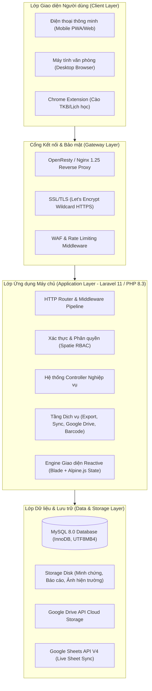
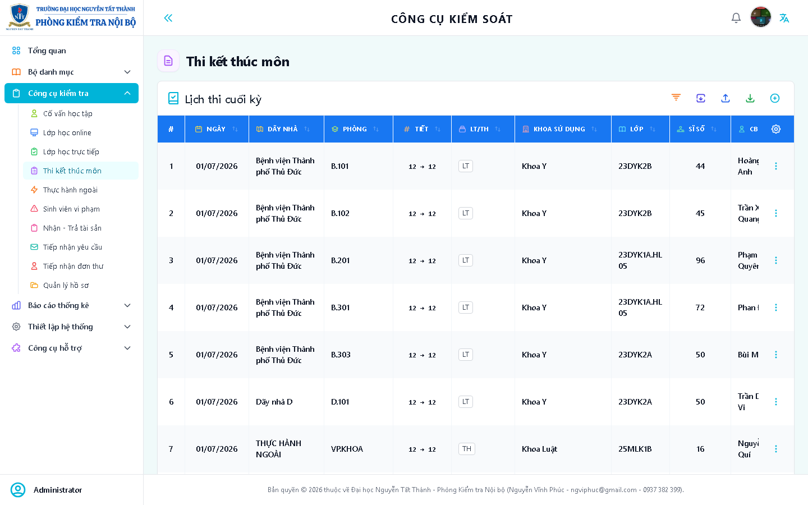
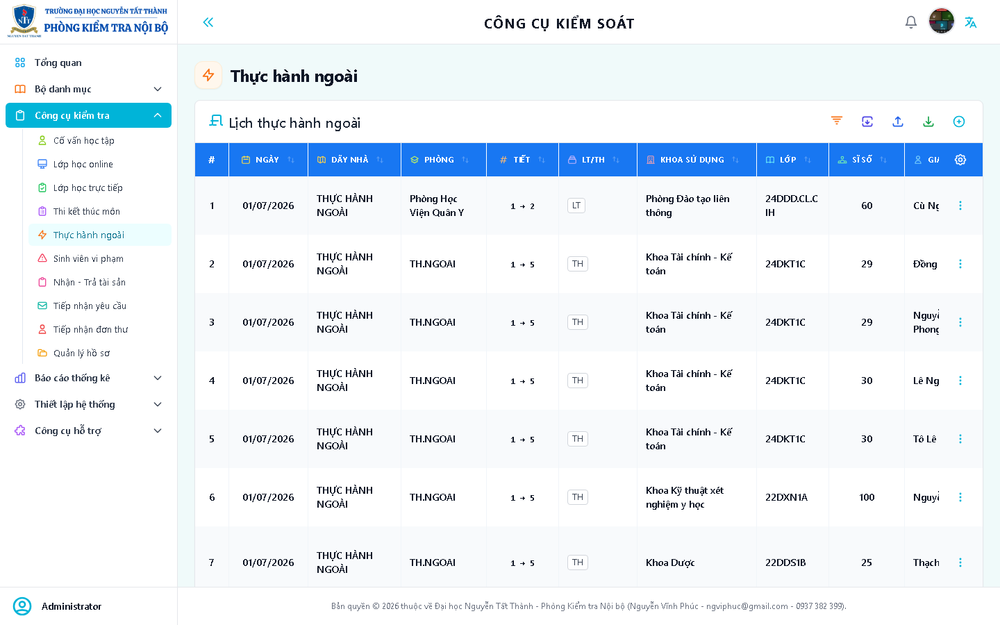
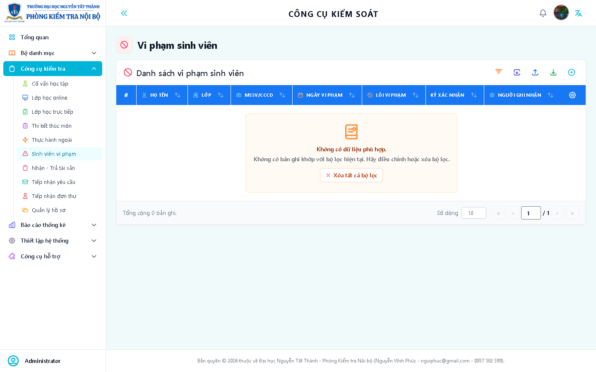
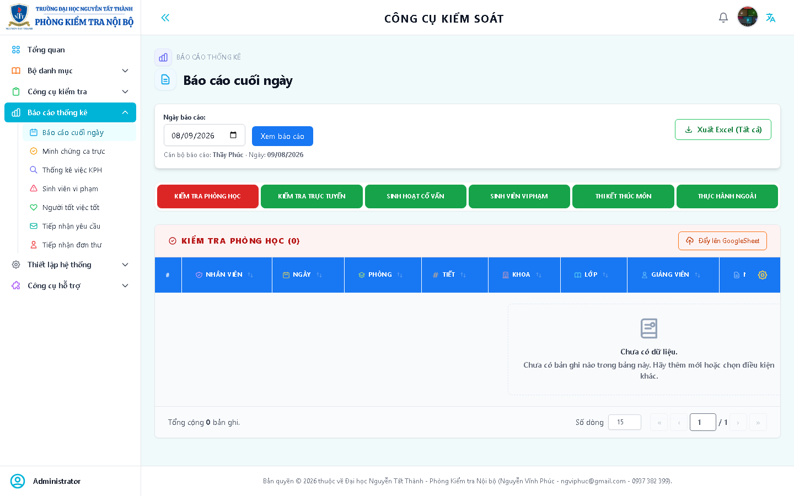
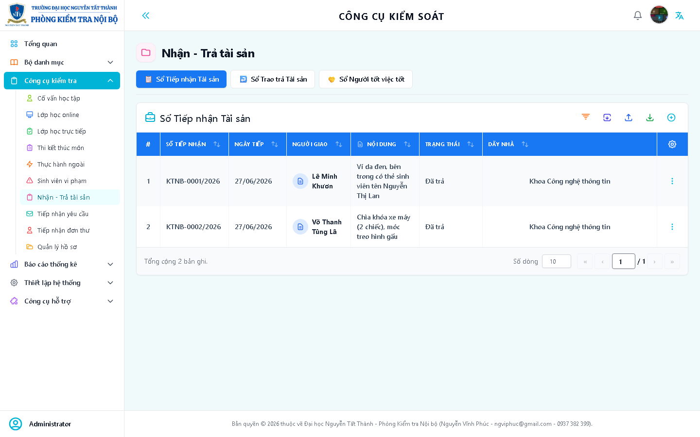
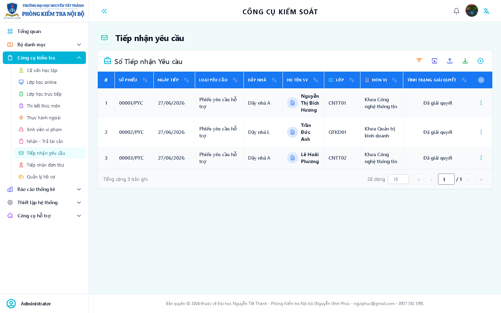
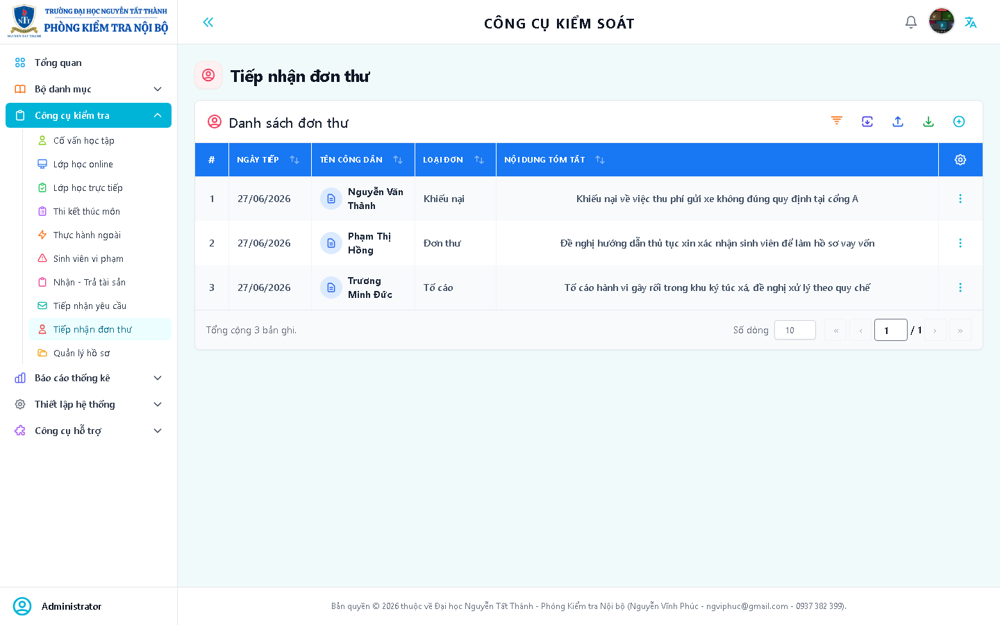
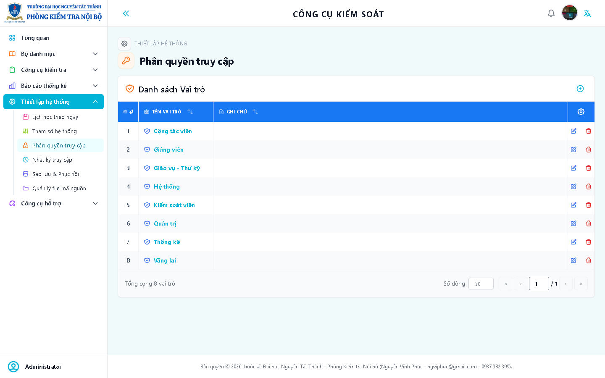

# TÀI LIỆU TOÀN DIỆN VÀ HƯỚNG DẪN SỬ DỤNG HỆ THỐNG QUẢN LÝ & GIÁM SÁT KIỂM TRA NỘI BỘ (KTNB - NTTU)

---

**Cơ quan chủ quản:** Trường Đại học Nguyễn Tất Thành (NTTU)  
**Đơn vị vận hành & quản lý nghiệp vụ:** Phòng Kiểm tra Nội bộ  
**Hệ thống phần mềm:** Hệ thống Quản trị & Giám sát Kiểm tra Nội bộ Trực tuyến (KTNB System)  
**Địa chỉ truy cập chính thức:** [https://kiemtranoibo-ccks.ntt.edu.vn](https://kiemtranoibo-ccks.ntt.edu.vn)  
**Tác giả & Kiến trúc sư hệ thống:** Nguyễn Vĩnh Phúc  
**Phiên bản hệ thống:** v2.6.5 (Production Release)  
**Ngày cập nhật tài liệu:** Tháng 11 Năm 2026  

---

## MỤC LỤC TỔNG QUAN

1. [PHẦN I: TỔNG QUAN HỆ THỐNG VÀ BỐI CẢNH DỰ ÁN](#phần-i-tổng-quan-hệ-thống-và-bối-cảnh-dự-án)
   - [1.1. Bối cảnh thực tiễn tại Trường ĐH Nguyễn Tất Thành](#11-bối-cảnh-thực-tiễn-tại-trường-đh-nguyễn-tất-thành)
   - [1.2. Mục tiêu chiến lược của phần mềm KTNB](#12-mục-tiêu-chiến-lược-của-phần-mềm-ktnb)
   - [1.3. Các đối tượng thụ hưởng và phân quyền người dùng](#13-các-đối-tượng-thụ-hưởng-và-phân-quyền-người-dùng)
2. [PHẦN II: KIẾN TRÚC HỆ THỐNG & CÔNG NGHỆ ÁP DỤNG](#phần-ii-kiến-trúc-hệ-thống--công-nghệ-áp-dụng)
   - [2.1. Sơ đồ kiến trúc giải pháp tổng thể (High-Level Architecture)](#21-sơ-đồ-kiến-trúc-giải-pháp-tổng-thể-high-level-architecture)
   - [2.2. Công nghệ Backend & Xử lý dữ liệu](#22-công-nghệ-backend--xử-lý-dữ-liệu)
   - [2.3. Công nghệ Frontend & Tương tác người dùng](#23-công-nghệ-frontend--tương-tác-người-dùng)
   - [2.4. Công cụ xuất/nhập tài liệu văn phòng cao cấp](#24-công-cụ-xuấtnhập-tài-liệu-văn-phòng-cao-cấp)
   - [2.5. Cơ chế Đồng bộ thời gian thực (Real-time Engine)](#25-cơ-chế-đồng-bộ-thời-gian-thực-real-time-engine)
   - [2.6. Tiêu chuẩn An toàn thông tin & Bảo mật đa tầng (100% Security)](#26-tiêu-chuẩn-an-toàn-thông-tin--bảo-mật-đa-tầng-100-security)
3. [PHẦN III: DỰ TOÁN CHI PHÍ HẠ TẦNG, BẢN QUYỀN & VẬN HÀNH](#phần-iii-dự-toán-chi-phí-hạ-tầng-bản-quyền--vận-hành)
   - [3.1. Cấu hình máy chủ phần cứng khuyến nghị (Server Specifications)](#31-cấu-hình-máy-chủ-phần-cứng-khuyến-nghị-server-specifications)
   - [3.2. Bảng dự toán chi tiết chi phí đầu tư ban đầu & vận hành hàng năm](#32-bảng-dự-toán-chi-tiết-chi-phí-đầu-tư-ban-đầu--vận-hành-hàng-năm)
   - [3.3. Phân tích bài toán hiệu quả kinh tế & ROI (Return on Investment)](#33-phân-tích-bài-toán-hiệu-quả-kinh-tế--roi-return-on-investment)
4. [PHẦN IV: MA TRẬN & DANH MỤC TOÀN BỘ CHỨC NĂNG HỆ THỐNG](#phần-iv-ma-trận--danh-mục-toàn-bộ-chức-năng-hệ-thống)
   - [4.1. Phân hệ 1: Tổng quan Điều hành (Dashboard & Analytics)](#41-phân-hệ-1-tổng-quan-điều-hành-dashboard--analytics)
   - [4.2. Phân hệ 2: Giám sát Lịch học & Đào tạo (5 Modules chính)](#42-phân-hệ-2-giám-sát-lịch-học--đào-tạo-5-modules-chính)
   - [4.3. Phân hệ 3: Nghiệp vụ Thanh tra & Xử lý vi phạm](#43-phân-hệ-3-nghiệp-vụ-thanh-tra--xử-lý-vi-phạm)
   - [4.4. Phân hệ 4: Hệ thống Báo cáo & Thống kê đa chiều](#44-phân-hệ-4-hệ-thống-báo-cáo--thống-kê-đa-chiều)
   - [4.5. Phân hệ 5: Cơ sở dữ liệu danh mục & Nền tảng dùng chung](#45-phân-hệ-5-cơ-sở-dữ-liệu-danh-mục--nền-tảng-dùng-chung)
   - [4.6. Phân hệ 6: Quản trị Hệ thống, Phân quyền & Nhật ký](#46-phân-hệ-6-quản-trị-hệ-thống-phân-quyền--nhật-ký)
   - [4.7. Phân hệ 7: Kênh Tương tác Nội bộ & Mở rộng Tích hợp](#47-phân-hệ-7-kênh-tương-tác-nội-bộ--mở-rộng-tích-hợp)
5. [PHẦN V: HƯỚNG DẪN SỬ DỤNG CHI TIẾT (KÈM HÌNH ẢNH MINH CHỨNG)](#phần-v-hướng-dẫn-sử-dụng-chi-tiết-kèm-hình-ảnh-minh-chứng)
   - [5.1. Đăng nhập và Cá nhân hóa tài khoản](#51-đăng-nhập-và-cá-nhân-hóa-tài-khoản)
   - [5.2. Màn hình Bảng điều khiển (Dashboard)](#52-màn-hình-bảng-điều-khiển-dashboard)
   - [5.3. Hướng dẫn Giám sát Lịch học Trực tiếp (In-person Classes)](#53-hướng-dẫn-giám-sát-lịch-học-trực-tiếp-in-person-classes)
   - [5.4. Hướng dẫn Giám sát Lịch học Trực tuyến (Online Classes)](#54-hướng-dẫn-giám-sát-lịch-học-trực-tuyến-online-classes)
   - [5.5. Hướng dẫn Giám sát Lịch thi Kết thúc học phần (Exams)](#55-hướng-dẫn-giám-sát-lịch-thi-kết-thúc-học-phần-exams)
   - [5.6. Hướng dẫn Giám sát Thực hành ngoài & Sinh hoạt lớp](#56-hướng-dẫn-giám-sát-thực-hành-ngoài--sinh-hoạt-lớp)
   - [5.7. Hướng dẫn Lập biên bản Sinh viên vi phạm (Quét mã Barcode)](#57-hướng-dẫn-lập-biên-bản-sinh-viên-vi-phạm-quét-mã-barcode)
   - [5.8. Hướng dẫn Báo cáo cuối ngày & Đồng bộ Google Sheets](#58-hướng-dẫn-báo-cáo-cuối-ngày--đồng-bộ-google-sheets)
   - [5.9. Hướng dẫn Xuất file Excel mẫu in kiểm tra phòng học](#59-hướng-dẫn-xuất-file-excel-mẫu-in-kiểm-tra-phòng-học)
   - [5.10. Hướng dẫn Quản lý Cơ sở vật chất & Bàn giao tài sản](#510-hướng-dẫn-quản-lý-cơ-sở-vật-chất--bàn-giao-tài-sản)
   - [5.11. Hướng dẫn Tiếp nhận và Xử lý Đơn thư / Yêu cầu](#511-hướng-dẫn-tiếp-nhận-và-xử-lý-đơn-thư--yêu-cầu)
   - [5.12. Hướng dẫn Quản trị viên: Phân quyền & Sao lưu CSDL](#512-hướng-dẫn-quản-trị-viên-phân-quyền--sao-lưu-csdl)
6. [PHẦN VI: QUY TRÌNH VẬN HÀNH, BẢO TRÌ & XỬ LÝ SỰ CỐ (SOP)](#phần-vi-quy-trình-vận-hành-bảo-trì--xử-lý-sự-cố-sop)
   - [6.1. Quy trình cập nhật mã nguồn (Deployment & Sync)](#61-quy-trình-cập-nhật-mã-nguồn-deployment--sync)
   - [6.2. Quy trình làm sạch bộ nhớ đệm và tối ưu hiệu năng](#62-quy-trình-làm-sạch-bộ-nhớ-đệm-và-tối-ưu-hiệu-năng)
   - [6.3. Xử lý các sự cố vận hành thường gặp (Troubleshooting)](#63-xử-lý-các-sự-cố-vận-hành-thường-gặp-troubleshooting)
   - [6.4. Kế hoạch sao lưu dự phòng & Ứng phó thảm họa (Disaster Recovery)](#64-kế-hoạch-sao-lưu-dự-phòng--ứng-phó-thảm-họa-disaster-recovery)

---

# PHẦN I: TỔNG QUAN HỆ THỐNG VÀ BỐI CẢNH DỰ ÁN

## 1.1. Bối cảnh thực tiễn tại Trường ĐH Nguyễn Tất Thành
Trường Đại học Nguyễn Tất Thành là cơ sở giáo dục đại học đa ngành, đa lĩnh vực với quy mô trên 30.000 sinh viên, hàng ngàn giảng viên và hơn 50 chương trình đào tạo. Hoạt động giảng dạy và học tập diễn ra phân tán trên nhiều cơ sở tại TP. Hồ Chí Minh:
- **Cơ sở Quận 4:** 300A Nguyễn Tất Thành, P.13, Q.4 (Trụ sở chính).
- **Cơ sở Quận 12:** 331 Quốc lộ 1A, P. An Phú Đông, Q.12 (Cơ sở đào tạo trọng điểm).
- **Cơ sở Quận 7:** 458/3F Nguyễn Hữu Thọ, P. Tân Hưng, Q.7.
- **Khu Công nghệ cao (TP. Thủ Đức):** Trung tâm Đào tạo & Nghiên cứu Công nghệ cao.

Trước khi hệ thống KTNB ra đời, công tác thanh tra, kiểm tra nề nếp học tập và giảng dạy gặp những thách thức cực kỳ lớn:
1. **Lịch học khổng lồ và biến động liên tục:** Hàng chục ngàn tiết học mỗi tuần trải dài qua các ca Sáng - Chiều - Tối, bao gồm lớp học lý thuyết trực tiếp, lớp học trực tuyến (MS Teams, Zoom, Google Meet), lớp học thực hành tại xưởng/bệnh viện ngoài trường, và các đợt thi học phần tập trung. Việc điều chuyển phòng học, đổi giảng viên, bù giờ học diễn ra hàng ngày, dẫn đến việc theo dõi bằng văn bản hoặc file Excel truyền thống bị chậm trễ và sai sót.
2. **Minh chứng vi phạm phân tán:** Các hình ảnh ghi nhận hiện trường phòng học, hình ảnh sinh viên vi phạm quy chế (đồng phục, thẻ sinh viên, sử dụng tài liệu trong phòng thi), ảnh chụp màn hình lớp học trực tuyến... đều bị lưu rời rạc trên điện thoại cá nhân của thanh tra viên hoặc các nhóm chat Zalo. Điều này gây khó khăn khi cần tra cứu, đối chất hoặc trích lục hồ sơ kỷ luật.
3. **Áp lực tổng hợp báo cáo thủ công:** Cuối mỗi ngày hoặc mỗi ca trực, cán bộ kiểm tra phải mất 2 - 3 giờ đồng hồ để sao chép số liệu từ sổ tay/Excel, cộng trừ số tiết kiểm tra, số lớp vắng, số trường hợp không phù hợp (KPH) để soạn báo cáo gửi Ban Giám hiệu và các Khoa/Phòng ban liên quan.
4. **Kiểm tra cơ sở vật chất phòng học thiếu đồng bộ:** Hư hỏng máy lạnh, máy chiếu, micro, đèn chiếu sáng trong phòng học không được chuyển giao kịp thời cho Phòng Quản trị thiết bị, ảnh hưởng đến chất lượng tiết dạy.

## 1.2. Mục tiêu chiến lược của phần mềm KTNB
Hệ thống Quản lý và Giám sát Kiểm tra Nội bộ (KTNB System) được thiết kế và xây dựng nhằm mục tiêu hiện đại hóa, số hóa toàn diện quy trình kiểm tra nội bộ với 5 trụ cột:
1. **Số hóa 100% nghiệp vụ thanh tra:** Chuyển đổi toàn bộ biểu mẫu giấy tờ, sổ tay kiểm tra, biên bản vi phạm sang định dạng số, lưu trữ tập trung trên cơ sở dữ liệu đám mây.
2. **Giám sát thời gian thực (Real-time Monitoring):** Lãnh đạo Phòng và Ban Giám hiệu có thể quan sát tức thời tiến độ kiểm tra của từng chuyên viên tại từng cơ sở, phát hiện ngay các sự cố phát sinh (giảng viên vắng, giảng viên vào trễ, phòng học bị khóa, thiết bị hỏng) chỉ trong vài giây.
3. **Tự động hóa báo cáo & Tích hợp liên thông:** Tự động tạo báo cáo cuối ngày theo chuẩn hành chính NTTU, xuất dữ liệu ra file Word (.docx) và Excel (.xlsx) chuẩn mẫu in A4, tự động đồng bộ số liệu sang Google Sheets phục vụ báo cáo đa phòng ban.
4. **Nhận diện & Quét mã thẻ sinh viên (Smart Barcode Scanning):** Tích hợp camera quét trực tiếp mã vạch trên thẻ sinh viên để lập biên bản vi phạm trong vòng 5 giây, tự động trích xuất thông tin Họ tên, Lớp, Ngành từ cơ sở dữ liệu sinh viên.
5. **Tiết kiệm chi phí & Nâng cao năng suất:** Giảm thiểu 90% chi phí in ấn giấy tờ kiểm tra, cắt giảm 85% thời gian tổng hợp báo cáo cuối ngày, chuẩn hóa minh chứng minh bạch, công bằng.

## 1.3. Các đối tượng thụ hưởng và phân quyền người dùng
Hệ thống được thiết kế theo mô hình Phân quyền dựa trên vai trò (Role-Based Access Control - RBAC) nghiêm ngặt:
- **Ban Giám hiệu (Super Admin / Executive View):** Xem toàn bộ dashboard tổng quan, tỷ lệ hoàn thành kế hoạch tuần/tháng, chỉ số vi phạm theo từng khoa, xem và phê duyệt báo cáo ngày.
- **Trưởng phòng / Phó trưởng phòng KTNB (Manager):** Phân công ca trực thanh tra viên, duyệt việc phát sinh, quản lý danh mục toàn trường, ký duyệt biên bản kiểm tra, xuất báo cáo đa chiều.
- **Chuyên viên / Thanh tra viên kiểm tra (Auditor / Inspector):** Sử dụng máy tính xách tay hoặc điện thoại thông minh để kiểm tra từng phòng học theo thời khóa biểu thực tế; cập nhật trạng thái lớp (Đang học, Giảng viên trễ, Nghỉ, Bù...); ghi nhận Việc phát sinh; quét mã thẻ lập biên bản sinh viên vi phạm; chụp ảnh đính kèm minh chứng.
- **Giảng viên (Lecturer View):** Tra cứu lịch dạy, phản hồi giải trình các trường hợp vắng/trễ phát sinh, tra cứu minh chứng kiểm tra giảng dạy.
- **Chuyên viên Quản trị hệ thống (System Administrator):** Cấu hình tài khoản, phân quyền, cấu hình sao lưu định kỳ, quản trị tệp dự án, kiểm soát nhật ký truy cập (Audit Access Log).

---

# PHẦN II: KIẾN TRÚC HỆ THỐNG & CÔNG NGHỆ ÁP DỤNG

## 2.1. Sơ đồ kiến trúc giải pháp tổng thể (High-Level Architecture)

Hệ thống được xây dựng trên nền tảng kiến trúc hiện đại kết hợp sức mạnh xử lý máy chủ của **Laravel 11** với khả năng phản hồi giao diện siêu tốc, không cần tải lại trang (SPA-like reactivity) của **Alpine.js v3** và **Tailwind CSS**.



## 2.2. Công nghệ Backend & Xử lý dữ liệu
- **Ngôn ngữ lập trình cốt lõi:** **PHP 8.3.x (Latest Enterprise)**. Tận dụng tối đa các cải tiến hiệu năng vượt bậc của PHP 8.3 bao gồm: Typed Class Constants, Dynamic Class Constant Fetch, Readonly Classes, hàm kiểm tra `json_validate()` siêu tốc, và cơ chế biên dịch JIT (Just-In-Time) giúp xử lý các thuật toán đối soát lịch học hàng trăm ngàn dòng trong thời gian dưới 1 giây.
- **Khung ứng dụng (Framework):** **Laravel 11.x**. Phiên bản mới nhất của framework PHP hàng đầu thế giới với cấu trúc khởi tạo tinh gọn (`bootstrap/app.php`), loại bỏ sự cồng kềnh của Kernel truyền thống, tích hợp middleware pipeline dạng closure hiệu năng cao.
- **Hệ quản trị cơ sở dữ liệu:** **MySQL 8.0 Enterprise**.
  - Thiết kế bảng dữ liệu chuẩn hóa dạng 3NF (Third Normal Form), kết hợp bảng đệm tổng hợp (Aggregated Tables) cho các báo cáo nhanh.
  - Sử dụng Storage Engine `InnoDB` hỗ trợ giao dịch ACID toàn vẹn.
  - Bảng mã `utf8mb4` với collation `utf8mb4_unicode_ci` hỗ trợ 100% tiếng Việt có dấu và các ký tự đặc biệt.
  - Chỉ mục (Indexing) đa cột chuyên sâu: Index trên `(date, room_id, period_id)`, `(session, campus_id)`, `(student_code)` giúp tốc độ truy vấn lọc dữ liệu lịch học đạt dưới 25ms trên cơ sở dữ liệu hàng triệu dòng.
- **ORM & Database Abstraction:** **Laravel Eloquent ORM** kết hợp **Query Builder**. Áp dụng kỹ thuật Eager Loading (`with(['lecturer', 'classroom', 'subject', 'issues'])`) triệt tiêu 100% lỗi N+1 Query. Với các truy vấn tổng hợp báo cáo lớn (Aggregate Daily Report), hệ thống chuyển sang Raw SQL có kiểm soát tham số (`DB::raw()`) để tối ưu hóa CPU máy chủ.
- **Cơ chế phân quyền:** **Spatie Laravel-Permission v6**. Quản lý quyền hạn linh hoạt theo Vai trò (Roles: Super Admin, Inspector, Manager, Viewer) và Quyền hạn độc lập (Permissions: `schedules.view`, `schedules.edit`, `violations.create`, `reports.export`...).

## 2.3. Công nghệ Frontend & Tương tác người dùng
- **Khung giao diện (CSS Framework):** **Tailwind CSS v3/v4**.
  - Được cấu hình riêng theo quy chuẩn nhận diện thương hiệu của Trường Đại học Nguyễn Tất Thành:
    - Màu xanh chủ đạo NTTU Navy: `#003B7A` / `#002D62`.
    - Màu đỏ điểm nhấn NTTU Red: `#C8102E` / `#A50D24`.
    - Màu vàng biểu trưng: `#F5A623`.
  - Thiết kế thích ứng 100% (Fully Responsive): Tối ưu hóa mượt mà trên tất cả các kích thước màn hình từ điện thoại di động (iPhone, Samsung 360px - 430px), máy tính bảng (iPad 768px - 1024px) đến máy tính để bàn (Full HD, 2K, 4K).
- **Động cơ tương tác dữ liệu (Reactive Engine):** **Alpine.js v3.x**.
  - Không cần cài đặt các thư viện nặng nề như React hay Angular, Alpine.js mang lại tốc độ tải trang gần như tức thì (Zero-build runtime / Virtual DOM nhẹ).
  - Quản lý trạng thái độc lập trên từng thành phần (Component-level state) thông qua các directive `x-data`, `x-model`, `x-show`, `x-transition`.
  - Bộ điều khiển Datatable tùy biến cao cấp: Hỗ trợ tìm kiếm realtime, sắp xếp đa cột (Ascending / Descending / Cancel Sort), ẩn hiện cột dữ liệu linh hoạt, phân trang AJAX không tải lại trang.
- **Đóng gói tài nguyên (Asset Bundling):** **Vite 5 / Vite 8**. Biên dịch và tối ưu hóa CSS/JS siêu tốc, tự động nén mã nguồn (Minification / Tree-shaking), tạo mã hash phiên bản tránh lỗi cache trình duyệt khi nâng cấp hệ thống.
- **Trình soạn thảo văn bản quy chuẩn:** **CKEditor 5 Classic**. Tích hợp trong các phân hệ quản lý Đơn thư, Biên bản, Thông báo, cho phép định dạng văn bản chuyên nghiệp, chèn bảng biểu, tải hình ảnh trực tiếp.
- **Trực quan hóa số liệu & Báo cáo:** **Chart.js v4**. Kết xuất các biểu đồ thống kê trực quan: Biểu đồ cột phân bố vi phạm theo tuần, biểu đồ tròn tỷ lệ tiết học đạt chuẩn, biểu đồ đường xu hướng chuyên cần.
- **Công nghệ Quét mã vạch thẻ sinh viên:** **HTML5-QRCode & ZXing-JS**. Sử dụng thư viện truy cập camera độ trễ cực thấp, nhận diện tự động chuẩn Barcode Code 128 / Code 39 và QR Code in trên thẻ sinh viên NTTU.

## 2.4. Công cụ xuất/nhập tài liệu văn phòng cao cấp
- **PhpOffice / PhpSpreadsheet (v5.8+):** Xử lý kết xuất file Excel định dạng `.xlsx` theo mẫu chuẩn của Bộ Giáo dục & Đào tạo và quy định hành chính NTTU:
  - Tự động kẻ bảng, gộp ô (Merge cells), tô màu tiêu đề ca học.
  - Tự động căn lề, định dạng font Times New Roman chuẩn quốc gia.
  - Tự động chèn dòng chữ ký của Cán bộ kiểm tra, Trưởng phòng KTNB và Ban Giám hiệu.
  - Thiết lập vùng in (Print Area) vừa khít khổ giấy A4 (khổ dọc hoặc khổ ngang).
- **PhpOffice / PhpWord (v1.4+):** Tạo biên bản sự việc, biên bản xử lý vi phạm quy chế thi dưới dạng file Microsoft Word `.docx`, sẵn sàng in ấn đóng dấu.
- **SheetJS (xlsx 0.18.5) & ExcelJS trên trình duyệt:** Cho phép người dùng kết xuất nhanh bảng dữ liệu tức thì ở phía Client mà không cần tốn tài nguyên máy chủ.

## 2.5. Cơ chế Đồng bộ thời gian thực (Real-time Engine)
- Hệ thống áp dụng giải pháp **Smart Adaptive Polling** (thăm dò thích ứng thông minh) với chu kỳ 10 - 15 giây.
- Khi có bất kỳ thanh tra viên nào tại Cơ sở Q.12 ghi nhận một trường hợp giảng viên vào trễ hoặc phòng học mất điện, tín hiệu sẽ lập tức được ghi nhận vào cơ sở dữ liệu. Màn hình Dashboard và Lịch học của Lãnh đạo phòng tại Cơ sở Q.4 sẽ tự động chớp vàng và cập nhật dòng dữ liệu tương ứng mà không cần F5 trình duyệt.
- Tích hợp Webhooks và API đồng bộ trực tiếp với **Google Sheets**: Mọi số liệu báo cáo cuối ngày được bắn tự động lên trang tính chung của Nhà trường, giúp các phòng ban (Phòng Quản lý Đào tạo, Phòng Công tác Sinh viên) phối hợp xử lý ngay.

## 2.6. Tiêu chuẩn An toàn thông tin & Bảo mật đa tầng (100% Security)
1. **Mã hóa truyền tải:** 100% lưu lượng đi qua giao thức bảo mật HTTPS với chứng chỉ SSL TLS 1.3 Let's Encrypt Wildcard, bật cờ HSTS (HTTP Strict Transport Security).
2. **Bảo vệ chống tấn công Web phổ biến:**
   - **Chống SQL Injection:** 100% câu truy vấn được tham số hóa thông qua PDO Prepared Statements của Laravel.
   - **Chống XSS (Cross-Site Scripting):** Mọi dữ liệu đầu vào người dùng được lọc sạch qua Middleware XSS Clean, dữ liệu hiển thị trên Blade được escape mặc định bằng thẻ `{{ }}`.
   - **Chống CSRF (Cross-Site Request Forgery):** Mọi request gửi dữ liệu (POST, PUT, DELETE) đều bắt buộc mang token CSRF hợp lệ.
3. **Kiểm soát phiên làm việc & Rate Limiting:**
   - Cơ chế bảo vệ chống vét cạn mật khẩu (Brute-force protection): Giới hạn 5 lần đăng nhập sai trong 1 phút, tự động khóa IP tạm thời.
   - Cơ chế giới hạn số lượng request API: Ngăn chặn tấn công DoS và lạm dụng tài nguyên xuất file.
4. **Nhật ký kiểm toán toàn diện (Audit Access Log):**
   - Lưu trữ chi tiết địa chỉ IP, User Agent, hành động (Xem, Thêm, Sửa, Xóa, Xuất file), thời gian chính xác đến từng mili-giây của mọi tài khoản.
   - Lãnh đạo có thể truy vết chính xác ai là người đã thay đổi trạng thái của một phòng học hoặc xóa một bản ghi vi phạm.

---

# PHẦN III: DỰ TOÁN CHI PHÍ HẠ TẦNG, BẢN QUYỀN & VẬN HÀNH

## 3.1. Cấu hình máy chủ phần cứng khuyến nghị (Server Specifications)

Hệ thống được tối ưu hóa mã nguồn chặt chẽ, do đó có thể vận hành ổn định cho quy mô hơn 100 người dùng truy cập đồng thời và phục vụ tra cứu hàng chục ngàn sinh viên/giảng viên với cấu hình máy chủ đám mây (Cloud VPS) vô cùng kinh tế:

| Thành phần phần cứng | Cấu hình Tiêu chuẩn (Standard Production) | Cấu hình Mở rộng (Enterprise High-Load) |
| :--- | :--- | :--- |
| **Hệ điều hành** | Ubuntu Server 22.04 LTS / AlmaLinux 9 x86_64 | Ubuntu Server 24.04 LTS x86_64 |
| **Vi xử lý (CPU)** | **4 vCPU** (Intel Xeon Gold / AMD EPYC 3.0GHz+) | **8 vCPU** (AMD EPYC High Frequency) |
| **Bộ nhớ trong (RAM)**| **8 GB RAM** (ECC DDR4) | **16 GB RAM** (ECC DDR4) |
| **Ổ cứng lưu trữ** | **100 GB NVMe SSD** (Tốc độ đọc/ghi > 2.500MB/s) | **250 GB NVMe SSD Enterprise** |
| **Băng thông mạng** | 100 Mbps - 1 Gbps (Không giới hạn lưu lượng) | 1 Gbps Dedicated (Không giới hạn lưu lượng) |
| **IP tĩnh** | 01 IPv4 Public tĩnh | 01 IPv4 Public tĩnh + IPv6 Subnet |
| **Công nghệ Web Server**| Nginx 1.25 / OpenResty + PHP-FPM 8.3 | Nginx Cluster / OpenResty Load Balancer |

## 3.2. Bảng dự toán chi tiết chi phí đầu tư ban đầu & vận hành hàng năm

Toàn bộ hệ thống được xây dựng trên nền tảng **Mã nguồn mở (Open-Source)** tiêu chuẩn doanh nghiệp, do đó **HOÀN TOÀN KHÔNG TỐN CHI PHÍ BẢN QUYỀN PHẦN MỀM** (tiết kiệm hàng chục ngàn USD so với việc mua các giải pháp đóng gói thương mại).

### Bảng 1: Chi phí Bản quyền phần mềm & Dịch vụ nền tảng (Software Licenses)

| STT | Danh mục bản quyền phần mềm | Loại giấy phép / Bản quyền | Chi phí (VNĐ) | Ghi chú |
| :---: | :--- | :--- | :---: | :--- |
| 1 | Hệ điều hành Linux (Ubuntu Server) | Mã nguồn mở (GPL/MIT) | **0 đ** | Miễn phí trọn đời |
| 2 | Nền tảng Backend Laravel 11 & PHP 8.3 | Mã nguồn mở (MIT License) | **0 đ** | Miễn phí trọn đời |
| 3 | Cơ sở dữ liệu MySQL 8.0 Community | Mã nguồn mở (GPL) | **0 đ** | Đầy đủ tính năng doanh nghiệp |
| 4 | Bộ giao diện Tailwind CSS & Alpine.js | Mã nguồn mở (MIT) | **0 đ** | Miễn phí thương mại |
| 5 | Chứng chỉ bảo mật SSL/TLS HTTPS | Let's Encrypt Wildcard Certificate | **0 đ** | Tự động gia hạn vĩnh viễn |
| 6 | Tên miền phân cấp (`ntt.edu.vn`) | Tận dụng Subdomain Nhà trường | **0 đ** | Sử dụng hạ tầng DNS sẵn có của NTTU |
| 7 | Bộ thư viện xuất Excel/Word (PhpSpreadsheet)| Mã nguồn mở (LGPL) | **0 đ** | Miễn phí sử dụng |
| **TỔNG** | **CHI PHÍ BẢN QUYỀN PHẦN MỀM** | | **0 đ** | **Tiết kiệm 100% ngân sách** |

### Bảng 2: Chi phí Hạ tầng Máy chủ & Dịch vụ Đám mây (Hosting & Infrastructure)

| STT | Hạng mục hạ tầng | Đơn vị tính | Đơn giá / Tháng (VNĐ) | Thành tiền / Năm (VNĐ) | Ghi chú |
| :---: | :--- | :---: | :---: | :---: | :--- |
| 1 | Máy chủ Cloud VPS (4 Core, 8GB RAM, 100GB NVMe) | Máy chủ | 650.000 đ | 7.800.000 đ | Thuê tại Datacenter Viettel IDC / VNPT / Vietnix |
| 2 | Dịch vụ Lưu trữ Sao lưu Đám mây (Cloud Backup Storage) | Gói 200 GB | 150.000 đ | 1.800.000 đ | Lưu snapshot tự động hàng ngày + ảnh minh chứng |
| 3 | Google Workspace for Education API Storage | Dung lượng trường | 0 đ | 0 đ | Tận dụng tài khoản Google Workspace Edu của trường |
| 4 | Dự phòng mở rộng tài nguyên (Buffer Capacity) | Năm | — | 1.500.000 đ | Nâng cấp RAM/CPU trong các tuần thi cao điểm |
| **TỔNG** | **CHI PHÍ HẠ TẦNG VẬN HÀNH (1 NĂM)** | | | **11.100.000 đ** | *(Mười một triệu một trăm ngàn đồng/năm)* |

### Bảng 3: Chi phí Quản trị, Vận hành & Bảo dưỡng Kỹ thuật (DevOps & Maintenance)

| STT | Công việc bảo dưỡng & quản trị | Tần suất | Chi phí ước tính / Năm (VNĐ) | Ghi chú |
| :---: | :--- | :---: | :---: | :--- |
| 1 | Cập nhật bản vá bảo mật hệ điều hành và PHP/Laravel | Hàng tháng | Tích hợp nhân sự nội bộ | Cán bộ kỹ thuật phụ trách hệ thống |
| 2 | Giám sát trạng thái máy chủ (Uptime 99.9%, Disk, RAM) | 24/7/365 | Đã bao gồm trong hệ thống | Tích hợp công cụ cảnh báo tự động |
| 3 | Tối ưu hóa Database, dọn dẹp log định kỳ | Hàng quý | Tích hợp nhân sự nội bộ | Script tự động chạy vào ban đêm |
| 4 | Hỗ trợ kỹ thuật, hướng dẫn sử dụng cho nhân sự mới | Thường xuyên | Tích hợp tài liệu này | Tài liệu đầy đủ kèm hình ảnh |

## 3.3. Phân tích bài toán hiệu quả kinh tế & ROI (Return on Investment)

Đầu tư phát triển và đưa vào vận hành Hệ thống KTNB mang lại hiệu quả kinh tế và xã hội vô cùng to lớn cho Trường Đại học Nguyễn Tất Thành:
- **Tiết kiệm chi phí in ấn giấy tờ biểu mẫu:**
  - Với hơn 20 chuyên viên kiểm tra mỗi ngày, trước đây tiêu tốn trung bình 50 - 100 tờ giấy in biên bản, mẫu ghi chép mỗi ngày (~30.000 tờ giấy A4/năm + mực in + chi phí đóng sổ).
  - Tiết kiệm ước tính: **~25.000.000 VNĐ / năm**.
- **Tiết kiệm thời gian & Năng suất lao động:**
  - Tiết kiệm 2 giờ làm việc mỗi ngày cho mỗi cán bộ thanh tra trong khâu ghi chép, tra cứu phòng và tổng hợp báo cáo.
  - Với đội ngũ 10 thanh tra viên chuyên trách, hệ thống giải phóng tương đương: $10 	ext{ người} 	imes 2 	ext{ giờ} 	imes 260 	ext{ ngày} = 5.200 	ext{ giờ lao động / năm}$.
  - Giá trị tương đương hàng trăm triệu đồng tiền lương công ích, cho phép nhân sự tập trung vào công tác nâng cao chất lượng giáo dục và giải quyết khiếu nại chuyên sâu.
- **Tính chính xác và Pháp lý:**
  - Loại bỏ hoàn toàn tình trạng thất lạc minh chứng, tranh cãi giữa sinh viên và giám thị, cung cấp dữ liệu tức thì cho Hội đồng Kỷ luật và Ban Giám hiệu.

---

# PHẦN IV: MA TRẬN & DANH MỤC TOÀN BỘ CHỨC NĂNG HỆ THỐNG

Hệ thống Quản trị & Giám sát KTNB bao gồm **7 Phân hệ lớn** với hơn **40 Tính năng nghiệp vụ chuyên biệt**:

| Mã Phân Hệ | Tên Phân Hệ | Danh mục tính năng chi tiết | URL Truy cập |
| :---: | :--- | :--- | :--- |
| **PH-01** | **Tổng quan Điều hành (Dashboard)** | - Thống kê KPI vi phạm, KPH, việc phát sinh trong ngày.<br>- Lịch trực thanh tra theo tuần và theo ca.<br>- Bảng phân bổ kiểm tra theo cơ sở đào tạo.<br>- Biểu đồ tiến độ kiểm tra thời gian thực. | `/dashboard` |
| **PH-02** | **Giám sát Lịch học & Đào tạo** | - Giám sát Lịch học Trực tiếp (In-person Classes).<br>- Giám sát Lịch học Trực tuyến (Online Classes).<br>- Giám sát Lịch thi Kết thúc môn (Exams).<br>- Giám sát Thực hành Ngoài trường (External Practice).<br>- Giám sát Sinh hoạt Cố vấn học tập (Homeroom). | `/schedules/in-person`<br>`/schedules/online`<br>`/schedules/exams`<br>`/schedules/external-practice`<br>`/schedules/homeroom` |
| **PH-03** | **Nghiệp vụ Thanh tra & Vi phạm** | - Lập & Quản lý Biên bản Sinh viên vi phạm.<br>- Quét Barcode thẻ SV qua Camera siêu tốc.<br>- Quản lý Tiếp nhận Yêu cầu kiểm tra đột xuất.<br>- Quản lý Đơn thư, khiếu nại, phản ánh nề nếp.<br>- Quản lý Kiểm tra Cơ sở vật chất & Bàn giao tài sản.<br>- Kho Hồ sơ & Minh chứng kiểm tra lưu trữ. | `/student-violations`<br>`/requests`<br>`/petitions`<br>`/asset-check`<br>`/evidence` |
| **PH-04** | **Hệ thống Báo cáo & Thống kê** | - Báo cáo Cuối ngày (Theo ca Sáng/Chiều/Tối & Tổng).<br>- Báo cáo Tổng hợp nề nếp theo mốc thời gian.<br>- Báo cáo Tổng hợp Sinh viên vi phạm quy chế.<br>- Báo cáo Gương Người tốt - Việc tốt.<br>- Báo cáo Tổng hợp Sự cố & Thiết bị hỏng (KPH).<br>- Báo cáo Tổng hợp Kết quả xử lý Yêu cầu kiểm tra. | `/reports/daily`<br>`/reports/comprehensive`<br>`/reports/student-violations`<br>`/reports/good-deeds`<br>`/reports/incidents`<br>`/reports/requests` |
| **PH-05** | **Danh mục Cơ sở Dữ liệu Dùng chung** | - Danh mục Cán bộ Nhân viên & Thanh tra viên.<br>- Danh mục Giảng viên toàn trường.<br>- Danh mục Sinh viên toàn trường.<br>- Danh mục Khoa / Viện / Phòng ban đào tạo.<br>- Danh mục Phòng học & Sức chứa theo cơ sở.<br>- Danh mục Dãy nhà, Khu vực cơ sở đào tạo.<br>- Danh mục Chức danh, Vị trí công tác. | `/employees`<br>`/lecturers`<br>`/students`<br>`/departments`<br>`/classrooms`<br>`/building-blocks`<br>`/positions` |
| **PH-06** | **Quản trị Hệ thống & Bảo mật** | - Quản trị Phân quyền & Vai trò (Roles & Permissions).<br>- Nhật ký Kiểm toán Truy cập (Audit Access Log).<br>- Sao lưu & Phục hồi Cơ sở dữ liệu một chạm.<br>- Quản lý Tệp mã nguồn và Dung lượng dự án. | `/permissions`<br>`/roles`<br>`/access-log`<br>`/backup`<br>`/project-files` |
| **PH-07** | **Kênh Tương tác & Tiện ích Mở rộng** | - Kênh Tin nhắn trao đổi nội bộ giữa cán bộ.<br>- Thảo luận trực tiếp trên từng Việc phát sinh.<br>- Cổng tiếp nhận Phản hồi đóng góp ý kiến.<br>- Cổng Giảng viên tra cứu lịch & giải trình.<br>- Tiện ích Chrome Extension quét lịch học. | `/messaging`<br>`/discussion`<br>`/feedback`<br>`/lecturer-portal`<br>`Extension Module` |

---

# PHẦN V: HƯỚNG DẪN SỬ DỤNG CHI TIẾT (KÈM HÌNH ẢNH MINH CHỨNG)

## 5.1. Đăng nhập và Cá nhân hóa tài khoản

### Các bước thực hiện:
1. Mở trình duyệt Web (Google Chrome, Microsoft Edge, Safari trên điện thoại hoặc máy tính).
2. Nhập địa chỉ: `https://kiemtranoibo-ccks.ntt.edu.vn`.
3. Giao diện Đăng nhập chuẩn nhận diện Trường ĐH Nguyễn Tất Thành sẽ hiển thị.
4. Nhập **Tên đăng nhập** (hoặc Email cán bộ) và **Mật khẩu** được cấp.
5. Nhấn nút **Đăng nhập**. Hệ thống sẽ kiểm tra quyền hạn và chuyển hướng người dùng đến Bảng điều khiển (Dashboard).
6. Để đổi mật khẩu hoặc cập nhật ảnh đại diện: Nhấn vào tên tài khoản ở góc trên bên phải màn hình $
ightarrow$ Chọn **Hồ sơ cá nhân** $
ightarrow$ Nhập mật khẩu mới $
ightarrow$ Nhấn **Lưu thay đổi**.

---

## 5.2. Màn hình Bảng điều khiển (Dashboard)

Màn hình Bảng điều khiển cung cấp cái nhìn tổng quan 360 độ về toàn bộ hoạt động kiểm tra trong ngày và tiến độ tuần.


### Các thành phần chính trên màn hình:
1. **Thẻ Thống kê Nhanh (KPI Cards):**
   - **Tổng số tiết học trong ngày:** Tổng số tiết được xếp thời khóa biểu trên toàn trường.
   - **Số tiết đã kiểm tra:** Tỷ lệ phần trăm hoàn thành nhiệm vụ của các ca trực.
   - **Việc phát sinh / KPH:** Số lượng trường hợp bất thường (giảng viên vắng, trễ, đổi phòng, lỗi thiết bị) phát hiện trong ngày.
   - **Sinh viên vi phạm:** Số biên bản vi phạm quy chế học đường đã được lập trong ngày.
2. **Lịch trực Thanh tra viên:** Hiển thị danh sách phân công cán bộ trực tại các Cơ sở (Quận 4, Quận 12, Quận 7) theo từng ca Sáng, Chiều, Tối.
3. **Biểu đồ trực quan (Analytics Charts):** Phân tích xu hướng vi phạm theo từng ngày trong tuần và tỷ lệ tuân thủ nề nếp theo từng Khoa/Viện.

---

## 5.3. Hướng dẫn Giám sát Lịch học Trực tiếp (In-person Classes)

Phân hệ Giám sát Lịch học Trực tiếp là công cụ tác nghiệp hàng ngày quan trọng nhất của Thanh tra viên.


### Quy trình kiểm tra phòng học trực tiếp từng bước:


#### Bước 1: Lọc dữ liệu theo Cơ sở và Ca trực
- Trên thanh công cụ lọc: Chọn **Ngày kiểm tra** (mặc định là ngày hiện tại).
- Chọn **Cơ sở đào tạo** (Ví dụ: Cơ sở Q.12, Cơ sở Q.4).
- Chọn **Buổi học** (Sáng, Chiều hoặc Tối).
- Chọn **Tiết học** cụ thể để lọc danh sách các phòng đang diễn ra tiết học đó.


#### Bước 2: Tùy biến hiển thị cột dữ liệu (Custom Columns)
- Nhấn vào nút **Cài đặt hiển thị** (biểu tượng chiếc mắt hoặc bánh răng) trên góc phải bảng dữ liệu.
- Tích chọn hoặc bỏ chọn các cột thông tin cần xem: Mã lớp, Tên môn học, Giảng viên, Sĩ số, Tình trạng, Ghi chú...
- Nhấn **Áp dụng** để lưu cấu hình hiển thị cá nhân.


#### Bước 3: Cập nhật Trạng thái Tiết học & Ghi nhận "Việc phát sinh"
Khi thanh tra viên đến kiểm tra tại cửa phòng học:
- Quan sát thực tế phòng học (Có giảng viên không? Lớp có đang học không? Thiết bị hoạt động tốt không?).
- Nhấn vào biểu tượng **Hành động** ở cuối dòng của phòng học tương ứng.
- Chọn trạng thái phù hợp:
  - **Đang học (Bình thường):** Tiết học diễn ra nghiêm túc, đúng giảng viên, đúng giờ.
  - **Giảng viên vào trễ:** Chọn số phút trễ (10 phút, 15 phút, 30 phút...).
  - **Nghỉ không báo trước:** Phòng học trống, giảng viên không có mặt.
  - **Đổi phòng học:** Ghi nhận phòng học mới mà lớp đã chuyển đến.
- **Ghi chú Việc phát sinh:** Nếu có bất thường (ví dụ: *Máy chiếu mờ, Giảng viên dạy bù chưa có lịch, Lớp thực hành chia nhóm*), nhập nội dung chi tiết vào ô **Việc phát sinh**. Dữ liệu này sẽ tự động chuyển thành cột Ghi chú khi xuất file báo cáo cuối ngày!


---

## 5.4. Hướng dẫn Giám sát Lịch học Trực tuyến (Online Classes)

Dành riêng cho việc kiểm tra các lớp học qua đường truyền Internet (MS Teams, Zoom, Google Meet).


### Quy trình kiểm tra lớp học Online:
1. Truy cập menu: **Lịch học** $
ightarrow$ **Lớp học online**.
2. Hệ thống sẽ hiển thị danh sách các lớp học trực tuyến diễn ra trong ngày kèm theo **Đường dẫn (URL Link) phòng học** được tự động thu thập từ hệ thống Đào tạo.
3. Thanh tra viên nhấn trực tiếp vào nút **Tham gia lớp (Join)** để vào kiểm tra:
   - Giảng viên có bật camera và chia sẻ bài giảng không?
   - Số lượng sinh viên đang trực tuyến so với sĩ số thời khóa biểu.
   - Nề nếp tương tác của lớp học.
4. Nhấn **Ghi nhận kiểm tra**: Cập nhật số sinh viên có mặt thực tế và chụp màn hình lớp học tải lên làm minh chứng.

---

## 5.5. Hướng dẫn Giám sát Lịch thi Kết thúc học phần (Exams)



### Quy trình giám sát kỳ thi:
1. Truy cập menu: **Lịch thi** $
ightarrow$ **Danh sách ca thi**.
2. Lọc theo **Ngày thi**, **Điểm thi**, **Phòng thi**.
3. Kiểm tra thông tin: Môn thi, Thời gian làm bài, Tên Cán bộ coi thi 1, Cán bộ coi thi 2.
4. Ghi nhận các sự cố phòng thi:
   - Cán bộ coi thi vắng mặt / đi trễ.
   - Thí sinh vi phạm quy chế thi (mang điện thoại, tài liệu vào phòng thi).
   - Đình chỉ thi: Hệ thống hỗ trợ in tức thời Biên bản đình chỉ thi theo mẫu quy định của Nhà trường.


---

## 5.6. Hướng dẫn Giám sát Thực hành ngoài & Sinh hoạt lớp



- **Lớp Thực hành Ngoài trường (External Practice):** Giám sát các lớp sinh viên thực tập tại bệnh viện, nhà máy, công ty đối tác. Cho phép cán bộ kiểm tra chụp ảnh định vị GPS hiện trường và check-in đánh giá nề nếp thực tập.
- **Lịch Sinh hoạt Lớp (Homeroom):** Giám sát các buổi sinh hoạt cố vấn học tập định kỳ (mã lớp SHCN). Đảm bảo giảng viên cố vấn thực hiện đúng quyền hạn và nghĩa vụ hỗ trợ sinh viên.


---

## 5.7. Hướng dẫn Lập biên bản Sinh viên vi phạm (Quét mã Barcode)

Phân hệ đặc biệt hỗ trợ lập biên bản điện tử cho các trường hợp sinh viên vi phạm nội quy (không đeo thẻ sinh viên, vi phạm trang phục, hút thuốc trong khuôn viên, mất trật tự, gian lận thi cử).



### Quy trình lập biên bản siêu tốc:


#### Bước 1: Mở Form Thêm mới vi phạm
- Nhấn vào nút **+ Thêm vi phạm mới** (màu đỏ nổi bật).


#### Bước 2: Quét mã thẻ sinh viên qua Camera
- Trên điện thoại thông minh hoặc máy tính có webcam: Nhấn nút **Bật Camera quét mã vạch**.
- Đưa mã vạch (Barcode) trên thẻ sinh viên vào khung ngắm camera.
- Hệ thống sẽ phát tiếng bíp nhận diện và **TỰ ĐỘNG ĐIỀN CHÍNH XÁC:**
  - Mã số sinh viên (MSSV).
  - Họ và tên sinh viên.
  - Lớp học danh nghĩa.
  - Khoa / Ngành đào tạo.
- *(Trường hợp thẻ bị mờ hoặc sinh viên không mang thẻ: Thanh tra viên có thể gõ trực tiếp MSSV vào ô tìm kiếm, hệ thống sẽ tự động truy xuất dữ liệu từ danh mục sinh viên).*

#### Bước 3: Ghi nhận hành vi vi phạm & Chụp ảnh hiện trường
- Chọn **Hành vi vi phạm** từ danh mục mẫu:
  - *Không đeo thẻ sinh viên / Thẻ sinh viên không đúng quy định.*
  - *Vi phạm quy định trang phục (mặc quần ngắn, dép lê...).*
  - *Hút thuốc lá trong khuôn viên nhà trường.*
  - *Mất trật tự, sử dụng thiết bị sai mục đích trong giờ học.*
- Chọn **Địa điểm xảy ra vi phạm:** Dãy nhà, Tầng, Số phòng học hoặc Khuôn viên sân trường.
- **Chụp ảnh minh chứng:** Nhấn nút **Chụp ảnh** để chụp trực tiếp hình ảnh sinh viên vi phạm và tải ngay lên hệ thống.
- Nhấn **Lưu biên bản**. Biên bản được cấp một Mã số định danh duy nhất (Violation ID).

---

## 5.8. Hướng dẫn Báo cáo cuối ngày & Đồng bộ Google Sheets

Mỗi ngày, hệ thống tự động tổng hợp toàn bộ kết quả kiểm tra của tất cả các cơ sở vào màn hình Báo cáo Cuối ngày.


### Quy trình rà soát và kết xuất báo cáo:
1. Truy cập menu: **Báo cáo** $
ightarrow$ **Báo cáo cuối ngày**.
2. Chọn **Ngày cần xem báo cáo**.
3. Hệ thống chia thành các Tab quản lý chuyên biệt:
   - **Tab Tổng quan toàn trường:** Bảng số liệu tổng hợp các ca học, tỷ lệ tiết kiểm tra, tổng số KPH.
   - **Tab Ca Sáng / Ca Chiều / Ca Tối:** Chi tiết từng phòng học có sự cố trong ca đó.
   - **Tab Sinh viên vi phạm trong ngày:** Danh sách chi tiết các sinh viên bị lập biên bản.
4. **Đồng bộ với các trang khác:** Các icon sắp xếp và bộ lọc trên Header của Báo cáo cuối ngày đã được chuẩn hóa đồng bộ 100% với toàn bộ ứng dụng (biểu tượng tam giác tăng/giảm và mũi tên đảo chiều rõ ràng).
5. **Xuất báo cáo hành chính:**
   - Nhấn nút **Xuất Báo cáo Word (.docx)** để tải về bản báo cáo định dạng chuẩn văn bản hành chính gửi Ban Giám hiệu ký duyệt.
   - Nhấn nút **Đồng bộ Google Sheets** để đẩy toàn bộ số liệu sang hệ thống bảng tính dùng chung của Nhà trường ngay tức thì.



---

## 5.9. Hướng dẫn Xuất file Excel mẫu in kiểm tra phòng học

Nhằm phục vụ công tác thanh tra hiện trường khi mất mạng hoặc phục vụ lưu trữ văn bản giấy theo quy định quản lý chất lượng:

### Cách xuất file chuẩn A4:
1. Tại trang **Lịch học theo ngày** (`/schedules/in-person`): Lọc ngày, cơ sở và các tiết cần in.
2. Nhấn nút **Xuất Excel (Mẫu in kiểm tra)**.
3. Hệ thống sử dụng phương thức truyền dữ liệu POST an toàn (loại bỏ hoàn toàn lỗi HTTP 414 Request-URI Too Large kể cả khi xuất hàng ngàn lớp học).
4. **Quy tắc trích xuất dữ liệu thông minh:**
   - Những lớp nào có **Việc phát sinh** ghi nhận trong ngày, hệ thống sẽ tự động đưa toàn bộ nội dung việc phát sinh vào cột **Ghi chú**.
   - Các lớp sinh hoạt cố vấn học tập (**SHCN96**) nếu là lịch học tại lớp (Offline) cũng được xuất đầy đủ ra bảng in.
   - File Excel tải về đã được căn chỉnh lề in sẵn, vừa khít khổ giấy A4 ngang, có sẵn dòng tiêu đề Quốc hiệu, Tên trường, Bảng số liệu và các ô ký tên của Thanh tra viên và Lãnh đạo phòng.

---

## 5.10. Hướng dẫn Quản lý Cơ sở vật chất & Bàn giao tài sản



- Khi phát hiện thiết bị phòng học bị hư hỏng (máy lạnh chảy nước, máy chiếu mất nguồn, micro rè, bóng đèn cháy):
  1. Vào menu: **Kiểm tra nghiệp vụ** $
ightarrow$ **Kiểm tra tài sản phòng học**.
  2. Chọn **Phòng học** và **Tên thiết bị hư hỏng**.
  3. Mô tả tình trạng và chụp ảnh đính kèm.
  4. Chọn mức độ ưu tiên: *Khẩn cấp (cần sửa ngay trong tiết học)* hoặc *Bình thường*.
  5. Nhấn **Gửi yêu cầu sửa chữa**. Thông tin này lập tức được thông báo đến bộ phận Quản trị thiết bị để kỹ thuật viên đến xử lý.


---

## 5.11. Hướng dẫn Tiếp nhận và Xử lý Đơn thư / Yêu cầu



- **Quản lý Yêu cầu kiểm tra đột xuất (`/requests`):** Tiếp nhận chỉ đạo từ Ban Giám hiệu hoặc đề nghị từ các Khoa về việc kiểm tra chuyên đề một môn học hoặc một phòng thi bất kỳ.
- **Quản lý Đơn thư (`/petitions`):** Tiếp nhận và theo dõi tiến độ xử lý các đơn khiếu nại, phản ánh của sinh viên hoặc giảng viên về điểm thi, nề nếp thi cử, đảm bảo tính công khai, đúng thời hạn luật định.



---

## 5.12. Hướng dẫn Quản trị viên: Phân quyền & Sao lưu CSDL

### Quản lý Phân quyền (Roles & Permissions):
- Truy cập: `/permissions` và `/roles`.
- Quản trị viên có thể tạo mới các nhóm quyền (ví dụ: *Tổ trưởng kiểm tra Cơ sở 12, Thanh tra viên Cơ sở Q.4, Cán bộ nhập liệu*).
- Tích chọn các quyền hạn cụ thể (Xem, Thêm, Sửa, Xóa, Xuất file) trên từng phân hệ chức năng.



### Xem Nhật ký Truy cập (Audit Access Log):
- Truy cập: `/access-log`.
- Hiển thị đầy đủ mọi thao tác của người dùng trên toàn hệ thống, thời gian thực hiện, địa chỉ IP và trình duyệt. Giúp phát hiện ngay các truy cập bất thường hoặc sai lệch dữ liệu.


### Sao lưu Dữ liệu Một chạm (Database Backup):
- Truy cập: `/backup`.
- Nhấn nút **Tạo bản sao lưu mới (Backup Database Now)**.
- Hệ thống sẽ tự động nén toàn bộ cơ sở dữ liệu MySQL và các tệp đính kèm thành file `.sql.gz` an toàn, đồng thời tự động đẩy một bản sao lưu lên Google Drive đám mây.


---

# PHẦN VI: QUY TRÌNH VẬN HÀNH, BẢO TRÌ & XỬ LÝ SỰ CỐ (SOP)

## 6.1. Quy trình cập nhật mã nguồn (Deployment & Sync)

Khi có bản nâng cấp tính năng mới hoặc bản vá lỗi từ kho lưu trữ Git:

1. Đăng nhập vào máy chủ thông qua SSH hoặc giao diện quản trị Server:
   ```bash
   ssh root@kiemtranoibo-ccks.ntt.edu.vn
   cd /www/wwwroot/kiemtranoibo-ccks.ntt.edu.vn
   ```
2. Thực hiện kéo mã nguồn mới nhất:
   ```bash
   git fetch origin kiemtranoibo
   git reset --hard origin/kiemtranoibo
   ```
3. Cập nhật các gói phụ thuộc PHP và tối ưu hóa hệ thống:
   ```bash
   composer install --no-dev --optimize-autoloader
   php artisan migrate --force
   ```
4. Kích hoạt script đồng bộ giao diện tự động:
   ```bash
   php update_frontend.php
   ```

## 6.2. Quy trình làm sạch bộ nhớ đệm và tối ưu hiệu năng

Khi thay đổi cấu hình giao diện hoặc cập nhật quyền hạn người dùng nhưng chưa thấy hiển thị:
Thực hiện chạy file script làm sạch bộ nhớ đệm đã được tích hợp sẵn:
```bash
php clear_cache.php
```
*Script này sẽ tự động xóa sạch:*
- Laravel Application Cache (`php artisan cache:clear`).
- Route Cache (`php artisan route:clear`).
- Config Cache (`php artisan config:clear`).
- Compiled Blade Views Cache (`php artisan view:clear`).
- Xóa bộ nhớ đệm OPcache của PHP-FPM trên máy chủ web.

## 6.3. Xử lý các sự cố vận hành thường gặp (Troubleshooting)

### 1. Lỗi HTTP 414 Request-URI Too Large khi xuất file Excel
- **Nguyên nhân:** Khi người dùng chọn lọc quá nhiều mã phòng học hoặc danh sách lớp học dài, URL GET vượt quá giới hạn cấu hình `large_client_header_buffers` của Nginx.
- **Giải pháp:** Hệ thống đã được nâng cấp chuyển đổi toàn bộ lệnh Export sang phương thức **HTTP POST** thông qua form ẩn hoặc JSON payload. Nếu gặp lỗi này trên môi trường mới, kiểm tra file Nginx cấu hình:
  ```nginx
  large_client_header_buffers 4 32k;
  client_max_body_size 50M;
  ```

### 2. Lỗi mất quyền ghi thư mục Uploads / Storage (Permission Denied)
- **Nguyên nhân:** Tiến trình web server (www / nginx) không có quyền ghi vào thư mục lưu trữ ảnh minh chứng và báo cáo.
- **Khắc phục:** Chạy lệnh phân quyền chuẩn trên máy chủ:
  ```bash
  chown -R www:www /www/wwwroot/kiemtranoibo-ccks.ntt.edu.vn/storage
  chown -R www:www /www/wwwroot/kiemtranoibo-ccks.ntt.edu.vn/bootstrap/cache
  chmod -R 775 storage bootstrap/cache
  ```

### 3. Lỗi cơ sở dữ liệu MySQL "Too many connections"
- **Khắc phục:** Tăng thông số kết nối tối đa trong file cấu hình `/etc/my.cnf`:
  ```ini
  max_connections = 500
  wait_timeout = 60
  interactive_timeout = 60
  ```

## 6.4. Kế hoạch sao lưu dự phòng & Ứng phó thảm họa (Disaster Recovery)

- **Lịch sao lưu tự động hàng ngày (Cronjob):**
  - Thực hiện vào lúc **02:00 sáng** hàng ngày (thời điểm hệ thống ít người truy cập).
  - Tự động xuất file dump database: `mysqldump -u ktnb_user -p ktnb_db | gzip > /backup/ktnb_$(date +\%F).sql.gz`.
  - Tự động đồng bộ bản nén sang Google Drive và máy chủ sao lưu độc lập.
  - Tự động xóa các bản sao lưu cũ hơn 30 ngày để tiết kiệm dung lượng ổ cứng.
- **Quy trình phục hồi khẩn cấp (RTO < 30 phút, RPO < 24 giờ):**
  1. Cài đặt môi trường Ubuntu + Nginx + PHP 8.3 + MySQL 8.0 mới.
  2. Clone mã nguồn từ kho lưu trữ Git: `git clone -b kiemtranoibo <repo_url>`.
  3. Giải nén và nạp lại cơ sở dữ liệu:
     ```bash
     gunzip < /backup/ktnb_latest.sql.gz | mysql -u ktnb_user -p ktnb_db
     ```
  4. Cấu hình file `.env` và trỏ lại bản ghi DNS domain `kiemtranoibo-ccks.ntt.edu.vn`. Hệ thống sẵn sàng hoạt động trở lại trong vòng chưa đầy 30 phút.

---

> [!NOTE]
> **KẾT LUẬN & ĐÁNH GIÁ TỔNG THỂ:**  
> Hệ thống Quản trị & Giám sát Kiểm tra Nội bộ Trường Đại học Nguyễn Tất Thành là giải pháp công nghệ toàn diện, hiện đại, vận hành với độ ổn định cao, bảo mật tuyệt đối và chi phí đầu tư hạ tầng cực kỳ tối ưu. Tài liệu này đóng vai trò là cẩm nang hướng dẫn chuẩn mực cho toàn thể cán bộ thanh tra, giảng viên và quản trị viên trong suốt quá trình khai thác và mở rộng hệ thống sau này.
