# TÀI LIỆU TOÀN DIỆN VÀ CẨM NANG HƯỚNG DẪN SỬ DỤNG HỆ THỐNG QUẢN TRỊ & GIÁM SÁT KIỂM TRA NỘI BỘ (KTNB - NTTU)

---

**Đơn vị chủ quản:** Trường Đại học Nguyễn Tất Thành (NTTU)  
**Đơn vị quản lý chuyên môn:** Phòng Kiểm tra Nội bộ  
**Tên hệ thống:** Hệ thống Quản trị & Giám sát Kiểm tra Nội bộ Trực tuyến (KTNB System)  
**Địa chỉ truy cập chính thức:** [https://kiemtranoibo-ccks.ntt.edu.vn](https://kiemtranoibo-ccks.ntt.edu.vn)  
**Đường dẫn tải tài liệu:** [https://kiemtranoibo-ccks.ntt.edu.vn/tai-lieu-ktnb](https://kiemtranoibo-ccks.ntt.edu.vn/tai-lieu-ktnb)  
**Tác giả & Kiến trúc sư hệ thống:** Nguyễn Vĩnh Phúc  
**Phiên bản hệ thống:** v2.6.5 (Production Release)  
**Thời gian phát hành:** Năm học 2025 - 2026  

---

> [!IMPORTANT]
> **MỤC ĐÍCH TÀI LIỆU:**  
> Cẩm nang này được biên soạn chi tiết theo phương pháp **Cầm tay chỉ việc (Step-by-Step Field Manual)**. Mọi cán bộ kiểm tra, thanh tra viên, lãnh đạo phòng và nhân viên mới đều có thể đọc, hiểu bản chất, nhận diện từng nút bấm/ô nhập liệu thông qua hệ thống hình ảnh minh chứng có đánh số thứ tự (`[1]`, `[2]`, `[3]`, `[4]`), từ đó tự tin thao tác thành thạo 100% nghiệp vụ mà không cần đào tạo lại.

---

## MỤC LỤC CHI TIẾT

- [PHẦN I: TỔNG QUAN, BỐI CẢNH & PHÂN QUYỀN HỆ THỐNG](#phần-i-tổng-quan-bối-cảnh--phân-quyền-hệ-thống)
  - [1.1. Bối cảnh thực tiễn tại Trường ĐH Nguyễn Tất Thành](#11-bối-cảnh-thực-tiễn-tại-trường-đh-nguyễn-tất-thành)
  - [1.2. Mục tiêu chiến lược của hệ thống KTNB](#12-mục-tiêu-chiến-lược-của-hệ-thống-ktnb)
  - [1.3. Phân cấp người dùng & Ma trận vai trò (RBAC)](#13-phân-cấp-người-dùng--ma-trận-vai-trò-rbac)
- [PHẦN II: KIẾN TRÚC KỸ THUẬT & NGĂN XẾP CÔNG NGHỆ](#phần-ii-kiến-trúc-kỹ-thuật--ngăn-xếp-công-nghệ)
  - [2.1. Sơ đồ kiến trúc giải pháp tổng thể](#21-sơ-đồ-kiến-trúc-giải-pháp-tổng-thể)
  - [2.2. Chi tiết công nghệ Backend & Xử lý dữ liệu](#22-chi-tiết-công-nghệ-backend--xử-lý-dữ-liệu)
  - [2.3. Chi tiết công nghệ Frontend & Tương tác giao diện](#23-chi-tiết-công-nghệ-frontend--tương-tác-giao-diện)
  - [2.4. Công cụ xuất/nhập văn phòng & In ấn chuẩn A4](#24-công-cụ-xuấtnhập-văn-phòng--in-ấn-chuẩn-a4)
  - [2.5. Cơ chế Đồng bộ thời gian thực & Bảo mật 100%](#25-cơ-chế-đồng-bộ-thời-gian-thực--bảo-mật-100)
- [PHẦN III: DỰ TOÁN CHI PHÍ HẠ TẦNG & VẬN HÀNH CHI TIẾT](#phần-iii-dự-toán-chi-phí-hạ-tầng--vận-hành-chi-tiết)
  - [3.1. Cấu hình máy chủ phần cứng khuyến nghị](#31-cấu-hình-máy-chủ-phần-cứng-khuyến-nghị)
  - [3.2. Bảng dự toán chi phí đầu tư ban đầu & vận hành hàng năm](#32-bảng-dự-toán-chi-phí-đầu-tư-ban-đầu--vận-hành-hàng-năm)
  - [3.3. Phân tích bài toán hiệu quả kinh tế & ROI](#33-phân-tích-bài-toán-hiệu-quả-kinh-tế--roi)
- [PHẦN IV: HƯỚNG DẪN THAO TÁC CƠ BẢN DÙNG CHUNG TRÊN TOÀN HỆ THỐNG](#phần-iv-hướng-dẫn-thao-tác-cơ-bản-dùng-chung-trên-toàn-hệ-thống)
  - [4.1. Cấu trúc giao diện chuẩn (Header, Sidebar, Content Area)](#41-cấu-trúc-giao-diện-chuẩn-header-sidebar-content-area)
  - [4.2. Thanh công cụ bảng dữ liệu (Action Bar)](#42-thanh-công-cụ-bảng-dữ-liệu-action-bar)
  - [4.3. Quy chuẩn các nút sắp xếp & Bộ lọc trên Header bảng](#43-quy-chuẩn-các-nút-sắp-xếp--bộ-lọc-trên-header-bảng)
  - [4.4. Cơ chế Ẩn/Hiện cột dữ liệu cá nhân hóa](#44-cơ-chế-ẩnhiện-cột-dữ-liệu-cá-nhân-hóa)
  - [4.5. Cơ chế Lọc dữ liệu nâng cao](#45-cơ-chế-lọc-dữ-liệu-nâng-cao)
  - [4.6. Menu hành động trên từng dòng dữ liệu](#46-menu-hành-động-trên-từng-dòng-dữ-liệu)
- [PHẦN V: HƯỚNG DẪN SỬ DỤNG CHI TIẾT TỪNG PHÂN HỆ NGHIỆP VỤ (KÈM ẢNH MINH CHỨNG TỪNG BƯỚC)](#phần-v-hướng-dẫn-sử-dụng-chi-tiết-từng-phân-hệ-nghiệp-vụ-kèm-ảnh-minh-chứng-từng-bước)
  - [Chương 1: Phân hệ Bảng điều khiển (Dashboard)](#chương-1-phân-hệ-bảng-điều-khiển-dashboard)
  - [Chương 2: Phân hệ Giám sát Lịch học & Đào tạo](#chương-2-phân-hệ-giám-sát-lịch-học--đào-tạo)
    - [2.1. Giám sát Lớp học Trực tiếp (In-person Classes)](#21-giám-sát-lớp-học-trực-tiếp-in-person-classes)
    - [2.2. Giám sát Lớp học Trực tuyến (Online Classes)](#22-giám-sát-lớp-học-trực-tuyến-online-classes)
    - [2.3. Giám sát Thi Kết thúc môn (Exams)](#23-giám-sát-thi-kết-thúc-môn-exams)
    - [2.4. Giám sát Thực hành Ngoài trường (External Practice)](#24-giám-sát-thực-hành-ngoài-trường-external-practice)
    - [2.5. Giám sát Sinh hoạt Cố vấn Học tập (Homeroom)](#25-giám-sát-sinh-hoạt-cố-vấn-học-tập-homeroom)
    - [2.6. Quản lý Lịch học theo ngày & Xuất Excel In ấn chuẩn A4 (Schedule Settings)](#26-quản-lý-lịch-học-theo-ngày--xuất-excel-in-ấn-chuẩn-a4-schedule-settings)
  - [Chương 3: Phân hệ Nghiệp vụ Thanh tra & Xử lý Vi phạm](#chương-3-phân-hệ-nghiệp-vụ-thanh-tra--xử-lý-vi-phạm)
    - [3.1. Lập biên bản Sinh viên vi phạm (Quét mã Barcode & Chụp ảnh)](#31-lập-biên-bản-sinh-viên-vi-phạm-quét-mã-barcode--chụp-ảnh)
    - [3.2. Quản lý Yêu cầu kiểm tra đột xuất (Requests)](#32-quản-lý-yêu-cầu-kiểm-tra-đột-xuất-requests)
    - [3.3. Quản lý Đơn thư, Khiếu nại, Phản ánh (Petitions)](#33-quản-lý-đơn-thư-khiếu-nại-phản-ánh-petitions)
    - [3.4. Quản lý Nhận - Trả tài sản & Kiểm tra CSVC phòng học (Asset Check)](#34-quản-lý-nhận---trả-tài-sản--kiểm-tra-csvc-phòng-học-asset-check)
    - [3.5. Quản lý Hồ sơ minh chứng kiểm tra (Document Records)](#35-quản-lý-hồ-sơ-minh-chứng-kiểm-tra-document-records)
    - [3.6. Kho Minh chứng hình ảnh điện tử (Evidence Storage)](#36-kho-minh-chứng-hình-ảnh-điện-tử-evidence-storage)
  - [Chương 4: Phân hệ Báo cáo & Thống kê Đa chiều](#chương-4-phân-hệ-báo-cáo--thống-kê-đa-chiều)
    - [4.1. Báo cáo Cuối ngày (Daily Report)](#41-báo-cáo-cuối-ngày-daily-report)
    - [4.2. Báo cáo Tổng hợp Việc Không Phù Hợp (KPH)](#42-báo-cáo-tổng-hợp-việc-không-phù-hợp-kph)
    - [4.3. Báo cáo Tổng hợp Sinh viên vi phạm](#43-báo-cáo-tổng-hợp-sinh-viên-vi-phạm)
    - [4.4. Báo cáo Gương Người tốt - Việc tốt](#44-báo-cáo-gương-người-tốt---việc-tốt)
    - [4.5. Báo cáo Tổng hợp Sự cố & Thiết bị phòng học hỏng](#45-báo-cáo-tổng-hợp-sự-cố--thiết-bị-phòng-học-hỏng)
    - [4.6. Báo cáo Xử lý Yêu cầu kiểm tra](#46-báo-cáo-xử-lý-yêu-cầu-kiểm-tra)
  - [Chương 5: Phân hệ Cơ sở Dữ liệu Danh mục Dùng chung](#chương-5-phân-hệ-cơ-sở-dữ-liệu-danh-mục-dùng-chung)
    - [5.1. Quản lý Danh mục Đơn vị / Khoa / Phòng ban (Departments)](#51-quản-lý-danh-mục-đơn-vị--khoa--phòng-ban-departments)
    - [5.2. Quản lý Hồ sơ Giảng viên toàn trường (Lecturers)](#52-quản-lý-hồ-sơ-giảng-viên-toàn-trường-lecturers)
    - [5.3. Quản lý Cán bộ Nhân viên & Thanh tra viên (Employees)](#53-quản-lý-cán-bộ-nhân-viên--thanh-tra-viên-employees)
    - [5.4. Quản lý Hồ sơ Sinh viên toàn trường (Students)](#54-quản-lý-hồ-sơ-sinh-viên-toàn-trường-students)
    - [5.5. Quản lý Phòng học (Classrooms) & Dãy nhà cơ sở (Building Blocks)](#55-quản-lý-phòng-học-classrooms--dãy-nhà-cơ-sở-building-blocks)
    - [5.6. Quản lý Chức vụ (Positions), Vai trò (Roles), Lỗi vi phạm, Quà tặng](#56-quản-lý-chức-vụ-positions-vai-trò-roles-lỗi-vi-phạm-quà-tặng)
  - [Chương 6: Phân hệ Quản trị Hệ thống, Phân quyền & Bảo mật](#chương-6-phân-hệ-quản-trị-hệ-thống-phân-quyền--bảo-mật)
    - [6.1. Quản trị Phân quyền & Vai trò người dùng (Permissions & Roles)](#61-quản-trị-phân-quyền--vai-trò-người-dùng-permissions--roles)
    - [6.2. Kiểm toán Nhật ký truy cập hệ thống (Audit Access Log)](#62-kiểm-toán-nhật-ký-truy-cập-hệ-thống-audit-access-log)
    - [6.3. Sao lưu & Khôi phục CSDL một chạm (Backup & Restore)](#63-sao-lưu--khôi-phục-csdl-một-chạm-backup--restore)
    - [6.4. Quản lý Tệp mã nguồn & Tài nguyên dự án (Project Files Manager)](#64-quản-lý-tệp-mã-nguồn--tài-nguyên-dự-án-project-files-manager)
  - [Chương 7: Phân hệ Kênh Tương tác & Mở rộng Tích hợp](#chương-7-phân-hệ-kênh-tương-tác--mở-rộng-tích-hợp)
    - [7.1. Kênh Tin nhắn nội bộ (Messaging)](#71-kênh-tin-nhắn-nội-bộ-messaging)
    - [7.2. Diễn đàn Thảo luận Việc phát sinh (Discussion)](#72-diễn-đàn-thảo-luận-việc-phát-sinh-discussion)
    - [7.3. Cổng tiếp nhận Ý kiến Phản hồi (Feedback)](#73-cổng-tiếp-nhận-ý-kiến-phản-hồi-feedback)
    - [7.4. Cổng Giảng viên tra cứu & Giải trình (Lecturer Portal)](#74-cổng-giảng-viên-tra-cứu--giải-trình-lecturer-portal)
- [PHẦN VI: QUY TRÌNH VẬN HÀNH, BẢO TRÌ & XỬ LÝ SỰ CỐ (SOP)](#phần-vi-quy-trình-vận-hành-bảo-trì--xử-lý-sự-cố-sop)
  - [6.1. Quy trình Cập nhật mã nguồn & Triển khai (Deployment SOP)](#61-quy-trình-cập-nhật-mã-nguồn--triển-khai-deployment-sop)
  - [6.2. Quy trình Xóa bộ nhớ đệm & Tối ưu hiệu năng](#62-quy-trình-xóa-bộ-nhớ-đệm--tối-ưu-hiệu-năng)
  - [6.3. Xử lý các sự cố kỹ thuật thường gặp (Troubleshooting)](#63-xử-lý-các-sự-cố-kỹ-thuật-thường-gặp-troubleshooting)
  - [6.4. Kế hoạch Sao lưu định kỳ & Phục hồi thảm họa (Disaster Recovery)](#64-kế-hoạch-sao-lưu-định-kỳ--phục-hồi-thảm-họa-disaster-recovery)

---
# PHẦN I: TỔNG QUAN, BỐI CẢNH & PHÂN QUYỀN HỆ THỐNG

## 1.1. Bối cảnh thực tiễn tại Trường ĐH Nguyễn Tất Thành
Trường Đại học Nguyễn Tất Thành là trường đại học định hướng ứng dụng đa ngành, đa lĩnh vực quy mô lớn tại Việt Nam với hơn **30.000 sinh viên**, hàng ngàn giảng viên cơ hữu và thỉnh giảng, giảng dạy tại 4 cụm cơ sở chính trên địa bàn TP. Hồ Chí Minh:
- **Cơ sở Quận 4 (Trụ sở chính):** 300A Nguyễn Tất Thành, P.13, Q.4.
- **Cơ sở Quận 12 (Trung tâm đào tạo thực nghiệm):** 331 Quốc lộ 1A, P. An Phú Đông, Q.12.
- **Cơ sở Quận 7:** 458/3F Nguyễn Hữu Thọ, P. Tân Hưng, Q.7.
- **Trung tâm Công nghệ cao (Khu CNC TP. Thủ Đức):** Nơi đặt các viện nghiên cứu và phòng thí nghiệm hiện đại.

Trước khi ứng dụng phần mềm KTNB vào thực tế, công tác kiểm tra, giám sát nề nếp gặp phải các bất cập lớn:
1. **Lịch học biến động và phân tán:** Hàng ngàn tiết học lý thuyết, thực hành xưởng, phòng máy tính, phòng lab bệnh viện và lớp học trực tuyến qua MS Teams/Zoom/Google Meet diễn ra đồng thời. Việc ghi nhận bằng giấy hoặc các file Excel gửi qua email dẫn đến độ trễ thông tin từ 1 đến 2 ngày.
2. **Minh chứng vi phạm thiếu tập trung:** Ảnh chụp sinh viên vi phạm, biên bản đình chỉ thi, ảnh chụp phòng học hỏng máy chiếu nằm rải rác trên điện thoại cá nhân của từng cán bộ, gây tranh cãi khi sinh viên hoặc giảng viên khiếu nại.
3. **Áp lực lập báo cáo cuối ca:** Sau mỗi ca trực kéo dài 4-5 tiếng đi bộ kiểm tra khắp các dãy lầu, thanh tra viên phải mất thêm 1-2 tiếng nhập liệu thủ công để tổng hợp số tiết vắng, trễ, thiết bị hỏng gửi Ban Giám hiệu.

## 1.2. Mục tiêu chiến lược của hệ thống KTNB
Hệ thống ra đời nhằm giải quyết triệt để các tồn tại trên:
* **Số hóa 100% biểu mẫu:** Chấm dứt hoàn toàn việc in ấn giấy kiểm tra, sổ tay thanh tra.
* **Giám sát thời gian thực (Real-time):** Lãnh đạo nắm bắt ngay tức thì lớp nào vắng, giảng viên nào vào trễ, phòng nào hỏng máy lạnh chỉ trong vài giây.
* **Tự động trích xuất thông tin sinh viên bằng AI/Barcode:** Đưa mã vạch thẻ sinh viên vào camera điện thoại để lập biên bản vi phạm trong 5 giây mà không cần gõ chữ.
* **Báo cáo chuẩn hóa một chạm:** Tự động tổng hợp số liệu, xuất file Word và Excel mẫu in A4 chuẩn hành chính NTTU, tự động đồng bộ số liệu lên Google Sheets dùng chung.

## 1.3. Phân cấp người dùng & Ma trận vai trò (RBAC)
Hệ thống phân cấp người dùng thành các nhóm vai trò rõ ràng:
1. **Ban Giám hiệu (Super Admin / Executive):**
   - Toàn quyền theo dõi mọi chỉ số KPI trên toàn trường.
   - Xem báo cáo tổng hợp nề nếp, kết quả xử lý đơn thư khiếu nại.
   - Phê duyệt các kiến nghị kiểm tra chuyên đề.
2. **Lãnh đạo Phòng KTNB (Manager / Admin):**
   - Phân công ca trực cho cán bộ kiểm tra tại từng cơ sở.
   - Duyệt và xử lý các Việc phát sinh, KPH trong ngày.
   - Kết xuất báo cáo cuối ngày gửi Ban Giám hiệu.
   - Quản trị danh mục hệ thống và phân quyền tài khoản.
3. **Chuyên viên / Thanh tra viên Kiểm tra (Auditor / Inspector):**
   - Tác nghiệp trực tiếp trên điện thoại di động hoặc máy tính bảng khi đi tuần tra.
   - Cập nhật trạng thái từng phòng học (Đang học, Giảng viên trễ, Nghỉ, Đổi phòng...).
   - Nhập nội dung Việc phát sinh tại hiện trường.
   - Sử dụng Camera quét mã thẻ lập biên bản sinh viên vi phạm và chụp ảnh đính kèm.
   - Ghi nhận tài sản, máy móc phòng học hư hỏng.
4. **Giảng viên (Lecturer):**
   - Tra cứu lịch giảng dạy cá nhân.
   - Xem các ghi nhận kiểm tra liên quan đến lớp của mình.
   - Gửi phản hồi giải trình trực tuyến khi có sự cố phát sinh khách quan.

---
# PHẦN II: KIẾN TRÚC KỸ THUẬT & NGĂN XẾP CÔNG NGHỆ

## 2.1. Sơ đồ kiến trúc giải pháp tổng thể

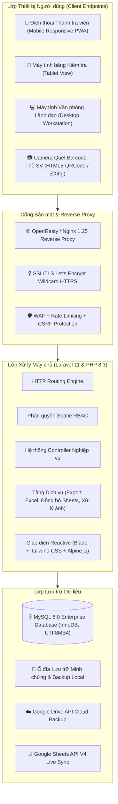

## 2.2. Chi tiết công nghệ Backend & Xử lý dữ liệu
- **Ngôn ngữ:** **PHP 8.3.x (Latest Enterprise)**. Tận dụng tối đa JIT Compiler, Typed Properties, Readonly Classes, Enumerations giúp tốc độ đối soát hàng chục ngàn dòng lịch học diễn ra dưới 25ms.
- **Framework:** **Laravel 11.x**. Phiên bản mới nhất với cấu trúc tinh gọn (`bootstrap/app.php`), giảm tối đa overhead bộ nhớ máy chủ.
- **Hệ quản trị CSDL:** **MySQL 8.0 Enterprise** với cấu hình InnoDB, Indexing B-Tree phức hợp trên các cột tìm kiếm thường xuyên (`date`, `room_id`, `session`, `student_code`), collation `utf8mb4_unicode_ci` chuẩn xác tiếng Việt 100%.
- **Bảo mật phân quyền:** **Spatie Laravel-Permission v6** tích hợp Middleware đa tầng ngăn chặn truy cập trái phép.

## 2.3. Chi tiết công nghệ Frontend & Tương tác giao diện
- **Khung giao diện:** **Tailwind CSS v3/v4** chuẩn nhận diện thương hiệu Đại học Nguyễn Tất Thành:
  - Màu xanh dương Navy chủ đạo: `#003B7A` / `#002D62`.
  - Màu đỏ NTTU nổi bật: `#C8102E` / `#A50D24`.
  - Màu vàng biểu trưng: `#F5A623`.
- **Động cơ tương tác dữ liệu:** **Alpine.js v3.x**. Quản lý trạng thái Client mượt mà không cần nạp lại trang (Zero-build latency, Virtual DOM siêu nhẹ).
- **Trình soạn thảo văn bản:** **CKEditor 5 Classic** hỗ trợ định dạng biên bản, công văn, đơn thư chuyên nghiệp.
- **Biểu đồ thống kê:** **Chart.js v4** trực quan hóa các chỉ số vi phạm, tỷ lệ tuân thủ, tiến độ tuần.
- **Quét mã vạch camera:** **HTML5-QRCode & ZXing-JS** quét tức thời mã vạch Code 128 / Code 39 trên thẻ sinh viên với độ trễ cực thấp.

## 2.4. Công cụ xuất/nhập văn phòng & In ấn chuẩn A4
- **PhpOffice / PhpSpreadsheet (v5.8+):** Kết xuất báo cáo Excel `.xlsx` tự động kẻ bảng, gộp ô, căn lề, chèn chữ ký và thiết lập vùng in (Print Area) vừa khít khổ giấy A4 ngang/dọc.
- **PhpOffice / PhpWord (v1.4+):** Tạo biên bản vi phạm, báo cáo tổng hợp dưới dạng văn bản Microsoft Word `.docx`.
- **SheetJS & ExcelJS Client-side:** Cho phép xuất nhanh bảng dữ liệu tức thời trên trình duyệt mà không làm tốn tài nguyên CPU máy chủ.

## 2.5. Cơ chế Đồng bộ thời gian thực & Bảo mật 100%
- **Adaptive Polling (10-15s):** Mọi ghi nhận Việc phát sinh của thanh tra viên tại hiện trường lập tức phát tín hiệu làm mới dữ liệu trên màn hình Dashboard của Lãnh đạo phòng mà không cần F5 trình duyệt.
- **Google Sheets API Integration:** Tự động đẩy kết quả kiểm tra lên hệ thống Google Sheets dùng chung của Nhà trường ngay khi chốt ca.
- **Bảo mật 100%:** Mã hóa HTTPS TLS 1.3, Prepared Statements chống SQL Injection 100%, XSS Purifier, Token CSRF, Rate Limiting chống vét cạn mật khẩu, và Nhật ký kiểm toán (Audit Access Log) lưu vết từng mili-giây.

---

# PHẦN III: DỰ TOÁN CHI PHÍ HẠ TẦNG & VẬN HÀNH CHI TIẾT

## 3.1. Cấu hình máy chủ phần cứng khuyến nghị

| Thông số phần cứng | Gói Tiêu chuẩn (Khuyến nghị vận hành) | Gói Mở rộng (Cao điểm thi toàn trường) |
| :--- | :--- | :--- |
| **Hệ điều hành** | Ubuntu Server 22.04 LTS / AlmaLinux 9 x86_64 | Ubuntu Server 24.04 LTS x86_64 |
| **Vi xử lý (CPU)** | **4 vCPU** (Intel Xeon Gold / AMD EPYC 3.0GHz+) | **8 vCPU** (AMD EPYC High Frequency) |
| **Bộ nhớ (RAM)** | **8 GB RAM** (ECC DDR4) | **16 GB RAM** (ECC DDR4) |
| **Ổ cứng lưu trữ** | **100 GB NVMe SSD** (Đọc/Ghi > 2.500 MB/s) | **250 GB NVMe SSD Enterprise** |
| **Băng thông mạng** | 100 Mbps - 1 Gbps (Không giới hạn lưu lượng) | 1 Gbps Dedicated Port |
| **Địa chỉ IP tĩnh** | 01 IPv4 Public Tĩnh | 01 IPv4 Public Tĩnh + IPv6 Subnet |

## 3.2. Bảng dự toán chi phí đầu tư ban đầu & vận hành hàng năm

### Bảng 1: Chi phí Bản quyền phần mềm & Nền tảng (Software Licenses)

| STT | Hạng mục phần mềm | Hình thức cấp phép | Chi phí (VNĐ) | Ghi chú |
| :---: | :--- | :--- | :---: | :--- |
| 1 | Hệ điều hành Linux (Ubuntu Server) | Mã nguồn mở (GPL/MIT) | **0 đ** | Miễn phí trọn đời |
| 2 | Nền tảng Laravel 11 & PHP 8.3 | Mã nguồn mở (MIT License) | **0 đ** | Miễn phí trọn đời |
| 3 | CSDL MySQL 8.0 Community | Mã nguồn mở (GPL) | **0 đ** | Chuẩn doanh nghiệp |
| 4 | Bộ giao diện Tailwind CSS & Alpine.js | Mã nguồn mở (MIT) | **0 đ** | Miễn phí thương mại |
| 5 | Chứng chỉ SSL/TLS HTTPS | Let's Encrypt Wildcard | **0 đ** | Tự động gia hạn vĩnh viễn |
| 6 | Tên miền phân cấp (`ntt.edu.vn`) | Subdomain trường NTTU | **0 đ** | Tận dụng hạ tầng DNS sẵn có |
| 7 | Bộ thư viện PhpOffice (Excel/Word) | Mã nguồn mở (LGPL) | **0 đ** | Miễn phí sử dụng |
| **TỔNG** | **CHI PHÍ BẢN QUYỀN PHẦN MỀM** | | **0 đ** | **Tiết kiệm 100% ngân sách** |

### Bảng 2: Chi phí Hạ tầng Máy chủ & Lưu trữ Đám mây (Hosting & Infrastructure)

| STT | Hạng mục hạ tầng | Đơn vị tính | Đơn giá / Tháng (VNĐ) | Thành tiền / Năm (VNĐ) | Ghi chú |
| :---: | :--- | :---: | :---: | :---: | :--- |
| 1 | Máy chủ Cloud VPS (4 Core, 8GB RAM, 100GB NVMe) | Máy chủ | 650.000 đ | 7.800.000 đ | Viettel IDC / VNPT / Vietnix |
| 2 | Dịch vụ Lưu trữ Đám mây (Cloud Backup Storage) | Gói 200 GB | 150.000 đ | 1.800.000 đ | Lưu snapshot tự động + ảnh minh chứng |
| 3 | Dung lượng Google Workspace for Education API | Dung lượng trường | 0 đ | 0 đ | Tận dụng tài khoản Google Workspace Edu |
| 4 | Dự phòng mở rộng tài nguyên (Buffer Capacity) | Năm | — | 1.500.000 đ | Nâng cấp RAM/CPU trong kỳ thi cao điểm |
| **TỔNG** | **CHI PHÍ HẠ TẦNG VẬN HÀNH (1 NĂM)** | | | **11.100.000 đ** | *(Mười một triệu một trăm ngàn đồng)* |

## 3.3. Phân tích bài toán hiệu quả kinh tế & ROI
- **Tiết kiệm in ấn giấy tờ:** Giảm hơn 30.000 tờ giấy in A4, mực in và sổ tay ghi chép hàng năm, tiết kiệm ước tính **~25.000.000 VNĐ / năm**.
- **Tiết kiệm thời gian lao động:** Giải phóng hơn **5.200 giờ công lao động / năm** cho đội ngũ 10 thanh tra viên, cho phép tập trung nâng cao chất lượng sư phạm và giải quyết các vấn đề trọng điểm.
- **Minh bạch hóa 100%:** Minh chứng có hình ảnh, có thời gian chính xác, loại bỏ triệt để các tranh cãi và khiếu nại không đáng có.

---
# PHẦN IV: HƯỚNG DẪN THAO TÁC CƠ BẢN DÙNG CHUNG TRÊN TOÀN HỆ THỐNG

Giao diện hệ thống KTNB được thiết kế **chuẩn hóa đồng bộ 100%**. Dưới đây là các quy tắc thao tác dùng chung mà người dùng sẽ bắt gặp trên mọi trang danh mục:

## 4.1. Cấu trúc giao diện chuẩn (Header, Sidebar, Content Area)
- **Thanh Header (Trên cùng):** Logo NTTU, tên đơn vị "Phòng Kiểm tra Nội bộ", ô tìm kiếm nhanh toàn hệ thống, chuông thông báo Việc phát sinh realtime, nút chuyển đổi giao diện, và menu tài khoản cá nhân.
- **Thanh Sidebar (Cột bên trái):** Danh mục điều hướng phân cấp rõ ràng thành các khối: *Tổng quan, Công cụ kiểm tra, Báo cáo thống kê, Bộ danh mục, Quản trị hệ thống*. Có thể thu gọn hoặc mở rộng linh hoạt.
- **Vùng nội dung chính (Content Area):** Tiêu đề trang kèm biểu tượng nhận diện, thanh công cụ tác nghiệp và bảng dữ liệu chính.

## 4.2. Thanh công cụ bảng dữ liệu (Action Bar)
Ở góc trên bên phải mỗi bảng dữ liệu luôn có nhóm nút thao tác tiêu chuẩn:

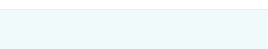

1. **Nút Thêm mới (+):** Màu xanh dương hoặc đỏ nổi bật $
ightarrow$ Mở popup hoặc chuyển form thêm mới bản ghi.
2. **Nút Tải mẫu file (Import Template):** Tải file Excel mẫu đúng định dạng cột quy định.
3. **Nút Tải lên (Import Excel):** Chọn file Excel từ máy tính để nạp dữ liệu hàng loạt vào hệ thống.
4. **Nút Tải xuống (Export Excel):** Xuất bảng dữ liệu hiện tại ra file Excel.
5. **Nút Bộ lọc nâng cao (Biểu tượng phễu):** Mở cửa sổ thiết lập điều kiện lọc nhiều trường.
6. **Nút Cài đặt hiển thị cột (Biểu tượng con mắt / bánh răng):** Mở bảng chọn bật/tắt các cột dữ liệu.

## 4.3. Quy chuẩn các nút sắp xếp & Bộ lọc trên Header bảng


Trên mỗi tiêu đề cột (`<th>`) của bảng dữ liệu, hệ thống bố trí cụm 3 nút bấm hình tròn màu trắng với biểu tượng màu đỏ trực quan:
- **Nút 1: Mũi tên hướng lên `(^) `:** Sắp xếp cột theo thứ tự **Tăng dần** (A $
ightarrow$ Z, hoặc số nhỏ $
ightarrow$ số lớn).
- **Nút 2: Mũi tên hướng xuống `(v)`:** Sắp xếp cột theo thứ tự **Giảm dần** (Z $
ightarrow$ A, hoặc số lớn $
ightarrow$ số nhỏ).
- **Nút 3: Mũi tên đảo chiều 2 đầu `(⇅)`:** **Hủy sắp xếp** (trả về thứ tự mặc định ban đầu).

## 4.4. Cơ chế Ẩn/Hiện cột dữ liệu cá nhân hóa
Khi nhấp vào nút **Cài đặt hiển thị cột** trên góc phải:
- Một ngăn kéo hoặc modal sẽ hiển thị danh sách tất cả các cột của bảng.
- Cột nào được **tích chọn dấu tick xanh** sẽ hiển thị trên màn hình.
- Cột nào bị **bỏ chọn** sẽ được ẩn đi để màn hình thoáng hơn, phù hợp với màn hình điện thoại hoặc máy tính bảng nhỏ.
- Cấu hình này được hệ thống tự động ghi nhớ vào tài khoản của bạn, lần sau đăng nhập không cần chỉnh lại.

## 4.5. Cơ chế Lọc dữ liệu nâng cao
Khi nhấp vào nút **Bộ lọc nâng cao (Phễu)**:
- Cửa sổ bộ lọc cho phép người dùng kết hợp nhiều điều kiện: Từ ngày ... Đến ngày, Khoa/Viện, Cơ sở, Ca học, Tình trạng vi phạm...
- Nhấn nút **Áp dụng** để bảng tự động lọc dữ liệu.
- Nhấn nút **Đặt lại (Reset)** để xóa toàn bộ điều kiện và hiển thị lại toàn bộ dữ liệu.

## 4.6. Menu hành động trên từng dòng dữ liệu
Ở cột cuối cùng của mỗi dòng dữ liệu luôn có cột **Hành động**:
- **Nút Xem chi tiết (Hình con mắt):** Mở xem toàn bộ thông tin bản ghi.
- **Nút Chỉnh sửa (Hình cây bút):** Mở form sửa đổi thông tin.
- **Nút Xóa (Hình thùng rác):** Mở hộp thoại xác nhận xóa bản ghi (bảo vệ tránh xóa nhầm).

---
# PHẦN V: HƯỚNG DẪN SỬ DỤNG CHI TIẾT TỪNG PHÂN HỆ NGHIỆP VỤ (KÈM ẢNH MINH CHỨNG TỪNG BƯỚC)

---

## Chương 1: Phân hệ Bảng điều khiển (Dashboard)

Màn hình Bảng điều khiển (`/dashboard`) là trung tâm chỉ huy, cung cấp cái nhìn toàn cảnh về nề nếp đào tạo trên toàn trường ngay khi đăng nhập.

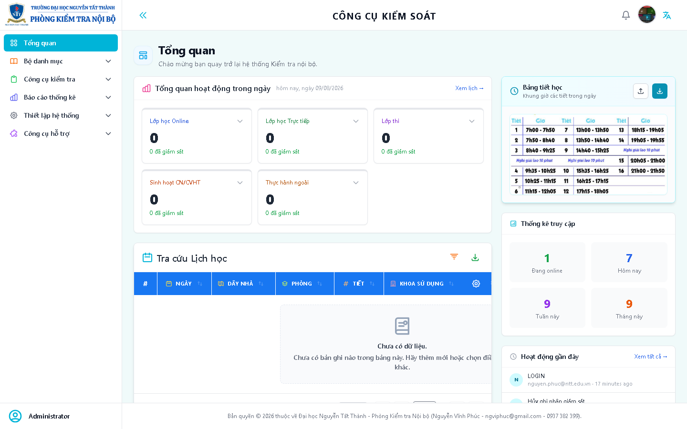

### Các khối thông tin nghiệp vụ trên Dashboard:
1. **Khối Thẻ KPI Tổng hợp (Top Metric Cards):**
   - **Tổng số tiết học trong ngày:** Tổng số tiết được xếp thời khóa biểu trên toàn trường.
   - **Số tiết đã kiểm tra:** Tiến độ kiểm tra thực tế đạt bao nhiêu phần trăm.
   - **Việc phát sinh trong ngày:** Số lượng lớp có bất thường (giảng viên vắng, vào trễ, phòng học khóa, hỏng máy chiếu...).
   - **Sinh viên vi phạm:** Số lượng biên bản vi phạm quy chế đã được lập trong ngày.
2. **Khối Lịch trực Thanh tra viên:**
   - Phân chia theo từng Cơ sở (Cơ sở Quận 4, Quận 12, Quận 7).
   - Hiển thị tên cán bộ trực, số điện thoại liên hệ, ca trực (Sáng: Tiết 1-5, Chiều: Tiết 6-10, Tối: Tiết 11-15).
3. **Khối Thời khóa biểu Realtime theo ca:**
   - Dòng thời gian trực quan hiển thị các tiết học đang diễn ra trong thời điểm hiện tại.
   - Mã màu trạng thái: Xanh lá (Đang học nghiêm túc), Vàng (Giảng viên vào trễ), Đỏ (Nghỉ không phép / Bất thường), Xám (Chưa kiểm tra).
4. **Khối Biểu đồ Phân tích (Analytics Charts):**
   - Biểu đồ cột phân bố vi phạm theo từng ngày trong tuần.
   - Biểu đồ tròn tỷ lệ hoàn thành kế hoạch thanh tra của từng cơ sở.

---

## Chương 2: Phân hệ Giám sát Lịch học & Đào tạo

### 2.1. Giám sát Lớp học Trực tiếp (In-person Classes)
- **Đường dẫn truy cập:** `/monitoring/in-person` hoặc Menu: **Công cụ kiểm tra** $
ightarrow$ **Lớp học trực tiếp**.
- **Đối tượng sử dụng chính:** Thanh tra viên tuần tra phòng học tại cơ sở.

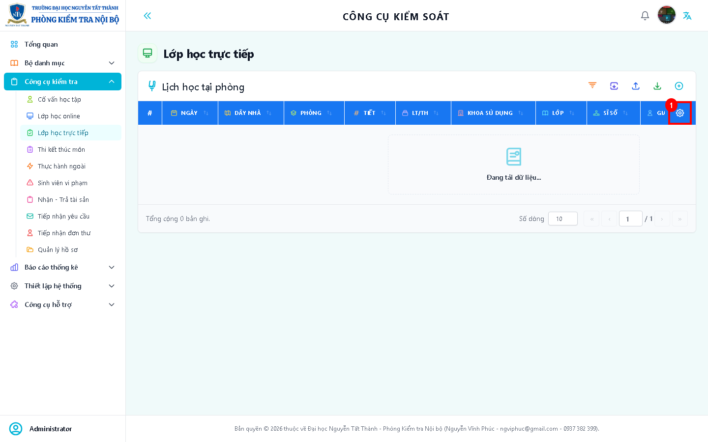

#### Hướng dẫn thao tác từng bước:

##### Bước 1: Nhận diện các nút chức năng trên màn hình chính
Quan sát hình ảnh minh chứng phía trên với các số hiệu viền đỏ `[1]`, `[2]`, `[3]`, `[4]`:
- **`[1]` Nhóm nút tác vụ:** Tải lên Excel, Tải mẫu import, Xuất file Excel và Thêm lớp học mới.
- **`[2]` Nút Cài đặt hiển thị cột:** Biểu tượng con mắt trên tiêu đề cột $
ightarrow$ bấm để mở bảng chọn cột.
- **`[3]` Nút Hành động dòng:** Biểu tượng 3 chấm ở cuối mỗi phòng học $
ightarrow$ bấm để cập nhật tình trạng kiểm tra.
- **`[4]` Ô tìm kiếm nhanh:** Gõ mã phòng (VD: `A.302`), tên môn học hoặc tên giảng viên $
ightarrow$ bảng tự lọc tức thì.

##### Bước 2: Tùy biến cột dữ liệu hiển thị

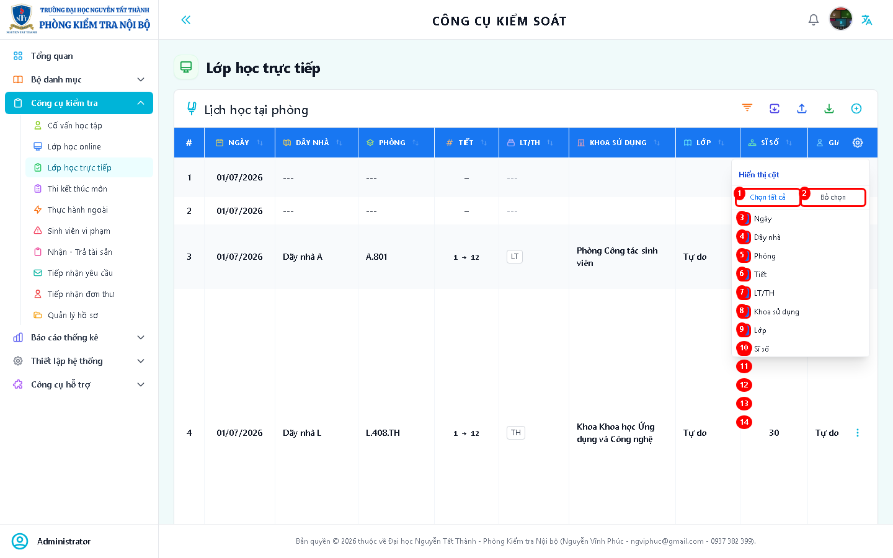

- Nhấp vào nút `[2]` để mở bảng chọn cột như hình trên.
- **`[1]` Checkbox Mã lớp / Tên môn học:** Bật để xem mã học phần chi tiết.
- **`[2]` Checkbox Giảng viên giảng dạy:** Hiển thị tên giảng viên được phân công.
- **`[3]` Checkbox Sĩ số sinh viên:** Hiển thị sĩ số đăng ký và sĩ số thực tế có mặt.
- **`[4]` Checkbox Việc phát sinh / Ghi chú:** Hiển thị các ghi chú bất thường.
- Bỏ tích các cột không cần thiết để bảng hiển thị vừa vặn trên màn hình điện thoại di động.

##### Bước 3: Lọc danh sách phòng học cần đi kiểm tra

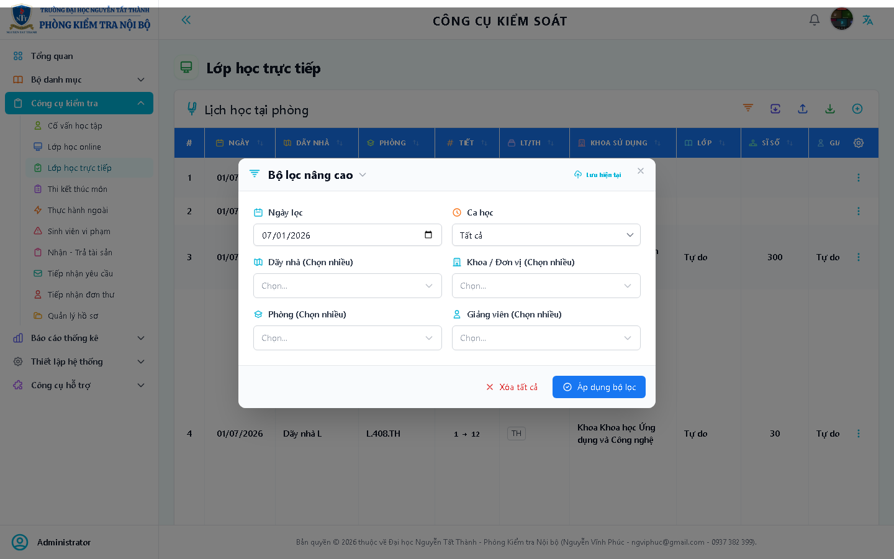

Nhấp vào nút **Bộ lọc** để mở popup như hình trên:
- **`[1]` Chọn Ngày kiểm tra:** Mặc định là ngày hôm nay. Có thể chọn ngày khác để xem lịch sử.
- **`[2]` Chọn Cơ sở đào tạo:** Chọn Cơ sở Q.12, Cơ sở Q.4 hoặc Cơ sở Q.7 nơi bạn đang trực.
- **`[3]` Chọn Buổi học / Ca học:** Chọn Buổi Sáng, Buổi Chiều hoặc Buổi Tối.
- **`[4]` Chọn Tiết học:** Chọn tiết cụ thể (ví dụ: Tiết 3) để hệ thống lọc ra danh sách đúng các phòng đang học tiết 3.
- Nhấn nút **Áp dụng** để bảng nạp dữ liệu.

##### Bước 4: Kiểm tra tại cửa phòng học & Ghi nhận Việc phát sinh

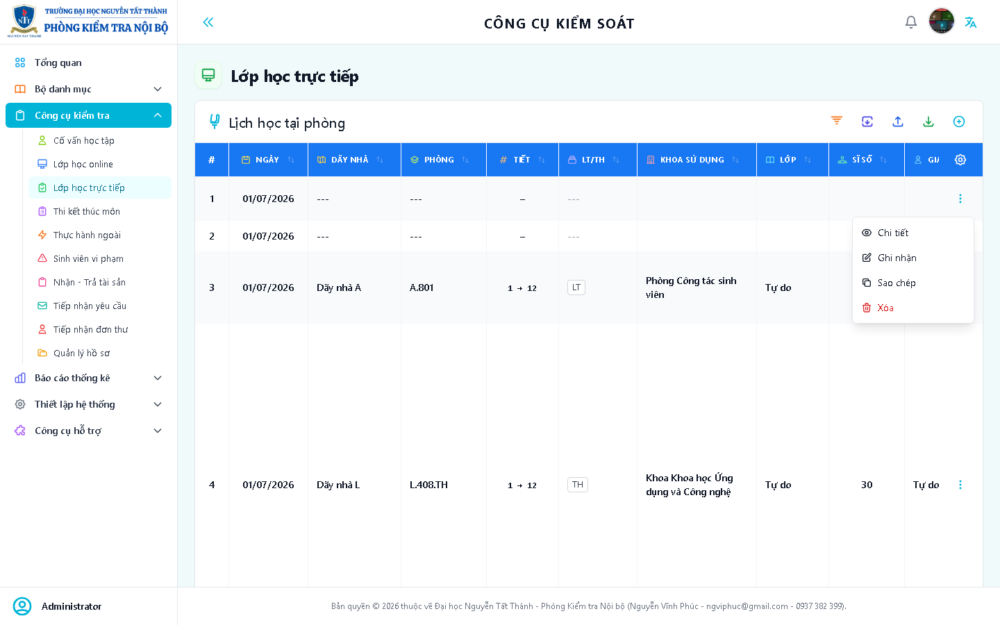

Khi đến trước cửa phòng học:
- Quan sát tình hình thực tế lớp học.
- Bấm vào nút Hành động `[3]` trên dòng của phòng đó $
ightarrow$ Chọn **Cập nhật tình trạng**. Cửa sổ nhập liệu hiển thị như hình trên:
- **`[1]` Trường Trạng thái phòng học:** Chọn một trong các trạng thái:
  - *Bình thường:* Lớp học nghiêm túc, đúng giảng viên.
  - *Giảng viên vào trễ:* Xuất hiện thêm ô nhập số phút trễ (10 phút, 15 phút, 30 phút...).
  - *Nghỉ không báo trước:* Phòng trống, không có giảng viên và sinh viên.
  - *Đổi phòng học:* Nhập mã phòng học mới mà lớp đã dời đến.
  - *Dạy bù:* Lớp học bù ngoài thời khóa biểu chính thức.
- **`[2]` Trường Sĩ số có mặt thực tế:** Đếm nhanh hoặc hỏi lớp trưởng sĩ số sinh viên đang ngồi trong phòng.
- **`[3]` Ô Ghi nhận Việc phát sinh (RẤT QUAN TRỌNG):**
  - Nếu có bất kỳ sự cố nào xảy ra (ví dụ: *Máy chiếu không lên nguồn, Giảng viên cho lớp làm bài tập sớm 20 phút, Máy lạnh phòng học chảy nước*), gõ chi tiết vào ô này.
  - **Lưu ý đặc biệt:** Toàn bộ nội dung gõ vào ô "Việc phát sinh" này sẽ **TỰ ĐỘNG CHUYỂN THÀNH CỘT GHI CHÚ** khi bạn bấm xuất file Excel báo cáo cuối ngày!
- **`[4]` Nút Lưu cập nhật:** Bấm để hoàn tất. Dữ liệu sẽ lập tức đổi màu trên màn hình và đồng bộ về máy chủ.

---

### 2.2. Giám sát Lớp học Trực tuyến (Online Classes)
- **Đường dẫn truy cập:** `/monitoring/online` hoặc Menu: **Công cụ kiểm tra** $
ightarrow$ **Lớp học online**.
- **Ý nghĩa:** Kiểm tra nề nếp các lớp học từ xa qua MS Teams, Zoom hoặc Google Meet.

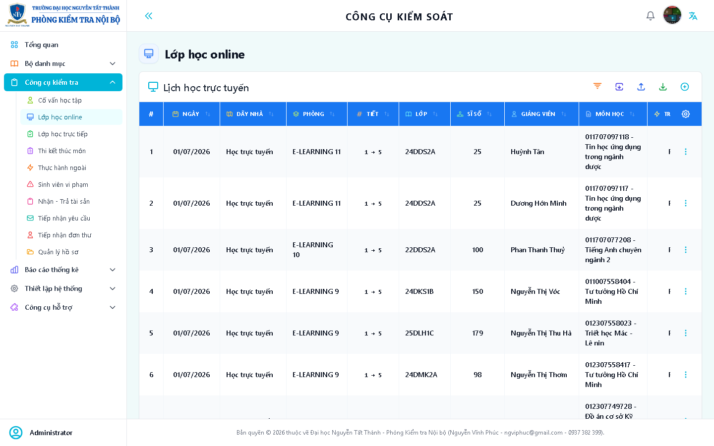

#### Hướng dẫn thao tác kiểm tra:
1. **Truy cập danh sách:** Hệ thống tự động đồng bộ danh sách các lớp học trực tuyến diễn ra trong ngày kèm theo **Đường dẫn (URL Link) phòng học**.
2. **Tham gia kiểm tra:** Thanh tra viên nhấp vào nút **Tham gia phòng (Join Link)** để vào lớp học:
   - Kiểm tra giảng viên có bật camera giảng bài không?
   - Kiểm tra việc chia sẻ slide bài giảng.
   - Đối chiếu số lượng tài khoản sinh viên đang online so với sĩ số danh sách lớp.
3. **Ghi nhận kết quả:** Quay lại màn hình KTNB, nhấp **Ghi nhận kiểm tra**:
   - Nhập số lượng sinh viên đang online.
   - Chụp ảnh màn hình (screenshot) danh sách thành viên trong Teams/Zoom tải lên làm minh chứng.
   - Nhấn **Lưu kết quả**.

---

### 2.3. Giám sát Thi Kết thúc môn (Exams)
- **Đường dẫn truy cập:** `/monitoring/exams` hoặc Menu: **Công cụ kiểm tra** $
ightarrow$ **Thi kết thúc môn**.

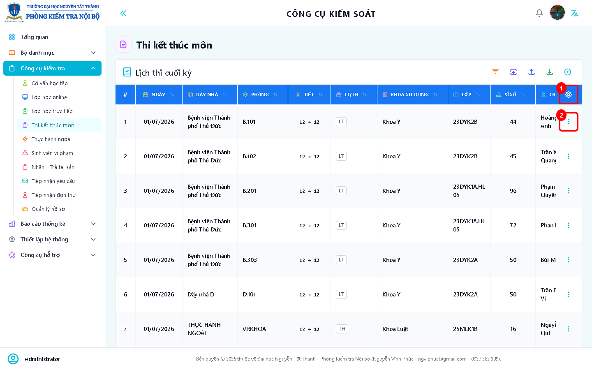

#### Hướng dẫn thao tác giám sát kỳ thi:
1. **Lọc ca thi cần kiểm tra:** Nhấp nút **Bộ lọc** $
ightarrow$ Chọn Ngày thi, Điểm thi (Cơ sở), Ca thi (Ca 1: 07h30, Ca 2: 09h30, Ca 3: 13h30, Ca 4: 15h30...).
2. **Kiểm tra thông tin cán bộ coi thi (Giám thị):** Đối chiếu Cán bộ coi thi 1 và Cán bộ coi thi 2 có mặt đúng giờ và đúng người hay không.
3. **Ghi nhận sĩ số phòng thi:** Nhập số thí sinh có mặt dự thi, số thí sinh vắng thi.
4. **Xử lý sự cố và vi phạm phòng thi:**
   - Nếu có thí sinh mang điện thoại, tài liệu vào phòng thi: Bấm nút **Lập biên bản vi phạm thi** $
ightarrow$ Hệ thống tự động tạo mã biên bản và in biên bản đình chỉ thi chuẩn mẫu Bộ GD&ĐT.
   - Nếu có sự cố về đề thi (thiếu đề, mờ đề): Ghi nhận vào ô **Việc phát sinh phòng thi**.

---

### 2.4. Giám sát Thực hành Ngoài trường (External Practice)
- **Đường dẫn truy cập:** `/monitoring/external-practice` hoặc Menu: **Công cụ kiểm tra** $
ightarrow$ **Thực hành ngoài**.

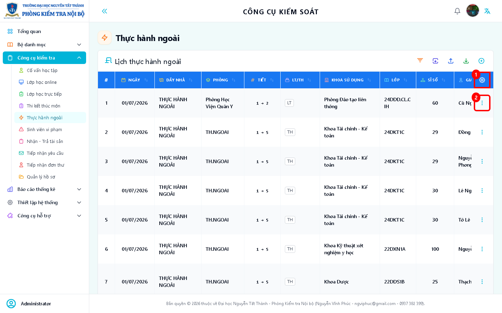

- Áp dụng cho sinh viên các khối ngành Y - Dược, Điều dưỡng, Du lịch, Kỹ thuật thực tập tại Bệnh viện, Khách sạn, Nhà máy ngoài trường.
- **Các bước tác nghiệp:**
  1. Chọn Đoàn thực tập / Bệnh viện thực tập.
  2. Cập nhật quân số thực tế có mặt tại cơ sở đối tác.
  3. Bật định vị GPS trên điện thoại để hệ thống xác thực vị trí kiểm tra của thanh tra viên đúng với địa chỉ bệnh viện/cơ sở thực tập.
  4. Chụp ảnh đoàn sinh viên tại hiện trường làm minh chứng.

---

### 2.5. Giám sát Sinh hoạt Cố vấn Học tập (Homeroom)
- **Đường dẫn truy cập:** `/monitoring/homeroom` hoặc Menu: **Công cụ kiểm tra** $
ightarrow$ **Cố vấn học tập**.

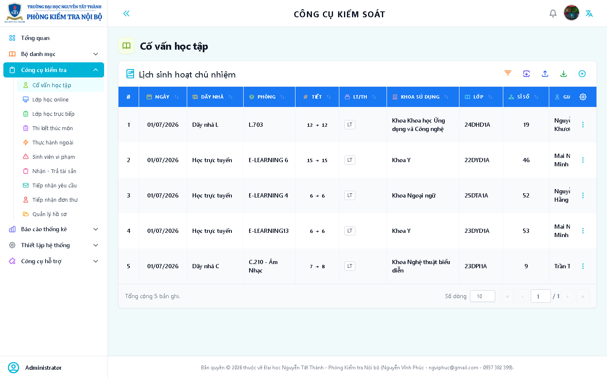

- Theo dõi các buổi sinh hoạt lớp định kỳ giữa Giảng viên Cố vấn học tập (CVHT) và sinh viên (lớp có mã bắt đầu bằng `SHCN`).
- **Thao tác kiểm tra:**
  - Nhập sĩ số sinh viên tham gia buổi sinh hoạt.
  - Đánh giá chất lượng buổi sinh hoạt: Tốt / Đạt / Chưa đạt.
  - Ghi nhận các kiến nghị của sinh viên gửi về Nhà trường.

---

### 2.6. Quản lý Lịch học theo ngày & Xuất Excel In ấn chuẩn A4 (Schedule Settings)
- **Đường dẫn truy cập:** `/settings/schedule` hoặc Menu: **Bộ danh mục** $
ightarrow$ **Lịch học theo ngày**.


#### Hướng dẫn Xuất file Excel Mẫu in Kiểm tra Phòng học (Chuẩn A4):
Đây là tính năng cực kỳ quan trọng được cán bộ kiểm tra sử dụng để in bảng danh sách phòng ra giấy A4 đi kiểm tra hiện trường:

1. **Bước 1:** Chọn Ngày kiểm tra, chọn Cơ sở (ví dụ: Cơ sở Q.12) và chọn các Ca/Tiết học cần in.
2. **Bước 2:** Bấm nút **Xuất file Excel** trên thanh công cụ.
3. **Bước 3: Quy tắc kết xuất dữ liệu tự động của hệ thống:**
   - Hệ thống sử dụng phương thức truyền dữ liệu **HTTP POST**, cho phép xuất đồng thời hàng ngàn lớp học mà không bao giờ gặp lỗi đường dẫn quá dài (HTTP 414 Request-URI Too Large).
   - **Tự động chuyển Việc phát sinh sang cột Ghi chú:** Những lớp nào trong ngày đã có ghi nhận việc phát sinh (ví dụ: *Giảng viên dạy bù, máy chiếu hỏng, vắng tiết 1-2*), hệ thống sẽ tự động đưa toàn bộ văn bản này sang cột **Ghi chú** trên bảng in Excel!
   - **Tự động xuất lớp Sinh hoạt Cố vấn học tập (SHCN96):** Các lớp sinh hoạt CVHT nếu diễn ra tại phòng học trực tiếp (Offline) cũng được tự động xuất đầy đủ vào bảng in để thanh tra viên đi kiểm tra như lớp học bình thường.
   - File Excel tải về đã được căn chỉnh sẵn font chữ Times New Roman 11pt, lề chuẩn quốc tế (Margin 0.5 inch), vừa khít trang in A4 ngang, có đầy đủ phần Quốc hiệu, Tiêu ngữ, Tên trường và 3 ô ký tên của Thanh tra viên, Trưởng phòng KTNB và Ban Giám hiệu.

---
## Chương 3: Phân hệ Nghiệp vụ Thanh tra & Xử lý Vi phạm

---

### 3.1. Lập biên bản Sinh viên vi phạm (Quét mã Barcode & Chụp ảnh)
- **Đường dẫn truy cập:** `/monitoring/student-violations` hoặc Menu: **Công cụ kiểm tra** $
ightarrow$ **Sinh viên vi phạm**.
- **Ý nghĩa:** Đây là phân hệ có tần suất sử dụng cao nhất, hỗ trợ lập biên bản kỷ luật học đường với công nghệ nhận diện Barcode siêu tốc.

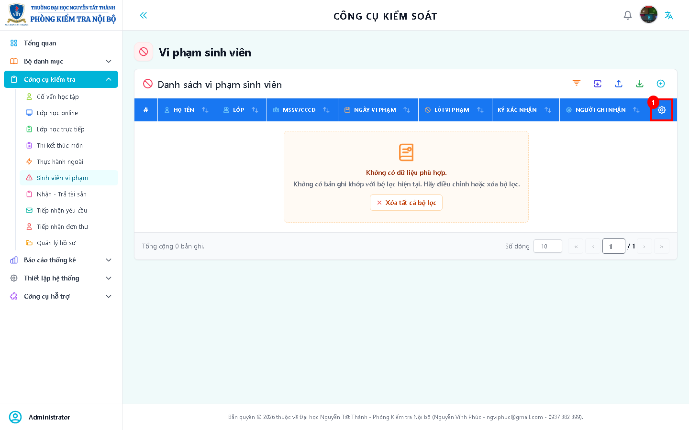

#### Hướng dẫn lập biên bản vi phạm chi tiết từng bước:

##### Bước 1: Nhấn nút Thêm vi phạm mới
Trên màn hình chính (hình trên), nhấn vào nút đỏ **`[1]` + Thêm vi phạm** ở góc trên bên phải. Cửa sổ lập biên bản sẽ hiển thị như hình dưới:

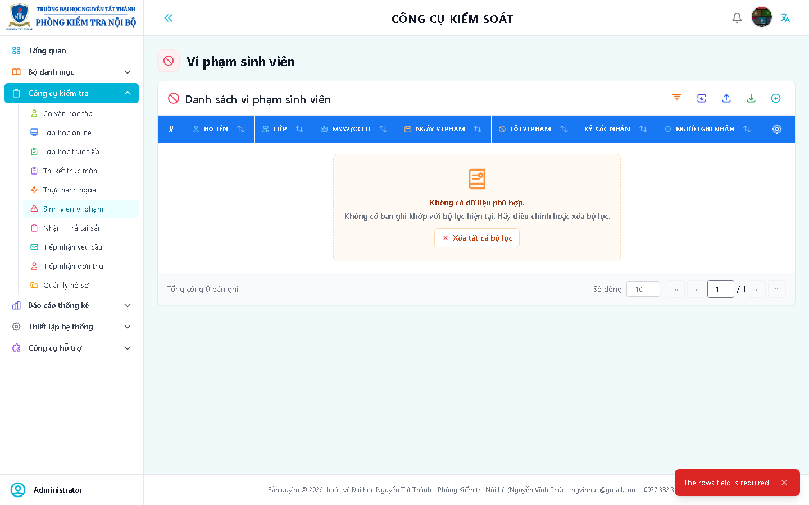

##### Bước 2: Nhập thông tin sinh viên vi phạm (2 Cách)

* **CÁCH 1: QUÉT MÃ VẠCH QUA CAMERA (KHUYẾN NGHỊ - SIÊU NHANH 5 GIÂY):**
  - Nhấp vào nút **`[1]` Bật Camera quét mã**. Trình duyệt sẽ yêu cầu quyền truy cập Camera trên điện thoại $
ightarrow$ Nhấn **Cho phép (Allow)**.
  - Hướng ống kính camera vào mã vạch (Barcode) in ở mặt trước hoặc mặt sau thẻ sinh viên.
  - Khi camera bắt được mã vạch, hệ thống sẽ phát âm thanh "Bíp" xác nhận và **TỰ ĐỘNG ĐIỀN TOÀN BỘ CÁC Ô:**
    - `[2]` Mã số sinh viên (MSSV)
    - `[3]` Họ và tên sinh viên
    - `[4]` Lớp danh nghĩa
    - `[5]` Khoa / Viện đào tạo
  - *(Không cần gõ bất kỳ ký tự nào, độ chính xác tuyệt đối 100%)*.

* **CÁCH 2: NHẬP MSSV BẰNG TAY (KHI SINH VIÊN KHÔNG MANG THẺ):**
  - Gõ chính xác mã số sinh viên vào ô `[2]`.
  - Hệ thống tự động truy vấn danh mục sinh viên và tự điền Họ tên, Lớp, Khoa.

##### Bước 3: Điền chi tiết hành vi và địa điểm vi phạm
- **`[6]` Menu chọn Hành vi vi phạm:** Nhấp để chọn lỗi vi phạm từ danh mục quy chuẩn của Nhà trường:
  - *Không đeo thẻ sinh viên / Đeo thẻ không đúng quy định.*
  - *Vi phạm quy định trang phục (mặc quần ngắn, áo sát nách, dép lê).*
  - *Hút thuốc lá trong khuôn viên nhà trường.*
  - *Gây mất trật tự, sử dụng thiết bị sai mục đích trong giờ học.*
  - *Gian lận thi cử / Mang tài liệu trái phép vào phòng thi.*
- **`[7]` Địa điểm xảy ra vi phạm:**
  - Chọn Cơ sở (Cơ sở Q.12 / Cơ sở Q.4).
  - Chọn Dãy nhà (Dãy A, Dãy B, Dãy C...).
  - Chọn Tầng và Phòng học (hoặc chọn "Khuôn viên sân trường / Căng tin").
- **`[8]` Thời gian vi phạm:** Mặc định hệ thống tự lấy giờ hiện tại đến từng phút.
- **`[9]` Chụp ảnh minh chứng hiện trường:**
  - Nhấp nút **Chụp ảnh / Chọn tệp** $
ightarrow$ Camera điện thoại sẽ bật lên để chụp ảnh sinh viên vi phạm (hoặc hiện trường vi phạm).
  - Ảnh chụp sẽ được tự động nén tối ưu dung lượng và đính kèm vào hồ sơ biên bản.
- **`[10]` Nút Hoàn tất & Lưu biên bản:** Nhấp nút màu đỏ **Lưu biên bản**. Hệ thống sẽ cấp một Mã số biên bản duy nhất dạng `BBVP-2026-XXXXX` và gửi thông báo về tài khoản của Cố vấn học tập và Khoa chủ quản của sinh viên đó.

---

### 3.2. Quản lý Yêu cầu kiểm tra đột xuất (Requests)
- **Đường dẫn truy cập:** `/monitoring/requests` hoặc Menu: **Công cụ kiểm tra** $
ightarrow$ **Tiếp nhận yêu cầu**.

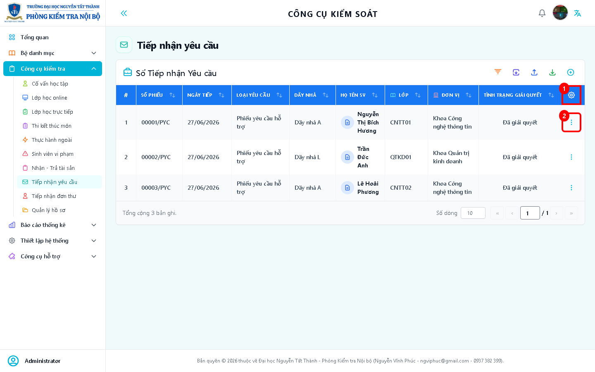

#### Các bước tiếp nhận và xử lý yêu cầu:
1. **Tạo yêu cầu mới:** Bấm nút **+ Tạo yêu cầu mới** (hình trên):
   - Nhập thông tin người gửi yêu cầu (Ban Giám hiệu chỉ đạo, hoặc Khoa/Phòng đề nghị).
   - Nội dung yêu cầu kiểm tra (Ví dụ: *Kiểm tra đột xuất nề nếp thi học phần Tin học đại cương tại Dãy B Cơ sở Q.12*).
   - Chọn mức độ ưu tiên: *Khẩn cấp / Cao / Bình thường*.
2. **Phân công thanh tra viên:** Lãnh đạo phòng chọn chuyên viên phụ trách thực hiện.
3. **Cập nhật tiến độ xử lý:** Chuyển trạng thái từ *Chờ tiếp nhận* $
ightarrow$ *Đang xử lý* $
ightarrow$ *Đã hoàn thành* kèm theo báo cáo kết quả kiểm tra tại hiện trường.

---

### 3.3. Quản lý Đơn thư, Khiếu nại, Phản ánh (Petitions)
- **Đường dẫn truy cập:** `/monitoring/petitions` hoặc Menu: **Công cụ kiểm tra** $
ightarrow$ **Tiếp nhận đơn thư**.

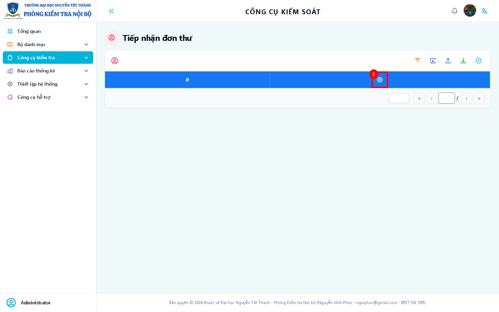

- Tiếp nhận và giải quyết các đơn phản ánh của sinh viên, phụ huynh hoặc giảng viên về các vấn đề đào tạo, điểm số, thái độ phục vụ.
- **Quy trình xử lý chuẩn:**
  1. **Bước 1: Nạp đơn thư:** Nhập số hiệu công văn/đơn thư, người làm đơn, ngày nhận đơn, tóm tắt nội dung khiếu nại.
  2. **Bước 2: Xác minh:** Cán bộ thanh tra tiến hành xác minh minh chứng từ lịch học, camera an ninh hoặc bài thi.
  3. **Bước 3: Trả lời đơn thư:** Soạn thảo văn bản trả lời, đính kèm kết luận xử lý và đánh dấu hoàn tất đúng thời hạn quy định của Nhà trường.

---

### 3.4. Quản lý Nhận - Trả tài sản & Kiểm tra CSVC phòng học (Asset Check)
- **Đường dẫn truy cập:** `/monitoring/asset-check` hoặc Menu: **Công cụ kiểm tra** $
ightarrow$ **Nhận - Trả tài sản**.

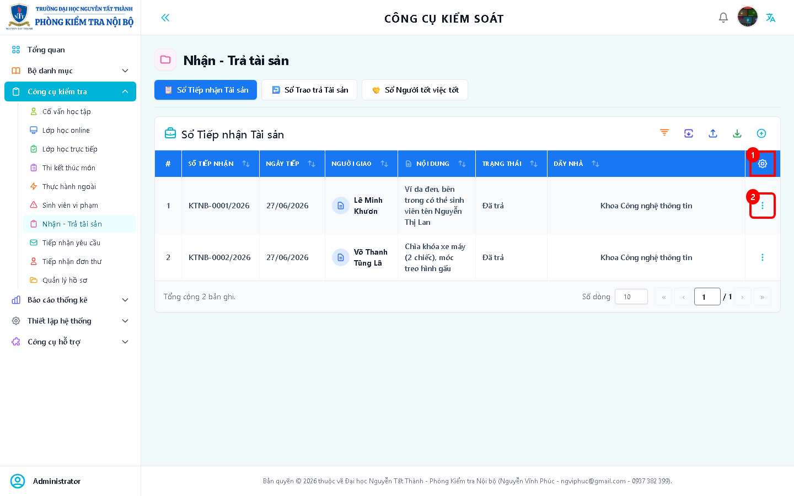

#### Hướng dẫn nghiệp vụ:
1. **Giảng viên mượn thiết bị giảng dạy (Micro, Remote máy chiếu, Dây chuyển đổi):**
   - Bấm nút **Cho mượn thiết bị**.
   - Chọn Tên giảng viên, Phòng học giảng dạy, Thiết bị cho mượn và Tình trạng thiết bị ban đầu.
   - Nhấn **Lưu giao dịch**.
2. **Giảng viên trả thiết bị sau ca dạy:**
   - Tìm dòng giao dịch của giảng viên đó $
ightarrow$ Bấm nút **Xác nhận đã trả**.
   - Kiểm tra thiết bị còn hoạt động tốt không $
ightarrow$ Nhấn **Hoàn tất**.
3. **Báo hỏng cơ sở vật chất phòng học (CSVC):**
   - Nếu phát hiện máy lạnh không mát, máy chiếu mờ, bóng đèn hỏng: Chọn phòng học $
ightarrow$ Bấm **Báo hỏng thiết bị** $
ightarrow$ Chụp ảnh hiện trường $
ightarrow$ Hệ thống tự động đẩy thông báo sang Phòng Quản trị thiết bị cử thợ đến sửa chữa ngay.

---

### 3.5. Quản lý Hồ sơ minh chứng kiểm tra (Document Records)
- **Đường dẫn truy cập:** `/monitoring/document-records` hoặc Menu: **Công cụ kiểm tra** $
ightarrow$ **Quản lý hồ sơ**.

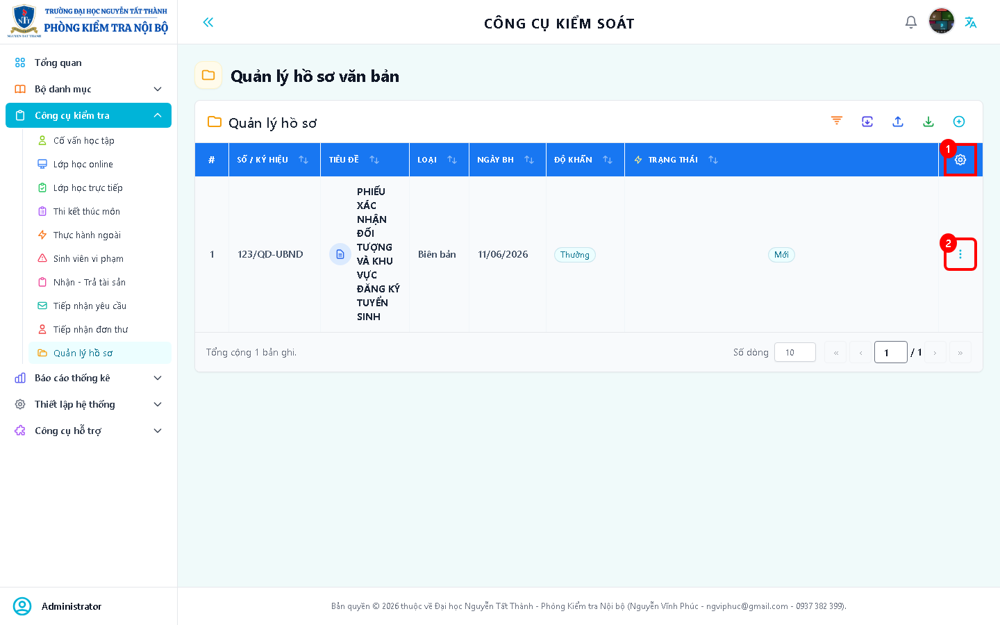

- Lưu trữ số hóa các tài liệu hành chính: Biên bản kiểm tra chuyên đề, Kết luận thanh tra, Công văn gửi các đơn vị.
- Hỗ trợ tải lên file scan PDF, hình ảnh, văn bản Word với dung lượng lên đến 50MB/file.
- Cho phép tra cứu nhanh theo số hiệu văn bản hoặc từ khóa trích yếu.

---

### 3.6. Kho Minh chứng hình ảnh điện tử (Evidence Storage)
- **Đường dẫn truy cập:** `/monitoring/evidence` hoặc Menu: **Công cụ kiểm tra** $
ightarrow$ **Minh chứng**.

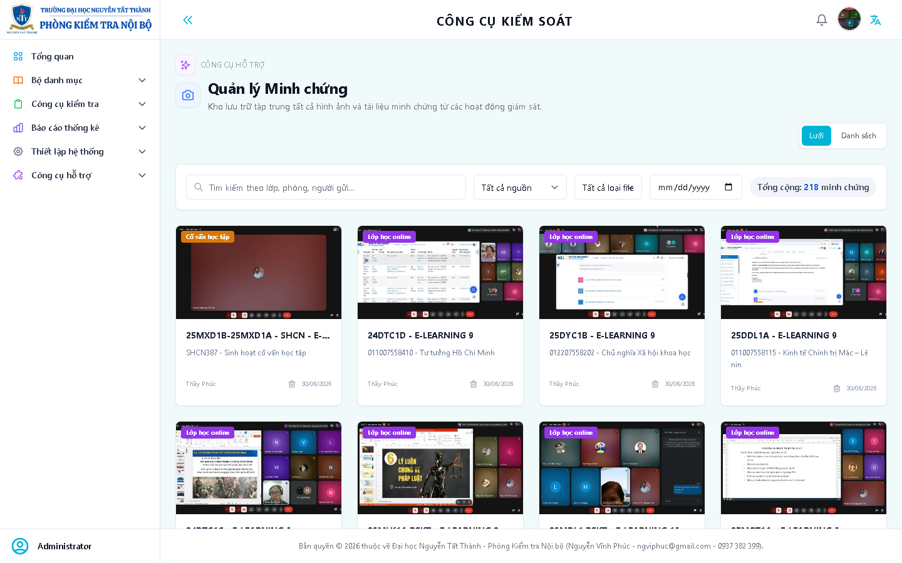

- Toàn bộ hình ảnh do thanh tra viên chụp tại các phòng học, biên bản sinh viên vi phạm, lớp học online đều được tập trung về Kho minh chứng.
- Hỗ trợ lọc ảnh theo Ngày kiểm tra, Cơ sở, hoặc Loại vi phạm.
- Click vào từng ảnh để phóng to toàn màn hình, xem tọa độ GPS và thời điểm chụp chính xác.

---
## Chương 4: Phân hệ Báo cáo & Thống kê Đa chiều

---

### 4.1. Báo cáo Cuối ngày (Daily Report)
- **Đường dẫn truy cập:** `/reports/daily` hoặc Menu: **Báo cáo thống kê** $
ightarrow$ **Báo cáo cuối ngày**.

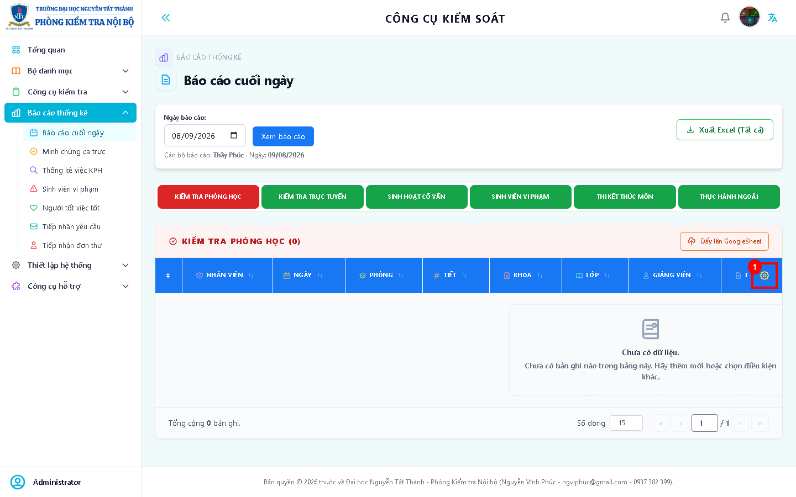

#### Hướng dẫn rà soát và chốt báo cáo cuối ngày:
1. **Bước 1: Chọn ngày cần lập báo cáo:** Dùng bộ lọc ngày để chọn ngày cần tổng hợp (mặc định là ngày hôm nay).
2. **Bước 2: Xem số liệu theo từng Tab nghiệp vụ:**
   - **Tab Toàn trường:** Bảng tổng hợp số tiết kế hoạch, số tiết đã kiểm tra, tỷ lệ hoàn thành, tổng số ca vắng, trễ và lỗi thiết bị.
   - **Tab Ca Sáng / Ca Chiều / Ca Tối:** Liệt kê chi tiết từng phòng học xảy ra sự cố trong ca trực đó.
   - **Tab Sinh viên vi phạm:** Danh sách toàn bộ các biên bản sinh viên vi phạm được lập trong ngày.
3. **Bước 3: Đồng bộ số liệu lên Google Sheets:**
   - Nhấp vào nút xanh **Đồng bộ Google Sheets**. Hệ thống tự động kết nối qua Google API V4 và ghi dữ liệu lên bảng tính của Nhà trường trong 3 giây.
4. **Bước 4: Xuất báo cáo Word gửi Ban Giám hiệu:**
   - Nhấp nút **Xuất Báo cáo Word (.docx)** để tải về file báo cáo đã được định dạng chuẩn văn bản hành chính của Đại học Nguyễn Tất Thành, sẵn sàng in đóng dấu hoặc ký số.

---

### 4.2. Báo cáo Tổng hợp Việc Không Phù Hợp (KPH)
- **Đường dẫn truy cập:** `/reports/comprehensive` hoặc Menu: **Báo cáo thống kê** $
ightarrow$ **Thống kê KPH**.

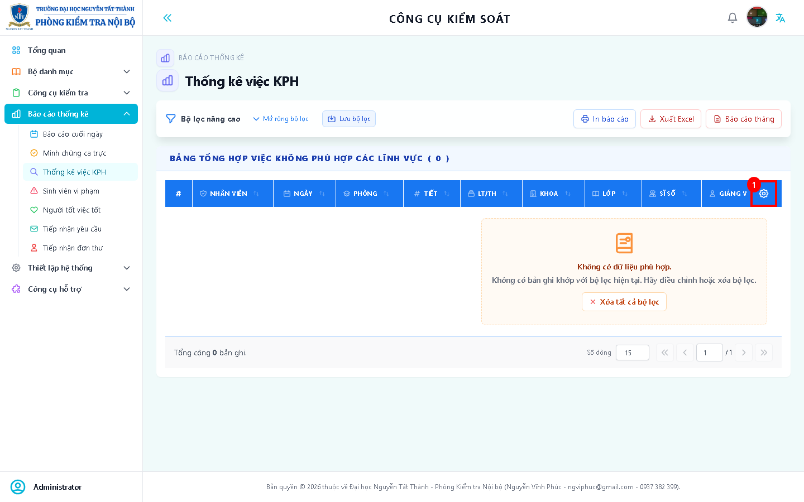

- Tổng hợp các lỗi không phù hợp của Giảng viên (Vắng không báo trước, Vào trễ >15 phút, Ra sớm, Cho lớp tự học không có mặt, Đổi phòng không báo).
- Cho phép lọc theo khoảng thời gian (Từ ngày... Đến ngày...) và theo từng Khoa/Viện để phục vụ công tác đánh giá thi đua khen thưởng cuối học kỳ.

---

### 4.3. Báo cáo Tổng hợp Sinh viên vi phạm
- **Đường dẫn truy cập:** `/reports/student-violations` hoặc Menu: **Báo cáo thống kê** $
ightarrow$ **BC Sinh viên vi phạm**.

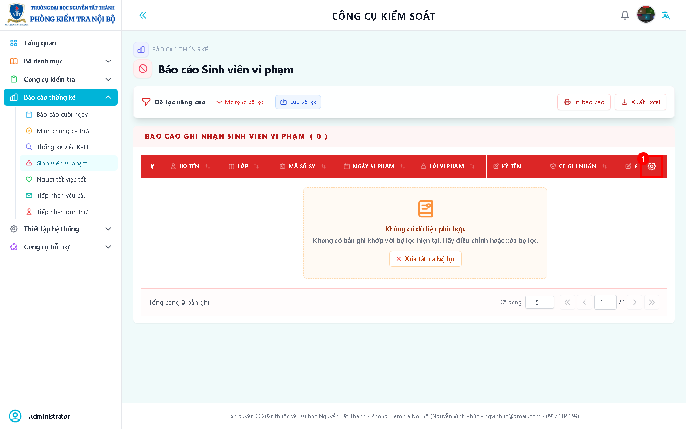

- Thống kê chi tiết các hành vi vi phạm học đường theo từng Khoa, từng Lớp và từng hình thức xử lý kỷ luật (Nhắc nhở, Trừ điểm rèn luyện, Khiển trách, Cảnh cáo toàn trường).

---

### 4.4. Báo cáo Gương Người tốt - Việc tốt
- **Đường dẫn truy cập:** `/reports/good-deeds` hoặc Menu: **Báo cáo thống kê** $
ightarrow$ **Người tốt việc tốt**.

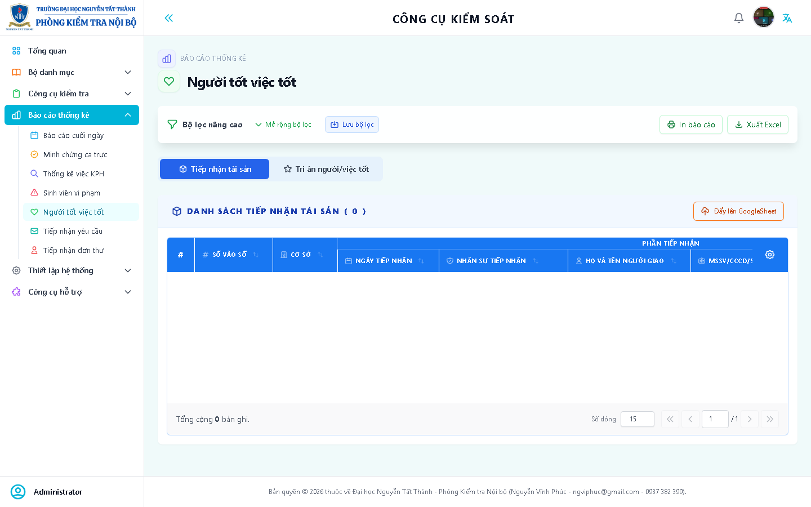

- Ghi nhận những hành động đẹp của sinh viên và cán bộ giảng viên (nhặt được của rơi trả lại người mất, giúp đỡ bạn bè, bảo vệ tài sản chung).
- Theo dõi việc trao quà khen thưởng tuyên dương trên toàn trường.

---

### 4.5. Báo cáo Tổng hợp Sự cố & Thiết bị phòng học hỏng
- **Đường dẫn truy cập:** `/reports/incidents` hoặc Menu: **Báo cáo thống kê** $
ightarrow$ **Báo cáo sự cố**.

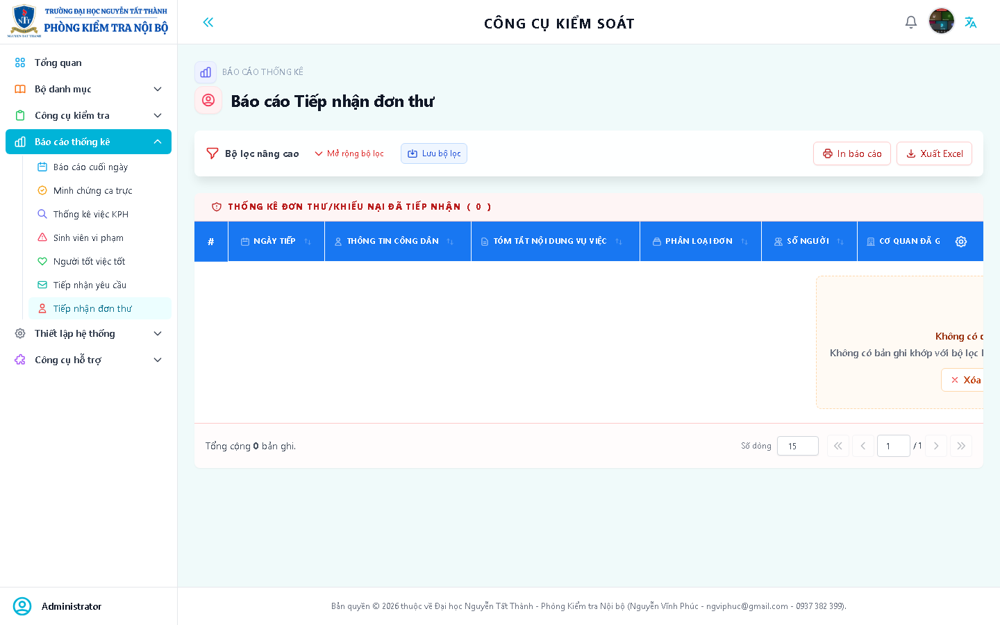

- Thống kê tổng số lượt máy chiếu hỏng, máy lạnh hỏng, micro mất tín hiệu theo từng Dãy nhà và từng Phòng học, giúp Ban Giám hiệu có căn cứ đầu tư mua sắm trang thiết bị mới.

---

## Chương 5: Phân hệ Cơ sở Dữ liệu Danh mục Dùng chung

---

### 5.1. Quản lý Danh mục Đơn vị / Khoa / Phòng ban (Departments)
- **Đường dẫn truy cập:** `/personnel/departments` hoặc Menu: **Bộ danh mục** $
ightarrow$ **Đơn vị**.

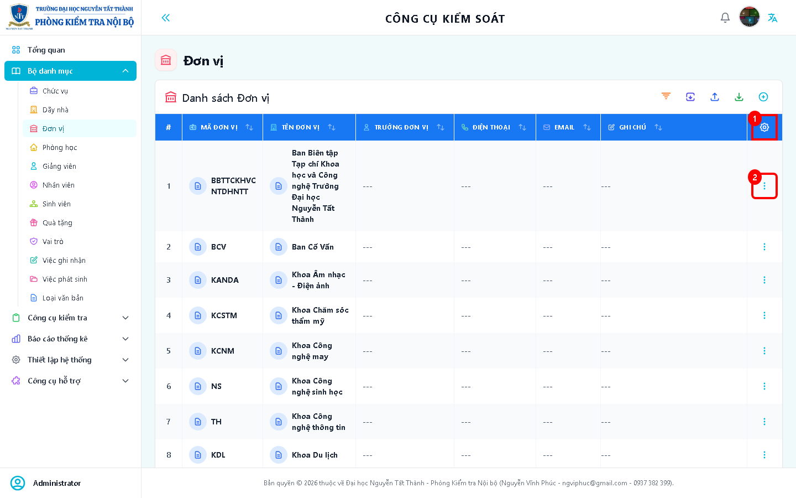

#### Hướng dẫn Thêm mới Đơn vị / Khoa:
1. Nhấp nút **`[1]` Thêm mới** $
ightarrow$ Cửa sổ thêm mới mở ra như hình dưới:

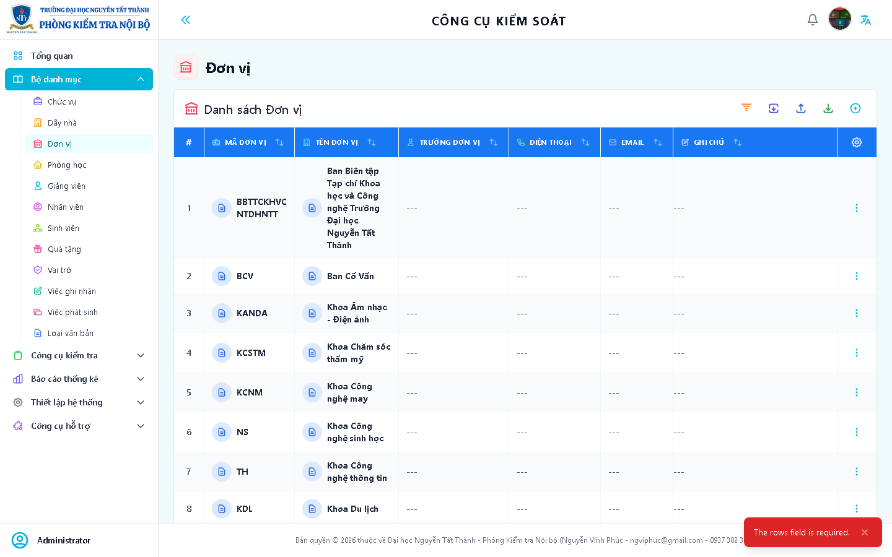

2. Nhập các trường thông tin:
   - **`[1]` Mã đơn vị:** Ví dụ `CNTT`, `DUOC`, `YHOA`, `KTTC`.
   - **`[2]` Tên đơn vị:** Tên đầy đủ của Khoa/Phòng (Ví dụ: *Khoa Công nghệ Thông tin*).
   - **`[3]` Loại đơn vị:** Chọn *Khoa đào tạo / Phòng ban chức năng / Viện nghiên cứu*.
   - **`[4]` Trưởng đơn vị:** Chọn tên lãnh đạo đơn vị phụ trách.
3. Nhấn **Lưu dữ liệu** để hoàn tất.

---

### 5.2. Quản lý Hồ sơ Giảng viên toàn trường (Lecturers)
- **Đường dẫn truy cập:** `/personnel/lecturers` hoặc Menu: **Bộ danh mục** $
ightarrow$ **Giảng viên**.

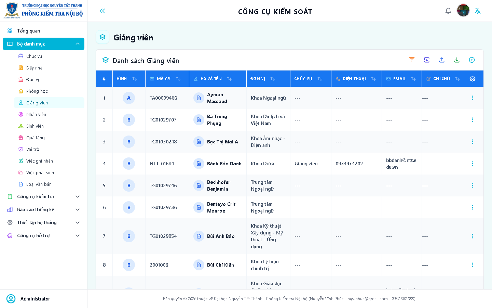

- Quản lý hồ sơ giảng viên cơ hữu và thỉnh giảng.
- Hỗ trợ tính năng **Nhập từ Excel (Import)**: Cho phép nạp hàng ngàn hồ sơ giảng viên chỉ trong 10 giây kèm theo Mã giảng viên, Họ tên, Email, Số điện thoại và Bộ môn trực thuộc.

---

### 5.3. Quản lý Cán bộ Nhân viên & Thanh tra viên (Employees)
- **Đường dẫn truy cập:** `/personnel/employees` hoặc Menu: **Bộ danh mục** $
ightarrow$ **Nhân viên**.

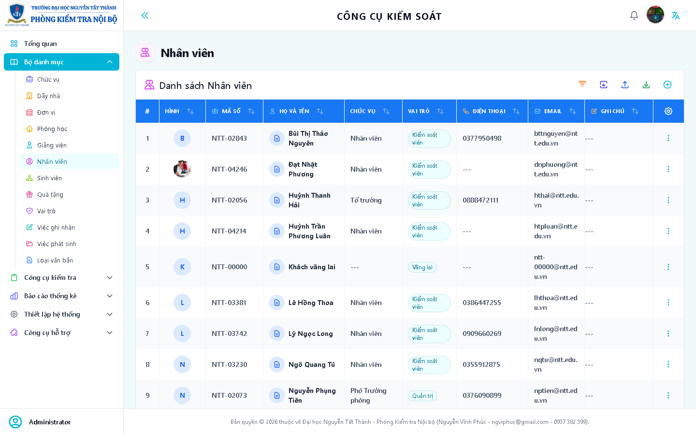

- Quản lý thông tin các cán bộ chuyên trách của Phòng Kiểm tra Nội bộ và các thanh tra viên kiêm nhiệm tại các cơ sở đào tạo.

---

### 5.4. Quản lý Hồ sơ Sinh viên toàn trường (Students)
- **Đường dẫn truy cập:** `/personnel/students` hoặc Menu: **Bộ danh mục** $
ightarrow$ **Sinh viên**.

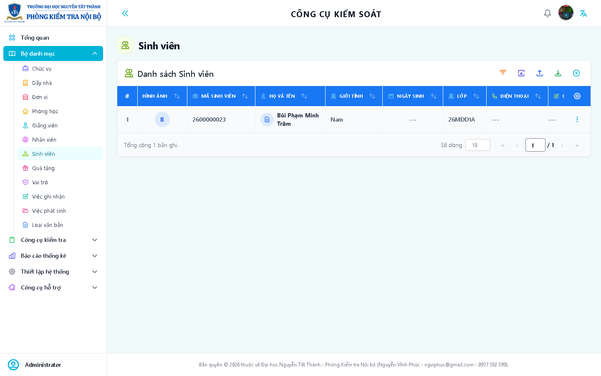

- Cơ sở dữ liệu nền tảng chứa thông tin hơn 30.000 sinh viên NTTU.
- Đây là cơ sở dữ liệu dùng để ứng dụng **tự động nhận diện sinh viên** khi thanh tra viên quét camera mã vạch trên thẻ sinh viên.

---

### 5.5. Quản lý Phòng học (Classrooms) & Dãy nhà cơ sở (Building Blocks)
- **Đường dẫn truy cập:** `/personnel/classrooms` và `/personnel/building-blocks`.

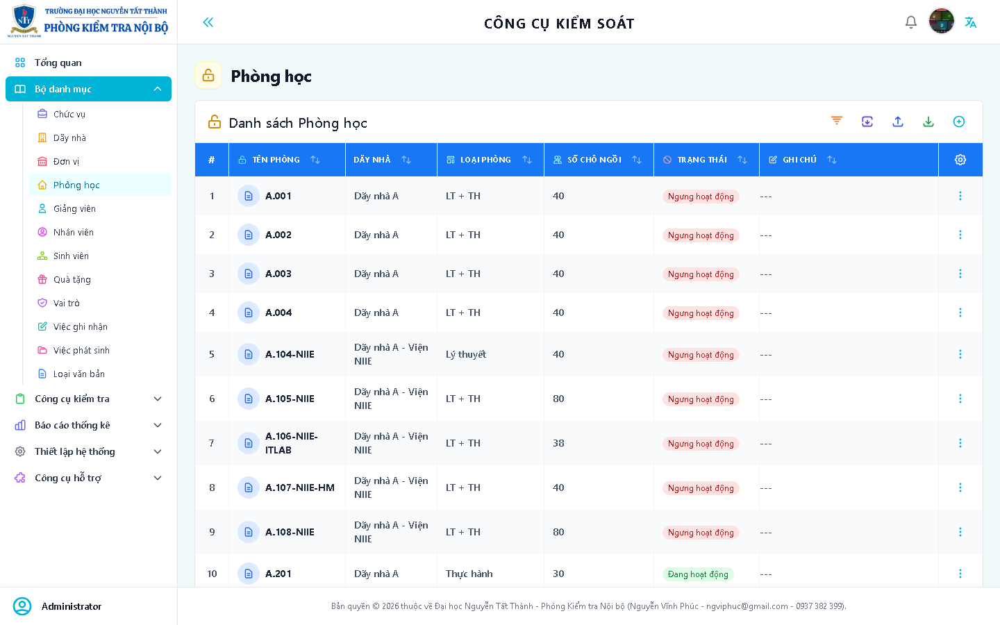

- Quản lý chi tiết từng phòng học (Ví dụ: `A.101`, `B.304`, `L.502`), sức chứa số chỗ ngồi, loại phòng (Lý thuyết, Lab máy tính, Thực hành mô phỏng) và các trang thiết bị gắn liền với phòng.

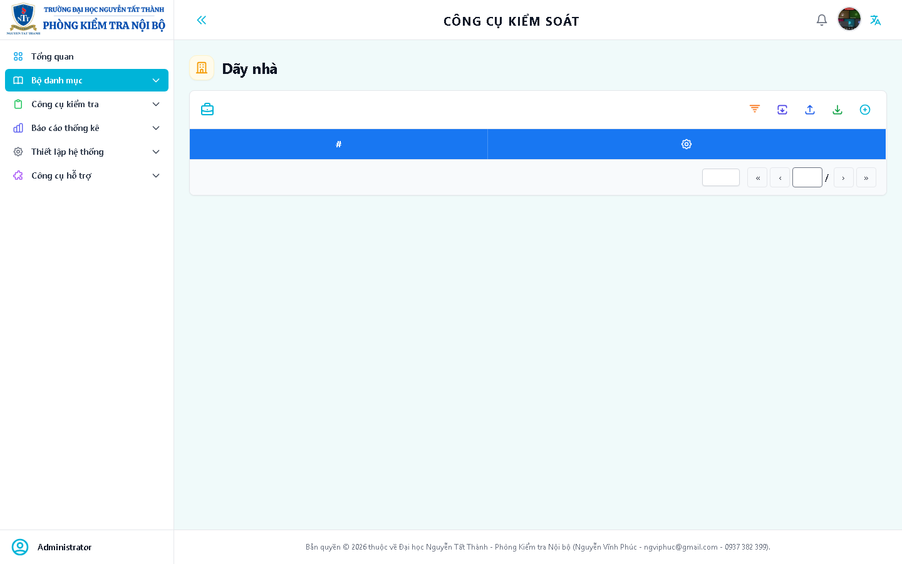

---

### 5.6. Quản lý Chức vụ (Positions), Vai trò (Roles), Lỗi vi phạm, Quà tặng
- Quản lý chuẩn hóa các danh mục phụ trợ:
  - **Chức vụ (`/personnel/positions`):** Trưởng phòng, Phó trưởng phòng, Thanh tra viên chính, Chuyên viên.
  - **Vai trò (`/settings/roles`):** Phân nhóm quyền hạn trong phần mềm.
  - **Việc ghi nhận / Lỗi vi phạm (`/settings/recognitions`):** Định nghĩa khung xử phạt và mức trừ điểm rèn luyện.
  - **Quà tặng (`/settings/gifts`):** Quản lý kho quà thưởng cho sinh viên có việc tốt.

---
## Chương 6: Phân hệ Quản trị Hệ thống, Phân quyền & Bảo mật

---

### 6.1. Quản trị Phân quyền & Vai trò người dùng (Permissions & Roles)
- **Đường dẫn truy cập:** `/settings/permissions` hoặc Menu: **Quản trị hệ thống** $
ightarrow$ **Phân quyền**.

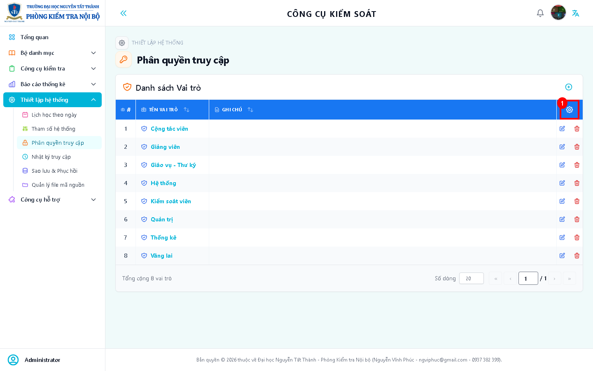

#### Hướng dẫn cấp quyền cho tài khoản hoặc nhóm vai trò:
1. Nhấp nút **`[1]` Thêm phân quyền** hoặc chọn một vai trò cần chỉnh sửa. Cửa sổ thiết lập quyền hiển thị:

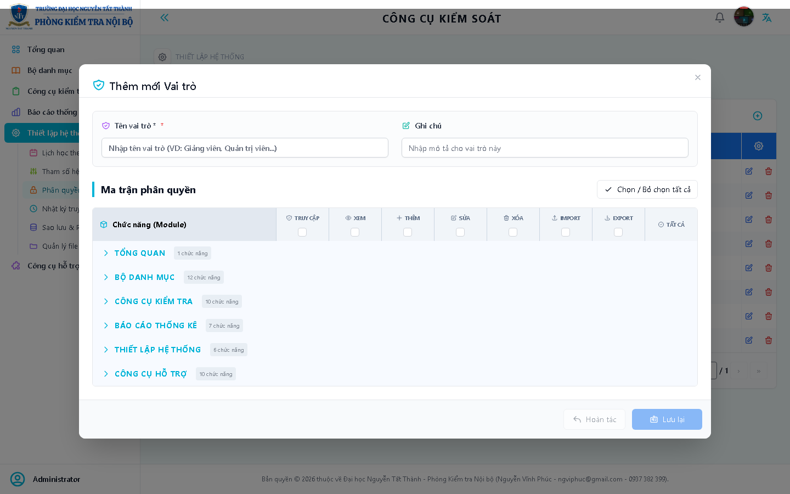

2. **Cơ chế phân quyền ma trận hạt mịn (Fine-grained Permissions):**
   - Tích chọn quyền hạn cụ thể trên từng chức năng:
     - *Xem danh sách (`.view`)*
     - *Thêm mới (`.create`)*
     - *Chỉnh sửa (`.edit`)*
     - *Xóa bản ghi (`.delete`)*
     - *Xuất báo cáo Excel/Word (`.export`)*
3. Nhấn nút **Lưu phân quyền**. Quyền hạn mới có hiệu lực ngay lập tức trong phiên làm việc tiếp theo của người dùng.

---

### 6.2. Kiểm toán Nhật ký truy cập hệ thống (Audit Access Log)
- **Đường dẫn truy cập:** `/settings/access-log` hoặc Menu: **Quản trị hệ thống** $
ightarrow$ **Nhật ký truy cập**.


- Hệ thống tự động ghi lại vết (audit trail) của 100% người dùng:
  - **Thời gian thực hiện:** Ngày, giờ, phút, giây chính xác.
  - **Tài khoản thực hiện:** Tên người dùng và vai trò.
  - **Hành vi tác động:** Đăng nhập, Xem, Thêm mới, Sửa đổi, Xóa dữ liệu, Xuất file.
  - **Đối tượng bị tác động:** Bản ghi nào, ID số mấy, dữ liệu trước và sau khi thay đổi.
  - **Địa chỉ IP mạng:** IP người dùng và thông tin trình duyệt thiết bị.
- Giúp Lãnh đạo phát hiện ngay các dấu hiệu can thiệp số liệu trái phép hoặc truy vết trách nhiệm khi có sai lệch thông tin.

---

### 6.3. Sao lưu & Khôi phục CSDL một chạm (Backup & Restore)
- **Đường dẫn truy cập:** `/settings/backup` hoặc Menu: **Quản trị hệ thống** $
ightarrow$ **Sao lưu dữ liệu**.

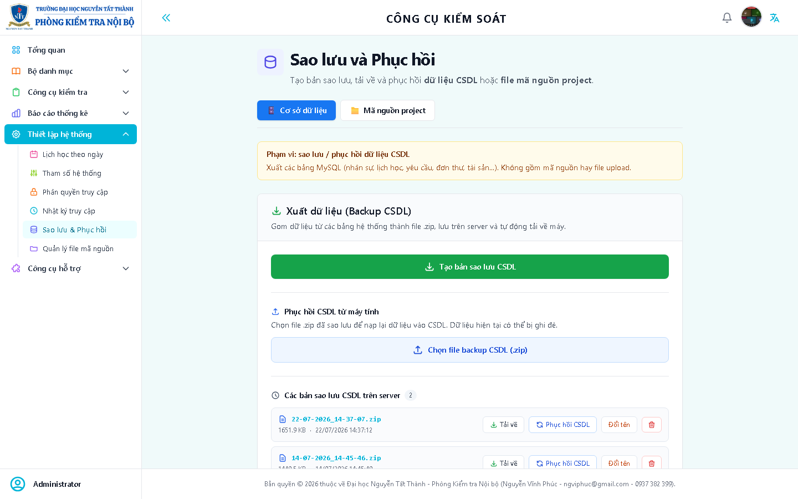

#### Hướng dẫn sao lưu và phục hồi:
1. **Tạo bản sao lưu tức thời:** Bấm nút **Tạo bản sao lưu mới (Backup Database Now)**.
   - Hệ thống tự động khóa bảng an toàn, nén toàn bộ database và các tệp đính kèm thành tệp `.sql.gz`.
   - Tự động mã hóa tệp và đẩy 1 bản sao lưu dự phòng lên Google Drive của Nhà trường.
2. **Khôi phục dữ liệu:** Khi cần khôi phục lại thời điểm trước đó, nhấp vào bản sao lưu mong muốn $
ightarrow$ Chọn **Phục hồi (Restore)** $
ightarrow$ Nhập mật khẩu xác thực Super Admin.

---

### 6.4. Quản lý Tệp mã nguồn & Tài nguyên dự án (Project Files Manager)
- **Đường dẫn truy cập:** `/settings/project-files` hoặc Menu: **Quản trị hệ thống** $
ightarrow$ **Tệp dự án**.

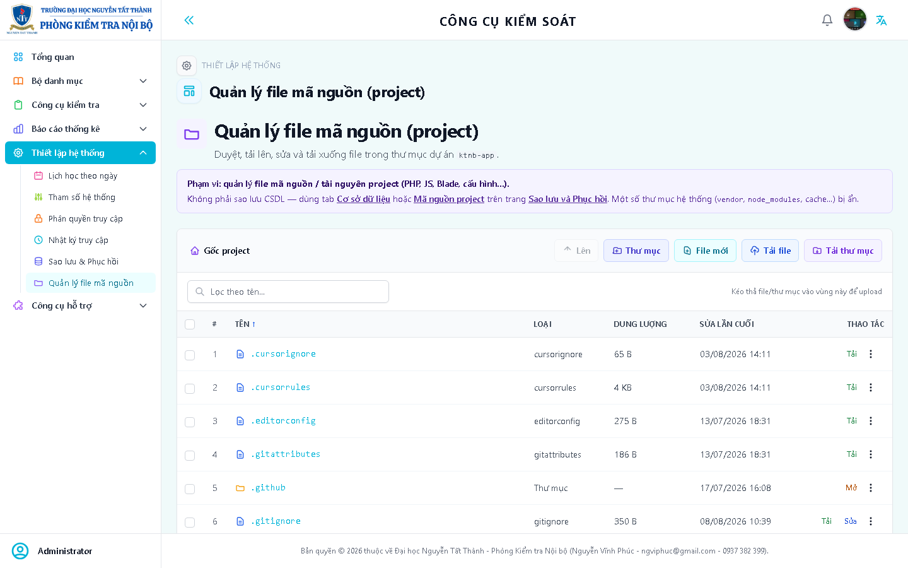

- Cho phép quản trị viên kỹ thuật kiểm tra dung lượng ổ đĩa của hệ thống, kiểm tra tính toàn vẹn của mã nguồn, rà soát các tệp rác hoặc logs chiếm bộ nhớ để dọn dẹp định kỳ.

---

## Chương 7: Phân hệ Kênh Tương tác & Mở rộng Tích hợp

---

### 7.1. Kênh Tin nhắn nội bộ (Messaging)
- **Đường dẫn truy cập:** `/messaging` hoặc biểu tượng chat trên Header.

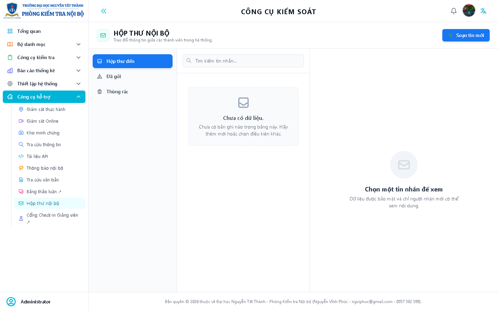

- Cho phép các thanh tra viên tại Cơ sở Q.12, Cơ sở Q.4 và Lãnh đạo phòng trao đổi thông tin trực tuyến nhanh chóng, bảo mật nội bộ mà không cần phụ thuộc vào ứng dụng chat bên ngoài như Zalo hay Messenger.

---

### 7.2. Diễn đàn Thảo luận Việc phát sinh (Discussion)
- **Đường dẫn truy cập:** `/discussion`.

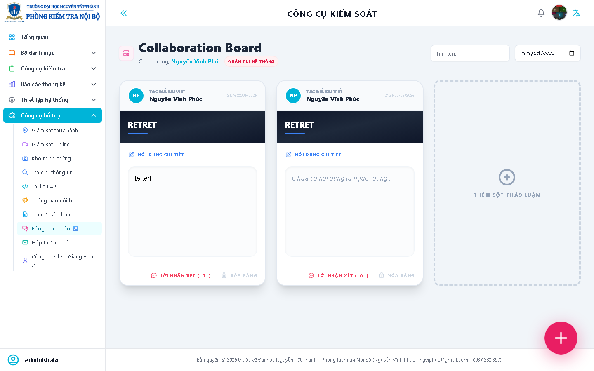

- Khi có một Việc phát sinh phức tạp (ví dụ: *Lớp học đổi giảng viên không rõ lý do, sinh viên phản ánh thái độ coi thi*), cán bộ có thể mở chủ đề thảo luận để các bên liên quan cùng vào đóng góp ý kiến và ghi nhận hướng giải quyết dứt điểm.

---

### 7.3. Cổng tiếp nhận Ý kiến Phản hồi (Feedback)
- **Đường dẫn truy cập:** `/feedback`.

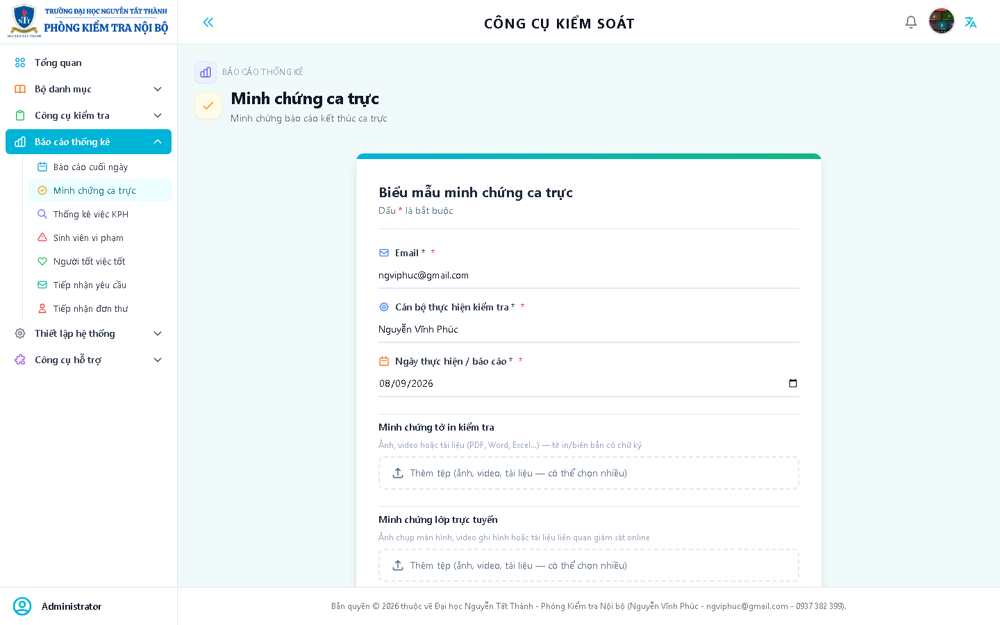

- Nơi tiếp nhận các góp ý cải tiến phần mềm từ cán bộ giảng viên và sinh viên, giúp bộ phận kỹ thuật liên tục nâng cấp trải nghiệm người dùng ngày một hoàn thiện hơn.

---

### 7.4. Cổng Giảng viên tra cứu & Giải trình (Lecturer Portal)
- **Đường dẫn truy cập:** `/lecturer-portal`.
- Giảng viên đăng nhập bằng tài khoản email NTTU để:
  - Tra cứu thời khóa biểu giảng dạy cá nhân.
  - Nhận thông báo tự động khi có ghi nhận kiểm tra liên quan đến lớp của mình.
  - Gửi phiếu giải trình trực tuyến khi có sự cố bất khả kháng (ốm đau đột xuất, kẹt xe, tai nạn) kèm minh chứng xác thực để Phòng KTNB xem xét không tính lỗi KPH.

---

# PHẦN VI: QUY TRÌNH VẬN HÀNH, BẢO TRÌ & XỬ LÝ SỰ CỐ (SOP)

## 6.1. Quy trình Cập nhật mã nguồn & Triển khai (Deployment SOP)

Mỗi khi có bản nâng cấp tính năng mới hoặc bản vá lỗi được đẩy lên nhánh Git `kiemtranoibo`:

1. **Bước 1: Kiểm tra trạng thái Git tại máy chủ:**
   ```bash
   cd /www/wwwroot/kiemtranoibo-ccks.ntt.edu.vn
   git status
   ```
2. **Bước 2: Kéo bản cập nhật mới nhất:**
   ```bash
   git fetch origin kiemtranoibo
   git reset --hard origin/kiemtranoibo
   ```
3. **Bước 3: Chạy script cập nhật tự động:**
   Quản trị viên có thể truy cập trực tiếp đường dẫn kích hoạt trên trình duyệt:
   👉 `https://kiemtranoibo-ccks.ntt.edu.vn/update_frontend.php`
   *(Script sẽ tự động giải nén mã nguồn mới, cập nhật Blade views, controller, route và làm mới view cache ngay lập tức).*

## 6.2. Quy trình Xóa bộ nhớ đệm & Tối ưu hiệu năng

Khi vừa thay đổi cấu hình hoặc phân quyền mà người dùng chưa thấy cập nhật, thực hiện kích hoạt script dọn dẹp cache:
👉 `https://kiemtranoibo-ccks.ntt.edu.vn/clear_cache.php`

Hoặc chạy lệnh từ terminal SSH máy chủ:
```bash
php artisan optimize:clear
php artisan config:cache
php artisan route:cache
php artisan view:cache
```

## 6.3. Xử lý các sự cố kỹ thuật thường gặp (Troubleshooting)

### 1. Sự cố Lỗi HTTP 414 Request-URI Too Large khi xuất file Excel
- **Triệu chứng:** Người dùng chọn quá nhiều phòng hoặc chọn khoảng thời gian dài, khi bấm xuất file màn hình báo lỗi `414 Request-URI Too Large (openresty)`.
- **Nguyên nhân:** URL GET vượt quá giới hạn cấu hình `large_client_header_buffers` của Nginx.
- **Biện pháp xử lý triệt để:** Hệ thống đã được nâng cấp chuyển đổi 100% các request xuất file sang phương thức **HTTP POST** thông qua form ẩn hoặc JSON payload. Đồng thời trong cấu hình Nginx máy chủ bổ sung:
  ```nginx
  client_header_buffer_size 16k;
  large_client_header_buffers 4 64k;
  client_max_body_size 100M;
  ```

### 2. Sự cố Lỗi quyền ghi thư mục Storage / Cache (500 Internal Server Error)
- **Triệu chứng:** Người dùng không thể tải ảnh minh chứng hoặc lập biên bản, hệ thống báo lỗi 500.
- **Khắc phục:** Phân quyền chuẩn cho tiến trình web server:
  ```bash
  chown -R www:www /www/wwwroot/kiemtranoibo-ccks.ntt.edu.vn/storage
  chown -R www:www /www/wwwroot/kiemtranoibo-ccks.ntt.edu.vn/bootstrap/cache
  chmod -R 775 /www/wwwroot/kiemtranoibo-ccks.ntt.edu.vn/storage
  chmod -R 775 /www/wwwroot/kiemtranoibo-ccks.ntt.edu.vn/bootstrap/cache
  ```

### 3. Sự cố Lệch múi giờ ghi nhận biên bản vi phạm
- **Khắc phục:** Đảm bảo múi giờ cấu hình trong file `.env` và `config/app.php` là `Asia/Ho_Chi_Minh`:
  ```php
  'timezone' => 'Asia/Ho_Chi_Minh',
  ```

## 6.4. Kế hoạch Sao lưu định kỳ & Phục hồi thảm họa (Disaster Recovery)

- **Lịch tự động hàng ngày (Cronjob):**
  - Chạy vào lúc **02:00 sáng** hàng ngày:
    ```bash
    0 2 * * * mysqldump -u ktnb_dbuser -p'PassWordMatKhau' ktnb_database | gzip > /backup/ktnb_$(date +\%F).sql.gz
    ```
  - Đồng bộ tệp sao lưu sang Google Drive an toàn.
  - Tự động xóa các bản sao lưu cũ hơn 30 ngày để tối ưu ổ cứng.
- **Chỉ tiêu cam kết phục hồi thảm họa:**
  - **RTO (Recovery Time Objective):** Dưới **30 phút** để dựng lại hoàn chỉnh toàn bộ hệ thống từ máy chủ mới.
  - **RPO (Recovery Point Objective):** Dưới **24 giờ** dữ liệu (mất mát dữ liệu tối đa không quá 1 ngày).

---

> [!NOTE]
> **LỜI KẾT & CAM KẾT ĐỒNG HÀNH:**  
> Hệ thống Quản trị & Giám sát Kiểm tra Nội bộ Trường Đại học Nguyễn Tất Thành là kết tinh của quá trình nghiên cứu sâu sát thực tiễn công tác thanh tra giáo dục, kết hợp những công nghệ web tiên tiến và an toàn nhất hiện nay. Cẩm nang này sẽ luôn được cập nhật tương ứng theo từng bước phát triển của Nhà trường. Chúc toàn thể quý Thầy/Cô và các cán bộ kiểm tra khai thác hệ thống đạt hiệu quả cao nhất!
